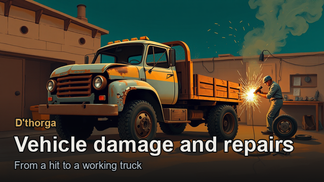

# Vehicle damage and repairs

What hits, fire and wear do to a vehicle, how it is knocked out before it is a wreck, and how your mechanics put it right. It
works on **every Vehicle Framework vehicle from any mod**, with D'thorga Framework. The tabs and lamps that show all this are in
[vehicle systems](vehicle-systems.md); the parts bench that makes the replacement parts is in [the vehicle
workshop](vehicle-workshop.md). [Back to the guide](README.md).

## Read this first

1. **A destroyed part needs replacing before the vehicle is whole again.** At 0% it waits for supplies in the vehicle's cargo and
   a mechanic. **An engine or transmission costs the whole part**, made at the vehicle parts bench, and **a vehicle whose engine
   is destroyed cannot move** until it has a new one.
2. **Put a vehicle fire out fast.** A small one put out at once costs little. Put a big one out within an in-game hour or expect a
   hot engine and a radiator to repair; left two hours, the engine boils over. **Fit a vehicle extinguisher** (after
   **Firefoam**).
3. **Carry components.** Away from a base a mechanic patches leaks and shorts, and re-fits a thrown track or a wrecked wheel, with
   a component from the cargo: enough to limp home, not a repair.
4. **Keep the engine running in a long fight.** A powered turret on a flat battery is cranked round by hand: a fifth of the speed,
   aiming twice as slowly and missing more.
5. **Every faction's vehicles are hurt the same way.** Fire, EMP, a shot-out weapon mount or a destroyed track stop a raider's
   vehicle as they stop yours, and a destroyed vehicle leaves a hull you can take apart for **salvaged vehicle parts**.

## Armour

**On our service trucks every part has an armour class, named by what it stops.** The part's line on the Health tab says it in
every display mode: "skin armour: stops nothing aimed at it: thin sheet metal".

- **All five service trucks are skin today**: they are civilian trucks, and rifle fire goes through them.
- **Each cell of a truck has one outside part** (the cab, the body, a wheel, the chassis), so a shot at the cab strikes the cab,
  and what sits inside is hurt once the outside part over it is holed.
- **With Combat Extended**, shots strike a truck across its whole width. The parts our systems add take the engine's cells and
  armour, so shots can reach them, and a hit counts only the health the part really lost: a round the armour stopped drains
  nothing.
- Armour kits for our working trucks, and what comes through a beaten plate, are in [working
  vehicles](working-vehicles.md#armour-and-kits).

## What damage does

- **Parts carry conditions**, shown under the part on the Health tab: a holed radiator keeps leaking coolant, a shot battery
  drains itself, a boiled-over engine has a warped head and runs hotter (badly warped, it also loses power and labours on hills
  and under load). **Repair the part to full health to clear them.**
- **Every fault says what caused it**: a grey line under the fault, and in a diagnosis report, reads
  "Cause: a bullet hit, 2 hours ago, at Amber Anchorage", or names the reading that strained it ("coolant temperature (boiling)").
- **A shot-through fuel tank leaks fuel**, even parked, wherever the vehicle's maker did not already make its tank leak.
- **A hit on the battery or alternator can short the wiring**: a message names what stopped working (the headlights, a heater...),
  and the Systems tab says it is dead. Repair the part, or patch it in the field.
- **A damaged oil pump wears the engine down over time, and a damaged gearbox slows the vehicle.**
- **Damage shows on our vehicles' pictures** once a part is below 60%: scorches, holes and tears.
- **EMP can stall a vehicle for a moment and drains its battery.** Steam engines and RimThunder's vehicles are never stalled.
  Raiders' vehicles are hit the same way, so EMP grenades and mortars stop them too. **Jump-start a drained truck** before driving
  off.

| Vehicle hit by EMP | Battery charge lost |
| --- | --- |
| A civilian truck | About 40% |
| An armed vehicle (hardened) | About 16% |

## Repairs

- **Field repairs**: away from a base, a mechanic can **patch leaks and shorts** with a component from the cargo. A patch slows
  the damage so the vehicle can limp home; it is not a repair. **Field repairs also re-fit a thrown track or a wrecked wheel**
  with a component, back to a quarter of its health: enough to drive home slowly. It still needs replacing properly.
- **In a caravan**, select it on the world map and press **Repair** for a vehicle that needs it. The caravan must have stopped and
  have a mechanic. **The parts can be anywhere in the convoy's cargo**, not only in the broken vehicle.
- **Serious work waits for a dyno bay**: machining a badly warped cylinder head, a turbine's hot-section overhaul, and tunes and
  changes of grade on a working part are done only within 5 cells of a powered dyno bay. Your land vehicles can be taken there by
  themselves: [trips to the dyno bay](vehicles-on-the-road.md#trips-to-the-dyno-bay).

### A destroyed part

At 0% a part waits for supplies in the vehicle's cargo and a mechanic. Once fitted it comes back at **25%** health (**60%** when
it is fitted within reach of a dyno bay), and ordinary repair carries on from there.

| Destroyed part | What replaces it |
| --- | --- |
| Piston engine | An **engine assembly** |
| Gas turbine | A **turbine assembly** |
| Transmission | A **transmission** |
| A helicopter's rotor gearbox | A **reduction gearbox** |
| An aircraft's flight-control channel or avionics bay | A **flight computer** |
| A hydraulic ram, or an aircraft's servos | A **hydraulic actuator** (or its steel and components while your colony takes raw materials for services) |
| A traction motor, or a generator truck's generator | An **electric motor** |
| Anything else | Half its materials |

All of these are made at the vehicle parts bench: see [the vehicle workshop](vehicle-workshop.md#parts-and-kits). Where you have
another mod that makes a suitable part (RimThunder, Vanilla Vehicles Expanded), its part is accepted too.

**A salvaged-grade part is cheaper**: order the salvaged grade for a destroyed part in **Fittings and tunes**, and **salvaged
vehicle parts** in the cargo pay for it as new materials would. It takes less punishment and faults more easily, as that grade
does.

## Knocked out, not destroyed

A vehicle loses its jobs before it is a wreck, and every faction's vehicles do, yours and theirs alike.

- **A weapon stops when its mount is shot to pieces**: at a tenth of the mount's health or less. The mount is the vehicle's own
  turret part, or a **turret ring** (ground vehicles) or **weapon pylons** (aircraft) added at the gunner's seat. **Repair the
  mount** and the weapon works again. Its button says why it is out.
- **Damage slows it first**: as the mount is hurt, the weapon turns, aims and reloads slower, down to a little over half its
  speed. A gunner with poor sight aims slower, and one with hurt hands turns and reloads slower.
- **A destroyed track stops a tank.** Wheels still limp on. A stopped vehicle says why ("Cannot move: left track destroyed"), and
  yours send a message when it happens.
- **A tank's turret can be blown off** when its ammunition rack goes up: a hit on a badly damaged rack, or ammunition cooking off
  in a fire. Only tanks with an ammunition rack part (RimThunder's), and only while ammunition cook-off is on. The crew rarely
  survives.
- **The Systems tab shows all of this**: the **Weapons** card (each weapon, its mount's health, ready or out and why), the
  **Running gear** card (tracks, and why the vehicle cannot move), the **Electrical loads** card, and a red **Crew** card when
  people are aboard a burning or dead vehicle.

### Powered turrets

- **On your vehicles, a powered turret needs power.** The **turret drive** draws from the battery while someone mans it.
- **With the battery flat, or the load shed when the charging fails, the crew cranks it round by hand**: a fifth of the speed and
  aiming twice as slowly, but it never stops.
- **A turret cranked by hand also aims worse**: it has no stabiliser and no powered sights, so it hits
  less often on the move and at night, and worst of all moving at night.
- **Machine guns on their own ring or pintle need no power**, including a commander's gun on top of a turret; a coaxial gun goes
  with its turret. Aircraft have no turret drive.
- **Keep the engine running in a long fight.**

### Crews in danger

**Crews leave a burning vehicle or a dead hull** (one that can neither move nor fire). Raiders and other factions climb out by
themselves, leaving the vehicle for you to claim.

- **Yours get out of a burning vehicle by themselves once it stops** (the setting **Your crews get out of a burning vehicle**, on
  by default), never while it drives or flies.
- **In a dead hull they wait for your order**, and the **Crew in danger** alert lists them.

## Glass

Every vehicle with a closed cab, ours or another mod's, has **glass**: a windscreen and windows, **armoured glass** once the
armoured cab is fitted, or **vision blocks** on a tank. The setting **Vehicles' glass cracks and breaks** (on by default) switches
it.

- **What breaks it:** hits on the cab (armoured glass and vision blocks hold far better), **explosions well beyond where they hurt
  anything else**, fire, and a missile strike.
- **What you see:** the Health tab's **glass** row says its kind and whether it is whole, **cracked** or **gone**; an alert names
  vehicles whose glass is gone; the logbook records it.
- **Glass gone, the cab is open:** within the hour the cab is as hot or cold as the weather, and the **Windows** button greys out.
- **Splinters:** breaking glass cuts the people sitting behind it, now and then an eye; goggles and helmets help. The setting
  **Breaking glass cuts the people behind it** (on by default) switches it.
- **The driver slows** with cracked glass in the dark or in bad weather, and a tank with broken vision blocks crawls with the
  driver head-out. **An aircraft with a cracked canopy** loses its pressure: it flies low unless everyone aboard has oxygen.
- **Re-glazing:** load the goods into the vehicle's cargo and a mechanic re-glazes it. **Nothing mends glass for free.**

| Glass | Mended with |
| --- | --- |
| A cracked windscreen | A **laminated pane** |
| Side windows | **Glass panes** |
| Armoured glass | **Armoured panes** |
| A tank's vision blocks | **Vision blocks** |

## The glass chain

Our vehicles' glass is made from the ground up.

| Good | Where | From |
| --- | --- | --- |
| **Glass sand** | Stonecutter's table | 1 sandstone chunk gives 20 |
| **Potash** | Fueled or electric stove | 20 wood gives 4 |
| **Soda ash** (with Vanilla Cooking Expanded) | Fueled or electric stove | 4 salt and 2 limestone blocks give 4; it can stand in for potash |
| **Glass pane** | **Electric smelter** | 7 glass sand, 2 potash or soda ash, 2 limestone blocks |
| **Plastic film** | Machining table | 4 chemfuel gives 2 |
| **Laminated pane** (a windscreen) | Machining table | 2 glass panes and 1 film |
| **Armoured pane** | Machining table | 4 glass panes and 3 films |
| **Vision block** | Machining table | 4 films and 3 steel |

## Fire

**A fire on a vehicle cooks it from the inside**: the cab grows stifling, the coolant heats, and the radiator, the tyres, the
battery, the belts, the hydraulic lines, the fuel tank and the brakes burn, and the wiring shorts. **A bigger fire burns faster**;
a small one put out at once costs little. Put a big one out within an in-game hour or expect a hot engine and a radiator to
repair; left two hours, the engine boils over.

### Where it starts and how it spreads

| Where a fire starts | What starts it there |
| --- | --- |
| The engine bay | Most fires, and any hit on the engine, the fuel or the wiring |
| The crew compartment | A hit through the cab |
| The running gear | The tyres and brakes |

A tyre fire reaches the engine bay in about ten game minutes, and an engine fire reaches the crew compartment in about six. A
message says when it reaches the crew.

### Putting it out

- **A vehicle extinguisher** (after **Firefoam** research; made at the vehicle parts bench, fitted in **Fittings and tunes**)
  holds three charges. **Press Use the extinguisher** on a burning vehicle: someone aboard uses it at once, or, with nobody
  aboard, **the nearest free colonist runs over**. To choose who, select a colonist and right-click the vehicle. Each use knocks
  the fire down and puts a small one out.
- **A mechanic refills it at the vehicle** with an **extinguisher refill** from the parts bench, without being told, as a repair.
- **Taken off, the kit keeps the charges it has left**, shown on its inspect line, and brings them to the next vehicle. Only kits
  holding the same charges stack together.
- **Automatic fire suppression** on our trucks with the armoured cab: **Engine fire suppression** and **Crew fire suppression**,
  two upgrades (a **suppressant bottle** each, 30 kg as cargo). Each goes off by itself, once, when fire is in its own part of the
  truck, puts it out, and is **spent** until a mechanic recharges it with another bottle. **Another author's armoured vehicle** (a
  tank, an armoured car) takes both as fittings.
- **The Fire protection spent** alert names vehicles whose systems are spent or whose extinguisher is empty.
- **Firefoam works on a burning vehicle with Combat Extended**: foam that lands on the vehicle shrinks the fire on it, as it does
  without Combat Extended.
- **A helicopter can drop water on a fire**: see [aircraft and sling
  loads](aircraft-and-sling-loads.md#fighting-a-fire-from-the-air).

### What fire can set off

| Setting | Default |
| --- | --- |
| **Other factions' vehicles burn as yours do** | On |
| **Fire underneath burns fireproof vehicles' tyres and hoses** | On |
| **Leaking fuel feeds a vehicle fire** | **Off** |
| **Burnt tyres can light again** | On |
| **Burning tyres can burst** | **Off** |
| **Ammunition aboard can cook off in a fire** | On |

- **Other factions' vehicles burn as yours do**, so fire is a way to stop a raider's truck.
- **Some vehicles never catch fire** (tanks and trains among them, as their makers built them), but **a ground fire under one
  still burns its tyres or tracks, belts and hoses**.
- **Leaking fuel feeds the fire** (off by default): with it on, once the fire has worn the fuel tank into
  leaking, the fuel catches as a **pool of fire on the ground** beneath the vehicle, which spreads and can set it alight again
  after an extinguisher. **Keep people and other vehicles clear.**
- **Burnt tyres can light again**: a fire that reached a wheeled vehicle's tyres leaves them
  **smouldering for about two game hours** once it is out, and they may catch again; rain puts them out. Tracked vehicles have no
  tyres.
- **Burning tyres can burst** (off by default): a small blast that hurts anyone within about two cells.
- **Ammunition in a burning vehicle can go off** (with Combat Extended's ammunition in use). Each blast uses part of what is
  aboard and grows with it. **Get the ammunition out or the fire out quickly, and keep people clear.**

## Hulls and wrecks

- **A destroyed vehicle leaves its hull** (the setting **Destroyed vehicles leave a hull**, on by default): yours or anyone's, where it fell. A raiders' aircraft brought down leaves nothing.
- **Mark it to Deconstruct**: it gives **salvaged vehicle parts**, worth a quarter of the vehicle, on top of the quarter of its
  materials Vehicle Framework drops where it is destroyed.
- **A vehicle that dies burning leaves a burnt-out hull**, named so, which gives **half** the salvaged parts.
- **Salvaged parts pay for salvaged-grade parts**: see [a destroyed part](#a-destroyed-part).
- **A helicopter can carry a hull home** on its sling: see [aircraft and sling loads](aircraft-and-sling-loads.md#lifting-a-hull).
- **Hulls waiting to be taken apart are listed at the bottom of the Fleet board**, with other factions' vehicles standing
  unguarded.

## Other factions' vehicles

- **Raiders' and visitors' vehicles run a simpler model**: they take hits, but nothing in them heats, wears or runs down by
  itself, which keeps a raid cheap. **They still burn, stall, lose weapons and tracks, and leave hulls** as yours do.
- **Claim a vehicle**: press **Claim** on it to send the nearest free colonist, or select a colonist and right-click it. Nobody
  may be aboard, and none of its owners' armed people within 12 cells. It takes from half an hour to six hours, by size. **Taking
  one from a faction that is not hostile costs 30 goodwill**, and the order says so. Machines' vehicles cannot be claimed.
- **A captured vehicle wakes to the full model** on your settings, and its logbook begins the day you take it.
- **They may come with fittings** suited to their tech level, and keep them when captured.
- **A stuck or empty one can be winched clear before you claim it**: see [vehicles on the
  road](vehicles-on-the-road.md#recovering-a-stuck-vehicle).

How damage works underneath is in the reference page on [vehicle damage](../development/systems/vehicle-damage.md).

## Tested in game

What the owner has passed, by row of [the test list](../development/in-game-test-pass.md). A row passed **in part** says which part.

| Row | What the owner passed | Date |
| --- | --- | --- |
| 19 | **In part:** a damaged oil pump wears the engine down, and a damaged gearbox slows the vehicle (the cracked sump not reported on) | 10 Nov 2026 |
| 123 | A damaged weapon mount, and a hurt gunner, slow the weapon | 18 Nov 2026 |
| 158 | A shot-through fuel tank leaks, and a hit to the wiring kills a circuit | 21 Nov 2026 |
| 256 | A fault says what caused it | 21 Nov 2026 |
| 376 | Glass cracks and breaks: the Health tab, the alert, the logbook, the Windows button and the open cab | 23 Nov 2026 |

Everything else in this chapter is not yet tested in game.
