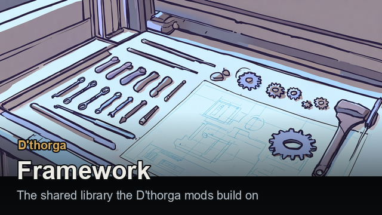
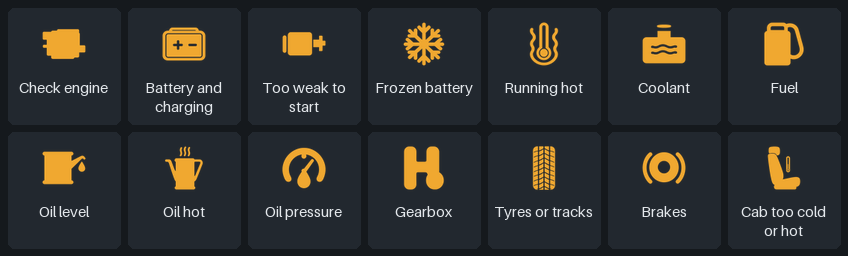

# Vehicle systems and how they fail

With **Vehicle Framework** active, **D'thorga Framework** gives every vehicle the insides a real one has: a battery that goes
flat, an engine that runs hot, oil, tyres and brakes that wear, and parts that fail when a service is overdue. It works on **every
Vehicle Framework vehicle from any mod**, not only ours. This chapter is what you see on a vehicle and what to do when something
goes wrong with it. [Back to the guide](README.md).

The rest of looking after vehicles has chapters of its own:

| Chapter | What it covers |
| --- | --- |
| **Vehicle systems** (this one) | The tabs, warning lamps, wear and services, batteries and jump-starts, lights, cabs, diagnosing |
| [Damage and repairs](vehicle-damage-and-repairs.md) | Hits, faults, knocked-out weapons, glass, fire, repairs, hulls, claiming vehicles |
| [The vehicle workshop](vehicle-workshop.md) | The parts bench and dyno bay, parts and kits, fittings, families, tunes, grades, upgrades |
| [Vehicles on the road](vehicles-on-the-road.md) | Driving, grip, hills, fuel, the world map, convoys, depots, towing, winching, parks and the service yard |
| [Aircraft and sling loads](aircraft-and-sling-loads.md) | Take-off checks, flight, fuel and height, the sling, water drops, the air ambulance, air defence |

## Read this first

1. **It changes every Vehicle Framework vehicle you have**, unless you narrow **Which vehicles** in the settings (**D'thorga
   Vehicle Systems**). That needs a restart, so **decide before you load a colony**. Switching vehicles off later is safe.
2. **Build a vehicle parts bench early**: research **vehicle parts**, then find it in the Architect's **D'thorga** tab, under
   **Motor pool**. Our parts, service kits and booster packs are made only there.
3. **Make a jump-start kit or a booster pack before you need one, and carry one in every caravan.** A flat battery is the
   commonest way to be stranded.
4. **Service when it is due, keep the kits in stock, and park somewhere warm in winter.** Services start by themselves, but they
   wait for kits made at the parts bench. Parts fail more often once a service is due, and far more once it is overdue.
5. **Before removing D'thorga Framework or Vehicle Framework from a colony that used the systems, press the removal button.** Load
   the colony, press **Remove the added parts from this colony's vehicles** in the settings, save, then remove the mod. Without
   it, saved vehicles may fail to load. Garages, sling wrecks, convoys, depots, litters, extra fuel tanks, vehicle parks and
   service yards need emptying or deleting first too: the whole list is in [Getting started, Removing a
   mod](getting-started.md#removing-a-mod).

## The three tabs

Select a vehicle. Beside Vehicle Framework's own tabs you will find three of ours. They work on the world map too, on a caravan or
on an aircraft in flight.

| Tab | Answers | Shows |
| --- | --- | --- |
| **Dashboard** | Does anything need me now? | Gauges, warning lamps, what the vehicle is waiting for, and its switches |
| **Health** (**Vehicle** on the world map) | How hurt is it? | Its picture with hurt parts tinted, every part's health, conditions, fitting and grade |
| **Systems** | What exactly is going on? | Every reading, one row each, with a graph; cards for weapons, running gear, loads and crew |

- **Dashboard**: click a gauge to open the Systems tab at that system.
- **Systems schematic** (in Operator and Engineer display modes, for land vehicles and boats with a piston engine, electric vehicles,
  steam locomotives and turbine aircraft; a boat's shows sea water cooling its engine and the shaft turning its propeller, an electric
  vehicle's the battery feeding the motor and power coming in while it charges, and **a steam locomotive's its boiler in section, the
  water standing where the gauge glass reads**, so you can watch it fall toward the firebox's crown):
  the **Systems schematic** button on the command bar or the Dashboard, the vehicle's **Schematic** tab (a live copy, with **Open
  large**), or **a lit warning lamp**, which opens it with that part outlined. It is a window that draws the engine's systems as a flow sheet; **a land vehicle's engine is a cutaway** of one
  cylinder, whose water, oil, air, exhaust and fuel show their colours while they flow, and **an aircraft's a turbine in section**
  (a jet's with its fan and cold bypass duct), its gas cold blue at the intake and hottest orange at the burners (red at its limit). **An aircraft with more than one engine has a tab
  for each**, showing that engine's own fuel pump, oil, chip detector and heat (a worn engine runs hotter than a sound one). Pipes take the colour of what they carry (fuel, oil, coolant, air, exhaust,
  power) and turn grey when nothing flows; each part is green, amber or red by its reading and its health. **Rest the mouse on a part**
  to read it and see it lit on the vehicle; **click it** to open the Systems tab there; **right-click it** for orders (a service,
  field repairs, a jump-start, fittings, a diagnosis). Press the button again to close it. **Flow
  marks on the systems schematic**, on the Display page of the settings, adds small marks that drift along the flowing pipes.
- **Health**: the vehicle's speed and strength, and what each hurt part does to them. Each part's line shows its armour class (see
  [damage and repairs](vehicle-damage-and-repairs.md#armour)). **Like parts share a row** (landing wheels, panels): the row's bar
  is split into a segment for each part; click the row to open it, or rest the mouse on a segment to see that part. A **Wear**
  block says when the tread, brakes, battery and service will next need a look ("Tread: worn in about 4 days").
- **Systems**: parts show as small bars. Its cards are **Weapons** (each weapon ready or out and why, how fast it works and how it
  turns), **Running gear** (tracks, and why the vehicle cannot move), **Electrical loads** (running, cut to save the battery, or
  without power; in Engineer mode the amps each load draws, and the total) and a red **Crew** card when people are aboard a
  burning or dead vehicle. Tick **Only what needs attention** to hide the rest. **The Systems tab is hidden in Plain display
  mode.**
- **Its class** shows at the top right: **military** (armed as built, or built to military standards: EMP-hardened, no civilian
  fittings), **armed by upgrade** (civilian by design, but a gun can be mounted through its upgrades: the L-ATV, the MaxxPro, the Humvee,
  our trucks with gun kits), **civilian** or **mechanical** (a steam locomotive). Rest the mouse on it to see what it means.
- **Rest the mouse on any reading or part** to learn what it means, what moves it, and what losing it costs.
- **Comms** (with D'thorga Radio Framework): every vehicle with a battery has it on the Systems tab. **Radio** says whether a radio is
  fitted and working; **link home** whether it is in touch with a radio station on the same map, faint, out of touch or **jammed**
  (away from home's map, the convoy's own radio button says how it reaches home). The radios themselves sit in the **radio bays** on
  the Fittings tab, and those bays are parts on the Health tab. **Aircraft, military vehicles and boats leave the factory with a
  radio**: aircraft an **aviation radio**, boats a **marine radio**, military vehicles a **dual-band radio**. Take one off like any fitting; it stays
  off.

### The Logbook tab

Only your own vehicles keep one. It is the vehicle's life story, newest first, each day under its own
heading with the hour beside each entry, up to 200 entries, for as long as you have the vehicle:

- every journey: where it set out for and where it ended, the distance, the fuel burnt and who drove;
- every repair and service, with the mechanic's name, and every fault, with what caused it;
- tows, winch recoveries, the day it came under fire, and the day you took it from another faction.

It is on the world map too. A captured vehicle's logbook begins the day you take it.

### The inspect pane

The panel at the bottom left names only the readings worth a look ("cab freezing"), with their figures in Operator and Engineer
display modes, and the one thing the vehicle is waiting for. It also says what the battery is doing, in words: which lights or
heaters are running it down, that it is charging, or that it is flat. In Operator and Engineer modes it says **about how much fuel
the vehicle burns a day**, and in Engineer mode what for: the engine, its work, its heaters or a leak. Every other reading is on
the Dashboard and Systems tabs.

### Buttons

Every button of ours says why when it is greyed out: rest the mouse on it. The chapters that follow say what each one does where
you meet it.

## Warning lamps

A lamp lights on the Dashboard when a system needs attention, as on a real dashboard. **A soft chime sounds when a red one comes
on.** Rest the mouse on a lamp for the reason.

## Reading the smoke

A vehicle with a fault shows it on the map, not only on its tabs and in its sounds. **The colour of its smoke says what is burning:**

| You see | It means | Look at |
| --- | --- | --- |
| **Blue-grey smoke** at the back | Oil burning: a worn turbocharger or a worn engine | Health tab; top up the oil |
| **Black smoke** at the back | Too much fuel for the air: a clogged air filter, high boost, a cold start, or an engine starved of oil | Systems tab; service it |
| **White steam** at the front | Coolant boiling: the engine is overheating | Stop and let it cool |
| **Pale smoke** at the wheels | Hot brakes, fading | Ease off on long descents |
| **Sparks** from the engine | Shorted wiring, or a seizing engine | Repair it now |
| **Drips** underneath | A fuel leak | Repair the tank |

Gelled fuel coughs white at the key; a turbine with a weak battery lights with a flash of flame.

Moving vehicles show how hard they work and where they go: **exhaust** that grows with the load (white from a cold engine on a freezing
morning), **dust, mud, snow or spray** behind the wheels, and **ruts** on soft ground and snow that fade after a while. A helicopter near
the ground blows a **ring of dust or spray** beneath it; a rough landing throws up tyre smoke. **Paving, floors and bare rock throw up
nothing**, so a paved yard or helipad stays clear.

Vehicles show their **lamps** too: headlamps and red tail lamps at night, **brake lamps** that flare red as a vehicle slows (by day too),
an aircraft's red and green wingtip lights with a flashing red beacon and white strobes, and a boat's red, green and white lights. A
truck with the **recovery winch** flashes two **amber beacons** while it winches or tows another vehicle. Turbines and jets leave **heat
shimmer** behind them, and an aircraft's **countermeasure salvo** throws out burning flares and a glitter of chaff. **The setting Vehicle effects** (vehicle
settings, Effects section) is **Full** to start; **Light** keeps every fault's sign but thins the rest; **Off** draws nothing.

## What wears out and what fixes it

The short version: **service when it is due, keep a kit in the cargo, and park somewhere warm in winter.**

| What you see | Why | What to do |
| --- | --- | --- |
| **Won't start**: a flat or very cold battery | Lights and heaters ran it down; a damaged alternator; deep frost | **Jump-start it**, charge it, warm it |
| **Running hot**, overheating, boiling over | A holed radiator, low coolant, hard work in heat, a snapped belt | Let it cool; repair; **coolant top-up** |
| Oil low, hot or losing pressure | Oil burns as the engine runs, faster when worn; a damaged oil pump | A **service** tops it up |
| **Chip light** on an engine or a rotor gearbox | Metal from wear inside it has reached its oil: low oil pressure, overheating, over-torque, or running past its service or with a worn hot section. **It harms nothing itself**; it warns before a breakdown | A **service** changes the oil and clears it, but it comes back until the cause is put right |
| Slower, then failing tyres | Tread wears, up to three times as fast off the roads | A service with a **tyre set** |
| **Brakes worn**: a tenth slower | The pads wear as it moves; faster laden, towing or fast | A service with a **brake pad set** |
| **No brakes**: it runs on past where it stops | Pads worn through, or the brakes wrecked | New pads, or repair the brakes |
| Loses its top gears, slips under load | A damaged gearbox or clutch | Repair the gearbox and clutch |
| **Clutch slipping**, then **worn through** | Wears a little at each take-off, more with a heavy load | A new clutch from a **clutch kit** |
| A little slower after crossing water | **Wet brakes**: the driver takes it gently | Nothing: a short drive dries them |
| Labours and drinks more, in the desert | **A clogged air filter**: dust, far worse in a sandstorm | An engine **service** fits a clean one |
| A heavy truck **crawls** | **Power steering** failed: its pump is hit or its fluid low | Repair the pump; a **top-up** (2 chemfuel) |
| **Low air**, then **won't drive** | Air brakes: a leak, a damaged compressor, or hours standing | Keep the engine running; let it idle |
| A weak fuel pump | Running the tank dry with the engine on: 5% of the pump each time | Keep some fuel in; repair the pump |
| **Fuel filter dirty**, then **clogged**: three quarters of its power | The **fuel filter** fills as fuel is burned, five times faster on stale fuel from an old depot; fresh fuel thins the dirt | An engine **service** changes it (a clogged one calls for one). With **Blocked fuel filters stop engines** on, a blocked one stops the engine |
| **Won't start** below about -8 °C | Cold fuel gels (only with the **cold fuel** setting on) | Warm it in a heated room |
| Parts failing now and then | A service is due (120 running hours) or overdue (180) | A **service** |

More on some of these:

- **Won't start.** To charge a flat battery without a jump-start, park the vehicle with a powered conduit touching it and its
  engine off ([charging from the grid](#charging-from-the-grid)). Repair a damaged alternator, or it will run flat again.
- **Running hot.** The coolant top-up is due at 60% coolant.
- **Brakes.** **The front brakes wear fastest.** A brake pad set does **one axle**: new pads go on the most worn axle first, both
  wheels together. **Heavy-duty brakes** (a fitting) wear slower.
- **No brakes.** It still drives, but cannot stop where it is told: it runs on, and strikes what is in its way. A message says so
  once, and colonists working by themselves leave it alone. **Do not drive it near people or walls until it is mended.**
- **Clutch worn through.** The vehicle crawls, with a quarter of its drive.
- **Air filter.** A clogged filter costs the engine power, so on a road the vehicle keeps its speed and only feels it on a climb,
  in mud or towing. A **heavy-duty air filter** clogs slower.
- **Power steering** belongs to heavy trucks; its top-up costs 2 chemfuel.
- **Low air.** Heavy trucks have air brakes. At **low air**, keep the engine running; below that the brakes lock until the engine
  has idled a few minutes.
- **Fuel pump.** A pump at half its health or less starves the engine, which then labours on hills and under load.
- **Cold fuel.** A **fuel heater** fitting keeps fuel from gelling while it has power: from the alternator, the grid, or the battery,
  until the battery is down to what it needs to start the engine. It only matters with **Fuel thickens in deep cold** on.
- **Running hours.** The engine counts as running while the vehicle is drafted, moving in a caravan or flying, with fuel aboard.
  Idling counts as half the work.

## Services and top-ups

- **Services start by themselves when due.** The **Service when possible** button asks for one now.
- **Haulers bring the supplies, then a constructor does the work.** What they bring is laid out on the ground beside the vehicle,
  not loaded into it, so it takes no cargo room (see [the vehicle workshop](vehicle-workshop.md#how-the-work-is-done)).
- **A service takes kits made at the parts bench**: a **tyre set**, a **brake pad set**, a **clutch kit**, an **engine service
  kit** and a **drive belt**; a turbine's overhaul takes a **hot-section kit** and a dyno bay. A colony from before kits existed
  keeps paying in raw materials until you switch off **This colony: services take raw materials instead of kits** in the settings.
- **The coolant top-up** is due at 60% coolant. It takes water from a plumbing pipe beside the parked vehicle with Dubs Bad
  Hygiene, or 3 chemfuel without it.
- **Services and coolant top-ups need a map.** Repairs and jump-starts work in a caravan on the world map too.

**With Vehicles at Work, colonists leave a wrecking vehicle alone.** While a vehicle is boiling over, has under a tenth of its
coolant or has no oil pressure, its colonists do not take it out for trips or hauls on their own, and that mod's "why it won't go"
line says why. A trip already under way may still finish. **Your own orders still go through**, and so do Deliver and Gather. Once
a mechanic has refilled it, or it has cooled, they use it again.

## Batteries and charging

### Jump-starting

**Press Jump-start on a vehicle that won't start.** The nearest free colonist with a way to do it goes; the button says why when
nobody can. **To choose who, select a colonist and right-click the flat vehicle.** They need one of:

- **another vehicle parked within 8 cells, and a jump-start kit**; or
- **a booster pack**: no second vehicle and no kit needed.

In a caravan on the world map, a crew member can jump-start from another vehicle in the caravan with a kit aboard, or with a
booster pack.

### Booster packs

| What | Figure |
| --- | --- |
| Research | **Booster packs** |
| Starts it holds | 4 |
| Gaining a start back | 1 every 2 hours in the cargo of a running vehicle |
| A full recharge | A bill at the vehicle parts bench |

**Every vehicle carries a booster pack** in the settings (off by default) does away with packs altogether.

### Cold starts

- **Cold oil makes a start harder on the battery.** Below freezing a parked vehicle is harder to start; deep frost can stop it.
- **A block heater** (a fitting) keeps a vehicle parked beside power warm, and the colony's grid pays for it (750 W while it heats).
- **The night heater** keeps a caravan's engine warm at camp. It needs the **Night heater at camp** setting, and the vehicle's
  night heater switch on before it leaves. It burns the same way for someone asleep in a parked truck's cab bunk.
- **Electric vehicles have their own night heater**: the same switch and setting keep the cab and the
  drive battery warm through the night, paid for from the drive battery: about a fifth of its range on a ten-hour night.
- **A cold snap warns you**: while one holds, or it is colder than -15 °C, the **Vehicles won't start**
  alert names your parked vehicles that would not start now, and why, before a raid makes you find out.
- **The cold-weather pack** in the fittings window orders the lot at once: see [the vehicle
  workshop](vehicle-workshop.md#families).

### When the charging fails

With the engine running, if the alternator or generator is wrecked, its drive belt breaks, or the battery runs low faster than the
charging can fill it, **the vehicle switches loads off to save the battery**, in this order:

1. air conditioning;
2. climate control;
3. the cab heater;
4. the night heater;
5. work lamps;
6. the lights, last.

**Instruments and avionics stay on.** A message says which went off, the Dashboard shows **saving the battery**, and the inspect
line names them and says **about how long the battery has left**. Everything comes back by itself when the charging recovers; your
switches stay as you set them. **With the engine stopped nothing is switched off**, so lights left on still run the battery down.

**A worn or damaged drive belt slips under a heavy load**: a message says so, the battery charges less and the engine cools less.
Switch something off, and have the belt replaced.

### Charging from the grid

Whenever a vehicle of ours stands with its engine off, it lays hidden pieces of the networks it uses across its footprint:
plumbing if it takes water, power conduit if it has a battery, and the pipe of any line it uses (a tanker's contents, a chemfuel
line for its fuel).

- **You see them in the plumbing and power overlays**, not on the floor. Run a pipe or conduit to any side of the vehicle and it
  joins.
- **A conduit from a powered grid runs the vehicle on the grid**: its lights, heaters and turret drives (up to 60 A) and its
  battery's charge, paid for in watts from your grid.
- **The grid does so only when it has power to spare** and has switched the vehicle on, and **never while the engine runs**, when
  the engine does the work. A conduit touching only a corner, or a powered machine standing beside it, does not count.
- **You cannot lay your own conduit under a parked vehicle**: the cells hold its own wiring.
- **The pieces go the moment its engine starts or it drives off**, and come back when it stops with its engine off. A vehicle set
  up for work keeps the pipes its work needs. A piece you deconstruct stays gone until the vehicle is parked again, and gives
  nothing back.
- **An autonomous turret with a flat battery and no grid stops** until it has power, unless someone aboard turns it by hand.
- **A short circuit on the grid reaches a plugged-in vehicle**: its wiring shorts, as a hit on its
  battery would, and its fault says the surge came from the grid.

### What else runs on the battery

| What | Draw | What to know |
| --- | --- | --- |
| **The recovery winch** | About 150 amps while it pulls | It will not start on a flat battery: **run the engine while winching** |
| **The tanker's electric pump** (an upgrade) | While it pumps with the engine off | Pumps until the battery is flat; without it the pump runs off the engine |
| **The Seabed Crawler's laboratories, sonar and listening array** | While each works | See [submarines](submarines.md) |
| **A powered turret's drive** | While someone mans it | Flat, the crew cranks it by hand ([powered turrets](vehicle-damage-and-repairs.md#powered-turrets)) |

Refuelling from a chemfuel pipe in the same way is in [vehicles on the
road](vehicles-on-the-road.md#refuelling-from-a-chemfuel-pipe).

## Headlights and work lamps

- **Lights switch themselves, by default** (the setting **Lights switch themselves**, on). Headlights light in the dark (night,
  dusk or an eclipse) while a vehicle is driven or its engine runs, and go out when it is parked with the engine off.
- **Work lamps** light at night while the vehicle stands still with your people near it, and go out an hour after the last one
  leaves. With the engine off and no power cable, they light only while the battery is more than half full. While they are lit,
  work round the vehicle goes at daylight pace.
- **Switch a vehicle's headlights or work lamps button off to keep its lights dark.** The **Systems** tab says what a switched-on
  light is waiting for (dark, a stop, people near, a driver).
- **With the setting off, the headlights button is off until you press it.** Switched on, a vehicle lights the ground ahead of it
  at night, engine running or not, and the light follows it as it drives and turns. People working or fighting there are not
  slowed by the dark.
- **Lights left on with the engine off run the battery down**, and left on all night they can flatten it. A message warns when the
  battery may soon be too weak to start the engine: start it, or switch off the lights and heaters.
- **Once the battery is flat, everything electrical goes out**, the lights and the night heater included, and a message names what
  went out. It all comes back once the engine runs (jump-start it) or the vehicle is plugged in.
- **Headlights dim when the battery carries them**: with the engine off, or when the loads outrun the alternator at idle, they
  burn at about seven-tenths of their light from a full battery, and less as it runs down. The inspect pane says so. Start the
  engine, or switch something off, and they brighten.
- **Driving in the dark with the headlights off is slower**: a land vehicle goes at 85% of its speed, and its warning lamp says
  **no lights**. Lamps and lit roads count as light.
- **Other factions' vehicles light up only while they drive**, so a raid arriving at night shows itself.
- **If many vehicles at night slow the game**, untick **Headlights light the ground** in the vehicle systems settings.

Work lamps are fitted with the **Work lights** family, on the vehicle's lamp bracket: see [the vehicle
workshop](vehicle-workshop.md#families).

## Cabs and comfort

- **A closed cab shelters its passengers**: they feel the cab's temperature, not the weather, while the heater or air conditioner
  has the engine to run on.
- **The heater runs off the engine's heat**, so a cab warms only once the engine has, and **heating the cab takes that heat from
  the engine**: in deep cold an idling engine with its heater on warms slowly, and may never get warm.
- **Modern vehicles have climate control** and hold the cab near 21 °C by themselves. Older ones have a **cab heater** (below 5 °C
  outside) and an **air conditioner** (above 26 °C) you switch by hand. Each draws on the battery or alternator.
- **Passengers have moods about it**: glad of a warm cab in the cold, unhappy in one too cold or hot for them.
- **Open vehicles shelter nobody**: bikes and open boats feel the weather.
- **An idling engine warms the room it stands in**, so a truck in a garage heats it.
- **Exhaust in closed rooms** (a setting, **off** by default): with it on, an engine or a generator
  running indoors fills the room with carbon monoxide, about 70 g an hour at idle and twice that working hard. In a closed single
  garage that is a dangerous level within about an hour and a half; doors, vents and gaps in the roof let it out. With **D'thorga
  Medical**, breathing it poisons people.

## Diagnosing a vehicle

- **Every fault says what caused it**. Under the fault on the Health tab a grey line reads "Cause: a
  bullet hit, 2 hours ago, at Amber Anchorage", or names the reading that strained it ("coolant temperature (boiling)"). A fault
  from before this was added has no line.
- **Diagnose** at a **dyno bay** (research **vehicle tuning**): park the vehicle within 5 cells of a powered dyno bay and press
  **Diagnose**. A mechanic looks it over and a report arrives listing every part, tune, reading and fault, each fault with its
  cause, with the vehicle's tinted picture and, in Operator and Engineer modes, a graph of its last day. **A lit chip light is named
  too**: which engine or gearbox, and the mechanic's best guess at why.
- Where to build a dyno bay, and what else it does, is in [the vehicle workshop](vehicle-workshop.md#the-workshop-buildings).

## Special engines

| Vehicle | What is different |
| --- | --- |
| **Electric vehicles** | A traction battery that gives less in the cold and heat and wears with age; charges parked over a powered conduit |
| **Steam locomotives** (Trains of the Rim) | Hours to raise steam from cold; a water glass; refill at a **water stop**; run it dry and the fusible plug melts. A **turbo-generator** lights the lamps and runs a fridge or outlet, **only while in steam**: no battery, so dark with the fire out |
| **Diesel-electric locomotives** | Traction motors heat when pulling hard from a standstill: ease the load and let them cool |
| **Boats** | Cool with sea water through a **raw-water pump**, with no radiator: a broken pump overheats the engine. The Trawler's gearbox has a clutch |
| **Aircraft** | A battery, a generator, a service and a gas turbine; their engines cool unlike a car's, so they have no coolant |
| **Helicopters** named by D'thorga Vehicles | A rotor drive that is **over-torqued** if asked for more than its gearbox takes |
| **The Harrier** (with D'thorga Vehicles) | Water injection for a heavy hover: refill 227 litres, from plumbing with Dubs Bad Hygiene, otherwise free |

**Electric vehicles:**

- They charge from the network's stored energy while parked over a powered conduit.
- **Brakes wear a third as fast**, and a descent on the world map puts energy back into the pack.
- The cab's heater and air conditioner, the lights and the other electrics draw on the drive battery, so they cost range.
- **New battery modules** cost 10 components and 20 steel.
- **An overheated battery catches fire only with the Battery fires setting** (off by default).
- The Lightning (D'thorga Vehicles) is electric only with **The Lightning runs on batteries** on.

**Steam locomotives: decide two settings before you run one.**

| Setting | Off (the default) | On |
| --- | --- | --- |
| **Boiler explosions** | No explosions | A boiler without a fusible plug (such as the American 4-8-4) explodes when its water runs below the firebox crown |
| **Realistic feed water** | A water stop draws a tenth of the real tender: 6,800 litres for the 4-8-4 | The real 68,000 litres |

One Dubs Bad Hygiene water tower holds 8,000 litres, so with **Realistic feed water** off a single tower fills a 4-8-4. Water
stops draw from water towers with Dubs Bad Hygiene.

## How a vehicle gets its systems

- **By what it is, not its name**: what it runs on, and whether it drives, floats or flies. Other mods (D'thorga Vehicles first)
  can give a named vehicle its own figures.

| Land vehicle | Vehicle Framework mass | Runs on |
| --- | --- | --- |
| Light | Under 120 | Petrol |
| Medium | 120 to 350 | Diesel |
| Heavy | 350 and more | Diesel, with a 24 V electrical system |
| Any with tracks | Any | Tracked running gear |

- **Per vehicle, in Vehicle Framework's own settings** (each vehicle's page in its mod settings) you can change the battery
  capacity, alternator output, starter draw, engine heat, radiator cooling, thermostat, oil use, tyre wear, gearbox heat, the air
  brakes' compressor and leak, and the **empty mass** (the weight with nothing aboard). Each starts at the vehicle's own figure.
  Real vehicles named by D'thorga Vehicles carry their real weights; others start at 12 kg per Vehicle Framework mass.
- **Raiders' and visitors' vehicles run a simpler model**: they take hits, but nothing in them heats, wears or runs down by
  itself, which keeps a raid cheap. Capture one and it wakes to the full model on your settings.
- **With RimHUD**, a value named **Vehicle (D'thorga Framework)** can be added to its pawn display: which vehicle a person is
  aboard and in what role, with the fuel, the cab and what the vehicle waits for in its tooltip.
- **Figures and supplies are gameplay choices**, each labelled with its source or as authored. Chemfuel stands in for oil, coolant
  and the rubber in tyres, because the game has none of them.

How the systems work underneath, for the curious, is in the reference pages: [engines and
drivetrain](../development/systems/engines-and-drivetrain.md), [power and machines](../development/systems/power-and-machines.md)
and [vehicle damage](../development/systems/vehicle-damage.md).

## Tested in game

What the owner has passed, by row of [the test list](../development/in-game-test-pass.md). A row passed **in part** says which part.
A row marked — is a verdict the owner gave outside the test list, most before it existed, with where it is recorded.

| Row | What the owner passed | Date |
| --- | --- | --- |
| — | With dev mode, the vehicle self-test passes on a throwaway vehicle (76 passed, none failed), and the cost reading finds the vehicle model within its budget (the owner, not on the test list; source: [Framework changelog](../../mods/PhobosFramework/CHANGELOG.md), 0.42.0) | 9 Nov 2026 |
| 36 | **In part:** **Diagnose**: the report lists every part and reading (a part fitted at the dyno bay not yet) | 11 Nov 2026 |
| 66 | Work lamps light the work round a parked vehicle | 13 Nov 2026 |
| 69 | **In part:** headlights light the ground; the battery's warnings (a turbine's warning: seen on aircraft, not yet on the Abrams) | 18 and 20 Nov 2026 |
| 74 | Low air on a heavy truck | 18 Nov 2026 |
| 130 | You cannot lay your own conduit under a parked vehicle | 18 Nov 2026 |
| 131 | The Systems tab's weapons, running gear and electrical loads cards, and **Only what needs attention** | 18 Nov 2026 |
| 160 | Wet brakes after a ford, and dust clogging the air filter | 18 Nov 2026 |
| 181 | A flat battery puts the lights out | 19 Nov 2026 |
| 231 | Lights switch themselves | 19 Nov 2026 |

Everything else in this chapter is not yet tested in game.
