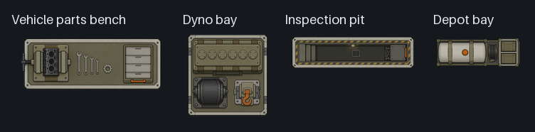

# The vehicle workshop

Where your vehicles' parts and kits are made, and how a vehicle is fitted out: fittings, families, tunes, grades and our
buildings' own upgrades. It works on **every Vehicle Framework vehicle from any mod** that has a loadout, with D'thorga Framework.
What wears out and when a service is due is in [vehicle systems](vehicle-systems.md); replacing a destroyed part is in [damage and
repairs](vehicle-damage-and-repairs.md); parks, the service yard and trips to the dyno bay are in [vehicles on the
road](vehicles-on-the-road.md). [Back to the guide](README.md).

## Read this first

1. **Build a vehicle parts bench early**: research **vehicle parts**, then find it in the Architect's **D'thorga** tab, under
   **Motor pool**. Every part, service kit, booster pack and refill of ours is made only there.
2. **Tick Vehicle parts in at least one stockpile or shelf.** Kits and parts have a storage category of their own, and stockpiles
   made before you installed the mod do not take it by themselves. Without one, "Do until you have X" counts nothing and the bench
   keeps making more than you asked for.
3. **The bench works its bills from the top.** Move the part you need most to the top of the list.
4. **Tunes, changes of grade and the two heavy overhauls need a powered dyno bay within 5 cells** (research **vehicle tuning**). A
   replacement part fitted there goes in at 60% health instead of 25%.
5. **Fitting is real work**: materials are brought, a mechanic works for hours, and demanding work needs a minimum Construction
   skill. **Each part takes one fitting, and a fitting is lost if its part is destroyed.**

## The workshop buildings

All of them, the fuel pump and the service yard's tool too, are in the Architect's **D'thorga** tab, under **Motor pool**.

| Building | Research | What it is for |
| --- | --- | --- |
| **Vehicle parts bench** | Vehicle parts | Makes our engines, transmissions, kits, sets and booster packs; recharges booster packs |
| **Inspection pit** | Vehicle parts | Speeds the parts bench, which also takes tool cabinets and whatever else a machining table takes |
| **Dyno bay** | Vehicle tuning | **Diagnose**; tunes, changes of grade and heavy overhauls; better-fitted replacement parts |
| **Depot bay** | Vehicle depots | A home for one vehicle: it refuels there, and mechanics work faster on it |
| **Fuel pump** | Vehicle depots | Beside a service yard, fills the yard's vehicles with chemfuel |

**The dyno bay:**

- **Diagnose**: a report with every part, tune, reading and fault, the vehicle's tinted picture and, in Operator and Engineer
  display modes, a graph of its last day.
- **Needed for tunes and changes of grade on a working part**, and for the two **heavy overhauls**: machining a badly warped
  cylinder head, and a turbine's hot-section overhaul. The vehicle must be **within 5 cells, and the bay powered**.
- **Replacement parts fitted here go in at 60% health** instead of 25%.
- Select it for **Vehicles in reach**.
- With a second roller set (an upgrade, below) it takes two vehicles at once from its service yard's line.

**The depot bay:**

- Press **Assign vehicle** on the bay, then **Go to bay** on the vehicle (it needs a driver aboard).
- **On the pad it refuels by itself** (chemfuel, while the bay has power), from a chemfuel pipe touching the bay or from what
  haulers bring, and **mechanics need 70% of the usual work**.
- The vehicle moves when you tell it to, when it comes home from a dyno bay, or, **with Vehicles at Work**, when a colonist parks
  it: a vehicle switched on there for trips or hauling is brought home to its bay instead of a parking lot.

**The fuel pump:** beside a **service yard**, it fills the yard's vehicles with chemfuel one at a time, the emptiest first.
Haulers fill its tank. Its **charging cable** upgrade charges electric vehicles too. The yard itself is in [vehicles on the
road](vehicles-on-the-road.md#the-service-yard).

## Building upgrades

Some of our buildings take upgrades. **Select one and press Upgrades.** The window lists each upgrade
with what it does, what it costs and needs, and a **Fit** button that says why when it cannot be pressed. Builders bring the
materials and fit it under **Construction**. **Take off** gives back about half the materials; **Cancel the work** puts down
whatever was brought.

| Building | Upgrade | Needs | What it does |
| --- | --- | --- | --- |
| Fuel pump | **Charging cable** | Electricity | Charges the yard's electric vehicles from the colony's power, one at a time, the flattest first |
| Dyno bay | **Second roller set** | Vehicle tuning | Takes two vehicles at once from its yard's dyno line |
| Depot bay | **Faster pump** | | Fills its vehicle at 60 an hour, where it fills at 30 |

The charging cable shows on the pump, and the grid pays for what it gives. D'thorga Radio Framework's desk and antennas use the
same upgrades window: see [radio](radio.md).

## Parts and kits

Everything here is made at the vehicle parts bench.

| Part or kit | What it is for |
| --- | --- |
| **Engine assembly** | Replaces a destroyed piston engine; builds vehicles |
| **Turbine assembly** | Replaces a destroyed gas turbine; built round a **turbine blade set** |
| **Transmission** | Replaces a destroyed transmission |
| **Reduction gearbox** | Replaces a helicopter's destroyed rotor gearbox |
| **Flight computer** | Replaces an aircraft's destroyed flight-control channel or avionics bay |
| **Hydraulic actuator** | Replaces a destroyed hydraulic ram, or an aircraft's servos |
| **Electric motor** | Replaces a destroyed traction motor, or a generator truck's generator |
| **Drivetrain kit**, **electrical kit** | Build a vehicle's running gear and electrics |
| **Tyre set**, **brake pad set**, **clutch kit** | Services: new tyres; new pads for one axle; a new clutch |
| **Engine service kit**, **drive belt** | Services: the engine's oil, filter and belt |
| **Hot-section kit** | A turbine's hot-section overhaul, at a dyno bay |
| **Jump-start kit**, **booster pack** | Starting a flat vehicle (see [jump-starting](vehicle-systems.md#jump-starting)) |
| **Vehicle extinguisher**, **extinguisher refill** | Fighting a fire on a vehicle (after **Firefoam**) |
| **Sling set**, **fire bucket** | A helicopter's sling loads and water drops |
| **Countermeasure cartridges** | Chaff and flares for aircraft (after the turbines research) |

**Our vehicles and the depot bay are built from parts by role** (an engine, a fuel tank, tyres and so on). Where an installed mod
makes a part that suits (RimThunder, Vanilla Vehicles Expanded), a build asks for theirs; otherwise ours. **Parts for building**
in the settings changes that, after a restart.

### Making parts

- **Bills run from the top.** The parts bench works its bills in order, top to bottom. A bill low in the list may wait a long time
  while the ones above keep the bench busy. **Move the part you need most to the top.**
- **Give the parts somewhere to go.** Kits and parts go in a storage category of their own, **Vehicle parts**. Stockpiles you made
  before installing don't accept new categories by themselves, so **tick Vehicle parts in at least one stockpile or shelf**. "Do
  until you have X" only counts parts in storage, so without one the bench keeps making more than you asked for.
- **Keep materials close.** A stockpile of steel and components beside the bench saves a long walk for every part.
- **An inspection pit** linked to the bench speeds its work by 15%; its placing shows the link.

## Fittings, tunes and grades

**Open Fittings and tunes** from the vehicle's Dashboard, from a right-click with a colonist selected, or from the button a
vehicle shows while a dyno bay is in reach. **Rest the mouse on any choice** to see what it would change ("engine power up, fuel
burned up" in Plain mode). Its details stay in the strip at the foot of the window until you rest on another choice, so you can
move down and scroll them.

### Fittings

**A fitting goes on one part. An engine, a battery and every other part take one fitting each**, so choose: a snorkel or a
heavy-duty air filter, a deep-cycle battery or a battery warmer. **A fitting is lost if its part is destroyed.**

| Fitting | Goes on | What it does |
| --- | --- | --- |
| **Uprated radiator** | Radiator | The engine sheds heat faster, so it is slower to boil on a long pull |
| **Oil cooler** | Engine | Cooler oil burns away more slowly, so the engine goes further between services |
| **Turbocharger** | Engine | More power, more heat and more fuel; holds its power in high country; adds a **Boost** tune |
| **Heavy-duty alternator** | Alternator | The battery charges faster, and heavy electrical loads are easier to carry |
| **Deep-cycle battery** | Battery | Holds more charge, so the vehicle runs its loads longer with the engine off |
| **Block heater** | Engine | Parked beside power, engine off, it stays warm: an easy cold start, less wear, a warm cab at once |
| **Heavy-duty springs** | Each axle | Carries a bigger load, for a harder, slightly slower ride |
| **Road tyres** | Each axle | Quicker on the move, and wear out sooner |
| **Snorkel** | Engine | A light vehicle can cross a river without drawing water into its engine |
| **Heavy-duty air filter** | Engine | In deserts and sandstorms the engine keeps its power far longer between services |
| **Heavy-duty brakes** | Each axle | Wear slower; on a descent they warm more slowly and cool faster |
| **Exhaust brake** | A diesel engine | Holds the vehicle back on a long descent with about half the engine's power |
| **Transmission cooler** | Transmission | A cooler gearbox when hauling heavy in the heat |
| **Gear-reduction starter** | Starter | A cold engine starts on a tired battery, and each start takes less from it |
| **Cab insulation** | Cab | The cab holds its warmth or cool far longer, and the night heater burns less |
| **Fuel heater** | Fuel pump | Fuel never gels, however cold |
| **Battery warmer** | Battery | Parked beside a powered grid, the battery stays above freezing |
| **Cargo hook** | A helicopter's hook mount | Lifts a vehicle on a sling |
| **Fast-rope bar**, **rescue hoist** | The Osprey | See [working vehicles](working-vehicles.md#v-22-osprey) |
| **Cabin oxygen** | An aircraft's oxygen panel | Oxygen for everyone aboard while the engine runs |
| **Litter kit** | A helicopter's cabin | Up to 4 casualties lying down: see [aircraft](aircraft-and-sling-loads.md#an-air-ambulance) |
| **Navigation set**, **autopilot**, **night sight**, **radar** | An aircraft | Avionics it lacks: see [aircraft](aircraft-and-sling-loads.md#avionics) |
| **Vehicle extinguisher** | Any vehicle | Three charges against a fire on it |

- **Wheels are grouped into axles**; a choice on an axle is ordered for each of its wheels. **Tyres, heavy-duty springs and
  heavy-duty brakes go on both wheels of an axle together**, even when ordered from one wheel's own menu, and an axle gains
  nothing until both are done (each wheel has its own brake).
- **New tyres renew the tread**: each wheel fitted takes away its share of the wear.
- **Cab insulation** needs a vehicle with a cab part.
- **A twin-engined aircraft's new engines are a matched pair**: ordering them on one engine orders both,
  one new engine and one job each, and nothing changes in flight until both are in, so the aircraft never flies with one engine
  stronger than the other. Cancelling or taking them off does both too.
- **Other mods' vehicles keep their own upgrades and costs**; our fittings go on any vehicle with a loadout.

### Tunes

Tunes are for **piston engines only**, and need a dyno bay in reach.

| Row | Choice | What it does |
| --- | --- | --- |
| **Engine** | Economy | Leaner and gentler: a little less power, less heat and less fuel |
| | Power | Richer and harder: more power, paid for in heat and fuel |
| **Final drive** | Tall | Lower revs and less strain at a cruise, weaker on a heavy pull |
| | Short | Pulls harder with a heavy load, and tops out sooner |
| **Boost** (with a turbocharger) | Low | A little less power, and a cooler, gentler engine |
| | High | A tenth more power, paid for in heat and fuel |

Each row also has **stock** (standard boost for the turbocharger): the engine as it was built.

- **A tall final drive cannot make a vehicle faster than it was built to go.**
- **Take the turbocharger off and the boost stops.**

### Grades

| Grade | What it is like |
| --- | --- |
| **Salvaged** | Cheap, frail and fault-prone; cannot hold a fitting. Salvaged vehicle parts from hulls pay for it |
| **Heavy-duty** | Costs more, takes more punishment and shrugs off faults |

Choose a grade when a part is destroyed, or to refit a working part (a working part needs a dyno bay in reach).

## Families

**Above the parts, Fit all orders a whole family in one go, on every part it suits**. Each piece can
still be fitted on its own below.

| Family | What it fits |
| --- | --- |
| **Cold-weather pack** | Block heaters, a deep-cycle battery, a gear-reduction starter, a fuel heater and cab insulation |
| **All-terrain tyres** | Every wheel: far more grip in mud, sand and snow, a little slower, faster wear |
| **Work lights** | Work lamps on the vehicle's **lamp bracket** |
| **Long range** | An **auxiliary fuel tank** (land vehicles and boats) or a **ferry tank** (aircraft) |
| **Recovery** | A **recovery winch** on the vehicle's winch mount |

- **The cold-weather pack** puts a block heater in every engine, and switches the night heater on. **Ordering it again orders only
  what is missing.** A battery warmer goes on a battery only when you choose it there yourself.
- **Work lamps** light the ground round the vehicle at night while it stands still, so work there goes at daylight pace, drawing
  on the battery. They light by themselves when your people are near, or by their button (see [headlights and work
  lamps](vehicle-systems.md#headlights-and-work-lamps)). The drill rig's and survey truck's own work light upgrade gives them too.
- **Long range**: an auxiliary tank holds half as much fuel again, and a ferry tank three quarters as much again. Either costs
  cargo space, and the range on the world map grows with the fuel aboard. Taking one off drains the extra fuel into containers
  beside the vehicle.
- **Recovery**: how the winch is used is in [vehicles on the road](vehicles-on-the-road.md#recovering-a-stuck-vehicle).
- **On our own trucks** (the tanker, survey truck, drill rig and tipper) the winch shows on the front bumper and the auxiliary
  tank between the wheels; other mods' vehicles keep their own pictures.

## How the work is done

- **Materials are brought, then a mechanic works.** For example, a turbocharger on a 5-tonne vehicle is about 12 hours and 100
  steel and 10 components; a power tune about 10 hours.
- **Bigger vehicles cost more bulk materials** (steel, plasteel, components), but **a part counted in ones, such as a new engine,
  is one whatever the vehicle**.
- **Demanding work needs a minimum Construction skill**; a mechanic below it is told why.
- **What haulers bring is laid out beside the vehicle, not loaded into it**: it takes no cargo room and
  adds no weight, so a jet with a small hold can be refitted, and services and repairs work the same way. The vehicle's inspect
  line lists what is laid out. Supplies already in the hold that the work needs are taken out of it and laid out too. When no work
  is waiting any more (an order called off, or something to spare), what is left is set down beside the vehicle.
- **Serious work waits for the dyno bay**: a tune, a change of grade on a working part, or a heavy overhaul ordered away from one
  waits, and says so. Your land vehicles can be taken there by themselves: see [trips to the dyno
  bay](vehicles-on-the-road.md#trips-to-the-dyno-bay).
- **Our own vehicles' upgrades cost the same way**, under the same three settings: **Time to fit and tune**, **Materials to fit
  and tune** and **Bigger vehicles cost more to fit and tune**. Taking one off refunds a share of what it cost. Other mods'
  upgrades keep their own costs.
- **An upgrade waiting for research refuses, and names the project.**

How fittings and upgrades work underneath is in the reference page on [upgrades and
fittings](../development/systems/upgrades-and-fittings.md), and the buildings in [stations, the yard and
depots](../development/systems/stations-yard-and-depots.md).

## Tested in game

What the owner has passed, by row of [the test list](../development/in-game-test-pass.md). A row passed **in part** says which part.

| Row | What the owner passed | Date |
| --- | --- | --- |
| 8 | Fittings and tunes: materials hauled, the work done, and a mechanic below the skill refused and told why | 18 Nov 2026 |
| 64 | **In part:** families and tunes ordered several at once queue as they should | 13 Nov 2026 |
| 161 | The cold-weather pack's fittings, ordered as a family | 23 Nov 2026 |
| 165 | Serious work waits for the dyno bay, and is done there | 18 Nov 2026 |
| 195 | An upgrade waiting for research refuses, and names the project | 19 Nov 2026 |
| 451 | **In part:** work materials laid out beside the vehicle, and an aircraft's engines fitted (what is left over set down beside it not yet) | 23 Nov 2026 |

Everything else in this chapter is not yet tested in game.
