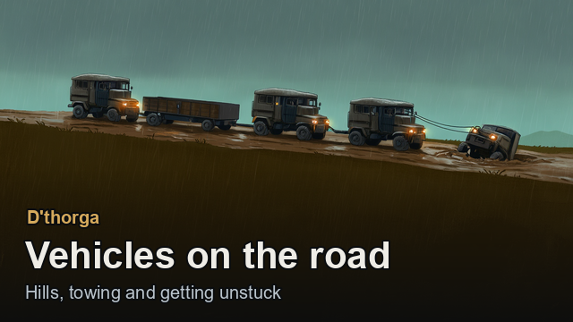

# Vehicles on the road

Driving on a map and across the world: grip, weather, hills, fuel, convoys, depots, towing and winching, and where your vehicles
park and get serviced at home. It works on **every Vehicle Framework vehicle from any mod**, with D'thorga Framework. Aircraft
have [a chapter of their own](aircraft-and-sling-loads.md); life aboard on a long trip (tents, berths, the kitchen) is in [camping
and life on the road](camping.md). [Back to the guide](README.md).

## Read this first

1. **Loaded vehicles slow on soft ground.** A heavy truck in sand, mud or snow labours, and **crawls with "Wheels spinning"**
   where it has no grip (never below 15% of its speed). **Drivetrain shown, speeds unchanged** in the settings keeps every vehicle
   at its author's speeds.
2. **Rain, snow and ice take grip, and the ground stays wet after the rain.** Wet open ground dries over about ten hours on a mild
   sunny day, longer at night or in frost, faster in heat and wind, so a heavy tow or a hill climb goes better once it has dried.
   Under a roof the ground is always dry. **Rain, snow and ice take grip** in the settings turns this off.
3. **High country takes engine power**: an engine without a turbocharger, a gas turbine and a helicopter's lift all lose some
   where the land stands high. **Thin air at height** in the settings turns this off.
4. **Give somebody Drive work.** It starts off for everyone (the Work tab's **Drive** column). Without it, vehicles that need the
   dyno bay wait where they are, and nothing is driven home.
5. **A vehicle parked in the wild is lost after a while**: a letter warns you three days ahead. Bring it home, or leave it at a
   garage or a depot.

## Driving on a map

### Soft ground and grip

- **The ground matters**: deserts are sand, swamps mud, jungle undergrowth, and winter adds snow. **A road is firm whatever the
  land.**
- **Grip only tells where grip is what holds a vehicle back**: hills, mud and towing. A laden truck or a heavy tow may crawl or
  stall in a blizzard or on ice that it would pull through in the dry. **All-terrain tyres help** (a family in the fittings
  window).
- **Where it has no grip, a heavy vehicle crawls with "Wheels spinning"**, never below 15% of its speed.

### Who drives

- **Who drives matters.** A driver who is hurt, drugged, half-blind, one-handed, freezing or tired drives slower, and wears tyres
  and brakes a little faster. Nothing is ever crashed for it. **Rest, medicine or a fresh driver put it right**; the vehicle's
  Systems tab shows how fit its driver is.

| Driver | Speed lost |
| --- | --- |
| Merely tired, or a little off | Up to a tenth |
| Impaired | A fifth |
| At the very worst | Three tenths |
| One eye | Near full pace still |
| Breaking down mentally | Cannot drive until it passes, or someone else takes the wheel |

- **Practice makes a gentler driver**. The hours a colonist spends at the wheel of one kind of vehicle
  make them easier on its brakes and tyres, and a practised pilot lands more gently. **Never faster.** The Systems tab shows the
  driver's practice, and a colonist's Records show their hours at the wheel. **Keep the same people on the same vehicles.**
- **A vehicle has a regular driver**: whoever has driven it most. The fleet board's pane names them. They are upset when it is
  destroyed or lost out on the world map, and glad when a lost one is brought home.
- **Raiders' drivers count too**: a raid with a hurt or tired driver comes in slower, as does a raider with no headlights at
  night.

### Driven from a station

- **A vehicle with the radio's control kit can be driven with nobody aboard**, from a radio station (with D'thorga Radio
  Framework). On the five service trucks it is the upgrade **Remote control kit**, after the research **remote vehicle control**;
  **on any other vehicle it is a fitting** of the same name, fitted at the vehicle workshop. It draws a little on the battery.
- **Guns that no seat works**, such as the L-ATV's, **fire only while the station has the vehicle's picture**: the vehicle must be
  drafted, and in good reach, since the picture needs a stronger signal than orders. Its text says "orders and picture" or
  "orders only". The setting **"Remote guns fire on their own"** (off) lets them fire with nobody watching.
  **Our own remote weapon station** on the Talus and Busbar follows the same rule **whether or not the truck has the control kit**.
- **Someone must work the station**: **turn on Remote operation for a colonist in the Work tab**. They stand at the console while a
  vehicle wants driving, and drive **two at once**; a third waits for another station's operator. When they leave to eat or sleep,
  the vehicle loses its link.
- **Press "Drive from a station"**, wait for a station to reach it, then **draft it and give it orders as usual**. It holds a
  control channel at that station while the button is on; **turn it off to park it** and free the channel.
- **Choose what it does if the link is lost**: **hold** where it is (the default), **come back** toward its station, or **carry
  on** with its last drive. It waits ten seconds first, in case the link returns. A letter tells you, and another when a station has
  it again.
- **It keeps to radio cover where it can**: its routes go round ground behind hills, rock and thick walls where no station would
  reach it, when the way round is not too much longer. It never refuses an order, so a drive out of reach still loses the link.
  The map of where stations reach takes some seconds to work out after you press the button, and again after a station, antenna,
  wall or roof changes. A setting, "Vehicles driven from afar keep to radio cover", turns this part off.
- **Give it a driver before it joins a caravan**: it cannot be driven from a station on the world map.
- A colonist at the wheel drives it the ordinary way. A setting, "Remote control of vehicles by radio", turns it all off.

### Convoys and loops

- **A vehicle with the route kit drives itself without a radio**: fit the **route kit** at the vehicle workshop, after the research
  **leader-follower driving**. It draws a little on the battery.
- **Follow:** press **Follow** and choose a vehicle. It joins the end of that vehicle's convoy, **at most four behind one leader**,
  and keeps behind the vehicle ahead. **The leader needs someone at its wheel**, or a radio station driving it.
- **Run a loop:** press **Run a loop**, then choose the **pick-up**, then the **drop-off**. It drives back and forth, **waiting an hour
  at each stop for colonists to load or unload it**. **Add a waypoint** to make it go a certain way.
- **A tipper unloads itself, and a Talus with the loading grab loads itself.** Put the **drop-off on a bulk bunker or stockpile**: the
  truck backs up to it and tips, or tips behind itself if the stop is on neither. Put the **pick-up beside the pile**: the grab lifts
  what the truck's **Gather what** allows within reach. Done, it drives on at once; storage full or nothing in reach, it waits its hour.
- **A tanker pumps itself out at the drop-off.** Put the **drop-off where its hose reaches** what should take the load: the pipe or
  pipeline for it under the stop, or a tank or vehicle beside it set to **Load** the same. It sets up, empties every compartment, packs
  up and drives on. If nothing takes the load, it says so and keeps pumping until its hour is up. A tanker **trailer** still needs
  colonists.
- **A tanker fills itself at the pick-up**, from the pipe under the stop or a tank beside it set to give, into compartments you have
  **set to a contents**. Full, or its source dry, it drives on.
- **If the leader is lost**, the follower does what you chose for a lost link: hold, come back or carry on. A letter tells you.
- **An aircraft flies a round between places by itself**, with its **pilot aboard**. Press **Plan a round**: where it stands is the first
  stop; click the next places on the world map (up to eight), picking a **landing spot** on each place with a map; right-click when done.
  Then **Fly its round**. At each stop it waits (an hour unless you set **Waits at stops**) for colonists to unload, load and **refuel**
  it, then flies on if it has the fuel for the next leg. On open ground it lands as a caravan. It never stops at an enemy's town.
- **Supply runs by air** (from Framework 0.340.0): for a helicopter with the sling and a sling set, **Its stops** also sets the sling at
  each stop. **Sling: lift the nearest filled cargo net here** (or **pick what to lift here**) hooks it up before it leaves; it is set down
  where it lands at the next place with a map, **without pausing the game**. At a stop on open ground, **Sling: leave its load here**
  leaves it as a depot; **a cargo net's load goes into the depot and the empty net is folded aboard**. At a depot, **Sling: collect from
  the depot here** fills that folded net with as much as the hook lifts and carries it on, or takes the heaviest single stack without a
  net. **A load too heavy for the hook today makes it wait there and say so.** A gift stop never gives away the sling set.
  **A worked example of the whole network:** [Setting up a supply network](supply-network.md).
- **With nobody aboard:** fit the **optionally piloted kit** at the vehicle workshop (after **vehicle autonomy** research; it needs the
  **autopilot** first). With no pilot aboard, it flies its round by itself; with one, the pilot flies.
- **The fleet board** lists followers under their leader, and its pane can add a follower, leave the convoy or break it up.
- A setting, "Vehicles follow a leader, run loops and fly rounds by themselves", turns it all off.

### Mechlinked vehicles (Biotech)

- **A mechanitor can drive a vehicle with nobody aboard**: research **mechlinked vehicles** (after basic mechtech) and fit the **mech
  control link** at the vehicle workshop. It goes where a radio control kit would, so a vehicle takes one or the other.
- **Press "Link to a mechanitor"** and choose one. **Draft the vehicle and give it orders as usual**, within the mechanitor's command range.
- **It takes their bandwidth by size**: 1 light, 2 medium, 3 heavy or tracked. **Mechanoids come first**: short of bandwidth, the newest
  linked vehicle loses control first.
- **Out of range, or with the mechanitor down**, it does what you chose for a lost link (hold by default). If the mechanitor dies, it is freed and stops.

### In the dark

- **Driving in the dark with the headlights off is slower**: a land vehicle goes at 85% of its speed over ground the game counts
  as dark, and its warning lamp says **no lights**. Lamps and lit roads count as light.
- **Lights switch themselves** by default; how they work, and what they cost the battery, is in [vehicle
  systems](vehicle-systems.md#headlights-and-work-lamps).

### Rivers and water

- **Light vehicles and rivers.** A car, buggy or light utility vehicle (under 2 tonnes) with its engine running in a river can
  draw water into its engine and damage it; a message warns as it enters the water. **A short crossing is a small gamble; driving
  along a river is asking for it.** Fit a **snorkel** to cross safely. Heavier vehicles ford the shallow rivers unaided.
- **Wet brakes**: after crossing water a vehicle is a little slower while the driver takes it gently; a short drive dries them.
- **A tanker can fill from a river** (needs Dubs Bad Hygiene): parked with a side against a river, lake or
  the sea, its pump draws water straight in, untreated, when there is no plumbing to draw from.

### Your traps

**Your traps leave your vehicles alone when you did not send them** (the setting **Vehicles you did not send pass over your
traps**, on by default). A vehicle of yours driving without your order (on a trip to a dyno bay, a gathering or delivery run,
towed, pushed by hand or heading off with a caravan) rolls over your traps without setting them off.

- **A drive you order with a right-click is different**: a trap goes off under it only now and then, as under a colonist who knows
  it is there, so **keep your own driving clear of trap lines**.
- Enemy vehicles still set traps off.

### Raiders' fuel

**Raiders arrive with the fuel their journey left them**: a raid from a faction far away comes in with
its tanks low, one from next door nearly full. **Hole a raid truck's fuel tank** and it leaks fuel onto the ground until it runs
dry, sooner the further it came. **A stranded raid truck is soon blown up by its own crew, so keep clear of it.**

## Hills and brakes on the world map

On the world map **hills go up and then down**: a caravan climbs for the first half of a hilly tile and
descends for the second, and going down to the coast is a little easier than coming back.

- **Going down, the engine holds the vehicle back by itself** and burns no fuel (a turbine burns its idle). What it cannot hold,
  the brakes take, and **that heats them**: watch **brake temperature** on the Systems tab.
- **Hot brakes fade.** A laden truck towing a trailer on a long mountain road is the hard case.

| Brake temperature | What happens |
| --- | --- |
| Past about 260 °C | A message says they are fading, and the caravan slows |
| Past 400 °C | It crawls down, and the pads wear fast |

- **What helps:** a lighter load; **heavy-duty brakes** (they warm more slowly and cool faster); an **exhaust brake**, a fitting
  for diesel engines that holds back about half the engine's power; and the **compression brake** every diesel of 250 kW or more
  already has.
- **Electric vehicles put a descent back into the pack.**
- **To switch the heat and fade off**, untick **Brakes heat and fade on descents** in D'thorga Framework's vehicle settings.
  Descents then still wear the pads.

## Fuel, and what the engine drives

With **Fuel use follows engine load** on (the default), a vehicle with the full drivetrain model burns fuel for what its engine
actually does.

- **At an ordinary cruise with nothing extra on, it burns the rate its author set.** Climbing, towing and soft ground burn more;
  an empty run on a road burns less.
- **Idling burns a quarter of the cruise rate.**
- **Whatever the engine drives costs fuel and a little power:**

| What | When it works | What it takes |
| --- | --- | --- |
| **Alternator** | Always; it drags a little even making nothing | A few tenths of a kW for the engine alone; about half a kW more for lights and a heater |
| **Air-conditioner compressor** | While the cab is being cooled | Heavy truck: 2.6 kW holding a cool cab, up to 5.6 kW cooling a hot one |
| **Radiator fan** | When the engine runs hot | A lot at high engine speed, almost nothing at idle |
| **Air brakes' compressor** (heavy trucks) | While the air is topped up after stops | About 1% of the engine |
| **A tanker's pump** | While it pumps on the engine | 10 kW |

- **The alternator** works for the engine's own electronics, the lights, the heaters and whatever the batteries are taking, and
  takes more just after a start, while the battery refills.
- **The air conditioner** on a car takes about three-fifths of a heavy truck's figure, and on a small vehicle a third.
- **You feel it most standing still.** An idling heavy truck with its air conditioner on burns a third to two-thirds more than one
  without, and a car somewhat more. On a road the same loads are a few per cent.
- **On a climb, in mud or under a heavy tow, switching loads off gets a little speed back**: what they take comes off what is left
  for driving.
- **A standing engine idles faster under its loads**, as a real engine's control does: about a tenth faster with a heavy truck's
  air conditioner on, up to a fifth. A faster idle charges the battery better and burns a little more.
- **Steering at walking pace works the power steering pump hard**, and an idling vehicle's hydraulic pump and air compressor still
  drag a little.
- **A worn or damaged drive belt slips under a heavy load.** A message says so: the battery charges less and the engine cools
  less. Switch something off, and have the belt replaced.
- **Old mechanical diesels** (the M113, Bradley, HMMWV, M48, T-54, BMP-1 and Wiesel) need far less electricity to run than a
  modern engine, so their alternators take less.
- **Working vehicles burn by the work**: a drill rig drilling takes half its engine, close to 100 chemfuel a day. The tipper's
  hoist takes about an eighth of its engine while it raises a load, and its loading grab a little less while it lifts.
- **Electric vehicles' lights and other electrics draw on the drive battery** through its converter, as their heaters do.
- **The Systems tab lists what the engine is driving** in Operator and Engineer display modes, as a table at the foot of its
  Engine and drivetrain card, biggest first: each load's share of the fuel burned now, its kilowatts too in Engineer mode, and all
  of them together on the last row. **The inspect pane says about how much fuel the vehicle burns a day.**
- **To go back to flat rates**, switch **Fuel use follows engine load** off in D'thorga Framework's settings, under vehicle
  systems.

### Refuelling from a chemfuel pipe

With **Vanilla Chemfuel Expanded**, park a fuelled vehicle against a chemfuel pipe and switch its engine off.

- The chemfuel pipe the vehicle lays beneath it joins the line and **fills it from the line's tanks, 30 chemfuel an hour**.
- The inspect pane says how full it is, and a message says when it is full. With the engine still running, a message says to
  switch it off.
- A vehicle set up for work packs up first.
- **The depot bay** fills its own tank from a chemfuel pipe touching it, so haulers need not fill it.

## Thin air in high country

**The higher a place stands, the thinner its air**, and an engine that breathes it has less to give. The
world map's terrain tab shows each tile's elevation; a map is as high as its tile.

| Height | Engine with no turbocharger | Turbocharged engine | Gas turbine | A helicopter needs, to hover |
| --- | --- | --- | --- | --- |
| The sea | All its power | All | All | Its usual power |
| 500 m | 95% | All | 94% | 2% more |
| 1,000 m | 89% | All | 89% | 5% more |
| 1,500 m | 85% | All | 83% | 8% more |
| 2,500 m | 75% | 89% | 74% | 13% more |
| 4,000 m | 63% | 74% | 61% | 22% more |

- **You only feel lost power where power is what holds the vehicle back**: a climb, mud, sand, a heavy tow. On a road it keeps its
  speed.
- **A turbocharger holds an engine's power to about 1,500 m**, and loses it more slowly above that. Trucks, modern tanks and
  locomotives have one as built; the HMMWV, the M113, the T-54 and the BMP-1 do not. **Fitting a turbocharger** to an engine
  without one gives it the same hold.
- **Radiators cool a little less** in thin air; the colder air up there mostly makes up for it.
- **While it matters, the inspect pane says** "The air is thin up here" and how much power the engine has left.
- **Helicopters are hit twice**: see [aircraft and sling loads](aircraft-and-sling-loads.md#thin-air-and-hot-days).
- Electric vehicles are not affected. Other factions' vehicles are not affected.
- **To switch it off**, untick **Thin air at height** in D'thorga Framework's settings, under vehicle systems.

## On the world map

- **A caravan moves as its slowest vehicle**, and its explanation names it. A vehicle that will not move stops the caravan; its
  inspect text says why.
- **Select a vehicle caravan to see its reach** on the fuel aboard, outlined in amber on the globe, and how many hours of driving
  the fuel allows.
- **A convoy is told when the snow comes**: its inspect pane says in how many days snow reaches the
  ground where it stands, or lifts, and the same for where it is going. Snow makes the going slower and thirstier, so leave before
  it or wait.
- **Repairs and jump-starts work on the world map; services and coolant top-ups need a map.** In a stopped caravan with a
  mechanic, press **Repair**; the parts can be anywhere in the convoy's cargo.
- **The vehicle's systems keep running on the world map**: the three tabs work on a caravan, wear goes on, and a night heater
  keeps an engine warm at camp (see [cold starts](vehicle-systems.md#cold-starts)).

### Refuelling from cargo

**Carry the fuel your vehicles burn in the caravan's cargo, then press Refuel *vehicle* from cargo** on the caravan.

- Whenever its tank falls to a quarter, the crew top it up from the cans with a short stop, so the caravan does not halt for fuel.
- **It starts off for every vehicle**, so fuel you carry to sell is safe until you switch it on.
- The fuel line and the reach on the globe count the cans for every vehicle switched on.
- It works on the world map only.
- Aircraft do the same by setting down on the way: see [aircraft and sling
  loads](aircraft-and-sling-loads.md#refuelling-on-the-way).

### When a journey goes wrong

- **A stranded convoy raises an alert**: **Convoy stranded** names the vehicle, why it cannot go on, what
  could fix it there with what the convoy carries, and how far home is. **Your choices are yours**: fix it where it stands, camp
  and wait, send for parts or a tow, or leave it behind.
- **A vehicle parked in the wild is lost after a while**; a letter warns you three days ahead.
- **A lost convoy stays where it stopped** (the setting **Lost convoys stay where they stopped**, on by default): when the last colonist of a convoy dies on the road, its vehicles, cargo and anyone else aboard wait on the world map as
  a **lost convoy**. **Right-click it with a caravan to Recover it**, then drive, tow or lift the vehicles home.

### Journeys, records and letters

- **Every journey goes in the vehicle's logbook**, and one that went wrong (a breakdown, a halt, someone
  hurt aboard) also sends a letter when the vehicle reaches a map. **Letters for troubled journeys** in the settings turns the
  letters off.
- **Colonists' records count the road**: drivers their **kilometres driven** (a stretch of the world map is about 30 km),
  mechanics their **vehicle repairs**, and winch drivers their **vehicles recovered**. Long journeys, roadside repairs and winch
  recoveries can turn up in your colonists' art.

### The fleet board

**The fleet button** on the bottom bar lists every vehicle you own, wherever it is, grouped by place.

- Each row shows the vehicle's picture, what it is doing, the one thing it most needs, its fuel and its worst part. A trailer sits
  under what pulls it.
- At the bottom are vehicles lying lost on the world map, hulls waiting to be taken apart, and other factions' vehicles standing
  unguarded that you could claim.
- **Choose a row** (a click, or the up and down arrow keys) and the pane on the right shows where it is hurt, its faults and what
  caused them, its regular driver and its newest logbook lines. **Enter**, or a click on the chosen row, goes to it.
- Tick **Only what needs attention** to hide the rest.
- **A key for the fleet board**: Options, Keyboard, main tabs, "toggle fleet tab". No key is set at
  first.
- The fleet board also runs the [service yard](#the-service-yard) and keeps vehicles out of [trips to the dyno
  bay](#trips-to-the-dyno-bay).

### Depots

**Fuel and gear left out on the world map for a later trip**. A depot never expires, and it is listed on
the fleet board.

1. **Stop a convoy on open ground and press Leave a depot here.** Tick the vehicles or trailers to leave (a bowser with a full
   tank is ideal) and choose cargo to leave with the arrows. Riders of a vehicle left behind walk on. **Keep one vehicle** to
   drive on.
2. Later, a convoy stopped at the depot can **Leave and take** cargo, or **Refuel from the depot**.
3. **Aircraft refuel there by themselves**: switch on **Refuel from cargo on the way**, and an aircraft passing over a depot that
   holds its fuel, below half a tank, sets down and fills up.
4. **To take the vehicles back, right-click the depot with a caravan and visit it**: drive them away from the small map.

**Time works on a depot** (each a setting under **Depots**):

| What | When |
| --- | --- |
| It weathers | In frost or a wet climate |
| Its fuel goes stale, a little a day | Kept more than about three months |
| It is found and emptied | Near enemies, with **Hostile neighbours find depots** on (off by default) |

**The depot's line says how old its fuel is and when it will be found.**

### Contracts from settlements

**Nearby settlements hire your vehicles**, through the quest window, as they send the game's own trade requests. A contract is offered
only while you own a vehicle that can do it.

| Contract | What does it |
| --- | --- |
| Chemfuel, 400 to 1,000 litres | A tanker or a fuel bowser |
| Water, 600 to 1,500 litres (Dubs Bad Hygiene) | A tanker or a water bowser |
| Stone, 40 to 80 chunks | Offered with a Talus tipper; any chunks the caravan carries count |
| Spare parts, one to three of one kind | Anyone who keeps vehicles |
| A ground survey, 12 to 24 hours | A Datum survey truck, and someone with Intellectual skill |
| A water bore, 18 to 36 hours (Dubs Bad Hygiene) | A Kelly drill rig, and someone with Mining skill |
| Power, two to four days | A Busbar generator set, and anyone to tend it; it runs day and night |

1. **Accept the quest** and send a caravan to the settlement before the time runs out.
2. **For a delivery, press Fulfil contract** there: it takes exactly what was asked from the tanks or the cargo, towed trailers too.
3. **For work, press Start the work** and leave the caravan there. The settlement's line counts the hours. The crew rests at night
   (except for power); the truck burns its own fuel; the better the hand's skill, the faster it goes, and they learn as they work.
   **Leaving stops the work and keeps what is done.**
4. The quest pays the game's usual rewards into the caravan, and the settlement's faction likes you better.

**How often** is the setting **How often settlements offer contracts** (Crews page, **Contracts**): from never to three times as often
as trade requests, in quarters; as often as trade requests by default.

**Some contracts wait at a place on the world map**, as the game's rescue quests do:

| Contract | How to do it |
| --- | --- |
| **A broken-down vehicle** (industrial or better settlements) | **Tow it** to their settlement with a winch truck and press **Hand over**, or **mend its wrecked part where it stands**: within an hour their people drive it home |
| **A hurt traveller** | **Carry them** into any caravan, or onto an aircraft's litters, and press **Hand over** at their settlement |

- **While the contract runs, the vehicle or person is one of yours**, so you can winch, mend, carry and caravan them. They go back to
  their people at the hand-over, or when the quest ends any other way, even from your colony.
- **You have 7 to 15 days.** The reward comes **by drop pod** to your home.
- **Enemies may wait at contract sites** (same page, **off** by default) lets these places hold the game's rescue threats: raiders,
  mechanoids, turrets or manhunting animals.

### Work on the road

**The working vehicles earn their keep on a journey.** Each has a button on the world map, and the convoy's line says how it goes.
**Work at a halt needs the convoy stopped and away from towns, and each vehicle does one job at a time**; driving on ends it.

- **Survey on the road** (a [Datum](working-vehicles.md#datum-survey-truck) with its **long-range kit**): switch it on and, while the
  convoy drives, someone aboard who is **not driving** reads the console. **They need Intellectual skill**; the better it is, the
  sooner a find. Now and then they find a lump of the ore the truck is tuned to (**the tune button sits beside the switch**), as the
  game's own long-range scanner quest, **placed a few tiles from where the convoy was**. Nothing is found while the convoy stands.
- **Drill a water bore** (a [Kelly](working-vehicles.md#kelly-drill-rig), **Dubs Bad Hygiene only**): stop the convoy and press it.
  **The button says how much rain falls there and how much water a bore would give**; under 250 mm of rain a year the ground is dry
  and it is greyed out. Someone with **Mining** skill drills for about eight hours (faster with more skill, **not at night**), then it
  pumps **untreated water** (as from a river) into the convoy's water tanks until they are full. It **burns the Kelly's fuel and wears
  its drill bit**: about a dozen bores to a new bit. **Driving on ends it.** Only tanks already set to water are filled, crew water
  tanks too.
- **Treat it on the way**: a water bowser or Ullage with the [reverse-osmosis kit](working-vehicles.md#pintle-water-and-fuel-bowsers) makes bore or
  river water clean while the convoy drives, on the towing vehicle's or the truck's own electrics.
- **Survey halt** (any Datum, no kit needed): stop and press it. Someone with **Intellectual** skill reads the ground for about **six
  hours of daytime work**, then a message says **which deep ore lies under the tile and roughly how much**, and, with Dubs Bad Hygiene,
  what a water bore would give. **A tile reads the same every time**, so it is read once; the convoy's line keeps showing it.
- **Drill a test hole** (a Kelly, **on a tile the Datum has read**): about **12 hours of daytime drilling** by someone with **Mining**
  skill brings up **3 portions of the read ore**, into a Talus's hold if one rides along, otherwise the convoy's cargo. One hole to a
  tile. It burns fuel and wears the bit, like a bore. **Insects in test holes** (off by default) lets a hole break into insect tunnels,
  as the game's deep drills can: the convoy must fight them, and the hole is lost; with it on, a hole that gets through brings up 4.
- **Quarry stone** (a Kelly with the **RC hammer**): stop and press it, with a **Mining** hand aboard. It breaks stone chunks of the
  tile's own rock out of the ground by day, into a Talus's hold first, **more on hills than on flat land**, until the convoy can carry
  no more. It burns fuel and wears the bit, like a bore.
- **A map opened on a read tile** (a camp, a settlement, an ambush) **has the read ore** in its deep ground, and its deep ore shows
  without a scanner.
- **Tip the load here** (a Talus): its whole load goes into a **depot** on the tile, made if there is none, in one press: to lighten the
  convoy for a climb, or leave a stock for the way back. The depot window takes it back out.

- **Hook up from the depot** (any truck with a free hitch, at a depot holding a trailer): pick the trailer from the menu and it is on the
  hitch at once, with no need to drive onto the depot's ground.

- **Raise the mast** (a Datum, at a halt, **with D'thorga Radio Framework**): the boom goes up as a 10 m radio mast, so a convoy with a
  radio fitted reaches home from further out. In reach of home, ambushes come with a warning and an aircraft can **airdrop to the
  convoy** ([radio](radio.md#convoys-on-the-world-map)). Driving on lowers it.

### Supply runs

**A truck that can take the route kit can run supplies on its own.** **Plan a supply run** (on the map or on the world map) and pick
its stops: **depots**, **open ground**, or **your colonies** (it drives in at the map's edge). In **Its stops**, set each to **deliver its
load**, **fetch the depot's goods** or **only wait**, and how long it waits. **Start the run** and it goes round and round.

- **With a driver aboard**, the driver drives it. **With nobody aboard**, its **route kit** does, if fitted and powered.
- **With D'thorga Radio Framework**, a crewless run is driven by radio: **Crewless supply runs need radio reach** (Remote section) asks for
  reach **all the way** (the default; relays stretch it) or only **to set off and at stops**. **A crewless supply truck out of reach**
  **holds** where it is (the default), **carries on** or **turns back**.
- **It drives to the edge of the map** before it leaves a colony, as any convoy does (from Framework 0.332.0).
- **At a colony, give its stop a loading list** (in **Its stops**, pick the stop, then **Loading list**): your people carry those
  things to it while it waits, less what it already carries. **It leaves as soon as all of it is loaded, or with part of it when its
  waiting time is up**, and says which. Fetching is from depots.
- **At a colony it parks to be loaded** (from Framework 0.335.0): beside the things on its loading list, or by your nearest
  stockpile when it delivers. **Its stops**, then the stop, then **Where it parks here**, picks the spot yourself. If it cannot get
  there, it waits where it stands.

### The ground: bogging and grit

- **Heavy vehicles bog on soft ground**: a vehicle **over 12 tonnes laden** sinks a little on each **swampy or very wet flat** tile it
  crosses, and **sticks** when it has sunk far enough (the heavier, the sooner; tracks spread the weight). **Frozen ground and hills
  never bog.** The convoy stops, and the message says how it gets out: a **winch truck** in the convoy in about **1.5 hours**, another
  vehicle **towing** in about **3**, or the ground firming up in about **24**. **Lay stone under the wheels** (on the stuck truck) uses
  **10 stone chunks** to free it at once. **Heavy vehicles bog on soft ground** (Camps section, **on**) switches it off.
- **Spread grit** (a Talus, in winter, with stone aboard): each snowy tile the convoy reaches takes **2 chunks**, and that tile is
  **easier going for every convoy of yours for five days**. Out of stone, it stops and says so.

### Ambushes

**A convoy that is driving sees an ambush coming.** The game stops and you choose:

- **Stop and fight**: the game's own ambush.
- **Drive through** or **Turn back**: each shows **its chance**, which rises with the convoy's speed and the armour on its vehicles.
  Turning back is the likelier escape, but the convoy then **waits 4 hours** for the road to clear (its line counts down). **If the
  chance fails, the ambush goes ahead.** A vehicle that cannot move means you must fight. **Getting through costs a few hits** on each
  vehicle, much lighter with armour kits.

A convoy at a halt, or camped for the night, is caught standing and fights. **Choose how to meet an ambush** (Camps section, **on** by
default) switches the choice off.

### A trailer on wrecked gear

**A trailer whose axle or tyres are wrecked can still be towed**, after a warning. The towing vehicle **crawls at a quarter of its speed**
and the trailer's damaged running gear **wears further** as it is dragged; you are told when it starts. Repair it, carry on slowly, or
leave it at a [depot](#depots). **Trailers on wrecked gear crawl** (Camps section, **on**) switches the crawl off.

### Garages

**Garages** (needs Vanilla Expanded Framework): a stopped convoy can set one up. Vehicles left there stay with no time limit, and
whoever is stationed there mends them from steel and components you bring.

## Towing a trailer

Any land vehicle can tow a trailer such as the [Pintle flatbed](working-vehicles.md#pintle-flatbed-trailer).

- **Press Hitch a trailer** and pick one within 8 cells; a colonist couples it and it is set behind the vehicle on its drawbar.
  **Unhitch** lets it go.
- **Before you hitch, read the label beside the mouse**: it says what the tow would be like on the ground where the vehicle stands
  (full speed, slowed by the engine or by grip, a crawl, or too heavy), or why it cannot be hitched. It is a forecast: hills and
  mud on the way can make it worse.
- **The trailer stays on the map** and follows the hitch, cutting inside corners as a real one does. **A vehicle that tows takes a
  wider way round**: it keeps off walls, fences and rock where it can, and checks each route for its trailer before it sets off,
  looking for another way where the trailer would not fit. If there is none it says so and goes anyway. **If the trailer would
  still hit a wall or another vehicle, the vehicle stops and says so**: choose a more open way, or unhitch. **Vehicles that tow take
  a wider way round** (under **Towing** in D'thorga Framework's settings, on by default) turns the wider way off.
- **The engine pulls the trailer and its load too**: lower gears, more heat, more fuel, a crawl on soft ground or uphill. The
  trailer adds no grip.
- **A towing vehicle's panels say what holds it back**: the inspect panel, the Dashboard and the Systems tab name what it tows,
  its weight, and whether the engine holds it to a gear, the wheels cannot grip, or it can only crawl.
- **Only vehicles the drivetrain model works out can tow**, unless you turn on **Vehicles without the drivetrain model can tow**
  (under **Towing** in D'thorga Framework's settings), which slows them by a plain rule instead.
- **Load a hitched trailer as any vehicle**, through its cargo window; haulers walk to it wherever it stands.
- **A trailer goes on journeys with its vehicle**: form a caravan with the vehicle and the trailer comes along, with its cargo.
  Its weight slows the caravan. On arrival it is set down behind the vehicle, still hitched; at the map's edge, where there is no
  room behind, it is set down beside and swings into line as you drive off.
- **Hitch first, then form the caravan.** In the Form caravan window a trailer cannot be ticked by hand: a hitched one is ticked
  with the vehicle towing it, and its cargo room counts, so the Items tab can load it; an unhitched one stays unticked, and its
  tooltip says to hitch it. A trailer that is not hitched never leaves with a caravan.
- **A trailer's tyres wear as it is towed**, on the map and on journeys, faster off the roads, just like a vehicle's. Its
  **Health** tab shows them, and its **Systems** tab lists the tread and the tyre service. **A service fits new tyres from a tyre
  set**: haulers bring it and a constructor does the work. **Worn-through tyres can burst and damage the trailer's axles.** A
  trailer has no Dashboard: it has no driver or engine.
- **A towing or towed vehicle cannot be lifted on a sling**: unhitch it first.
- **A trailer or vehicle that is set up cannot be hitched**, nor one a colonist is on the way to set up: pack it up first. A towed
  vehicle cannot be set up either.
- **Two tanks within reach of a hose pump one into the other**: set one up on **Unload** and the other on **Load**, both holding
  the same fluid. A trailer that takes water lays hidden plumbing beneath itself while it stands unhitched.

## Recovering a stuck vehicle

**Fit the recovery winch** (the **Recovery** family in the fittings window) to a land vehicle.

- **Press Winch something in** and pick a stuck, broken or empty vehicle within 12 cells, or since Framework 0.332.0 **a wreck, a
  chunk of rock, a crashed ship's chunk or a carcass**. **Someone must be aboard to work the winch.** It drags it in a cell at a time,
  slower the heavier the pull, and stops beside you. **Stop winching** ends it at any time. Nothing alive can be picked, and it never
  drags anything over another thing or a person.
- **What things weigh on the winch**: a wreck what its vehicle weighed empty; a crashed ship's chunk 3 tonnes; a rock chunk or a
  carcass what the game says it weighs.
- **Whether the winch can manage** is worked out from both vehicles' weight and ground: a vehicle in deep mud is far harder to
  move than one on gravel, and one whose wheels are wrecked is dragged, which is harder still. **The winch pulls up to 5,443 kg,
  but never more than your vehicle holds on its brakes, so park the winching vehicle on firm ground.** A refusal says both
  figures.
- **The winch runs on the battery** (about 150 amps while it pulls). It will not start on a flat battery, and a long pull that
  runs the battery flat stops it. **Run the engine while winching.**
- **Then tow it home**: with the winch fitted, **Hitch a trailer or vehicle** also takes an ordinary land vehicle. **Undraft it
  first** so it rolls free. It follows on a tow bar like a trailer, anyone aboard rides along, and it has its own **Unhitch**
  button.

| Tow weight | What happens |
| --- | --- |
| Up to 1.5 times your vehicle's weight | A fair tow |
| Heavier | Allowed with a warning: it goes slowly, and wears your brakes and clutch fast |

- **Another faction's vehicle can be winched too** where nobody is aboard and none of theirs stands armed nearby: pull a wreck clear before deciding whether to claim it. It stays theirs until you do. **To tow it home, claim it
  first** (see [damage and repairs](vehicle-damage-and-repairs.md#other-factions-vehicles)).

## Parks, the service yard and trips to the dyno bay

Where your vehicles stand at home, and how they get to the dyno bay without you driving each one. The buildings themselves (the
dyno bay, depot bay and fuel pump) are in [the vehicle workshop](vehicle-workshop.md#the-workshop-buildings).

### Vehicle parks

**A vehicle park is a zone**: in the D'thorga tab's **Motor pool** press **Vehicle park** and mark open ground.

- **Keep it one vehicle deep beside a road**, so nothing is boxed in.
- Vehicles fill it from its south-west corner with a gap between them.
- **A park on a gravship's deck is not carried by a flight**: mark it again after landing.
- **Before removing D'thorga Framework, delete every vehicle park and service yard.**

### Trips to the dyno bay

**A land vehicle of yours that needs the dyno bay is taken there without being told**, repaired, and put away.

- **Give somebody Drive work first.** It starts off for everyone (the Work tab's **Drive** column). With nobody on it, vehicles
  wait.
- **What goes**: a vehicle with a destroyed part to replace, a serious fault, or work only the dyno bay can do. The setting **What
  sends a vehicle to a dyno bay** has three levels; routine servicing is done where the vehicle stands unless you choose "any
  repair".
- **Only when its parts are in the colony.** A wreck nobody can repair stays where it is and says which part it waits for.
- **The trip**: a colonist walks to it, drives it into the bay's reach and gets out. Mechanics and haulers do the rest.
- **Afterwards** a colonist drives it into a [service yard](#the-service-yard) with room, or to **its depot bay** if it has one;
  with neither, to a **vehicle park**; with none of those, to a spot nearby that is clear of the bay.
- **Left alone**: a vehicle with anyone aboard, its engine on, set up for work, towing or towed, or on an errand. **Nothing sets
  off while enemies threaten the map**, and a trip under way stops and lets its driver out.
- **To keep one vehicle out**: open the **Fleet board**, select it and untick **Taken to a dyno bay when it needs one**.
- **The alert "Vehicles waiting for a dyno bay"** names each vehicle that should go and cannot, with its reason.
- **Aircraft, boats and trailers never go**: build a dyno bay beside the pad for aircraft.
- **To switch it all off**: untick **Vehicles are taken to a dyno bay for repair by themselves**, in the vehicle settings under
  **Dyno bay trips**.

**A vehicle that cannot be driven** (a dead starter, a dead battery) **is towed** by a vehicle of yours fitted with the **recovery
winch**:

1. A colonist on Drive work drives the tow vehicle over and gets out.
2. Someone who hauls couples the wreck.
3. A driver takes the wheel again, and the wreck is towed into the bay's reach and let go.
4. The tow vehicle drives back to where it stood.

It never takes a wreck heavier than one and a half times its own weight. **Fit a recovery winch to one sturdy truck** and leave it
parked with nobody aboard.

**With no tow vehicle free, a light one is pushed by hand** by colonists who haul: one or two for a car on firm ground, more on
soft ground, six at most. A heavy vehicle, or one whose wheels will not turn, cannot be pushed: it stays, and its line says how
many people it would take. **The tow and the push each have their own setting** under **Dyno bay trips**.

### The service yard

**One place where vehicles are serviced, tuned, fuelled and parked**, so a fleet stops shuttling between a park and the dyno bay.

- **Mark it beside a dyno bay**: in the D'thorga tab's **Motor pool** press **Service yard** and drag ground touching a dyno bay.
  **A yard needs a dyno bay beside it** to be a yard at all.
- **Its size is capped by its equipment.** A drag past the cap is cut to the cells nearest the yard, and a message says how many
  it has and may have. Grow it with **Expand service yard** after building more equipment beside it. A piece of equipment counts
  for one yard only.

| Equipment beside the yard | Cells it allows |
| --- | --- |
| Each dyno bay | 80 |
| Each fuel pump | 40 more |
| Each inspection pit | 40 more |

- **Lose equipment and the yard keeps its cells**, but says it is too big by so many and gives nothing until you make it smaller
  or build again.
- **What it gives:**
  - mechanics work its vehicles in **80%** of the usual time (a vehicle on its own depot bay's pad still gets 70%);
  - vehicles waiting for **dyno work** (a tune, a change of grade, a heavy overhaul, a part to replace, a diagnosis) **take turns
    where they stand**, one per dyno bay, the longest waiting first; the one whose turn it is counts as at the dyno;
  - its **fuel pumps** fill the yard's vehicles one at a time, the emptiest first, and a pump with a **charging cable** charges
    electric ones.
- **Bay trips go to a yard first.** A vehicle sent for repair is driven into a yard with room, and **stays there afterwards unless
  it has a depot bay of its own**, which it is driven home to. When every yard is full, the vehicle that has stood in one longest
  with nothing left to do (an hour or more) is driven out to make room. Nothing else is ever moved out.
- **Run it from the Fleet board.** Vehicles in a yard are listed under it. Choose one to see the yard card (who is on the dyno,
  who waits, each pump's work and fuel) with **Move up**, **Take out of yard** and **Go to the yard**. On a vehicle outside,
  **Send to yard** has it driven in and parked. **Both orders always go**, even with dyno bay trips switched off or the vehicle's
  **Taken to a dyno bay when it needs one** unticked: those stop only the trips vehicles take by themselves. The filter at the top shows only vehicles in a yard, waiting for one, or unable to
  get there.
- **A yard on a gravship's deck is not carried by a flight**: mark it again after landing.
- **Before removing D'thorga Framework, delete every service yard**, as with a vehicle park.

## Camping and life on the road

Camp gear, tents, berths, the crew water tank, camp lights, the kitchen box, life aboard and sleeping on the road have a chapter
of their own: [camping and life on the road](camping.md).

How it works underneath is in the reference pages on [engines and drivetrain](../development/systems/engines-and-drivetrain.md),
[hitches and trailers](../development/systems/hitches-and-trailers.md) and [stations, the yard and
depots](../development/systems/stations-yard-and-depots.md).

## Tested in game

What the owner has passed, by row of [the test list](../development/in-game-test-pass.md). A row passed **in part** says which part.

| Row | What the owner passed | Date |
| --- | --- | --- |
| 56 | **In part:** hitching a trailer, towing it through turns and unhitching (the stop at a wall and the engine load not yet) | 23 Nov 2026 |
| 76 | Driving in the dark without lights is slower | 19 Nov 2026 |
| 85 | **In part:** refuelling from a chemfuel pipe: the message with the engine on (filling with it off not yet) | 23 Nov 2026 |
| 184 | What the engine drives costs fuel, listed on the Systems tab | 18 Nov 2026 |
| 257 | Journeys in the logbook | 20 Nov 2026 |
| 271 | The fleet board | 21 Nov 2026 |
| 294 | Vehicles taken to a dyno bay by themselves | 21 Nov 2026 |
| 310 | The service yard and its size | 21 Nov 2026 |
| 318 | Your vehicles pass over your traps when you did not send them | 21 Nov 2026 |
| 441 | A trailer sits on its drawbar through a curve and after stopping | 23 Nov 2026 |

Everything else in this chapter is not yet tested in game.
