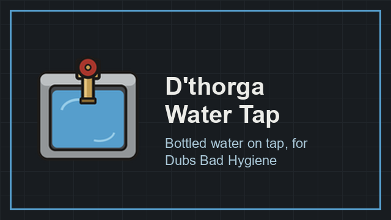
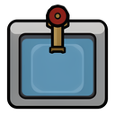
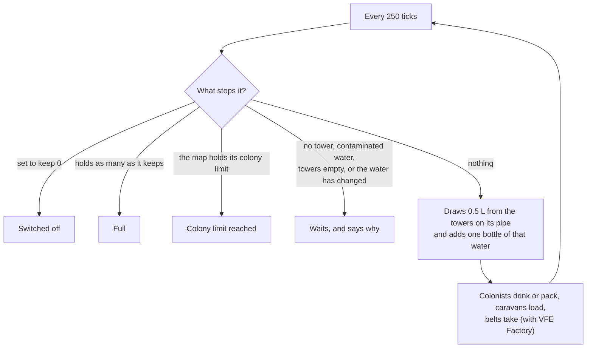

# Water tap

**D'thorga Water Tap** adds a small **Dubs Bad Hygiene** fixture that keeps a stack of bottled water ready and refills it by itself
from your water towers. Nobody has to stand at a basin filling bottles. [Back to the guide](README.md).

## Read this first (gotchas)

- **Needs Dubs Bad Hygiene with its thirst option on**, and D'thorga Framework. Without thirst there are no water bottles, so the tap
  doesn't appear. **Not for Dubs Bad Hygiene Lite**, or the full mod's lite mode: neither has plumbing.
- **It changes every water bottle in your game**: a bottle of untreated water now stays untreated when its stack is split (before,
  it came out clean by accident). Colonists on untreated water can now get sick from bottles, as from a basin.
- **Deconstructing a tap: lay a pipe back on its cell**, or your plumbing may be cut in two.

## Using it

1. **Research plumbing.** Find the tap under **Architect > Hygiene** (20 steel).
2. **Build it on a pipe or next to one.** It replaces a pipe it is built on and carries the water itself, like a basin.
3. Make sure **a water tower is on that pipe network**: the tap draws from towers only, like every Dubs Bad Hygiene fixture. Wells
   and pumps fill the towers. It needs no power.

It then makes one bottle every 250 ticks (up to 240 a day, half a litre each) until it holds as many as it keeps. Colonists drink
and pack bottles from it, and caravans load from it.

| Button | Does |
| --- | --- |
| **Fewer bottles** / **More bottles** | How many this tap keeps ready, 0 to 10, one at a time. At 0 it stops |
| **Colony limit -10** / **+10** | How many bottles the whole map may hold before every tap stops (starts at 50, up to 1,000). Raise it for a big colony or before a long caravan. Whichever tap you press it on, it sets the map's limit, and a click counts once however many taps are selected |

- **The limit counts bottles in storage and on the floor**, not in pockets and not riding on conveyor belts, so a long jammed belt can
  hold bottles above the limit.
- **Bottles stay put until someone drinks or packs them**: the tap's storage priority starts at Important. Lower it, or give water
  a Critical stockpile, and haulers carry bottles off while the tap refills, up to the limit.
- **Combat Extended**: a loadout with "drop undefined" drops the bottles a pawn packs, and haulers may carry them back to the tap. Add
  a water slot of 3 to it.

## What the tap says

The inspect pane always shows the map's count against the limit, and says what the tap is doing or the one thing it waits for:

| It says | What to do |
| --- | --- |
| Filling bottles / Full | Nothing |
| This map has reached its colony limit | Nothing, or press **Colony limit +10** if you want more bottles |
| Switched off | Press **More bottles** |
| Another item is on the tap | Have it moved |
| No water tower on this pipe network | Connect it to your plumbing |
| The water towers are empty | Get more water into the towers |
| The water is contaminated | Clear the contaminated water tower. The tap won't bottle this water |
| The water in the pipes has changed | Nothing: it fills again once the bottles here are taken |

## Water quality

Each bottle holds the water that filled it: treated or untreated. On a network with mixed towers, the bottle gets the worst of them.
Dubs Bad Hygiene checks this when someone drinks, the same way it checks a basin. For every water bottle in the game, not only the
tap's:

- **A bottle split off a stack keeps its water.**
- **Bottles of different water don't stack.** They are separate bottles.
- **Labels say so**: "water (untreated)". Treated water just says "water".

## Conveyor belts

With **Vanilla Furniture Expanded - Factory**, belts and factory machines can take bottles from the tap, as they do from a factory
hopper. With **D'thorga Factory Additions** the tap also gets the **Belts may take from here** switch, starting on
([factory](factory.md)). A belt empties the tap and it refills until the colony limit is reached, counting what the belt has
delivered; bottles still on the belt aren't counted.

The figures and the safe-removal steps are in [D'thorga Water Tap's README](../../mods/PhobosWaterTap/README.md); the notes for
modders are in [Water Tap for modders](../modding/water-tap.md).

## Tested in game

The owner has not yet passed anything in this chapter ([the test list](../development/in-game-test-pass.md)).

Everything in this chapter is not yet tested in game.
