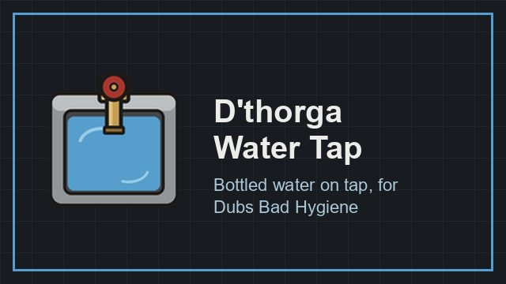

# Water tap

**D'thorga Water Tap** adds a small **Dubs Bad Hygiene** fixture that keeps a stack of bottled water ready and refills it by itself
from your water towers. Nobody has to stand at a basin filling bottles. [Back to the guide](README.md).

## Read this first (gotchas)

- **Not yet tested in game.**
- **Needs Dubs Bad Hygiene with its thirst option on**, and D'thorga Framework. Without thirst there are no water bottles, so the tap
  doesn't appear. **Not for Dubs Bad Hygiene Lite**, or the full mod's lite mode: neither has plumbing.
- **It changes every water bottle in your game**: a bottle of untreated water now stays untreated when its stack is split (before,
  it came out clean by accident). Colonists on untreated water can now get sick from bottles, as from a basin.
- **Deconstructing a tap: lay a pipe back on its cell**, or your plumbing may be cut in two.

## Using it

1. **Research plumbing.** Find the tap under **Architect > Hygiene** (20 steel).
2. **Build it on a pipe or next to one.** It replaces a pipe it is built on and carries the water itself, like a basin.
3. Make sure **a water tower is on that pipe network**: the tap draws from towers only, like every Dubs Bad Hygiene fixture.

It then makes one bottle every 250 ticks (up to 240 a day, half a litre each) until it holds as many as it keeps. Colonists drink
and pack bottles from it, and caravans load from it.

| Button | Does |
| --- | --- |
| **Fewer bottles** / **More bottles** | How many this tap keeps ready, 0 to 10. At 0 it stops |
| **Colony limit -10** / **+10** | How many bottles the whole map may hold before every tap stops (starts at 50). Raise it for a big colony or before a long caravan |

- **The limit counts bottles in storage and on the floor**, not in pockets and not riding on conveyor belts.
- **Bottles stay put until someone drinks or packs them**: the tap's storage priority starts at Important. Lower it, or give water
  a Critical stockpile, and haulers carry bottles off while the tap refills, up to the limit.
- **Bottles of different water don't stack**, and untreated ones say so: "water (untreated)".
- **Combat Extended**: a loadout with "drop undefined" drops the bottles a pawn packs. Add a water slot of 3 to it.
- **With VFE - Factory and D'thorga Factory Additions**, belts can take bottles from the tap ([factory](factory.md)).

The inspect pane says what the tap is doing, or the one thing it waits for: no water tower on its pipes, empty towers, contaminated
water (clear that tower first), or the colony limit reached.

The full detail is in [D'thorga Water Tap's README](../../mods/PhobosWaterTap/README.md).
