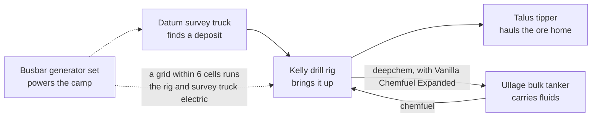
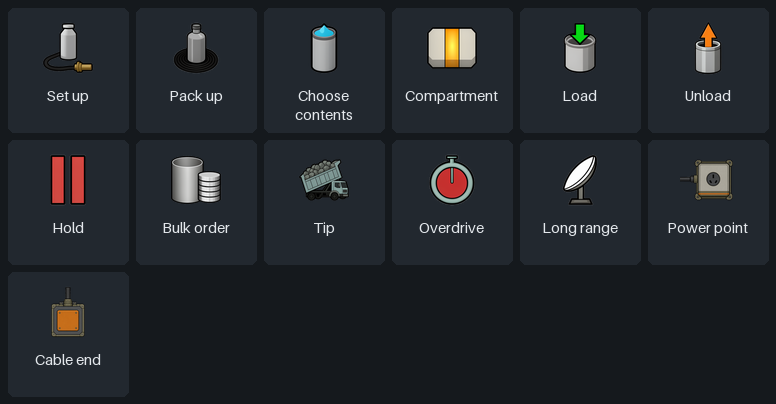
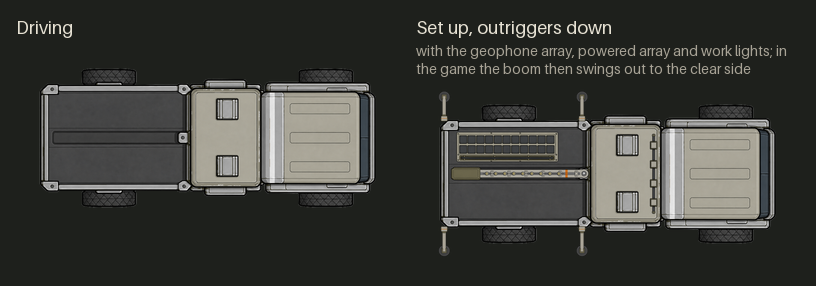
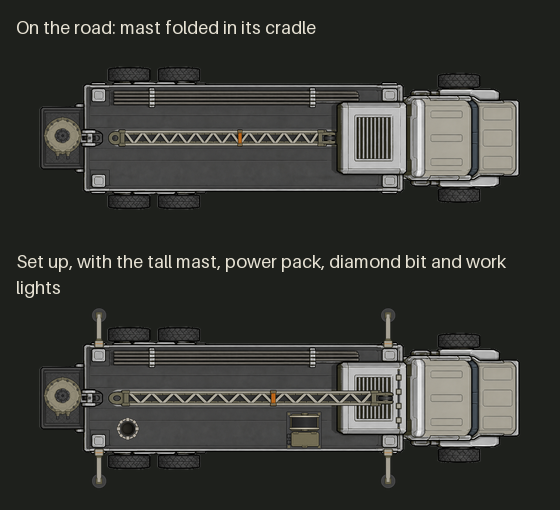
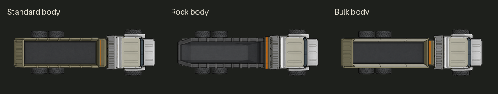
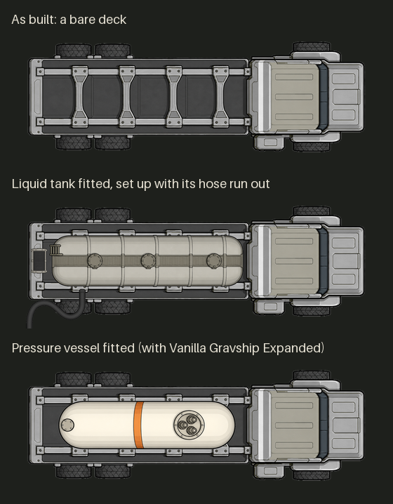
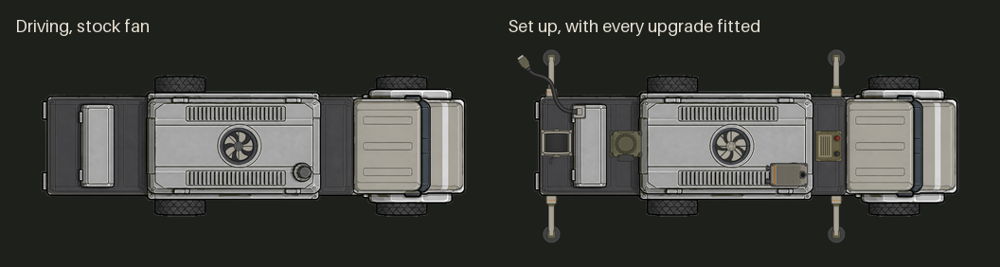

# Working vehicles

**D'thorga Vehicles** adds six vehicles that do a job: find ore, drill it, haul it, move fluids, power a camp, and explore under
the sea, and five trailers any of them can tow: a flatbed, two bowsers, the Billy field kitchen and a shower trailer. It also gives other mods' vehicles the figures their real counterparts have. The submarine has
[its own chapter](submarines.md); looking after any vehicle starts at [vehicle systems](vehicle-systems.md).
[Back to the guide](README.md).

## Read this first (gotchas)

- **Needs Vehicle Framework and D'thorga Framework**, loaded before it. RimWorld 1.7 only.
- **Each vehicle has its own research on the D'thorga tab**, after **vehicle parts** (the trailers after **towing and trailers**), and
  is built from the Architect's **motor pool** tab. Its upgrades need the research they name.
- **They are built from parts.** Make an engine assembly, transmission and kits at the **vehicle parts bench** first. Where
  RimThunder or Vanilla Vehicles Expanded is installed, a build asks for their parts instead.
- **To set up, someone must be aboard and the engine running.** Until then **Set up** (and the tipper's **Tip** and grab) is greyed out
  and says which is missing. Once it runs, the crew may get out: it works on by itself until it runs dry, its engine is switched off, or
  you pack it up. **If its engine stops, the work stops too**, and stays stopped even after refuelling until someone aboard starts the
  engine again.
- **A trailer has no crew: a colonist with construction work sets it up and packs it up** (the bowsers).
  **A set-up trailer cannot be hitched**: pack it up first.
- **The water bowser exists only with Dubs Bad Hygiene**, and not in its lite mode, which has no plumbing.
- **A vehicle that is set up cannot drive.** Its engine can still be started, but press **Pack up** before you move it.
- **Heavy trucks have air brakes**: after standing for hours, draft one and let it idle a few minutes before it will drive.
- **Heavy trucks have power steering**: a hit on its pump spills the fluid, and with it gone the truck crawls
  until the pump is repaired and topped up. **A laden or towing truck also wears its brakes and clutch faster** than an empty one.
- **A trailer goes on journeys with the vehicle towing it**, cargo and all ([towing a trailer](vehicles-on-the-road.md#towing-a-trailer)).
- **Before removing the mod, scrap every one of these vehicles**: they go with it.

## The fleet

*To scale: one game cell is the same size in every picture. The tanker is shown with a liquid tank fitted.*

Every name is a real word from engineering or earth science that says something true about the job. Each vehicle's description in
the game opens with its designation: the name, its first letter and a mark number. A refit adds a letter, as the Crawler's F1-S does.

| Vehicle | Designation | Size (cells) | Job | The name means |
| --- | --- | --- | --- | --- |
| **Datum survey truck** | D1 | 3 x 7 | Finds ore anywhere you can drive | The reference point every survey measures from |
| **Kelly drill rig** | K1 | 3 x 10 | Brings deep ore up fast | The square bar that turns the drill string on a rotary rig |
| **Talus tipper truck** | T1 | 3 x 8 | Hauls 2,400 kg and tips it in one go | The heap of broken rock at the foot of a cliff |
| **Ullage bulk tanker** | U1 | 3 x 10 | Carries and pumps fluids, buys them in bulk | The empty space a tank must keep above its load |
| **Busbar generator set** | B1 | 3 x 8 | A power station you can drive away | The bar that carries power into a grid |
| **Fathom seabed crawler** | F1, F1-S, F1-L | 4 x 9 | A small submarine ([its chapter](submarines.md)); set aside for now, off the build menu | The sailor's six-foot depth unit; to get to the bottom of something |
| **Pintle flatbed trailer** | P1 | 3 x 7 | A second load behind any land vehicle | The hook-and-ring coupling a drawbar trailer hangs from |
| **Pintle water bowser** | P2 | 3 x 8 | 2,500 litres of water to a camp (Dubs Bad Hygiene) | A bowser is a tank trailer, named after Sylvanus Bowser's fuel pump |
| **Pintle fuel bowser** | P3 | 3 x 8 | 2,500 litres of chemfuel to vehicles and generators | As the water bowser |
| **Billy field kitchen** | Billy | 3 x 8 | A kitchen tent at camp; cooks in a resting caravan | The camp billy, the pot every Australian camp boils |
| **V-22 Osprey** | V-22 | 5 x 9 | A tiltrotor: lifts off like a helicopter, crosses the world like an aeroplane | Its real name (real machines keep theirs) |
| **Pintle shower trailer** | P4 | 3 x 8 | Showers and toilets at camp (Dubs Bad Hygiene) | As the bowsers |

How they work together:

## Buttons the working vehicles share

- **Set up** and **Pack up**: every truck that works standing still sets up first. Its inspect pane then says what it is waiting
  for.
- **Overdrive** (drill rig and survey truck): doubles the pace while the engine runs flat out. Fuel goes 2.5 times as fast and the
  working parts wear. It switches itself off at half health on any working part, or if the engine overheats.
- **Power point**: the drill rig and survey truck set out a small power point. With a powered conduit or generator within 6 cells,
  they run off the grid instead of their engine. The setting **Power points have the larger socket** (off) changes only the point's
  picture, for the next one a truck sets out.
- **Progress bars** show how far a drilling portion, a survey or a pump has got.
- **Every vehicle sounds like itself**: its own engine start and stop, its own door, and an engine that rises as it revs, drops at
  each gear change and growls harder under load. The heavy trucks hiss their air brakes as they stop and splutter when the tank runs
  dry. Their work has its own sounds too: the tanker's hoses and pump, the tipper's rams and tailgate, the drill rig's hammer, the
  survey truck's boom and a soft tone for a find, the generator set running. **D'thorga sounds volume** in D'thorga Framework's
  settings turns them all down or off.

*In order: the tanker's five (liquid tank to hose reel), the drill rig's seven (diamond core bit to work lights), the tipper's
three, the survey truck's six (geophone array to groundwater), and the generator set's five.*

Upgrades are fitted in Vehicle Framework's **Upgrades** tab and show on the vehicle's picture. **Every upgrade shows at once**: a truck's own upgrades on the left and its armour kits on the right, the armoured cab always in the far column. Another author's tree too tall for the tab scrolls. **They cost what our fittings and tunes do** (from Framework 0.106.0): several hours' work and much more steel and components, more on a heavier vehicle, under the same two settings, *Time to fit and tune* and *Materials to fit and tune*.

## Armour and kits

- **Every service truck is armoured part by part**: skin, thin sheet metal that stops nothing aimed at it, as
  on a real civilian truck. The **Health** tab names each part's armour and what it stops. With Combat Extended, shots strike a truck
  across its full width.
- **Kits make a truck harder to stop.** Each is an upgrade on all five service trucks, after the **truck armour** research:
  - **Engine and tank guards:** the engine and fuel tank become rifle-proof. A guarded tank still leaks, and a guarded engine still
    burns, once they are finally holed: it takes heavier fire to get there. 300 kg.
  - **Run-flat tyres:** the wheels stop shell fragments and pistol bullets. 120 kg.
  - **EMP hardening:** an EMP harms the electrics less and stalls the engine less often, as on a military vehicle. 60 kg.
- **A kit's weight is carried as cargo**: the engine works harder and burns more fuel, as with the same weight aboard. **On the Talus
  it also comes off cargo room**; the other trucks keep their small stowage.
  - **Armoured cab:** bolted plates over the cab, rifle-proof. 1,000 kg. It shows on the truck.
  - **Heavy cab plates** (over the armoured cab, after **heavy truck armour** research): slabs and a visored windscreen that stop
    armour-piercing rifle bullets and heavy machine-gun fire. 850 kg more.
  - **Ram bar:** running into people, animals or walls harms the truck half as much, and what it hits more. 150 kg.
  - **Body plates** (Talus, Ullage and Kelly): skirts along both sides make the tipping body, tank or deck rifle-proof.
  - **Spall liner** (with Combat Extended; over the armoured cab, beside the heavy plates): panels inside the cab that catch the
    spall described below. Four **spall liner panels**, made at the parts bench after **truck armour** research. 200 kg.
- **Gun ring** (Talus, Kelly, Ullage and Busbar, after **truck guns** research, which follows truck armour and gunsmithing): a ring on
  the cab roof with a **gunner's seat**. On it, one gun, **swung by a gunner aboard**: a **7.62 mm machine gun** (all four), a **.50
  heavy machine gun** or a **40 mm grenade launcher** (Talus and Kelly; the launcher also needs mortars). The gunner is **exposed** until
  you fit a **gun shield**, plates that turn with the gun. Ring 120 kg, guns 40 to 110 kg, shield 180 kg.
- **Remote weapon station** (Talus and Busbar, **on the gun ring** instead of a gun, after **remote weapon station** research, which follows truck guns and gun turrets):
  a .50 heavy machine gun on a powered roof mount with a camera sight. **Nobody sits at it**: it fires only while a radio station's
  operator has the truck's picture (see [driven from a station](vehicles-on-the-road.md#driven-from-a-station)), or by itself when
  **"Remote guns fire on their own"** is on. **Without D'thorga Radio Framework it fires only with that setting.** It feeds from steel
  like other vehicle guns, draws the truck's battery while it tracks a target, and **stops without power** or when the cab is destroyed. 250 kg.
- **Smoke dischargers** (all five trucks, after **truck armour** research): two banks of four tubes at the front corners of the cab. **One
  button fires both**, throwing blinding smoke ahead and to each side; shots through smoke miss more often. **Each shot uses 5 chemfuel**,
  or **with Combat Extended a launcher smoke grenade**; colonists reload them from the cargo. 50 kg.
  - **Pop smoke when hit** (a switch on the truck, **on** to start): the truck fires them by itself when it is hit while enemies are
    about, then not again for 10 seconds. A fire or a stray shot with no enemy about does not set them off.
  - **Raiders' trucks with dischargers pop smoke too**, once each visit.
- **Ammunition locker** (Kelly, Ullage and Busbar, **on the gun ring**, after **truck guns** research): **150 kg of room for the truck's own
  rounds only**: what its guns and smoke dischargers fire (steel or chemfuel without Combat Extended, their rounds with it). **Other cargo
  goes in the truck's own small space**; if it spills over into the locker, the truck reads as **overloaded** until you take it out, and
  its cargo figure says why. 40 kg.
- **Extra mounts from other mods**, on the gun ring instead of one of our guns, worked by the gunner like ours:
  - **With GTek's MaxxPro:** its **M2HB** and **Mk 19**, on its own cupola (Talus and Kelly).
  - **With Frontline Workshop and Combat Extended:** its **M1919**, **PKM** and **MG3** (Talus, Kelly, Ullage and Busbar), and its
    **M2HB**, **DShK** and **Mk 19** (Talus and Kelly). They fire that mod's rounds.
- **With its armoured cab, the Talus may keep gathering while enemies are about**: in **Gather what**, set **When enemies come** to
  **keep working**. It starts on stop. Whoever drives it is still in the fight.

### Spall: what comes through a beaten plate

With Combat Extended only. **Any vehicle with rifle-proof plate or heavier**, ours and other mods' tanks alike:

- **A round that gets through the plate breaks the inside of it loose.** The pieces fly at whoever sits behind that plate and at the
  parts inside: a crew member can be wounded, a fuel tank holed. A round that only just gets through throws the most, because the plate
  takes most of the blow. Thin sheet metal throws nothing: rifle fire through an unarmoured truck hurts only by itself.
- **A heavy hit the plate stops can still shake a piece loose**: a shell bursting against it, or a round that very nearly got through.
  One piece, never a spray.
- **The spall liner catches most of it** and keeps the rest to one spot. It wears as it catches: its row on the **Health** tab reads
  *catches spall*, then *worn* (it catches less, and lets the rest spread), then *spent*. **Only liner panels put it right**: load them
  into the truck's cargo and a mechanic re-lines it, a panel for each quarter worn, once a whole quarter is gone. Ordinary repairs never
  mend it, and taking the upgrade off gives back only the panels' worth that is left. The cab's liner catches only what comes off the
  cab. A truck without the upgrade shows the liner as *not fitted*, in grey, and is not counted as damaged.
- **A spent liner is named in an alert**, *Spall liner spent*, until it is re-lined; the vehicle's **logbook** records when it wore
  through, and who was hurt by spall (once an hour at most for each vehicle).
- **Settings** (Mod settings, D'thorga Framework, Dangers, all on): *Beaten armour throws spall inside*, *Also on other mods'
  vehicles* and *Heavy hits shake spall loose*. Raiders' crews take spall exactly as yours do.

## Datum survey truck

1. **Research survey truck** (after Ground-penetrating scanner) and build it: it also takes 10 uranium.
2. **Park it outdoors with room beside it** and press **Set up**. Its boom swings out to whichever side is clear, about three cells
   from the middle of the truck. If both sides are blocked, it says so and will not set up.
3. **A colonist on Research work runs the survey**, at their research speed. The engine idles while they work, at about 6 to 8 chemfuel a day,
   or it runs off a grid within 6 cells of its power point at 700 W.
4. **Select the set-up truck to see what it has found.** Finds are the game's own deposits, with the game's odds and sizes.

| Fact | Figure |
| --- | --- |
| A first find | About 7 hours on average: ten times quicker than the game's scanner |
| Each later find on the same map | Takes longer than the last: one and a half times, up to eight times |

**Upgrades:** a **geophone array** (more steel) or a **radiometric probe** (40 uranium), not both; a **long-range array** that searches
nearby lands for one ore instead of this map, without the slowing that finds on this map bring (press **Long range**; a find becomes a
place on the world map to travel to); a **powered array** (three times as fast, 1,000 W, needs a grid or the battery); a **large
battery** (runs with the engine off; **the engine starts itself to recharge at 30%, burning fuel with nobody at the wheel**); work
lights. With Dubs Bad Hygiene, a **groundwater** upgrade shows the water while the truck is set up and marks the richest spot
within 15 cells. With Rimefeller, a set-up survey truck counts as the scanner a deep oil well needs.

## Kelly drill rig

1. **Research drill rig** (after Deep drilling) and build it.
2. **Reverse it up to a deposit** a scanner or survey truck has found: **it drills the cell behind its rear**. Press **Set up**; a
   ring shows its reach.
3. **A colonist on Mining work drills**, with the game's portions and their Mining skill. What comes up lands beside the hole, or
   **into storage of yours within 3 cells of the hole** (a bulk bunker, a hopper, a shelf) when its settings take it and it has room.

| Fit | Drilling speed against a deep drill |
| --- | --- |
| Bare rig | 10 times: a steel lump that takes a deep drill a month takes the rig about three days |
| Diamond core bit | 20 times |
| RC (reverse-circulation) hammer | 18 times on ore, 30 times once only stone is left |

**Fit one bit or the other, not both**: pick by the job.

- **It burns close to 100 chemfuel a day while drilling**, and nearly twice that in overdrive, because drilling takes half its engine:
  its 160 tank lasts under two days of drilling. (With the setting "Fuel use follows engine load" off, it burns a flat 40 a day.)
  Fit the **electric power pack** and have a powered grid within 6 cells to drill without fuel.
- **Drilling can bring insects**, by the game's own rule and your storyteller's odds. **A faster rig meets them sooner**: the risk per
  lump is the same as a deep drill's. **Keep guards near it.**
- **At night, without work lights, it drills at 80%.**
- **With Rimefeller**, the **oil well kit** sinks a well where no ore is in reach, using steel from the rig's cargo and needing what a
  derrick needs (a working console, or a scanner or set-up survey truck for deep oil). **Build a derrick over the well head to pump.**
- **With Vanilla Chemfuel Expanded**, the **deepchem head** raises deepchem into a 300-unit buffer at ten times a pumpjack's rate,
  though the buffer and the tanker's pump set the real pace. **Without the head, deepchem stays in the ground**, and it never comes
  up as items. Empty the buffer with a tanker holding deepchem, set up and loading within reach of its hose, or a deepchem pipe.

## Talus tipper truck

1. **Research tipper hauler** (after Electricity) and build it.
2. **Load it through its ordinary cargo window**: 2,400 kg, such as 96 granite chunks or 4,800 steel.
3. **With a driver aboard and stopped, press Tip.** Everything in its cargo lands in the outlined half-circle behind it,
   **including any spare parts you loaded**. Whatever will not fit stays aboard, and it says how many.

**Tipping into storage.** A storage building of yours inside the outlined half-circle (a bulk bunker, a hopper, a shelf) takes
whatever its storage settings allow, nearest cell first. **When it is full, the rest of those things stay aboard** instead of spilling
beside it; things it would not take still go on the ground, so a mixed load comes off in one tip. The message says how many stacks
went into storage.

**The bulk bunker** (research tipper hauler, Architect, **motor pool** tab; 120 steel) is built for this: an open 3 by 4 bay that
holds 8 things a cell, **96 chunks, one full load**. Build it with its open end (the striped wheel stop) where the truck will reverse
up to it, back the truck's tail to the stripe and press Tip.

- It starts set to take **chunks**; tick anything else in its storage settings.
- **Haulers fill it with chunks lying about the map**, as any stockpile that takes chunks. To keep it free for the truck, lower its
  priority or untick chunks until you need it.
- Its goods lie on its cells like a shelf's, so **belts take from it as from a factory hopper** (with VFE Factory), a factory machine's
  input cell on it reads that cell, a paste dispenser beside it draws from the cell it touches, and **The Dead Man's Switch's automatic
  benches link to it** like their own feed hopper.

**The loading chute** (research tipper hauler, Architect, **motor pool** tab; 30 steel) is a one-cell funnel that drops whatever
lands in it into the cargo of a vehicle parked across its **spout**, the cell it points at (outlined when you select it). Bring goods
by belt or by hand. **It starts set to take nothing: tick what it should load.** With no vehicle there, or a full one, it holds up to
four stacks and the belt behind it waits; its inspect line says what it is waiting for. Its picture is a stand-in.

**Nobody aboard? Press it anyway.** Deliver and Gather pressed with no driver aboard make the truck **wait for a driver**: a colonist
with **Drive** work (tick it in the work tab: it starts off for everyone) walks over, takes the wheel, and the work starts. The button
then reads **Stop waiting**, to call it off. With Vehicles at Work, Drive is that mod's own work, and its drivers list for the truck
decides who may come.

**Unloading by itself: Deliver.** Every storage building and every stockpile zone has a **Vehicles may unload here** button. **The
bulk bunker starts with it on; everything else starts off.** With a load aboard (from the cargo window, the drill rig, a chute), put
someone aboard who can drive and **press Deliver**:

1. The truck drives to the nearest marked storage that takes something aboard and has room, backs up with its tail against it (a
   bunker from its open end) and tips **only what that storage takes**.
2. When that storage is full, or takes nothing more of what is aboard, it moves on to the next marked one.
3. **Spare parts stay aboard.** Anything no marked storage takes, or has room for, stays aboard too, and the message says so.
4. **Afterwards**, with **Drive back after delivering** on (the default, a switch beside Deliver), it drives back to where it started
   and faces the way it faced, ready to be loaded again. Switched off, it stays at the last place it unloaded. Each truck keeps its
   own choice.

- **It stops if enemies come**, or at any other order, as gathering does; one message says how much it put down in how many stops.
- On a stockpile zone it tips onto the cells behind it, so some may land just outside; your haulers carry them in.
- **Deliver is greyed out with the reason** when nothing aboard can go anywhere: nothing marked, nothing that takes the load, or
  everything full.

**Loading from storage.** Every storage building has a **Vehicles may load from here** button, off to start. Switched on, the
loading grab may lift goods out of it, so belts or haulers can fill a bunker or a shelf while the truck is away and the grab takes the
lot when it comes. The grab never lifts from another faction's storage, or a thing a colonist is already on the way to carry.

**Upgrades:** **greedy boards** (taller sides, +600 kg), and either a **rock body** (tips half as fast again) or a **bulk body**
(3,600 kg, tips slower). And a **loading grab**, a small crane that shows folded behind the cab once fitted:

- **With a driver aboard and stopped, press Work the grab.** It lifts loose things lying within 4 cells (the blue outline) into the
  cargo, up to 500 kg a lift, every 20 seconds or so. **Each lift takes the nearest thing and the same kind lying within 2 cells of
  it**, so a heap of granite chunks comes up about 20 at a time. Nobody else has to carry.
- **It leaves things in a stockpile or on a shelf**, forbidden things and corpses, unless that storage has **Vehicles may load from
  here** switched on (above).
- It stops by itself when nothing is left in reach or the cargo is full, and says how much came aboard.
- **It cannot tip while the grab is out.** Press Stow the grab first.

**Gathering by itself.** With the loading grab fitted, the Talus gets two more buttons:

1. **Press Gather what** and choose what it fetches, exactly as for a stockpile. It starts with **chunks and raw resources**
   (steel, wood, silver and the like). The buttons at the top keep it inside one of your areas (or anywhere), and choose **where it
   unloads**: nowhere, **any marked bay** (every storage with **Vehicles may unload here** on, nearest with room first, moving on
   when one fills), or one of your storage buildings or stockpiles that takes something it gathers.
2. **Put someone aboard who can drive, and press Gather.** It starts its engine, drives to the nearest loose things you chose, stops
   about five cells from them, lifts everything you chose within reach, and moves on to the next pile.
3. **When its cargo is full:**
   - **With somewhere to unload,** it drives there, backs up with its tail against it and tips what it gathered, then goes back out.
     **A bulk bunker is always backed up to from its open end** (the striped wheel stop); a stockpile or a shelf from whichever side is
     nearest. When nothing is left to gather it tips the last of its load there and stops.
   - **With nowhere to unload,** it stops where it is: drive it home and tip it yourself.
4. **One message at the end** says how many loads and kilograms it gathered from how many places, how much it tipped on how many trips,
   and why it stopped. If it started the engine, it switches it off again.

- **It tips only what it gathers.** Anything else in its cargo, such as spare parts, stays aboard.
- **If its unloading place fills up, the run ends** and says so; what would not fit stays aboard. Leave room in the bunker, or set
  belts or haulers to empty it. **Set to any marked bay, it moves on to the next marked storage instead**, and ends only when none
  is left with room.

- **It only takes loose things.** It leaves stockpiles and shelves alone, and anything forbidden, anything a colonist is about to carry,
  and anything under the fog. **To keep something where it lies, forbid it.**
- **It works at the grab's pace**: a lift every 20 seconds or so, each taking up to 500 kg of one kind lying together. Chunks lying in
  heaps come up quickly; chunks scattered one here and one there take a lift each, and a drive between.
- **It stops if enemies come**, leaving its engine running so you can move it at once. Any other order you give it, a right-click
  somewhere, switching its engine off or pressing Stop gathering, ends the run too.
- Its inspect line says what it is doing: choosing, driving to something, or lifting, with what it has gathered so far.

## Pintle flatbed trailer

A two-axle flatbed as wide as the trucks that tow it: 2,800 kg empty, 5,000 kg of cargo, with low sides and a drawbar. Its one upgrade, the greedy boards (+1,000 kg), shows as
taller side boards. **It is also a camper trailer**: its deck takes a roof tent and an awning, and unhitched it
pitches a camp of its own ([camping](camping.md#camping-awning-roof-tent-and-swags)).

1. **Build it** from the **motor pool** tab, after **towing and trailers** research.
2. **Load it** through its cargo tab while it stands unhitched.
3. **Hitch it**: select a land vehicle, press **Hitch a trailer** and pick the trailer, within 8 cells. A colonist who hauls walks over and
   couples it, and it is set straight behind the vehicle.
4. **Drive.** The trailer follows on the map, cuts inside corners and can be shot. The vehicle keeps off walls and fences where it can,
   and looks for another way round where the trailer would not fit. **If the trailer would still run into a wall or another vehicle,
   the vehicle stops and says so**: choose a more open way, or unhitch.
5. **Unhitch** (on the vehicle or the trailer) leaves it where it stands, loaded, for later.

**Its weight is the towing vehicle's to pull.** A full trailer slows a small truck, runs its engine hotter and costs fuel; on mud or a
hill only the vehicle's own wheels grip. Only vehicles the drivetrain model works out can tow, unless you turn on **Vehicles without the
drivetrain model can tow** in D'thorga Framework's settings. A broken drawbar must be repaired before it can be hitched.

## Pintle water and fuel bowsers

Two tank trailers, 3 x 8 cells, as long as the Busbar: a **water bowser** (only with Dubs Bad Hygiene) and a
**fuel bowser**, and with Vanilla Nutrient Paste Expanded a third, the **paste bowser** (green stripe; nutrient paste only, filled from and emptied into paste pipes, paste meals or a tanker, and it fills the Billy's paste tap; the paste keeps 4 days, 8 lagged). Each holds 2,500 litres, weighs 2,000 kg empty and pumps 400 litres an hour. They take the load to where it is needed
and stay at a camp while the truck that brought them leaves. Both look alike, a tank on the flatbed's chassis: **a blue stripe along
the tank means water, an orange one fuel** (repaint either as you like).

1. **Build** from the **motor pool** tab, after **towing and trailers** research (the water bowser also needs Dubs' **plumbing**).
2. **Park it** where the load is wanted, unhitched, and press **Set up**. A colonist with construction work comes, chocks the wheels,
   lowers the legs and runs the hoses out (1,500 work: about half an hour for an average builder). Until then the inspect pane says
   it waits for a colonist, and **Cancel set-up** calls it off.
3. **Load** or **Unload**, as on the tanker. Each tank holds only its own load, already chosen.
   - **Fuel bowser:** takes chemfuel from stacks beside it, from a chemfuel pipe (Vanilla Chemfuel Expanded, Rimefeller) or from a
     tanker; gives it to vehicles and fuelled buildings within reach of its hose (10 cells), or to a tanker.
   - **Water bowser:** takes water from plumbing with a water tower on it, or from a tanker of water; gives it to the water towers on the
     plumbing it touches. Parked, it lays hidden plumbing under itself, so a pipe touching any side joins it. It keeps the worst water
     it was filled with. **Water freezes in it below 0 °C.**
4. **Tank to tank:** one tank set up on **Unload**, another within reach of its hose on **Load**, both holding the same: the loading one
   pumps from the other at its own pump's rate. The tanker fills a bowser this way, and a bowser fills the tanker. **One of the two
   needs a working pump** (see below): two bowsers with no electric pump between them move nothing.
5. **Pack up** before you hitch it (1,000 work). A colonist comes for that too, and the pump holds at once. **A bowser cannot be
   hitched while it is set up, or while a colonist is on the way to set it up.**

**Its weight is the towing vehicle's to pull**: a full bowser weighs about 4.5 tonnes with water, 4 with fuel.

**A trailer has no engine, so its pump needs the Electric pump upgrade and power.** Without both, a bowser works **by gravity only**:
it can still be **filled** (plumbing, a chemfuel line or stacks put load in), and **emptied by a pump beside it** (the tanker, or a
trailer that has one), but it **pushes nothing out by itself**, and its inspect pane says so. With the pump fitted, it runs off:
- **the grid**: run a conduit to any side of the parked trailer, and the grid pays the pump's 750 W while it pumps;
- **a power point** a trailer has set out (the shower trailer's, while its tent is up);
- **the towing vehicle's battery** (the shower trailer, which pumps while hitched to a vehicle that has stopped): its Systems tab
  gains a **trailer pump** line, about 60 amps on a 12-volt vehicle, so a long pump-out runs the battery down.

**Upgrades:** a **lagged tank** (the load takes four times as long to reach the outside temperature, so water freezes later and fuel
stays thin longer in the cold; it shows as a padded jacket) and a **second hose** (half as much again an hour; a second reel across the
front), and the **electric pump** above. The pump has no sound of its own yet; the hoses, relief valve, leaks and purges sound as the tanker's do.
- **Reverse-osmosis kit** (Dubs Bad Hygiene only; an upgrade, drawn as a cabinet on the water bowser's rear deck): **Treat water** passes the tank's untreated water (from a river, a bore or a well) through its membrane, **about 470 litres an hour**, and it comes out **clean to drink**. **A quarter of what passes runs off as reject**, so you end with less than you started with. It draws **1,500 W**: from the grid through a conduit touching the bowser where it is parked, or from the lead of the vehicle towing it, on a map or on the road (a 12-volt tow vehicle's battery runs down fast while it stands). Its membrane wears: **a mechanic fits a new membrane cartridge** (made at the vehicle parts bench) when it is spent. The button says how much is left to treat and how much membrane is left.

## Billy field kitchen

A kitchen on a 3 x 8 trailer, named for the camp billy. **It cooks with the game's own cooking**, so your
cooks, bills, ingredients and food poisoning work exactly as at home.

1. **Build** from the **motor pool** tab, after **field kitchen** research (after towing and trailers and electricity). The second range
   and the big kettle also need **field catering at scale**.
2. **Park it** with a **clear patch beside it: 6 cells out from its side, as long as the trailer** (no buildings, items, trees or
   people; either side will do). Press **Set up**. A colonist with construction work comes and pitches the tent (about an hour's
   work). If there is no room, the button is greyed out and says what is in the way.
3. Beside it stands a **canvas kitchen tent**, a real room with a canvas roof, so cooking there is **not** the slower, riskier cooking
   outdoors. Inside: a **field range**, a **field kettle**, a **shelf for meals**, a **cold box** and a **lamp**. A **power point** stands
   outside the flap.
4. **Fuel** the range and kettle with **chemfuel or wood**, and give them bills:
   - **The range** cooks everything your stoves cook, other mods' recipes too.
   - **The kettle** cooks **simple or fine meals ten at a time**, for less work than ten single meals.
5. **Power is a bonus, never a need.** Wire the power point to a grid or the **Busbar**'s cable end (within 6 cells, as any building
   wires) and the range and kettle work **a quarter faster**, the **cold box keeps raw food at 4 °C**, and the lamp lights.
6. **Pack up** before you tow it. Everything goes back aboard with its fuel, bills and contents; anything lying on the tent floor stays
   on the ground. **Packing up waits while someone is cooking.**

**On the road:** while a caravan rests for the night, its cooks turn **raw food from its packs into simple meals** at a Billy it carries,
on its own or hitched behind a vehicle: **up to 20 a cook**, burning half a unit of fuel a meal from the kitchen's burners, or chemfuel
and wood in the packs. **The cooks also reach whatever the caravan tows**: raw food and fuel loaded into the
Billy itself, into its packed cold box, or into another trailer on the hitch. Raw food goes nearly twice as far that way. Turn it off with **Field kitchens cook in a caravan** in
D'thorga Framework's settings.

**Water on the road** (with Dubs Bad Hygiene): the water a caravan carries in tanks is used. A thirsty
person **drinks from the tanks first** (1.5 L a drink), before their bottles. While the caravan stands still, anyone grubby **washes**:
5 L from a basin's worth, or a proper **20 L shower** when the shower trailer is along. **The kettle now needs its water on the road
too: 1 L a meal**, from the Billy's own tank first, then any bowser. **Fill the Billy's tank or bring a bowser, or the caravan's cooks
make nothing** and a message says why. Any tank holding water counts: a water bowser, the shower trailer, the Billy's own, a tanker
in the line. Tanks never fill themselves.

**The cold box on the road**: packed for the road, the cold box runs through the trailer's lead from the
vehicle that tows it. That vehicle's Systems tab gains a **trailer cold box** line (100 W: about 8 amps on a 12-volt vehicle, 4 on a
24-volt one) with its own switch, drawing only while the box holds food. While it runs, the food stays at 4 °C; switched off, shed
by a failing alternator, on a flat battery or unhitched, it is only a box. **Food in a trailer ages on the road like any cargo**: a
towed trailer is no freezer.

**Food in a towed trailer is eaten on the road**: once the caravan's own packs run out of anything a person
can eat, they eat from the cargo of whatever it tows, and the caravan's days of food count it, on the world map and when forming a
caravan.

**Driving through the night**: a caravan that never stops has no night's rest to cook in, so **its kettle
simmers on the move**: riders who are not driving or crewing make **half as many meals each** (up to 10), for the same fuel a meal.
Prefer a proper stop? Select the caravan and switch on **Meal halts**: it then stops **for an hour** each night, every cook works at
the whole kitchen as at camp (up to 20 each), and it drives on. With nobody but drivers and gunners aboard, the kettle stays cold and
a message says so.

**Lines and plumbing**: a Billy parked unhitched keeps Dubs Bad Hygiene's plumbing and its own water tank
beneath it **even while packed**, so you can fill it from a water bowser or plumbing before you set off. Set up, its tent's floor and
walls carry the hidden pipe of **every line its pieces use**: run a **chemfuel line** to any side of the tent and the range, kettle and
heater refill themselves. The same goes for the shower trailer's boiler and a camp's heater.

**With Dubs Bad Hygiene, the kettle needs water:** 10 L a batch, from **Billy's own 200 L tank**. Fill it from a water bowser parked beside
it (bowser on **Unload**) or from plumbing; its inspect pane shows how much is left, and without water the kettle's bills wait and say why.

**Paste**: any stove, and the Billy's range, can **bake paste**: two paste meals and a little raw food make three paste bakes, people's simple meal; **fine paste bake** (a cook of 6) makes two fine meals from one paste meal with meat and vegetables, on the Billy only with the paste kitchen. With Vanilla Nutrient Paste Expanded, the **paste kitchen** upgrade sets a **paste tap** in the tent (150 meals, 400 with the **bigger paste tank**): park a paste tanker or bowser within 10 cells on **Unload** and it fills the tap; colonists eat from it as from a dispenser, no power needed, and it packs up with the paste in it.

**Upgrades:** a **second range** (two cooks at once), a **big kettle** (meals twenty at a time), an **insulated tent** (a chemfuel heater
keeps the tent at about 15 °C, burning about 2 chemfuel a day **only while it is cold**), and a **dining annex** (a second tent in front
with a table and four chairs; needs 6 more cells clear in front). With Dubs Bad Hygiene: a **wash-up basin** (a cleaner tent, so less food
poisoning) and a **bigger water tank** (600 L). New pieces appear at the next set-up.

It looks like an olive kitchen box van with canvas shutters and a stove chimney. Its burners murmur while someone cooks, kept low on purpose.

## Pintle shower trailer

**Only with Dubs Bad Hygiene** (not its lite mode). The field ablutions block: a 3 x 8 trailer with a 2,000 L
water tank, two showers and two flushing toilets.

1. **Build** from the **motor pool** tab, after **field ablutions** research (after towing and trailers, and Dubs' plumbing and septic
   tanks).
2. **Park it** with a clear patch beside it (5 cells out, 6 along) and press **Set up**. A colonist pitches a **canvas shower tent**
   with **two showers and two toilets** inside, a **water heater** outside the tent and a **power point**. Everything is plumbed into
   the trailer.
3. **Fill its tank**: set a water bowser beside it on **Unload** and the shower trailer on **Load**, or fill it from plumbing with a
   water tower. Every shower and flush comes off its tank. **No need to set it up first**: the shower trailer shows **Load**,
   **Unload** and **Hold** while packed too, parked or on a hitch whose vehicle has stopped. To pump its water **out**, it needs the
   **electric pump** and power, as the bowsers do (above); filling needs neither, but one of the two tanks needs a pump.
4. **Fuel the water heater with chemfuel.** It burns only while the showers want hot water. Plugged in, it **burns half the chemfuel**.
   Without hot water, people wash cold and dislike it.
5. **The waste tank** fills as the toilets are used (about 70 flushes); **showers add nothing to it**. It stays beneath the trailer
   whenever it is parked unhitched, **set up or packed**, and its inspect pane shows how full it is. Four ways to empty it:
   - **Sludge drums**: your colonists empty it at the level its **Empty at** button sets (10, 25, 50 or 75 % full, or never; 50 % to
     start, as Dubs' septic tanks).
   - **A sewer**: plumb it to a septic tank, treatment plant or sewage outlet, and its waste drains into them by itself, about 300
     units an hour (the whole tank in a little over three hours). **Your colony's toilets never drain into the trailer.**
   - **A sludge tanker**: the tanker, set to fecal sludge and parked against the trailer's rear on **Load**, pumps it out.
   - **The dump valve**: **Open dump valve** lets it run onto the ground beside the trailer as Dubs' sewage, which fouls the ground,
     smells and can make colonists who walk through it ill. It closes by itself when the tank is empty. Turn the button off with
     **Trailers can dump waste on the ground** in D'thorga Framework's settings.
6. **Pack up** before towing: the water in its pipes goes back into the tank, and the waste stays aboard. Hitching takes the waste tank
   up too, with its waste, and closes the dump valve.

**Upgrades:** the water bowser's **lagged tank**, **second hose** and **electric pump**, and a **third shower**.

## Ullage bulk tanker

1. **Research bulk tanker** (after Electricity) and build it. It comes with a bare deck.
2. **Fit a tank** in its Upgrades tab: a general, insulated or high-volume liquid tank, or a **pressure vessel** with Vanilla
   Gravship Expanded. One tank at a time. **The tanker's other upgrades branch from the tanks**: the compartments need a liquid
   tank, and the electric pump and second hose reel need any tank. **Compartments must come off before their tank can**; the pump
   and hose reel stay on the truck when you swap tanks. The Upgrade and Remove buttons say what to fit or take off first.
3. **Choose contents.**
4. **Park it on or beside** the pipes, stacks or vehicle you want, and press **Set up**.
5. Press **Load** or **Unload**. The inspect pane says what the pump is waiting for. **Hold** stops the pump.

**Stacks pumped out go into storage first**: a storage building of yours under or beside the tanker, such as a hopper at the start
of a belt, takes what its settings allow before the rest is set down beside it.

**Electric pump** (an upgrade): the pump runs off the engine unless this is fitted. With it, the tanker can set up and pump with the
engine off, on its battery, until the battery is flat; then the pump waits and the inspect pane says why. Someone still has to be
aboard to set it up.

| It carries | Pumped to and from | Watch out for |
| --- | --- | --- |
| Chemfuel | Other vehicles' fuel tanks, generators and other buildings that burn it within reach of the hose (filled first, to the level set on each), stacks, Vanilla Chemfuel Expanded's pipes, Rimefeller's pipeline | Thickens and pumps slowly in deep cold, only with the setting **Fuel thickens in deep cold** on |
| Deepchem (Vanilla Chemfuel Expanded) | The drill rig's deepchem buffer, Vanilla Chemfuel Expanded's pipes | As chemfuel |
| Crude oil (Rimefeller) | Stacks and barrels on the ground, Rimefeller's pipeline | None |
| Water | Dubs Bad Hygiene's plumbing | Freezes below 0 °C |
| Nutrient paste (with Vanilla Nutrient Paste Expanded) | Its pipes, then paste meals in stacks beside it | The whole load spoils after **4 days** above 0 °C; the insulated tank doubles that to 8. **It keeps what it was made from**: vats it fills, and meals set down, carry the same ingredients, so cannibal and vegetarian rules still see them. **On the road a caravan eats it** (one unit a meal) once its packs and trailers hold nothing anyone can eat, and counts it in its days of food |
| Hemogen | Its pipes | The whole load spoils after about 18 hours above 0 °C; the insulated tank doubles that |
| Astrofuel, oxygen | Vanilla Gravship Expanded's pipes | Oxygen vents in a fire or great heat |
| Beer, insect jelly, wort | Stacks on the ground | Wort spoils after 5 days above 0 °C |
| FSX, prometheum (Combat Extended) | Stacks on the ground | A hit may set off FSX; prometheum needs the pressure vessel and any spill burns |
| Toxic sludge (Biotech) | Wastepacks | Dissolves after 8 days above 0 °C and pollutes the ground |
| Fecal sludge (Dubs Bad Hygiene) | Septic tanks and barrels | It is what it is |
| Napalm (Rimefeller) | Stacks and barrels | |

**With Rimefeller:** park the tanker with its engine off against a Rimefeller pipeline, with its compartment set to crude oil or
chemfuel. It lays Rimefeller's hidden pipeline beneath itself and pumps to and from Rimefeller's storage tanks; the pipeline under it
goes when it drives off.

- **An empty tank must be purged before it carries something else**: press **Purge the tank** to send the nearest free colonist, or
  select a colonist and right-click the truck (four in-game
  hours; it takes water with Dubs Bad Hygiene).
- **Taking a tank off with a load in it spills the load.** A damaged tank leaks; a destroyed tank of something flammable explodes,
  more violently the fuller it is (turn off **Flammable tank loads explode** and it only spills). A full tank slows the truck.
- **Compartments**: two upgrades split a liquid tank into two, then three, so it can carry different fluids at once. They share the
  capacity equally. Use **Compartment** to choose which one the pump and contents work on. **Food can't share a tank with anything
  else**, and the contents menu says so. Turn off **A tank needs upgrades for compartments** to give every liquid tank its
  compartments free.
- **Bulk buying**: take the tanker in a caravan to a settlement, pick the compartment and press **Bulk order**. Choose how much with
  the same number box and arrows as the trade window. You pay the game's price with the caravan's silver; what is on offer depends on
  what the settlement trades, only fluids that exist as items can be bought, and the same fluid can't be bought there again for 15
  days. Visiting traders don't sell by the tanker-load.
- **Reverse-osmosis kit** (Dubs Bad Hygiene only; an upgrade, drawn as a cabinet on the Ullage behind the cab; it needs a liquid tank): **Treat water** passes the tank's untreated water (from a river, a bore or a well) through its membrane, **about 470 litres an hour**, and it comes out **clean to drink**. **A quarter of what passes runs off as reject**, so you end with less than you started with. It draws **1,500 W**: from the truck's own electrics, about 62 A, alongside the electric pump; with the engine off it runs the battery down. Its membrane wears: **a mechanic fits a new membrane cartridge** (made at the vehicle parts bench) when it is spent. The button says how much is left to treat and how much membrane is left.

## Busbar generator set

A medium diesel-electric truck, 3 by 8 cells like the Talus tipper: its engine turns a generator, electric motors drive the back axle, and parked it feeds your grid.

1. **Research generator truck** (after vehicle electrics) and build it.
2. **Press Set up** (with someone aboard and the engine running) and choose how to join the grid: **Run the cable out**, and a
   **cable end** appears where you choose: wire things to it, or touch a conduit to it; or **Join through conduits beneath it**, and
   hidden power conduits are laid under the truck (shown in the power overlay), so any conduit touching it is on its power.
3. It cannot move until you press **Pack up**.

| Fact | Figure |
| --- | --- |
| Output at full health | 2,000 W (2,650 W with the uprated alternator) |
| Fuel | Follows what the grid draws: 2 chemfuel a day doing nothing, 15 a day flat out, or 15 a day whenever batteries on the grid have room |
| Economy | 60% of the game's chemfuel generator: you pay for being able to drive it away |
| Stops when | The tank runs dry, the engine or traction generator is destroyed, or damage takes it under 400 W. Its inspect pane says which |

**Upgrades:** an **uprated alternator** (2,650 W); a **cable reel** (put the cable end up to 12 cells away); a **battery buffer**
that keeps the grid alive for a time when the engine cannot; a **heavy-duty fan** that cools a parked engine as well as driving does,
for hard work in hot weather; and an **exhaust heat exchanger** that warms the room its cable end stands in, up to 21 °C, for 25 W
of output. **Put the cable end inside the room you want warm**; outdoors the heat is wasted.

**A vehicle of ours parked beside the cable end, or beside a conduit on its grid, counts as plugged in**, as with any grid. Vehicle
Framework's own electric vehicles need a battery on the grid to charge.

**With the battery buffer fitted, the set is a hybrid**:

- **Press Battery drive** to move it with the engine off: slowly (about a third of its speed), quietly, burning no fuel, about 300 cells
  on a full buffer.
- **Out of fuel, it creeps on the battery by itself**, so you can limp it to a tanker or a fuel dump. When the battery is flat it stops
  and says so.
- **The engine fills the battery again while it runs.** The inspect pane says how far the charge will carry it.

The **service lead** charges another vehicle's battery in the field:

- **With the set set up and running, press Run the service lead** and pick one of your vehicles within 6 cells.
- It charges that vehicle's battery while it stays in, and **starts it at once if the battery is too flat to start**. No other
  vehicle, kit or booster pack is needed.
- It takes 300 W before your grid does, so the camp gets less while the lead is in.
- It comes out by itself if the set packs up or either vehicle moves away. Select the set to see the lead drawn to its vehicle.

**Pack it up before removing the mod**, or a cable end is left behind that does nothing.

## V-22 Osprey

Our first aircraft, the Bell Boeing V-22: research **tiltrotor aircraft** (after turbine engines) and build it at the motor pool.

- **Crew:** two pilots, both needed; a crew chief at the ramp; 24 seats in the cabin. **It carries 5,600 kg.**
- **Built from aircraft parts**: make them at the vehicle parts bench first. Two gas turbine assemblies, two
  reduction gearboxes, four flight computers and three hydraulic actuators, besides steel, plasteel for its airframe and rotor blades,
  and components. RimThunder's turbines stand in for ours where it is installed, and Rimefeller's composite for the blades' plasteel.
- **It takes off and lands straight up** and flies between places at 17.5, twice as fast as any helicopter.
- **Fuel:** a 1,500 chemfuel tank that burns 200 a day. It is thirsty: plan its trips.
- **Its weights and engines are the real machine's**, so it lifts less on a hot day or high up, and with a full cabin flies below the
  height where its passengers would need oxygen.
- **Paint it:** the grey takes your main colour, the orange bands your second.
- **Its rotors spin when it is drafted**, and on take-off its nacelles tip forward as it climbs away.
- **It flies over the map**: draft it with its two pilots aboard and press **Take off**. Then **Fly to** a
  spot, or right-click the ground; **Hold here** stops it; **Land here** shows its outline at the mouse, turns with the usual keys, and
  needs open sky and firm ground with nothing built or growing on it. It flies over walls, rivers and buildings, its guns fire from the air, and
  nobody boards, unloads or steps out until it lands. **To go to another place**, press the launch button, on the ground or in the
  air: it flies to the map's edge on that side and leaves from there. **Arriving**, it comes in over the edge it flew from, already
  flying, and lands on the spot you chose, or holds over a map it attacks for your orders.
- **A landing ends with the engines off**: once it touches down, rolls in or comes down hard, it stands
  parked and burns nothing. **Draft it again to start the engines before taking off.** The stock helicopters that fly on our flight
  (the Cherokee, Louie and Mosquito, with the setting **Stock helicopters fly over the map**) do the same, and their rotors spin up
  while their engines run and run down after.
- **Switching its engines off in the air lands it**: it sets down on the nearest clear spot within about 15
  cells and shuts down there, or says why it cannot. **A take-off waits a few seconds for the rotors** to reach speed, and the stock
  helicopters now sound their rotors all through a flight.
- **Too heavy to lift straight up, it rolls**. On a hot day, high up or fully loaded it may be a little too
  heavy to hover, yet still able to take off rolling along a strip: **select it and the strip it needs is outlined ahead of it, green
  when clear, red when blocked**. Take off or the launch button rolls it 5 to 20 cells straight ahead the way it faces, longer the
  heavier it is, and the buttons say how long a strip it needs. Clear the strip or turn it to open ground. Heavier still, it cannot
  take off at all, and the button says about how much to unload. **While it cannot hover it circles** wherever it would otherwise
  stop: after a rolling take-off, at a spot you send it to, or when you press Hold here. **Land here** lands it rolling: it touches
  down at the spot and rolls on 20 cells ahead, so keep that ground clear too; if it is not clear when it gets there, it circles
  over the spot and says so.
- **Circle here**: pick a spot and it flies round it until you give another order. The button beside it,
  **Circles: wide, clockwise**, picks tight, wide or very wide (12, 19 or 30 cells out) and the way round.
- **Where it lands matters**. Each time it lifts off or touches down on **loose, dry soil or sand**, the dust
  wears its engines a little: about seventy such trips wear a new engine right down unless it is repaired. Dust alone never stops an
  engine, but a worn one gives much less power. Landing or leaving **rolling** halves it, and the **inlet barrier** stops most of it. Over **dry grass or bushes** its exhaust may start a small fire, more likely in
  a heat wave. **Floors, rock, wet ground and snow cost nothing: build it a landing pad.**
- **If it cannot stay up** (out of fuel, or an engine lost while heavily loaded), it comes down where it is: hard over open ground,
  damaging its undercarriage and shaking its people about; wrecked over a building, a roof, another vehicle or deep water. Watch its fuel.
- **Fittings, as on every aircraft:** a litter kit for stretchers, a ferry tank, cabin oxygen, and a **cargo hook** to sling up to
  4,536 kg.
- **A walk-in cabin** (D'thorga Framework's setting **Walk-in cabins**, on by default): right-click the Osprey
  with colonists selected and choose **Go into the cabin**, or right-click a downed colonist to **carry them in**. Inside are 24 seats
  in two rows with the way out at the ramp; with the litter kit, 6 seats and 8 litters, where doctors aboard tend the wounded in flight;
  with a ferry tank, the tanks fill the front and 8 seats are left. **Seats and cabin hold the same 24 people**: those in the cabin count
  against the passenger seats, weigh on the aircraft and need cabin oxygen to fly high. **Nobody can leave while it is in the air**; after it lands, right-click
  the way out to step out beside it on the new map. On the ground, colonists with nothing to do walk out by themselves, and the cabin is
  gone once it is empty, with anything left inside set down beside the Osprey.
- **Ropes and a hoist**, two more fittings at its ramp. **It must be hovering steadily** for either: it comes down
  to about 20 m, does the work, then climbs back, and takes no other order until the last person is off a line.
  - **Fast-rope bar:** **Rope down** puts everyone in a passenger's or crew chief's seat down two ropes, two at a time, onto open ground
    behind the ramp. **Stop** sends nobody more.
  - **Rescue hoist:** **Hoist** opens a list: lift someone of yours within 3 cells of the ground behind the ramp, or lower someone from
    aboard, one at a time, about a minute each. A downed person goes up in the stretcher, onto a litter if the litter kit is fitted and
    one is free. It takes a person and their gear up to 272 kg, needs someone else awake aboard to work it, and **draws heavily on the
    battery**: keep the engines running.
  - **Hold it steady.** If the Osprey has to come down while anyone is on a rope or the hoist, they fall from where they were, and a
    fall from 20 m can break bones or kill.
- **Raiders may come in by Osprey**. A raid of an industrial or better faction may arrive aboard up to three
  Ospreys. Each puts its raiders down by chance: on open ground beyond your turrets, roped in close to your buildings, or as close as it
  can land, then flies back out the way it came. Shoot it down while it is here and it is wrecked; kill its pilots on the ground and its
  raiders wreck it. **You cannot keep a raiders' Osprey.** Turn this off with **Raiders may arrive by aircraft** in D'thorga Framework's
  settings.
- **Its upgrades**, each with a small research after tiltrotor aircraft:
  - **Second cargo hook:** with the cargo hook fitted, it slings up to 6,804 kg.
  - **Armour kit:** rifle-proof plates in the cockpit and cabins; they weigh 360 kg, carried as cargo.
  - **Spall liner** (with Combat Extended; after the armour kit): six spall liner panels line the cockpit and both cabins, 150 kg. It
    works as the trucks' liner does (see *Spall* under the trucks' armour), and is re-lined once a sixth of it is worn.
  - **Infrared jammer:** two turrets that make air defences hit far less often; they draw power.
  - **Terrain-following radar:** a fuller nose; it draws power. What it lets it do, flying blind at night and in weather, comes later.
  - **Inlet barrier:** filters on the intakes, for a little engine power. They keep most of the dust out (below).
- **Its guns**, each an upgrade with its own research:
  - **Ramp gun, 7.62 mm or .50** (one or the other: there is one mount). The **crew chief** works it, so put someone in that seat. It
    points behind the aircraft and swings 60 degrees to each side, by hand, so it works without power. The .50 swings more slowly and
    hits harder and further.
  - **Belly gun:** a minigun under the belly that **fires all round by itself**, at a low or a high rate; its automatic aim is switched
    on as it is fitted, and its button switches it off. It needs power: with a dead battery, engines off and nobody aboard, it stops
    until it has power again. It weighs 360 kg, carried as cargo.
  - **Load them:** with Combat Extended's ammunition on, 7.62x51 mm NATO or .50 BMG rounds; otherwise steel, a little for each belt. A gun stops if the aft cabin is
    wrecked, and works more slowly as it is damaged.
- **Armoured part by part**: skin, thin sheet metal, everywhere but its engines and proprotor gearboxes, which
  stop shell fragments and pistol bullets. The armour kit makes the cockpit and both cabins rifle-proof. The **Health** tab names each
  part's armour.

## C-27J Spartan

Our first aeroplane, Leonardo's twin-turboprop transport: research **turboprop transport** (after tiltrotor aircraft) and build it at the
motor pool, from aircraft parts as the Osprey is.

- **It never hovers.** It takes off along a strip and lands on one, circles wherever a helicopter would hold, and cannot hook a sling
  load, work ropes or a hoist, or drop from a hover. Its drops are passes.
- **Crew:** two pilots, both needed; a loadmaster at the ramp; 40 seats in the hold.
- **Its take-off roll grows with its weight**: about 12 cells light, up to 35 at its full 32,500 kg. Select it and the strip ahead is
  outlined, green when clear. **Rough ground will do**; it needs no built floor. Landing it rolls on about 25 cells.
- **Too heavy, it will not go**, and the button says how many kilograms to shed. **Its fuel counts**: with full tanks it lifts about
  5,800 kg, so for a heavy load drag its fuel bar's target down, or have a colonist take fuel out, as the real aircraft trades fuel for
  payload.
- **Its hold takes one vehicle up to 2 by 5 cells and 8,600 kg**, loaded up the ramp, and **it drops by parachute**: people from two
  doors, bundles two a second, and up to two vehicles on platforms of up to 6,000 kg each ([dropping by parachute](aircraft-and-sling-loads.md#dropping-by-parachute)).
- **Defensive aids**, its one upgrade so far: an infrared jammer and chaff and flare dispensers, cued by its missile warning receiver.
  Haulers fill the dispensers' 60 cartridges once it is fitted.
- **Low extraction (LAPES)**: in flight, press **Low extraction** and pick where the load should touch down and the way it slides, on a
  clear, level strip. It lines up, comes down to a few feet and an extraction parachute pulls one vehicle of up to 5,000 kg, with nobody
  inside, out of the ramp on its platform; it slides about 6 cells and stops, right where you put it, with no wind drift. It needs a
  heavy-drop rig in its cargo. **The load lands hard more often than by parachute, and now and then the aircraft strikes the ground**
  and damages its landing gear. Switch it off in D'thorga Framework's settings (Airdrops).
- **Its propellers** show as bars across the engines' noses from above, blurring as they spin up.
- **Enemy C-27Js bring paratroopers**: they cross the map and drop them, and your guns and close-in weapons can shoot them down.
- **Its hold fits**, one at a time, as each fills the hold, and each weighing as cargo:
  - **Stretchers**: 36 for downed people, tended by anyone in the crew who can doctor.
  - **MC-27J gun kit**: a 30 mm cannon out of the left door, worked by the loadmaster. **Told to circle, it always turns left**, so the
    gun faces the centre and fires on what is inside the circle.
  - **Fire-fighting tank**: 7,950 litres. Land within 6 cells of a river, lake or marsh and press **Pump water aboard**: a colonist
    fills it in about 20 game minutes. **Full, it weighs nearly 8 tonnes more**, so its take-off roll grows. In the air, **Water drop
    pass** empties it along a line through the point you pick, about 26 cells long, putting out the fires beneath.

## Other mods' vehicles

D'thorga Vehicles also gives other mods' vehicles the systems and figures their real counterparts have, so each climbs, labours and
bogs like itself. Every other vehicle gets the general systems ([vehicle systems](vehicle-systems.md)).

**Stock helicopters can fly over the map too**: switch on **Stock helicopters fly over the map** in D'thorga Framework's settings (it starts off) and the Cherokee, the Louie and the Mosquito take the Osprey's buttons: take off, fly to, hold, circle and land, and they leave and arrive flying. They cannot roll to take off or use ropes or a hoist. Their pictures were drawn for flying straight off the map, so a hover may look a little odd.

| Vehicle (mod) | What changes |
| --- | --- |
| Big Rig (VVE - Tier 3), M1075 HEMTT (RimThunder - Roaring Tiger) | Air brakes and an air compressor: idle before driving after a long stand |
| Humvee (HUMVEE) | A 24-volt system from two batteries, with about 60 A of charging |
| M1A2 and M1A2 SEP (RimThunder) | A gas turbine on tracks with no radiator, which burns hard even at idle |
| Harrier (Harrier VTOL) | Its real engine's lift ratings, water injection (a mechanic refills it after a hard hover), its own flight phases and a hover check at its real empty mass. Too heavy to hover onto its pad in the day's heat, it lands on a runway ([aircraft](aircraft-and-sling-loads.md#before-take-off)). It starts as the day-attack AV-8B: its night sight and radar are kits, and the Pegasus 11-61 a fitting. A Harrier built before keeps both, fitted free |
| A-10 Warthog and Su-25 Frogfoot (Close Air Support) | Their real twin engines: lose one and the other carries the load, running hot, and the A-10 has an emergency rating for it. They start as their early versions: the A-10A with basic navigation, the first Su-25 with its R-95Sh engines and 128 flares. Fittings bring them up: navigation, autopilot and night sight (any aircraft's kits), the Su-25's R-195 engines and extra dispensers, and the A-10's uprated engines, which were offered but never fielded. **Both engines are changed together**, and the gain starts once both are in. In the air over a map they dodge some of the fire aimed at them, the faster Su-25 more than the A-10, and **Chaff and flares** dodges more for a few seconds. Climate control. |
| UH-60M Black Hawk (UH-60M Black Hawk) | Its two real turboshafts through a rotor drive, its lift checked before launch, a ten-minute rating and a one-engine-out rating, fly-by-wire controls on hydraulics, full navigation, a warning receiver and 60 flare cartridges. A cargo hook rated at 4,082 kg. Its own interior, airdrops and EVAC hoist are its author's, so it takes no rescue hoist, fast-rope bar or litter kit of ours. |
| C-17 Globemaster III (C-17 Globemaster III) | Its four real turbofans, fly-by-wire controls on hydraulics, full navigation, an autopilot, weather radar, a missile warner and 120 flare cartridges. **What its hold carries counts**: a hold full of vehicles makes it climb slowly and burn hard. Lose an engine and it pulls to that side, more for an outer one; each wing's tank feeds the two engines under it, with a cross-feed button. Its own modes, loading, airdrops and sounds are its author's. Built from real parts with D'thorga Patches. |
| Hind (Hind Helicopter Gunship), Mongoose (Mongoose Attack Helicopter) | Two turboshafts: lose one and the other carries the load and runs hot. The Hind takes a cargo hook rated at 2,400 kg; it flies across the map by itself and cannot fly water drop runs. The Mongoose takes no hook |
| Cherokee (VVE - Tier 3) | Two turboshafts, its rotor drive, and its lift checked before launch. A cargo hook rated at 11,800 kg (not with Cherokee Sling active); with a hook it can fly water drops, and its upholstery takes the litter kit |
| Ka-27PS and Mi-38 (RimArrow: Search and Rescue), every variant | Two turboshafts, a rotor drive, hydraulic flight controls and their lift checked before launch. Each takes a cargo hook rated at 5,000 kg, so it can fly water drops, and its cabin fittings take the litter kit. The Ka-27's coaxial rotors need no tail rotor |
| Louie (VVE - Tier 3), Mosquito (VVE) | One turboshaft each, lift checked before launch. The Louie takes a cargo hook rated at 1,814 kg; the Mosquito takes none |
| Frog, Toad (VVE), Goliath (VVE - Tier 3) | Their three or four thrusters are their engines: each one lost takes lift away, and a pod that cannot lift its load will not launch |
| L-ATV (GTek's Vehicles) | 370 hp, the middle of the published figures, Allison six-speed ratios, its real weight, tyres, four-wheel drive and a 740 A alternator |
| MaxxPro (GTek's Vehicles), Humvee, Land Cruiser J70, T-54 and Wiesel (Frontline Workshop), M113, M48H and the "HEMTT" (Roaring Tiger), M10 Booker and M2A3 Bradley (Desert Sabre), the BMP-1 family, both M1A2s | Their real engines' power, weights and gearboxes where published. The "HEMTT" is really the PLS, so it gets the PLS's figures. The BMP-1 mod left the Workshop on 8 November 2026; its figures wait for anyone with a copy |
| Goat DE2 (Trains of the Rim) | Diesel-electric: no gearbox, traction motors that heat when pulling hard, rail wheels, air brakes with a compressor |
| Steam locomotives (Trains of the Rim) | A boiler: hours to raise steam, a water glass, a tender or tanks to refill at a water stop, a fusible plug that melts if the water runs low. The Frisco follows the real 4500 class (a 68,000-litre tender), the tank engine the LB&SCR E2 ([special engines](vehicle-systems.md#special-engines)) |
| Lightning (VVE - Tier 3) | Can run on batteries: turn on **The Lightning runs on batteries** in D'thorga Framework's settings and restart. It then charges parked over a powered conduit from the grid's stored energy (about five batteries' worth for a full charge) instead of taking chemfuel |
| Vanilla Vehicles Expanded's vehicles | Real weights: bikes lighter, tanks far heavier, so cargo matters on a tank and hardly at all on a bike. Change any weight under Vehicle Framework's "Empty mass" |
| L-ATV, MaxxPro, M1A2 SEP, M10 Booker, Harrier, A-10, Su-25, Mongoose, Goat shunter, and VVE - Tier 3's vehicles except the Springbok and the Louie | Climate control: the cab holds near 21 °C by itself |
| Dirtbike, Charley and Dinghy (VVE) | Open: they shelter nobody, and the crew feels the weather. Every other vehicle here has a closed cab with a heater and an air conditioner |

Where each figure comes from is written beside it in the mod's own files: Oshkosh's and Allison's published figures for the L-ATV, a
US Army maintenance manual for the HEMTT's air brakes, All-Aero's Pegasus ratings and the Pima Air and Space Museum's empty mass for
the Harrier, and others ([the real figures record](../development/vehicle-real-figures-design.md)).

## Where to read more

What changed in each version is in [D'thorga Vehicles' changelog](../../mods/PhobosVehicles/CHANGELOG.md).

## Tested in game

What the owner has passed, by row of [the test list](../development/in-game-test-pass.md). A row passed **in part** says which part.

| Row | What the owner passed | Date |
| --- | --- | --- |
| 13 | The survey truck surveys, and its boom swings out and folds (its upgrades not reported on) | 9 Nov 2026 |
| 84 | **In part:** the Busbar's size and look (its output and conduits not yet) | 13 Nov 2026 |
| 128 | The tanker's electric pump | 23 Nov 2026 |
| 176 | The tanker's upgrades branch from its tanks, and its quieter inspect pane | 18 Nov 2026 |
| 201 | The Talus gathers by itself | 21 Nov 2026 |
| 251 | A truck with nobody aboard calls for a driver | 21 Nov 2026 |
| 298 | A tall upgrade tree scrolls, and the trucks' trees fit | 21 Nov 2026 |
| 433 | A tanker's load counts as weight | 23 Nov 2026 |
| 441 | The fuel bowser and the flatbed sit on their drawbars through a curve and after stopping | 23 Nov 2026 |

Everything else in this chapter is not yet tested in game.
