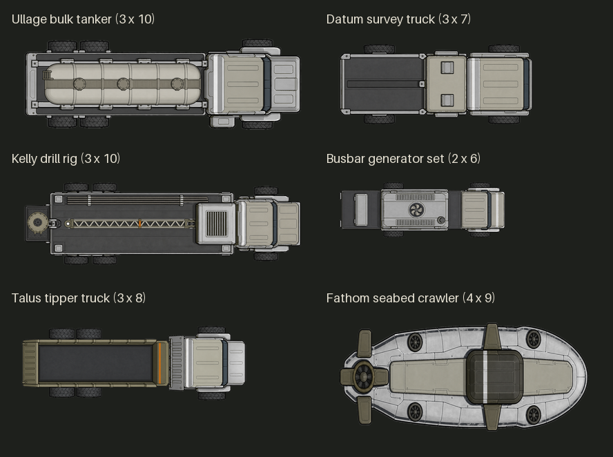
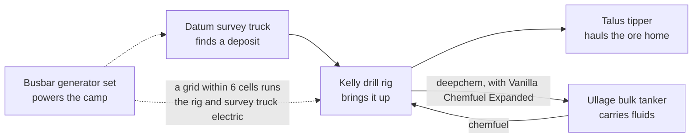
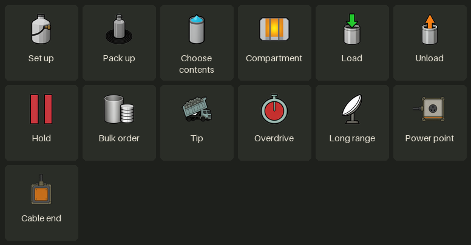
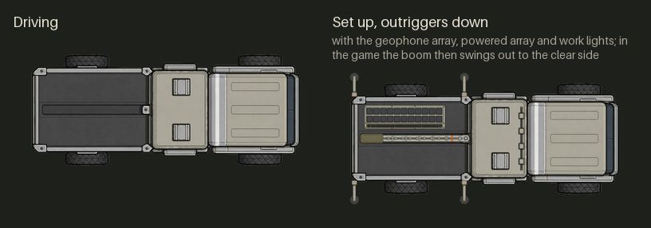
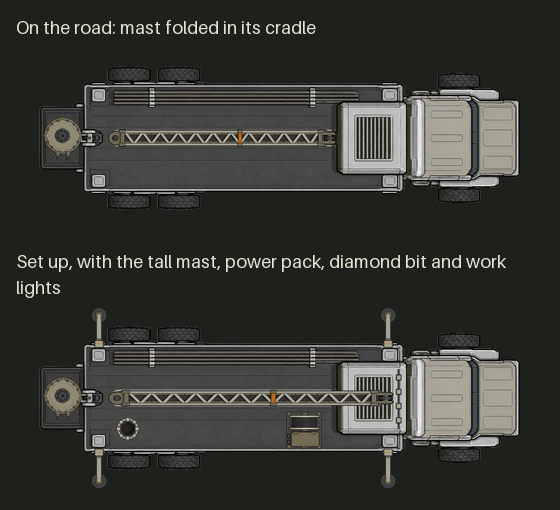
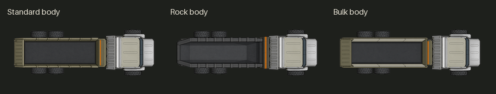
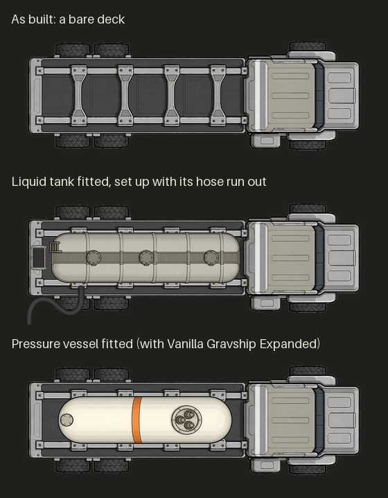
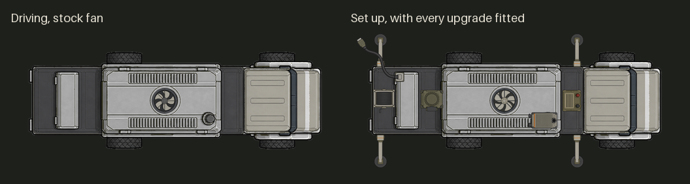

# Working vehicles

**D'thorga Vehicles** adds six vehicles that do a job: find ore, drill it, haul it, move fluids, power a camp, and explore under
the sea, and a trailer any of them can tow. It also gives other mods' vehicles the figures their real counterparts have. The submarine has
[its own chapter](submarines.md); looking after any vehicle is in [looking after vehicles](vehicle-care.md).
[Back to the guide](README.md).

## Read this first (gotchas)

- **Not yet tested in game**, except the survey truck and its boom (below).
- **Needs Vehicle Framework and D'thorga Framework**, loaded before it. RimWorld 1.7 only.
- **Each vehicle has its own research on the D'thorga tab**, after **vehicle parts**, and is built from the Architect's
  **motor pool** tab. Its upgrades need the research they name.
- **They are built from parts.** Make an engine assembly, transmission and kits at the **vehicle parts bench** first. Where
  RimThunder or Vanilla Vehicles Expanded is installed, a build asks for their parts instead.
- **To set up, someone must be aboard and the engine running.** Until then **Set up** (and the tipper's **Tip** and grab) is greyed out
  and says which is missing. Once it runs, the crew may get out: it works on by itself until it runs dry, its engine is switched off, or
  you pack it up. **If its engine stops, the work stops too**, and stays stopped even after refuelling until someone aboard starts the
  engine again.
- **A vehicle that is set up cannot drive.** Its engine can still be started, but press **Pack up** before you move it.
- **Heavy trucks have air brakes**: after standing for hours, draft one and let it idle a few minutes before it will drive.
- **A trailer goes on journeys with the vehicle towing it**, cargo and all (see the towing section of the vehicle care chapter).
- **Before removing the mod, scrap every one of these vehicles**: they go with it.

## The fleet

*To scale: one game cell is the same size in every picture. The tanker is shown with a liquid tank fitted.*

Every name is a real word from engineering or earth science that says something true about the job.

| Vehicle | Size (cells) | Job | The name means |
| --- | --- | --- | --- |
| **Datum survey truck** | 3 x 7 | Finds ore anywhere you can drive | The reference point every survey measures from |
| **Kelly drill rig** | 3 x 10 | Brings deep ore up fast | The square bar that turns the drill string on a rotary rig |
| **Talus tipper truck** | 3 x 8 | Hauls 2,400 kg and tips it in one go | The heap of broken rock at the foot of a cliff |
| **Ullage bulk tanker** | 3 x 10 | Carries and pumps fluids, buys them in bulk | The empty space a tank must keep above its load |
| **Busbar generator set** | 3 x 8 | A power station you can drive away | The bar that carries power into a grid |
| **Fathom seabed crawler** | 4 x 9 | A small submarine ([its chapter](submarines.md)) | The sailor's six-foot depth unit; to get to the bottom of something |
| **Pintle flatbed trailer** | 2 x 5 | A second load behind any land vehicle | The hook-and-ring coupling a drawbar trailer hangs from |

How they work together:

## Buttons the working vehicles share

- **Set up** and **Pack up**: every truck that works standing still sets up first. Its inspect pane then says what it is waiting
  for.
- **Overdrive** (drill rig and survey truck): doubles the pace while the engine runs flat out. Fuel goes 2.5 times as fast and the
  working parts wear. It switches itself off at half health on any working part, or if the engine overheats.
- **Power point**: the drill rig and survey truck set out a small power point. With a powered conduit or generator within 6 cells,
  they run off the grid instead of their engine.
- **Progress bars** show how far a drilling portion, a survey or a pump has got.
- **Every vehicle sounds like itself**: its engine follows the drive, and its work has its own sounds. **D'thorga sounds volume**
  in D'thorga Framework's settings turns them all down.

*In order: the tanker's five (liquid tank to hose reel), the drill rig's seven (diamond core bit to work lights), the tipper's
three, the survey truck's six (geophone array to groundwater), and the generator set's five.*

Upgrades are fitted in Vehicle Framework's **Upgrades** tab and show on the vehicle's picture. **They cost what our fittings and tunes do** (from Framework 0.106.0, not yet tested in game): several hours' work and much more steel and components, more on a heavier vehicle, under the same two settings, *Time to fit and tune* and *Materials to fit and tune*.

## Datum survey truck

**Tested in game by the owner (9 November 2026): the truck and its boom work well. Its upgrades are not yet tested in game.**

1. **Research survey truck** (after Ground-penetrating scanner) and build it: it also takes 10 uranium.
2. **Park it outdoors with room beside it** and press **Set up**. Its boom swings out to whichever side is clear, about three cells
   from the middle of the truck. If both sides are blocked, it says so and will not set up.
3. **A colonist on Research work runs the survey**, at their research speed. The engine idles while they work, at 8 chemfuel a day,
   or it runs off a grid within 6 cells of its power point at 700 W.
4. **Select the set-up truck to see what it has found.** Finds are the game's own deposits, with the game's odds and sizes.

| Fact | Figure |
| --- | --- |
| A first find | About 7 hours on average: ten times quicker than the game's scanner |
| Each later find on the same map | Takes longer than the last: one and a half times, up to eight times |

**Upgrades:** a **geophone array** or a **radiometric probe** (not both); a **long-range array** that searches nearby lands for one
ore instead of this map (press **Long range**; a find becomes a place on the world map to travel to); a **powered array** (three times as fast, 1,000 W, needs a grid or the battery); a **large
battery** (runs with the engine off; **the engine starts itself to recharge at 30%, burning fuel with nobody at the wheel**); work
lights. With Dubs Bad Hygiene, a **groundwater** upgrade shows the water while the truck is set up and marks the richest spot
within 15 cells. With Rimefeller, a set-up survey truck counts as the scanner a deep oil well needs.

## Kelly drill rig

1. **Research drill rig** (after Deep drilling) and build it.
2. **Reverse it up to a deposit** a scanner or survey truck has found: **it drills the cell behind its rear**. Press **Set up**; a
   ring shows its reach.
3. **A colonist on Mining work drills**, with the game's portions and their Mining skill. What comes up lands beside the hole.

| Fit | Drilling speed against a deep drill |
| --- | --- |
| Bare rig | 10 times: a steel lump that takes a deep drill a month takes the rig about three days |
| Diamond core bit | 20 times |
| RC (reverse-circulation) hammer | 18 times on ore, 30 times once only stone is left |

It carries both bits: pick by the job.

- **It burns 40 chemfuel a day while drilling**, unless you fit the **electric power pack** and have a powered grid within 6 cells.
- **Drilling can bring insects**, by the game's own rule. **A faster rig meets them sooner**: the risk per lump is the same as a deep
  drill's. **Keep guards near it.**
- **At night, without work lights, it drills at 80%.**
- **With Rimefeller**, the **oil well kit** sinks a well where no ore is in reach. **Build a derrick over the well head to pump.**
- **With Vanilla Chemfuel Expanded**, the **deepchem head** raises deepchem into a 300-unit buffer at ten times a pumpjack's rate.
  **Without the head, deepchem stays in the ground.** Empty the buffer with a tanker set up and loading, or a deepchem pipe.

## Talus tipper truck

1. **Research tipper hauler** (after Electricity) and build it.
2. **Load it through its ordinary cargo window**: 2,400 kg, such as 96 granite chunks or 4,800 steel.
3. **With a driver aboard and stopped, press Tip.** Everything in its cargo lands in the outlined half-circle behind it,
   **including any spare parts you loaded**. Whatever will not fit stays aboard, and it says how many.

**Upgrades:** **greedy boards** (taller sides, +600 kg), and either a **rock body** (tips half as fast again) or a **bulk body**
(3,600 kg, tips slower). And a **loading grab**, a small crane that shows folded behind the cab once fitted:

- **With a driver aboard and stopped, press Work the grab.** It lifts loose things lying within 4 cells (the blue outline) into the
  cargo, one stack or up to 500 kg a lift, every 20 seconds or so. Nobody else has to carry.
- **It leaves things in a stockpile or on a shelf**, forbidden things and corpses.
- It stops by itself when nothing is left in reach or the cargo is full, and says how much came aboard.
- **It cannot tip while the grab is out.** Press Stow the grab first.

## Pintle flatbed trailer

A two-axle flatbed: 2,000 kg empty, 3,000 kg of cargo, with low sides and a drawbar. Its one upgrade, the greedy boards (+600 kg), shows as
taller side boards.

1. **Build it** from the **motor pool** tab, after **vehicle parts** research.
2. **Load it** through its cargo tab while it stands unhitched.
3. **Hitch it**: select a land vehicle, press **Hitch a trailer** and pick the trailer, within 8 cells. A colonist who hauls walks over and
   couples it, and it is set straight behind the vehicle.
4. **Drive.** The trailer follows on the map, cuts inside corners and can be shot. **If it would run into a wall or another vehicle, the
   vehicle stops and says so**: take a wider way round, or unhitch.
5. **Unhitch** (on the vehicle or the trailer) leaves it where it stands, loaded, for later.

**Its weight is the towing vehicle's to pull.** A full trailer slows a small truck, runs its engine hotter and costs fuel; on mud or a
hill only the vehicle's own wheels grip. Only vehicles the drivetrain model works out can tow, unless you turn on **Vehicles without the
drivetrain model can tow** in D'thorga Framework's settings. A broken drawbar must be repaired before it can be hitched.

**Upgrade:** **greedy boards** (+600 kg).

## Ullage bulk tanker

1. **Research bulk tanker** (after Electricity) and build it. It comes with a bare deck.
2. **Fit a tank** in its Upgrades tab: a general, insulated or high-volume liquid tank, or a **pressure vessel** with Vanilla
   Gravship Expanded. One tank at a time.
3. **Choose contents.**
4. **Park it on or beside** the pipes, stacks or vehicle you want, and press **Set up**.
5. Press **Load** or **Unload**. The inspect pane says what the pump is waiting for. **Hold** stops the pump.

| It carries | Pumped to and from | Watch out for |
| --- | --- | --- |
| Chemfuel, deepchem | Other vehicles' fuel tanks, stacks, Vanilla Chemfuel Expanded's pipes | Thickens in deep cold, with the cold fuel setting on |
| Water | Dubs Bad Hygiene's plumbing | Freezes below 0 °C |
| Nutrient paste, hemogen | Their pipes | The whole load spoils after about 18 hours above 0 °C; the insulated tank doubles that |
| Astrofuel, oxygen | Vanilla Gravship Expanded's pipes | Oxygen vents in a fire or great heat |
| Beer, insect jelly, wort | Stacks on the ground | Wort spoils after 5 days above 0 °C |
| FSX, prometheum (Combat Extended) | Stacks on the ground | A hit may set off FSX; prometheum needs the pressure vessel and any spill burns |
| Toxic sludge (Biotech) | Wastepacks | Dissolves after 8 days above 0 °C and pollutes the ground |
| Fecal sludge (Dubs Bad Hygiene) | Septic tanks and barrels | It is what it is |
| Napalm, crude oil (Rimefeller) | Stacks and barrels | |

- **An empty tank must be purged before it carries something else**: select a colonist and right-click the truck (four in-game
  hours; it takes water with Dubs Bad Hygiene).
- **Taking a tank off with a load in it spills the load.** A damaged tank leaks; a destroyed tank of something flammable explodes
  (a setting can stop that). A full tank slows the truck.
- **Compartments**: two upgrades split a liquid tank into two, then three. Use **Compartment** to choose which one the pump and
  contents work on. **Food can't share a tank with anything else.**
- **Bulk buying**: take the tanker in a caravan to a settlement, pick the compartment and press **Bulk order**. You pay the game's
  price with the caravan's silver; what is on offer depends on what the settlement trades, and the same fluid can't be bought there
  again for 15 days. Visiting traders don't sell by the tanker-load.

## Busbar generator set

A medium diesel-electric truck, 3 by 8 cells like the Talus tipper: its engine turns a generator, electric motors drive the back axle, and parked it feeds your grid.

1. **Research generator truck** (after vehicle electrics) and build it.
2. **Press Set up** (with someone aboard and the engine running) and choose how to join the grid: **Run the cable out**, and a
   **cable end** appears where you choose: wire things to it, or touch a conduit to it; or **Join through conduits beneath it**, and
   hidden power conduits are laid under the truck (shown in the power overlay), so any conduit touching it is on its power.
3. It cannot move until you press **Pack up**.

| Fact | Figure |
| --- | --- |
| Output at full health | 2,000 W (2,650 W with the uprated alternator) |
| Fuel | Follows what the grid draws: 2 chemfuel a day doing nothing, 15 a day flat out, or 15 a day whenever batteries on the grid have room |
| Economy | 60% of the game's chemfuel generator: you pay for being able to drive it away |
| Stops when | The tank runs dry, the engine or traction generator is destroyed, or damage takes it under 400 W. Its inspect pane says which |

**Upgrades:** an **uprated alternator** (2,650 W); a **cable reel** (put the cable end up to 12 cells away); a **battery buffer**
that keeps the grid alive for a time when the engine cannot; a **heavy-duty fan** that cools a parked engine as well as driving does,
for hard work in hot weather; and an **exhaust heat exchanger** that warms the room its cable end stands in, up to 21 °C, for 25 W
of output. **Put the cable end inside the room you want warm.**

**With the battery buffer fitted, the set is a hybrid** (not yet tested in game):

- **Press Battery drive** to move it with the engine off: slowly (about a third of its speed), quietly, burning no fuel, about 300 cells
  on a full buffer.
- **Out of fuel, it creeps on the battery by itself**, so you can limp it to a tanker or a fuel dump. When the battery is flat it stops
  and says so.
- **The engine fills the battery again while it runs.** The inspect pane says how far the charge will carry it.

The **service lead** charges another vehicle's battery in the field:

- **With the set set up and running, press Run the service lead** and pick one of your vehicles within 6 cells.
- It charges that vehicle's battery while it stays in, and **starts it at once if the battery is too flat to start**. No other
  vehicle, kit or booster pack is needed.
- It takes 300 W before your grid does, so the camp gets less while the lead is in.
- It comes out by itself if the set packs up or either vehicle moves away. Select the set to see the lead drawn to its vehicle.

**Pack it up before removing the mod**, or a cable end is left behind that does nothing.

## Other mods' vehicles

D'thorga Vehicles also gives other mods' vehicles the figures their real counterparts have, so each climbs, labours and bogs like
itself. A few you will notice:

| Vehicle (mod) | What changes |
| --- | --- |
| Big Rig (VVE - Tier 3), M1075 HEMTT (RimThunder) | Air brakes: idle before driving after a long stand |
| Harrier (Harrier VTOL) | Its real engine ratings, water injection and a hover check |
| Hind, Mongoose, Cherokee | Twin turboshafts: lose one and the other runs hot. The Cherokee has a mount for a cargo hook |
| M1A2 and M1A2 SEP (RimThunder) | A gas turbine with no radiator, which burns hard even at idle |
| Lightning | Can run on batteries: turn on **The Lightning runs on batteries** in D'thorga Framework's settings and restart |
| Vanilla Vehicles Expanded's vehicles | Real weights: bikes lighter, tanks far heavier. Change any weight under Vehicle Framework's "Empty mass" |
| Steam and diesel-electric locomotives (Trains of the Rim) | A boiler, or traction motors ([special engines](vehicle-care.md#special-engines)) |

## What has been tested in game

- **Tested by the owner:** the survey truck and its boom (9 November 2026).
- **Not yet tested in game:** the other five vehicles, the trailer and towing, every upgrade, the bulk buying, and how the pictures sit. Where each upgrade's
  picture sits on its vehicle is a first placement, to be adjusted once seen in game.

Every figure and its source is in [D'thorga Vehicles' README](../../mods/PhobosVehicles/README.md).
