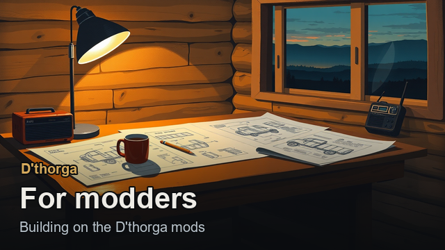

# D'thorga RimWorld reference for modders

<!-- Links here are DocFX cross-references (<xref:uid>), not file links: the pages they name are generated by
     scripts/reference-site.py into its work folder, so a relative link would be broken in the repository. -->

The reference for building on the **D'thorga** (spelled "dthorga" too) RimWorld mods from your own RimWorld 1.7 mod: D'thorga
Framework and its vehicle systems, Radio Framework, Medical, Factory Additions, Farming, Vehicles and Water Tap. Most of what you
write is XML; the C# reference is there when XML cannot say it.

- **<xref:guide-README?text=Guides>**: a page for each mod, saying what your mod can add to it or use from it, with worked
  examples. Start here.
- **<xref:xml-types?text=XML+types>**: every class you name in XML (comps, mod extensions, Defs, vehicle-system inputs, conditions and
  effects), each with an example of how it is written and every field's default.
- **<xref:extension-points?text=Extension+points>**: every interface and abstract class your own C# can implement or subclass.
- **<xref:patches?text=What+we+patch>**: every method our mods patch with Harmony, and how, to see where your patches may meet
  ours.
- **<xref:dev-actions?text=Dev+actions>**: every dev-mode action our mods add, for trying things out and finding faults.
- **<xref:modder-changes?text=Changes+for+modders>**: every changelog line marked for modders, newest first.
- **<xref:Phobos.Framework?text=C%23+reference>**: every public type and member, from the source's own comments.

## Read this first

- **RimWorld 1.7 only.** Nothing here is written for 1.6.
- **Every page's footer says when the site was built**, and from which version of D'thorga Framework. The site is rebuilt on every
  change to the code or the guides.
- **Classes are named in full in XML**: `Class="Phobos.VehicleSystems.Effect_Message"`, and a Def of ours by its full name as the
  element (`<Phobos.VehicleSystems.PhobosVehicleSystemDef>`).
- **The vehicle systems need Vehicle Framework.** Its own types (`VehicleCompProperties`, `VehiclePawn` and the rest) are named
  on these pages but not linked: this site is built without other authors' assemblies.
- **Defaults are read from the C# source** when the site is built. A field you leave out of your XML keeps its default.

This site is generated by `scripts/reference-site.py` from the
[phobos-rimworld repository](https://github.com/phobos-dthorga/phobos-rimworld); the guides are its `docs/` pages.
