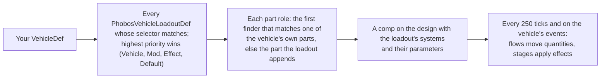

# Vehicle systems for modders

How to give your Vehicle Framework vehicles their own batteries, coolant, air brakes or anything else, and how to add systems of
your own, with D'thorga Framework's vehicle systems (0.10.0, RimWorld 1.7). Everything is XML; C# only when you want a new kind of
input, condition or effect. **Not yet tested in game**: the schema may change before the first public release, and this page will
say so when it does.

## Read this first (gotchas)

- **Every vehicle already gets systems by default**, matched by what it does (fuel, land or sea or air, mass). You only need a
  loadout to give a vehicle different figures or different systems. A vehicle you name beats a whole mod, which beats a match by
  effect.
- **Parts are appended, never reordered.** Vehicle Framework saves a vehicle's parts as healths in order. The service appends its
  parts after the vehicle's own and drops saved extras on load, so a design may lose or gain appended parts between versions, but
  **never insert or reorder parts in your own vehicle's list** for this.
- **Load after D'thorga Framework**, and put your loadouts in an `IfModActive` folder if they name another mod's vehicles.
- **Check your files offline**: `python scripts/check-vehicle-schemas.py` (in this repository) reads every system and loadout under
  `mods/`, resolves inheritance like the game, and names every mistake it can find without the game.
- **Classes are named in full**: `Class="Phobos.VehicleSystems.Effect_Message"`. A class of your own uses your namespace.
- **Player text stays in the world.** Messages and refusals describe the vehicle and what to do; they never name a mod or a setting.

## How a vehicle gets its systems



This happens while Defs load, before Vehicle Framework resolves the design, so Vehicle Framework builds the appended parts'
hitboxes itself. The settings window lets the player switch vehicles, kinds and systems off.

## A loadout for your vehicle

The smallest useful loadout inherits a default and changes figures. This gives `MyMod_BigTruck` a bigger alternator and air brakes:

```xml
<Phobos.VehicleSystems.PhobosVehicleLoadoutDef ParentName="PhobosVehicleLoadoutLandHeavy">
  <defName>MyMod_BigTruck_Loadout</defName>
  <label>my big truck</label>
  <priority>Vehicle</priority>
  <selector>
    <vehicleDefs><li>MyMod_BigTruck</li></vehicleDefs>
    <massMin>-1</massMin>   <!-- the parent asks for mass 350 or more; a named vehicle shouldn't depend on that -->
  </selector>
  <systems Inherit="False">
    <li><def>PhobosVehicleSystem_Electrical</def><set><alternatorAmps>140</alternatorAmps></set></li>
    <li><def>PhobosVehicleSystem_Cooling</def></li>
    <li><def>PhobosVehicleSystem_Lubrication</def></li>
    <li><def>PhobosVehicleSystem_Service</def></li>
    <li><def>PhobosVehicleSystem_RunningGear</def></li>
    <li><def>PhobosVehicleSystem_Brakes</def></li>
    <li><def>PhobosVehicleSystem_AirBrakes</def></li>
  </systems>
  <partRoles>
    <li>
      <role>Compressor</role>
      <add><key>PhobosAirCompressor</key><label>air compressor</label><health>25</health><cellsOf>Engine</cellsOf></add>
    </li>
  </partRoles>
</Phobos.VehicleSystems.PhobosVehicleLoadoutDef>
```

Without `Inherit="False"` a list adds to the parent's; with it, it replaces it. To exclude a vehicle entirely, give it a
`Vehicle`-priority loadout with no systems (D'thorga Vehicles did this for steam locomotives until they got a boiler).

### Loadout fields

| Field | What it does |
| --- | --- |
| `priority` | `Vehicle`, `Mod`, `Effect` (the defaults) or `Default`. Among equals the higher `rank` wins, then the last loaded, with a warning in the log. |
| `rank` | A whole number (default 0) that breaks ties within a priority: the shipped tracked loadout has 1, so it beats the light, medium and heavy ones. |
| `kind` | The settings window's group: `CombustionLand`, `CombustionHeavy`, `CombustionTracked`, `Boat`, `Aircraft`, or your own word. |
| `selector` | Which vehicles. Every condition given must hold: `vehicleDefs`, `packageIds`, `vehicleTypes` (Land, Sea, Air, Universal), `fuelled`, `electricPowered`, `flies` (each `Yes`, `No` or `Any`), `fuelTypes`, `excludeFuelTypes`, `massMin`, `massMax`, `partTags`, `partKeySuffixes` (a part key ends in one of them, as tracks end in `Track`). |
| `cabin` | `closed` (default true): whether the vehicles have a closed cab that shelters everyone aboard (the Cabin system gives it a temperature). A vehicle overrides it with a `Phobos.VehicleSystems.PhobosVehicleCabinExtension` on its VehicleDef (`closed` false for motorcycles and open boats). |
| `drivetrain` | The engine and drivetrain: a `def` (a `PhobosVehicleDrivetrainDef`) and an optional `set` of overrides (`kilowattsPerTonne`, `drivenShare`, `wheelRadius`, `dragArea`, `kilogramsPerVehicleMass`, `emptyKilograms`, `fuelKilogramsFull`, `idleFuelShare`, `efficiency`). See [Engines and drivetrains](#engines-and-drivetrains). |
| `flightProfile` | An aircraft's `PhobosVehicleFlightProfileDef`: its phases and what each asks of the engines. |
| `systems` | Each `def` (a system) with an optional `set` of parameter overrides, written as elements: `<set><batteryAmpHours>90</batteryAmpHours></set>`. |
| `partRoles` | Each `role` with `find` rules and an optional `add`. `all` binds every match (wheels). |
| `loads` | Electrical consumers: `name`, `label`, `description`, `amps`, `when` (a condition), `toggle` (the player gets a switch), `defaultOn`, `iconPath`. |

### Part roles

A role is a name a system reads (`Engine`, `Alternator`, `Battery`, `Starter`, `Radiator`, `OilPump`, `Transmission`, `Clutch`,
`Wheels`, `Brakes`, `Compressor`, `HydraulicPump`, `HydraulicLines`; `Engine1` and `Engine2` for twin engines, which the
drivetrain counts instead of `Engine` when they are bound). The first `find` rule that matches any of the vehicle's own parts binds
the role. A finder may ask for a `key`, a `keyContains` hint, `keyContainsAny` (several hints, any of which will do: one role
made of several kinds of part), `categories` (stats the part feeds), a `depth`, `priority` (`Yes` or
`No`) and a `tag`, all of which must hold. If nothing matches and the role has an `add`, the service appends that part:

| `add` field | Meaning |
| --- | --- |
| `key`, `label` | The part's identity and its in-world name. Prefix the key with your mod's prefix. |
| `health`, `depth`, `hitWeight`, `efficiencyWeight` | As Vehicle Framework's own parts (defaults 20, Internal, 0.3, 1). Vehicle Framework hits a bigger `hitWeight` more often. |
| `hitWeightCE` | The weight under Combat Extended, which sorts the other way (a smaller weight is hit more); left out, `hitWeight` is inverted there. |
| `cells` or `cellsOf` | Explicit hitbox cells, or the cells (and armour) of the part bound to another role, usually `Engine`, so Combat Extended's shots can reach it. |
| `categories`, `armor`, `tags` | As Vehicle Framework's own parts. |

A role nothing binds reads as a sound part (efficiency 1) and its effects do nothing. Every bound part reports its hits to the
systems, so `onPartHit` rules work on the vehicle's own parts too.

## A system of your own

A system is quantities, the flows that move them, and stages with effects. This is a minimal one: a tank of water that a working
pump empties, with a stage that stops the vehicle starting when it runs dry.

```xml
<Phobos.VehicleSystems.PhobosVehicleSystemDef>
  <defName>MyMod_WaterSpray</defName>
  <label>water spray</label>
  <description>A tank of water the spray pump draws from.</description>
  <roles><li>Pump</li></roles>
  <parameters>
    <pumpLitresPerHour>40</pumpLitresPerHour>
    <tankLitres>400</tankLitres>
  </parameters>
  <quantities>
    <li>
      <name>water</name>
      <label>water tank</label>
      <unit>Fraction</unit>
      <startsAt>Full</startsAt>
      <stages>
        <li>
          <to>0.05</to>
          <label>empty</label>
          <notable>true</notable>
          <effects>
            <li Class="Phobos.VehicleSystems.Effect_Message"><message>MyMod_TankEmpty</message></li>
          </effects>
        </li>
      </stages>
    </li>
  </quantities>
  <flows>
    <li>
      <name>spray</name>
      <quantity>water</quantity>
      <kind>From</kind>
      <factorParameter>pumpLitresPerHour</factorParameter>
      <divideByParameter>tankLitres</divideByParameter>
      <when Class="Phobos.VehicleSystems.When_Moving" />
      <inputs>
        <li Class="Phobos.VehicleSystems.Input_PartEfficiency"><role>Pump</role></li>
      </inputs>
    </li>
  </flows>
</Phobos.VehicleSystems.PhobosVehicleSystemDef>
```

### System fields

| Field | What it does |
| --- | --- |
| `parameters` | Named figures with their defaults, as elements. Loadouts override them; flows and effects name them. |
| `quantities` | State variables: `name`, `label`, `unit` (`Plain`, `Celsius`, `Fraction`, `Hours`), `min`, `max`, `startsAt` (`Ambient`, `Full`, `Empty`, `Value` with `startValue`), `hidden` (no figure shown; notable stages still show), `stages`. A quantity with `derivedFrom` is not integrated: each interval it is the product of those inputs. |
| `showOnDashboard` | The quantity gets a gauge on the vehicle's Dashboard tab (not for a hidden quantity). |
| `stages` | Ranges `from` (inclusive) and `to` (exclusive), either open-ended, in rising order: `label`, `notable` (Plain mode names it), `effects`. A value in a gap is in no stage. |
| `flows` | Rate rules on one quantity: `kind` `Into` and `From` (units per hour) or `Toward` a `target` input (the share of the gap closed per hour, done exactly, so it never overshoots). The rate is `factor`, times `factorParameter`, over `divideByParameter`, times every input. `openAbove` or `openAboveParameter` (and `openBelow`) with a `band` gate it like a thermostat. `when` limits it to a condition. |
| `onEvents` | Effects run once on one of Vehicle Framework's events (`IgnitionOn`, `IgnitionOff`, `MoveStart`, `MoveStop`, `Refueled`, `OutOfFuel` and the rest). |
| `onPartHit` | When a part playing `role` is hit, `quantity` changes by `perHealthLost` for each hit point lost. |
| `service` | What a mechanic does: `label`, due when `dueQuantity` passes `dueAbove` or `dueBelow`, `supplies` loaded into the cargo first, `waterLitres` (or `waterLitresParameter`, a system parameter each loadout can set; `scaledWaterLitresParameter`, a scaled figure used unless the player's `realisticWaterSetting` is on, `realisticFeedWater` by default; and `waterForShortfall`, to draw only what the due quantity is short of) drawn from the registered water source when the work ends (free when none is registered; see [Water](#water-for-services)), `work` (ticks at construction speed 1), then `restores` (any system's quantities). |
| `jumpStart` | How a colonist jump-starts the vehicle from another: `quantity` (raised to `raiseTo` when below it), `capacityParameter` (the unit the charge moves in), `donorMinimum` (or a running engine), `reach` in cells, `work` in ticks. The player orders it from the flat vehicle's right-click menu. |
| `workerClass` | A `VehicleSystemWorker` subclass for maths XML cannot say. |

The service runs every 250 ticks (the rare tick Vehicle Framework calls on every comp), in steps of at most 0.025 game hours, and
catches up on up to 24 hours after a vehicle has been away. Quantities are saved by system and name, so you may add quantities to a
system freely; renaming one loses its saved value.

### Inputs (`Class="Phobos.VehicleSystems.<name>"`)

Every input takes an optional `curve` (points `(x, y)` mapping the raw reading) and `factor`.

| Input | Reads |
| --- | --- |
| `Input_Constant` | `value` |
| `Input_Parameter` | a `parameter` of the system |
| `Input_Ambient` | the temperature around the vehicle, °C (its room on a map, the weather on the world map) |
| `Input_EngineRunning` | `running` (1) or `off` (0): drafted, or moving in a caravan, or flying, with fuel |
| `Input_EngineLoad` | 0 off, 0.5 idling, 1 moving or flying; with a drivetrain and the player's "full drivetrain", the model's load (0 to 1) |
| `Input_EngineRpm` | engine speed in rpm from the drivetrain, times `multiplier` (an alternator's pulley); without one, `idle` (800) or `cruise` (2000) |
| `Input_EngineHeat` | heat into the coolant as a share of the heat at rated power, from the drivetrain; without one, the engine load |
| `Input_DrivePower` | power at the driven wheels, kW (0 without a drivetrain) |
| `Input_Turbine` | a turbine `reading`: `Temperature` (degrees C), `OverContinuous` and `OverTop` (degrees past those limits), `SpeedPercent`, `LifePerHour`, `Demand`, `EnginesOut`, `OverTorque` (demand over the rotor drive's limit, minus 1) |
| `Input_TractionLoad` | a diesel-electric's pull over its traction motors' continuous rating (above 1 they heat) |
| `Input_Moving` | `moving` (1) or `stopped` (0) |
| `Input_PartEfficiency` | the average efficiency of the parts bound to `role`, or `missing` (1) |
| `Input_Quantity` | another `quantity` of the vehicle, in any system, or the `fallback` input |
| `Input_LoadAmps` | the amperes the switched-on loads draw now |
| `Input_ElectricalBalance` | `Surplus` or `Deficit`: the alternator (`supplyParameter` amperes times `supplyRole`'s efficiency times the optional `supplyFactor` input, while running) against the loads |
| `Input_ShorePower` | 1 when the parked vehicle stands beside a powered grid |
| `Input_Condition` | 1 when `condition` holds |
| `Input_Setting` | 1 when the player's setting of that name is on (`fuelGelling`) |

### Conditions

`When_Always`, `When_EngineRunning`, `When_Moving`, `When_Night` (hours in the rules Def), `When_AmbientBelow` and
`When_AmbientAbove` (`celsius`), `When_QuantityBelow` and `When_QuantityAbove` (`quantity`, `value`), `When_ParameterBelow` (`parameter`, `value`), `When_Setting`
(`setting`: `fuelGelling`, `boilerExplosions`, `realisticFeedWater`, `nightHeater`, `jumpStartNeedsKit`, `assumeBoosterPack`),
`When_CaravanResting` (the vehicle's caravan rests for the night), `When_LoadActive` (`load`: one of the loadout's loads is switched
on and its condition holds),
`When_All` and `When_Any` (`conditions`). Every condition takes `invert`.

### Effects

Every effect takes `when`. Those marked as consequences are skipped when the player chooses figures only.

| Effect | Does | Consequence |
| --- | --- | --- |
| `Effect_DamagePart` | `perHour` while the stage lasts, `amount` once on entry, to one living part of `role`; no armour, no reactions | yes |
| `Effect_Breakdown` | a failure rolled as the game rolls breakdowns: `mtbHours`, `healthFraction` of one part of `role`, `message` (`{VEHICLE}`, `{PART}`) | yes |
| `Effect_RefuseDraft` | the vehicle will not start; `reason` is a key with `{VEHICLE}` | yes |
| `Effect_RefuseMove` | started, but it will not drive; `reason` as above | yes |
| `Effect_StatFactor` | multiplies a Vehicle Framework `stat` by `factor` | yes |
| `Effect_ForceUndraft` | stops the engine on entry | yes |
| `Effect_ConsumeFuel` | `perHour` from the fuel tank | yes |
| `Effect_Letter` | a letter on entry (`label`, `text` keys with `{VEHICLE}`), at most once in the rules Def's cooldown | yes |
| `Effect_Message` | a message on entry (`message` key with `{VEHICLE}`, `type`), at most once in the cooldown | no |
| `Effect_PushHeat` | `heatPerSecond` into the vehicle's room, times `scaleBy` | no |
| `Effect_Fleck` | `fleck` (a FleckDef) at `perHour`, `scale` | no |
| `Effect_AddQuantity` | once: `amount` times `scaleByParameter`, over `divideByParameter`, times `scaleBy`, added to `quantity` | no |
| `Effect_SetQuantity` | once: `quantity` set to `value` | no |
| `Effect_RateQuantity` | `perHour` added to `quantity` while the stage lasts | no |
| `Effect_Explosion` | once: the game's explosion at the vehicle, `radius` and `damage` (`damageDef`, blast by default), and `breakRole`'s parts broken; only on a map | yes |

## Engines and drivetrains

A `PhobosVehicleDrivetrainDef` is a vehicle's engine, gearbox, running gear and mass. The service works backwards from the speed
the vehicle is moving at to the gear, rpm, load, fuel power and heat, and caps the speed only where the engine's power or the
tyres' grip runs out (never below 15%: "Wheels spinning"). The design is in
[the drivetrain record](development/vehicle-drivetrain-design.md). Vehicle Framework still decides every speed below the cap.

```xml
<Phobos.VehicleSystems.PhobosVehicleDrivetrainDef>
  <defName>MyMod_Drivetrain_Tractor</defName>
  <label>tractor diesel</label>
  <engine>
    <kind>Piston</kind>                  <!-- Piston, Electric, Turboshaft, Turbofan -->
    <idleRpm>700</idleRpm><launchRpm>1000</launchRpm><ratedRpm>2200</ratedRpm>
    <kilowattsPerTonne>12</kilowattsPerTonne>
    <torqueCurve><points><li>(0.3, 0.8)</li><li>(0.6, 1)</li><li>(1, 0.9)</li><li>(1.1, 0)</li></points></torqueCurve>
  </engine>
  <transmission>
    <kind>Automatic</kind>               <!-- Automatic, Direct, Propeller, None -->
    <gears><li>6.0</li><li>3.5</li><li>2.0</li><li>1.0</li></gears>
    <finalDrive>5.2</finalDrive>
    <upshiftRpm>1900</upshiftRpm><downshiftRpm>1100</downshiftRpm>
  </transmission>
  <running><wheelRadius>0.6</wheelRadius><drivenShare>1</drivenShare></running>
  <mass><emptyKilograms>4500</emptyKilograms></mass>
</Phobos.VehicleSystems.PhobosVehicleDrivetrainDef>
```

| Block | Fields (defaults) |
| --- | --- |
| `engine` | `kind`, `idleRpm` (700), `launchRpm` (1100), `ratedRpm` (3000), `kilowattsPerTonne` (30), `torqueCurve` (share of peak torque against rpm over rated; must end at 0), `frictionConstant`, `frictionLinear`, `frictionQuadratic` (Willans friction shares), `indicatedEfficiency` (0.40), `coolantHeatShare` (0.28), `idleFuelShare`, `turbine` |
| `transmission` | `kind`, `gears` (falling from first to top), `finalDrive` (4.1), `upshiftRpm` (2400), `downshiftRpm` (1300), `efficiency` (0.88) |
| `running` | `wheelRadius` (0.38 m), `drivenShare` (0.5: the share of weight on driven wheels), `dragArea` |
| `mass` | `kilogramsPerVehicleMass` (12), `emptyKilograms` (a real kerb mass, used instead), `fuelKilogramsFull` |

`engine` also takes `ratedKilowatts`, a real engine's rated power used instead of `kilowattsPerTonne`. A `DieselElectric`
transmission adds `maxTractiveEffortKilonewtons` (the traction motors' most pull) and `continuousTractiveEffortKilonewtons` (what
they hold indefinitely; above it the `PhobosVehicleSystem_TractionMotors` system heats them, through `Input_TractionLoad`).
`running` takes `fixedRollingResistance` and `fixedGrip` for running gear on its own surface (rails). A loadout binds `Engine1` to
`Engine8` for several engines; each below 20% health is out.

A gas turbine adds a `turbine` block to the engine: `idleSpeedPercent` (60), `idleTemperatureAboveAmbient` (363), `deratePerDegree`
(0.007 above 15 degrees C), `startSpeedPercent` (15), and `ratings`, each with `name`, `share` of maximum continuous output,
`speedPercent`, `temperatureLimit`, `minutes` (every rating above the first needs one), `thrustKilonewtons` (every rating or none:
a jet's hover check uses them) and `wet` (one rating may be the water-injected one). A wet rating needs a `waterInjection` block
(`tankKilograms`, `kilogramsPerSecond`) and a system holding the `injectionWater` quantity in the loadout
(`PhobosVehicleSystem_WaterInjection`); add `PhobosVehicleSystem_Turbine` for temperature, hot-section wear and starts. The
shipped archetypes are in `Drivetrains.xml`, every figure labelled. The turbine block also takes `transmissionLimit` (what a
helicopter's rotor drive accepts, as a share of all engines' maximum-continuous output, scaled by the `RotorDrive` parts' condition;
demand above it is over-torque, which `PhobosVehicleSystem_RotorDrive` turns into wear) and `liftToWeightAtMaxGross` (for the
`Thruster` engine kind: thrust as a multiple of empty mass plus full cargo and fuel). A loadout may override either in its
drivetrain `set`. See [the power and lift record](development/vehicle-power-and-lift-design.md). The design is in
[the turbine record](development/vehicle-turbine-design.md).

### Flight profiles

Vehicle Framework gives no throttle, so an aircraft's load comes from its phase. A `PhobosVehicleFlightProfileDef` lists the
`phases` (`phase`, `label` for the inspect line, `demand` as a share of maximum continuous output, or `hover` true to work it out
from the aircraft's weight; `running` and `moving`, default true) and a `reader` that tells them apart.
`Phobos.VehicleSystems.PhaseReader_Members` reads members by name, so your flight framework needs no reference to ours: each rule
gives a `phase`, an optional `comp` (a comp's class name), a `member` (a field or property, dotted for a path) and `equals` (text,
compared with the value's name) or `atLeast` (a number). The first matching rule wins. `hoverPowerAtMaxGross` (0.9) is a
helicopter's hover power at maximum gross weight. `liftCheckAtLaunch` checks an aircraft that launches through Vehicle
Framework itself against its weight before it lifts off (the shipped `PhobosFlightProfile_StockRotorcraft` and
`PhobosFlightProfile_StockThrustLift` do). Write your own reader by subclassing `PhaseReader`.

### The hover check for flight mods

`HoverLimits.Beyond(vehicle)` is true when the aircraft has a flight profile with hover phases, the player runs the full
drivetrain, and its engine cannot hold a hover now, dry or with water. `HoverLimits.RefusesPad(vehicle)` adds the player's
choice (refuse the pad) and `HoverLimits.RefusalText(vehicle)` gives the in-world reason. D'thorga Patches uses them on the
Harrier's pad landings. "Allow at a cost" and "warn only" need nothing from a flight mod.

## Water for services

A service's `waterLitres` comes from the one registered water source. None is registered by default, so water is free, as the
game treats it. With Dubs Bad Hygiene, D'thorga Framework registers its plumbing: a pipe with a water tower under or beside the
parked vehicle, and the service waits with the reason until one is there. Another mod may register its own source by
implementing `VehicleWater.ISource` (`CanDraw` with an in-world reason, `TryDraw`) and calling `VehicleWater.Register` at startup;
the last one registered is used, and a source that throws is dropped (water is free again until restart).

## The world map and the cab

The systems keep running while a vehicle travels in a caravan: wear, charge, heat and fuel, with the engine counted as running
only while the caravan moves (a caravan rests from 22:00 to 06:00, engine off). The drivetrain's speed cap slows the caravan
(Vehicle Framework's ticks per move, with an explanation line), and a `RefuseMove` effect stops it, through the caravan comp the
Framework adds to Vehicle Framework's vehicle caravan (`Common/Patches/Phobos/Framework/VehicleSystems/VehicleCaravan.xml`), whose
inspect text carries the reason. Services, water stops and shore charging need a map.

A closed cab's temperature (the Cabin system's `cabTemperature`) reaches the game through the Framework core's held-temperature
registry (`Phobos.Framework.Environment.HeldTemperature`): the game asks a held pawn's holders for a fixed temperature before the
cell or the tile, and the vehicle part registers Vehicle Framework's role handler with the cab's reading. Any mod can register a
reader for its own holder type the same way. A jump-start needs a `PhobosVehicleSystems_JumpStartKit` in stock or aboard when the
player's setting says so (`JumpStarts.NeedsKit`), found through the core's `Phobos.Framework.Items.ItemFinder`.

**From 0.18.0** (`docs/development/vehicle-crew-and-ground-design.md`):

- **The ground on the world map.** A caravan's drivetrain reads the tile through the core's `Phobos.Framework.WorldMap.BiomeGround`:
  the biome's typical terrain (its `terrainsByFertility` entry at fertility 0.5), its `movementDifficulty`, the game's winter offset
  and the road. `WorldGroundRules.PathCost` turns them into a path cost for the same ground curves a map cell uses. **A biome of
  your own needs nothing extra**: give it a `terrainsByFertility` list and a `movementDifficulty`, as the game's biomes have.
- **Booster packs.** `PhobosVehicleSystems_BoosterPack` carries the core's `Phobos.Framework.Items.CompProperties_PhobosCharges`
  (`uses`, `rechargeHoursPerUse`, `inspectKey`). Any item of yours with that comp and a `rechargeHoursPerUse` above 0 also
  recharges in the cargo of a running vehicle. A recipe that recharges such an item disallows the core's special filter
  `PhobosFramework_ChargesFull` in its fixed ingredient filter (see `Items_BoosterPack.xml`).
- **Cab moods.** `ThoughtDef PhobosVehicleSystems_CabComfort` has six stages in the order of the core's
  `Phobos.Framework.Rules.ShelterStage`. Patch its labels, descriptions or moods in XML; keep the order.
- **RimHUD.** `Mods/VehiclesRimHUD/Common` holds a `RimHUD.CustomValueDef` naming `Phobos.VehicleSystems.RimHudVehicleValue`, loaded
  only with both Vehicle Framework and RimHUD. RimHUD calls its `GetParameters(Pawn)` by reflection.

## How a system appears in the tabs

Every vehicle with systems gets two inspector tabs (`Presentation/ITab_VehicleDashboard.cs`, `ITab_VehicleSystems.cs`), added to
the design beside Vehicle Framework's own. The **Dashboard** shows a gauge for each quantity with `showOnDashboard`, coloured by its
stage (green; amber for a `notable` stage; red when the stage refuses, damages or explodes), a warning light for every notable
stage, the waiting line (a refusal, or the due service and what it lacks), a button for each `toggle` load with its `iconPath`,
and the service button. The **Systems** tab lists every system that runs on the vehicle: each quantity that is not `hidden` (Engineer
mode shows hidden ones too) with its figure, stage and a bar for Fraction and Celsius units; each role's parts; the drivetrain and
turbine figures; and in Engineer mode a graph of the last day (the comp keeps one sample per rare tick of every shown quantity,
saved with the vehicle) and the flows an hour. The widgets are the Framework core's `Phobos.Framework.Interface.PhobosWidgets` (in the core's `UI/` folder), so a tab
of your own can draw the same gauges and graphs; `TabState<T>` holds per-thing state for a shared tab instance.

## Dev actions

With dev mode on, the debug actions menu's D'thorga category holds, for the selected vehicles: **log selected** (every system's
quantities, stages and parts), **set a quantity** (any non-derived quantity to 0, 25, 50, 75 or 100% of its range), **request a
service**, **remove from this colony** (the sweep before removing the mod), **hit a part** (a 20-point hit on a role's first part
through Vehicle Framework's own damage path, which Combat Extended replaces, so part-hit rules can be checked under both), **log
part health memory** (what the systems last saw of each part's health), **explode the boiler now** (runs a system's explosion
effect whatever the player's setting, after a confirmation: destructive), **toggle a load**, **give a jump-start kit**, **give a
booster pack** (full, one start left, or flat), **flatten the battery**, **log cab comfort** (the cab, the outside, and each person
aboard with their comfortable range and the mood it gives), and on the world map with a vehicle caravan selected **log caravan
state** (now with the tile's ground: biome, typical terrain, road, winter and the path cost) and **set caravan cap** (half, crawl
or clear, to see the caravan slow and its explanation). The cab's temperature is set through **set a quantity**. For the tabs:
**fill history with a test curve** (a day of sine waves in every graph), **open the Dashboard tab**, **open the Systems tab** and
**log tab state** (how many vehicles' tab state is held; it should be none after the tab closes).

## A vehicle's own weight and power

Vehicle Framework's `Mass` is not comparable between mods, so a vehicle can carry its own figures:

```xml
<Operation Class="PatchOperationAddModExtension">
  <xpath>Defs/Vehicles.VehicleDef[defName="VVE_Dirtbike"]</xpath>
  <value>
    <li Class="Phobos.VehicleSystems.PhobosVehicleFiguresExtension">
      <emptyKilograms>110</emptyKilograms>   <!-- empty (kerb) mass -->
      <ratedKilowatts>30</ratedKilowatts>    <!-- optional: engine power, when power per tonne would be far off -->
    </li>
  </value>
</Operation>
```

Empty mass, most specific first: the player's tuning in Vehicle Framework's window; this extension; the loadout's or drivetrain's
`emptyKilograms`; `Mass` times `kilogramsPerVehicleMass` (12), never below 50 kg. Engine power: this extension; the loadout's or
drivetrain's `ratedKilowatts`; power per tonne times the empty mass. A quantity that counts what is used up can carry a
`remainingLabel` ("tread"): the tabs' gauges then show what is left, full when new.

## Tuning in Vehicle Framework's window

Players can change some of the shipped systems' parameters per vehicle in Vehicle Framework's own settings: battery capacity,
alternator output, starter draw, engine heat, radiator cooling, thermostat, oil use, tyre wear, gearbox heat, the air
brakes' compressor and leak, and (0.19.0) the empty mass. Each field starts at the vehicle's figure after its loadout's overrides, and the player's change
wins over the loadout. Vehicle Framework shows fields, not lists, so your own systems' parameters are tuned in loadouts only.

## A class of your own

Inputs, conditions and effects are plain classes the XML loader builds; subclass the base and name it in full.

```csharp
using Phobos.VehicleSystems;
using Verse.Sound;

namespace MyMod;

/// <summary>Sounds the horn once when the stage starts.</summary>
public class Effect_Horn : VehicleSystemEffect
{
    public Verse.SoundDef? sound;
    public override bool Consequential => false;

    public override void OnEnter(SystemContext context)
    {
        if (sound != null && context.Vehicle.Spawned) sound.PlayOneShot(new Verse.TargetInfo(context.Vehicle));
    }
}
```

`SystemContext` gives `Vehicle`, `Comp` (engine state, `Ambient`, `PartEfficiency`, `TryGetQuantity`, `AddToQuantity`,
`SetQuantity`, `WearRole`, `BreakRole`), `State` and `Parameter(name)`. Reference `PhobosFramework.Vehicles.dll` from the installed
D'thorga Framework (`Mods/VehicleFramework/1.7/Assemblies`) without copying it, and load your assembly only while Vehicle Framework
is active.

## The shipped systems

| System | Quantities | Roles | Notes |
| --- | --- | --- | --- |
| `PhobosVehicleSystem_Electrical` | charge, starting power, starter, battery frost | Battery, Alternator, Starter | Parameters `batteryAmpHours`, `alternatorAmps`, `starterAmpHours`, `shoreChargeAmps`; jump-starts |
| `PhobosVehicleSystem_Cooling` | coolant temperature and level, engine load | Engine, Radiator | `heatAtFullLoad`, `radiatorRate`, `soakRate`, `thermostatOpens`; coolant top-up service: 3 chemfuel and 10 litres of water |
| `PhobosVehicleSystem_Lubrication` | oil level, temperature, pressure | Engine, OilPump | Oil follows the coolant, or the air without a cooling system |
| `PhobosVehicleSystem_Fuel` | fuel gel | | Only with the player's cold-fuel setting |
| `PhobosVehicleSystem_Service` | hours since service | Engine, Alternator, Starter, Radiator | Service: 9 chemfuel, 1 component (the oil) |
| `PhobosVehicleSystem_RunningGear` | tread wear | Wheels | Service: 15 steel, 2 components, 10 chemfuel (the rubber) |
| `PhobosVehicleSystem_Brakes` | brake wear, brake parts | Brakes | Service: 1 component |
| `PhobosVehicleSystem_Transmission` | gearbox temperature | Transmission | |
| `PhobosVehicleSystem_AirBrakes` | air pressure | Compressor | Named loadouts only |
| `PhobosVehicleSystem_Hydraulics` | fluid, pressure | HydraulicPump, HydraulicLines | For working vehicles; nothing uses it yet |
| `PhobosVehicleSystem_Turbine` | turbine temperature, over the limits, hot-section life, engines out, turbine start | Engine | Hung and hot starts from the electrical system's starting power; overhaul: 10 plasteel, 3 components |
| `PhobosVehicleSystem_WaterInjection` | injection water | | Refill: 227 litres of water |
| `PhobosVehicleSystem_RotorDrive` | over-torque | RotorDrive | Wear while over-torqued |
| `PhobosVehicleSystem_TractionMotors` | traction motor temperature | TractionMotor | `heatAtContinuous`, `coolingRate` |
| `PhobosVehicleSystem_Cabin` | cab temperature, night heater running | | `heaterTarget`, `coolerTarget`, `insulationRate`, `heaterRate`, `coolerRate`, `nightHeaterRate`, `nightHeaterFuelPerHour`; `needsClosedCab`, so it stands down on open vehicles; reads the loads `cabHeater`, `airConditioner` and `nightHeater` |
| `PhobosVehicleSystem_Boiler` | steam pressure, water in the glass, feed water | Boiler | `firingRate`, `steamUse`, `coolingRate`, `waterUse`, `injectorRate`, `feedShare`, `feedWaterLitres`, `feedWaterLitresScaled`, `fusiblePlugFitted` (0: with the boiler explosions setting on, a dry crown sheet explodes); a water stop service |
| `PhobosVehicleSystem_FusiblePlug` | fusible plug | Boiler | Melts if the crown is uncovered with the fire lit; a new plug: 2 steel |

Every figure's source, or the word authored, is in the comment at the top of each system's file
(`mods/PhobosFramework/Mods/VehicleFramework/Common/Defs/Phobos/Framework/VehicleSystems/`). The design and the reasons behind it
are in [the design record](development/vehicle-systems-design.md).
