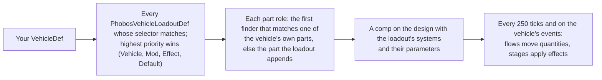

# Vehicle systems for modders

How to give your Vehicle Framework vehicles their own batteries, coolant, air brakes or anything else, and how to add systems of
your own, with D'thorga Framework's vehicle systems (RimWorld 1.7). Everything is XML; C# only when you want a new kind of
input, condition or effect. **Not yet tested in game**: the schema may change before the first public release, and this page will
say so when it does.

**What this page covers (28 Nov 2026):** the systems schema, checked against Framework 0.369.0: every input, condition and effect
class has a row in its table, and the vehicle systems' own Defs (fittings, tunes, grades, families, fit sets, the rules Defs, bills,
schematics, shaft loads, contracts and visits) have sections, all written from the code and the shipped XML. **The vehicle features**
(cabins, camps, hitches and trailers, the sling, litters, work rigs, aircraft, remote control and the rest) **are on their own page**:
[vehicle features for modders](vehicle-features-modding.md). **Every loadout field** has a row under [Loadout fields](#loadout-fields), and its nested blocks are covered where they are explained. For every field of every class, see the reference site's
[XML types](https://phobos-dthorga.github.io/phobos-rimworld/xml-types.html) page, rebuilt from the code on every change; the shipped
Defs under `mods/PhobosFramework/Mods/VehicleFramework/Common/Defs/Phobos/Framework/VehicleSystems/` show them in use, and
[the authors' override contract](development/vehicle-author-overrides.md) describes one of them. **Parts bills**
(what a vehicle is built from, by role) are core Framework services, on [D'thorga Framework for modders](framework-modding.md#parts-bills).

## Read this first (gotchas)

- **Every vehicle already gets systems by default**, matched by what it does (fuel, land or sea or air, mass). You only need a
  loadout to give a vehicle different figures or different systems. A vehicle you name beats a whole mod, which beats a match by
  effect.
- **Parts are appended, never reordered.** Vehicle Framework saves a vehicle's parts as healths in order. The service appends its
  parts after the vehicle's own and drops saved extras on load, so a design may lose or gain appended parts between versions, but
  **never insert or reorder parts in your own vehicle's list** for this.
- **Load after D'thorga Framework**, and put your loadouts in an `IfModActive` folder if they name another mod's vehicles.
- **Check your files offline**: `python scripts/check-vehicle-schemas.py` (in this repository) reads every system and loadout under
  `mods/`, resolves inheritance like the game, and names every mistake it can find without the game.
- **Classes are named in full**: `Class="Phobos.VehicleSystems.Effect_Message"`. A class of your own uses your namespace.
- **Player text stays in the world.** Messages and refusals describe the vehicle and what to do; they never name a mod or a setting.

## How a vehicle gets its systems



This happens while Defs load, before Vehicle Framework resolves the design, so Vehicle Framework builds the appended parts'
hitboxes itself. The settings window lets the player switch vehicles, kinds and systems off.

## A loadout for your vehicle

The smallest useful loadout inherits a default and changes figures. This gives `MyMod_BigTruck` a bigger alternator and air brakes:

```xml
<Phobos.VehicleSystems.PhobosVehicleLoadoutDef ParentName="PhobosVehicleLoadoutLandHeavy">
  <defName>MyMod_BigTruck_Loadout</defName>
  <label>my big truck</label>
  <priority>Vehicle</priority>
  <selector>
    <vehicleDefs><li>MyMod_BigTruck</li></vehicleDefs>
    <massMin>-1</massMin>   <!-- the parent asks for mass 350 or more; a named vehicle shouldn't depend on that -->
  </selector>
  <systems Inherit="False">
    <li><def>PhobosVehicleSystem_Electrical</def><set><alternatorAmps>140</alternatorAmps></set></li>
    <li><def>PhobosVehicleSystem_Cooling</def></li>
    <li><def>PhobosVehicleSystem_Lubrication</def></li>
    <li><def>PhobosVehicleSystem_Service</def></li>
    <li><def>PhobosVehicleSystem_RunningGear</def></li>
    <li><def>PhobosVehicleSystem_Brakes</def></li>
    <li><def>PhobosVehicleSystem_AirBrakes</def></li>
  </systems>
  <partRoles>
    <li>
      <role>Compressor</role>
      <add><key>PhobosAirCompressor</key><label>air compressor</label><health>25</health><cellsOf>Engine</cellsOf></add>
    </li>
  </partRoles>
</Phobos.VehicleSystems.PhobosVehicleLoadoutDef>
```

Without `Inherit="False"` a list adds to the parent's; with it, it replaces it. To exclude a vehicle entirely, give it a
`Vehicle`-priority loadout with no systems (D'thorga Vehicles did this for steam locomotives until they got a boiler).

### Loadout fields

| Field | What it does |
| --- | --- |
| `priority` | `Vehicle`, `Mod`, `Effect` (the defaults) or `Default`. Among equals the higher `rank` wins, then the last loaded, with a warning in the log. |
| `rank` | A whole number (default 0) that breaks ties within a priority: the shipped tracked loadout has 1, so it beats the light, medium and heavy ones. |
| `kind` | The settings window's group: `CombustionLand`, `CombustionHeavy`, `CombustionTracked`, `Boat`, `Aircraft`, or your own word. |
| `selector` | Which vehicles. Every condition given must hold: `vehicleDefs`, `packageIds`, `vehicleTypes` (Land, Sea, Air, Universal), `thingClasses` (the design's code class, or a class it is built on, by full name: how the shipped aircraft loadouts find every aircraft of a flight framework without naming each one), `fuelled`, `electricPowered`, `flies` (each `Yes`, `No` or `Any`), `trailer` (a design with `CompProperties_PhobosTrailer`; **`No` unless given**, so a loadout claims a trailer only with `<trailer>Yes</trailer>` or `Any`), `campDeck` and `campSide` (a trailer whose trailer comp has that camp setting on; `Any` unless given), `fuelTypes`, `excludeFuelTypes`, `massMin`, `massMax`, `partTags`, `partKeySuffixes` (a part key ends in one of them, as tracks end in `Track`). |
| `cabin` | `closed` (default true): whether the vehicles have a closed cab that shelters everyone aboard (the Cabin system gives it a temperature). `climateControl` (false): the cab has automatic climate control fitted, which holds it near a set temperature (see [Climate control](#climate-control)). A vehicle overrides either with a `Phobos.VehicleSystems.PhobosVehicleCabinExtension` on its VehicleDef (`closed` false for motorcycles and open boats). Since Framework 0.268.0, a ground vehicle whose author marked every seat exposed counts as open unless an extension says otherwise; aircraft are left out, as their exposed seats sit under a canopy. A closed cab gets the glass part. |
| `glass` | The glass's kind: `Ordinary` (default), `Armoured`, `VisionBlocks`, or `Windscreen` (since 0.268.0): a windscreen alone on an open vehicle, which still gets the glass part, reaches its open front seats with splinters and takes one laminated pane to re-glaze. A VehicleDef's `PhobosFittedEquipmentExtension` sets it for one design. |
| `empHardening` | What kind of vehicle this is, for EMP and for everything that asks whether it is military: `ByClass` (default: military if a gun is on the design as built, civilian otherwise), `Civilian`, `Military` or `Mechanical`. See [Vehicle class and EMP hardening](#vehicle-class-and-emp-hardening). |
| `noHitch` | (Framework 0.101.0) The loadout's land vehicles get no hitch, for a design that should never tow (false). A trailer gets none anyway. The shipped trailer loadout sets it. See the features page, [Hitches, couplings and trailers](vehicle-features-modding.md#hitches-couplings-and-trailers). |
| `drivetrain` | The engine and drivetrain: a `def` (a `PhobosVehicleDrivetrainDef`) and an optional `set` of overrides (`kilowattsPerTonne`, `drivenShare`, `wheelRadius`, `dragArea`, `kilogramsPerVehicleMass`, `emptyKilograms`, `fuelKilogramsFull`, `idleFuelShare`, `efficiency`). See [Engines and drivetrains](#engines-and-drivetrains). |
| `flightProfile` | An aircraft's `PhobosVehicleFlightProfileDef`: its phases and what each asks of the engines. |
| `avionics` | An aircraft's instruments, sensors and defences, and how it looks to an air defence. See [Avionics](#avionics). |
| `cruise` | (Framework 0.141.0) How the aircraft flies between tiles, in place of its flight profile's own `cruise` block (none: the profile's, and with neither, every leg is flown as its author made it). `designMetres` and `ceilingMetres` are **required, both above 0, the design height no higher than the ceiling** (a config error otherwise): the height its author's speed and fuel rate hold at, and its published service ceiling at its heaviest weight with every engine (above 11,000 m reads as 11,000). `lift` is `Rotor` (default), `Jet` or `Propeller`; `oxygenLineMetres` (3,810 m, 12,500 ft) is the height above which anyone aboard without oxygen keeps it down; `pressurised` (false) means nobody aboard needs oxygen while the canopy holds. Each leg is flown at the design height, brought down by the weight, lost engines or someone without oxygen, and refused where the ground and its clearance stand above what it can climb to. A jet or propeller aircraft flown lower is slower and thirstier; a rotor craft flown higher burns more. It governs only the player's aircraft with the player's **Cruising height between places** setting on (the default) and the full engine model. Shipped: the C-17's (`Mods/C17Globemaster/Defs/Loadouts_C17.xml`, sourced in its comment) and the profiles in `FlightProfiles.xml` (authored). |
| `engineOutYaw` | (Framework 0.247.0) How hard lopsided thrust pulls the aircraft round with one side's engines out, 0 to 1 (0: none, the default, right where one gearbox or a cross-shaft shares the engines' work, as on helicopters and the Osprey). With the player's **Lopsided thrust unsettles twin jets** setting on (the default), its dodge in the air is multiplied by 1 − `engineOutYaw` × how lopsided the thrust is now, and a player's turbine aircraft whose fuel follows its engines burns 1 + `engineOutYaw` × 0.5 × the same (the 0.5 is authored). Read only with two or more engine roles bound (`Engine1`, `Engine2` and on); where they sit comes from `engineArms` or the engine parts. Shipped figures, all authored: 0.15 on the A-10, Su-25 and Prowler, 0.2 on the C-17 and C-27J, 0.25 on Vanilla Vehicles Expanded's three-thruster pod. |
| `engineArms` | (Framework 0.255.0) Where each engine sits across the craft, `Engine1` first, for a design whose engine parts do not say, such as thrusters that each cover the whole body (empty: a twin's one each side by its order; with more engines, from where each engine part's hit area sits). Positive one side, negative the other, 0 on the centreline; only the signs and the sizes against each other matter, not the unit. **Give exactly one entry for each bound engine role**: a list of any other length is ignored, without a warning. `engineOutYaw` and `sideTanks` read it. Shipped: `<li>-1</li><li>1</li><li>0</li>` for Vanilla Vehicles Expanded's three-thruster pod (`Mods/VanillaVehiclesExpanded/Defs/Loadouts_VVE_Aircraft.xml`), its two outer thrusters either side and the third on the centreline. |
| `sideTanks` | (Framework 0.250.0) A fuel tank each side, each feeding the engines on its side, with a cross-feed between them (false). The vehicle keeps its one fuel figure; this tracks how it is split. A holed tank leaks from one side, picked at random; with the cross-feed shut, that side's engines starve once it runs dry, and the leak stops. The player's vehicle gets a cross-feed button: automatic (the default: the crew opens it when a side runs dry while the other holds fuel, and shuts it once the leak is gone and the tanks are level), open or shut. Refuelling fills the emptier side first; an engine on the centreline draws on both. **Needs a fuelled vehicle and engines on both sides** (`Engine1` and `Engine2` bound, or `engineArms`): with one `Engine` role it does nothing. Any faction's aircraft. Shipped on most of our twin and multi-engined aircraft. |
| `intakeDebris` | (Framework 0.250.0) How exposed the engines' intakes are to stones and grit off rough ground, 0 (none) to 1 (a low intake close behind the wheels). The shipped aircraft loadout gives 0.5, so **every aircraft loadout inherits 0.5 unless it says otherwise**. It drives grit strikes on take-off and landing and how fast a turbine's compressor fouls. See [Grit in the intakes](#grit-in-the-intakes). |
| `heldMassComps` | (Framework 0.254.0) Another mod's comps whose held things count as carried weight, by their **full type names, exactly** (namespace included; a subclass does not match). Each must be a comp that holds things (an `IThingHolder`). Everything it holds adds to the weight our engine model works with, as cargo does: a vehicle by its weight in kilograms, a person by their mass, anything else by its mass times its count. Read by name, so your mod needs no reference to the other mod, and a comp a later version drops simply weighs nothing. Shipped: `C17Globemaster.CompC17Airlifter`, the C-17's hold of vehicles (`Mods/C17Globemaster/Defs/Loadouts_C17.xml`). |
| `sling` | (Framework 0.92.0) A helicopter's cargo hook: `ratedKilograms` and `standDownIfActive` (none: no hook). See the features page, [Sling loads](vehicle-features-modding.md#sling-loads). |
| `systems` | Each `def` (a system) with an optional `set` of parameter overrides, written as elements: `<set><batteryAmpHours>90</batteryAmpHours></set>`. |
| `partRoles` | Each `role` with `find` rules and an optional `add`. `all` binds every match (wheels). |
| `cellsOfRemap` | (Framework 0.166.0) Moves parts the loadout adds: each `li` gives a `from` role and a `to` role, and every added part whose `cellsOf` names `from` takes the cells (and armour) of the part bound to `to` instead (empty). A role cannot be bound twice, so this is how a child loadout moves an inherited part. A child adds entries to its parent's; the first entry with a matching `from` wins. `to` must name a role bound on that design, or the moved parts get no cells. A part with its own `cells` is not moved. Shipped: the Osprey and the C-27J send `Engine` to `Cabin`, because the aircraft loadout puts the generator, battery, starter and cabin fittings on the engine's cells, and their `Engine` is the left nacelle out on the wing. |
| `loads` | Electrical consumers, each with a `name` (unique in the loadout), `amps` and a `when`. See [Electrical loads](#electrical-loads) for every field, the shedding order and keeping the start. |
| `factoryFittings` | (Framework 0.356.0) Fittings every vehicle of the loadout leaves the factory with: each given once, free, on the first free part it suits, to new vehicles and ones already in a save, and remembered by name so one the player takes off stays off. A child adds to its parent's list. Use `MayRequire` for another mod's fitting, as the aircraft loadout does for the Radio Framework's aviation radio. |
| `factoryFittingsMilitary` | (Framework 0.356.0) The same, only for a vehicle that counts as military: armed, or a loadout whose `empHardening` is military. |
| `fittedOnOlderSaves` | Fittings given once, free, on the first free part each suits, to a vehicle from an older save, so it keeps what its loadout no longer starts with (empty). For an aircraft that now starts as a plainer version: the Harrier lists its night sight and radar (`Mods/HarrierVtol/Defs/Loadouts_Harrier.xml`). A vehicle made since is given none. **Each vehicle is settled once, by one saved mark, and every vehicle saved with Framework 0.208.0 or later already has that mark**, so an entry added today reaches only vehicles from saves older than that. For a fitting every vehicle should have, new or saved, use `factoryFittings`. |

### Part roles

A role is a name a system reads (`Engine`, `Alternator`, `Battery`, `Starter`, `Radiator`, `OilPump`, `Transmission`, `Clutch`,
`Wheels`, `Brakes`, `Compressor`, `HydraulicPump`, `HydraulicLines`; `Engine1` and `Engine2` for twin engines, which the
drivetrain counts instead of `Engine` when they are bound). The first `find` rule that matches any of the vehicle's own parts binds
the role. A finder may ask for a `key`, a `keyContains` hint, `keyContainsAny` (several hints, any of which will do: one role
made of several kinds of part), `categories` (stats the part feeds), a `depth`, `priority` (`Yes` or
`No`) and a `tag`, all of which must hold. If nothing matches and the role has an `add`, the service appends that part:

| `add` field | Meaning |
| --- | --- |
| `key`, `label` | The part's identity and its in-world name. Prefix the key with your mod's prefix. |
| `health`, `depth`, `hitWeight`, `efficiencyWeight` | As Vehicle Framework's own parts (defaults 20, Internal, 0.3, 1). Vehicle Framework hits a bigger `hitWeight` more often. |
| `hitWeightCE` | The weight under Combat Extended, which sorts the other way (a smaller weight is hit more); left out, `hitWeight` is inverted there. |
| `cells` or `cellsOf` | Explicit hitbox cells, or the cells (and armour) of the part bound to another role, usually `Engine`, so Combat Extended's shots can reach it. |
| `categories`, `armor`, `tags` | As Vehicle Framework's own parts. |
| `last` | (Framework 0.366.0) Appended at the very end, after every part the code adds. **Vehicle Framework saves parts by position, so any part added to a design that saves already hold takes `last`**; added in the middle, it would hand its place's saved health to the next part. |
| `countsTowardDestruction` | Whether the part counts toward the vehicle's destruction (true). Vehicle Framework destroys a vehicle when its parts' health together falls under 1%. Give `false` to an empty mounting point for a fitting (a bay, a bracket, tie-downs): it can still be hit and broken, but it neither keeps a wreck alive nor brings the vehicle closer to destruction. |
| `eachOf` | (Framework 0.250.0) A role name: one part for each part bound to that role, rather than one in all, as one brake per wheel. The first keeps `key` and takes the first such part's cells; the others are keyed `key_` plus that part's key, each at its own part, appended after the other added parts. With fewer than two such parts, one part as usual. |
| `eachLabel` | The label of each part `eachOf` makes, with `{PART}` for the part it sits at ("{PART} brake") (empty: `label`). |
| `late` | (Framework 0.258.0) Appended after the other added parts, in the order of the loadout's list. **Superseded by `last` for anything new**: code appends further parts after the late ones, so a late part added today would still shift those in a saved vehicle. |

On the role itself (beside `role` and `find`): `notOnSubmersibles` (Framework 0.359.0) leaves it off a design that dives;
`onlyWithRole` (Framework 0.366.0, with `last`) adds it only where another role is bound, as the searchlight turret needs a rotor
drive; `notOnMilitary` (Framework 0.368.0) takes the part out of a military design (armed, or rated military), recording its place so a
saved vehicle drops its entry at the first load and the other parts keep their wear. A system may list `optionalRoles` (Framework
0.368.0): roles of its `roles` a vehicle may rightly lack, which the schema check then does not warn of.

A role nothing binds reads as a sound part (efficiency 1) and its effects do nothing. Every bound part reports its hits to the
systems, so `onPartHit` rules work on the vehicle's own parts too.

### Weapon mounts

**You write nothing for this.** While Defs load, every weapon on a design a loadout claims is tied to one part, its mount: the weapon stops
while that part is at or under a tenth of its health, and works again once it is repaired. It uses Vehicle Framework's own part
requirement (`VehicleTurret.component`), set on each weapon's template, so it acts on every faction's vehicles, costs nothing between hits
and is never saved: without D'thorga Framework the weapons work as their authors made them. The knock-out rules Def
(`PhobosKnockOutRulesDef`, see [Rules Defs for vehicles](#rules-defs-for-vehicles)) holds every figure.

**Gotchas first:**

- **Your own requirement always wins.** A weapon whose author gave it a `component` is left alone, as is a weapon mounted on another
  (it stops with its parent) and a fixed weapon (`turretType` `Static`, such as smoke dischargers). Weapons added by upgrade nodes
  (`Vehicles.TurretUpgrade`) are tied too.
- **To use your own turret part as the mount, add its key to `authorMountKeys`** with a patch (the example under
  [Rules Defs for vehicles](#rules-defs-for-vehicles) does exactly this). Keys match whole, case aside, and the first key in the list that
  the design has wins. Shipped: `MainTurret` (RimThunder's and others' turret part) and `PhobosPylons` (D'thorga Patches' Harrier pylons).
- **Otherwise a mount part is appended**, key `PhobosWeaponMount`: a "turret ring" of 60 health on a ground vehicle, or "weapon pylons" of
  40 on an aircraft (a design with Vehicle Framework's `CompProperties_VehicleLauncher`). It is internal, and sits on the cells of the seat
  that works the first weapon (the vehicle's centre cell if no seat names one), so hits there reach it. Healths and labels are authored, and
  patchable: `turretRingHealth`, `pylonHealth`, `turretRingLabel`, `pylonLabel`.
- **One mount per design.** Every tied weapon on a vehicle shares the same part.
- **Off for everyone with `<weaponMounts>false</weaponMounts>`**; `stopsAtOrBelow` (0.1, the owner's figure) moves the line.

**A weapon's drive.** The same Def decides how each weapon is turned, by its key or its turret Def's name (parts of names, case aside):

| Kind | How it is told | Without power |
| --- | --- | --- |
| Fixed | `turretType` `Static` | Nothing to turn. |
| Swung by hand | Standing alone, with a word of `handSwungTurretKeys` (`M2HB`, `M240`, `pintle`, ...); or riding on a turret with a word of `ownMountTurretKeys` (`cupola`, `topMG`, ...), or worked by a different crew member from its turret's | Loses nothing. |
| With its turret | Riding on a turret with a word of `coaxialTurretKeys` (`coax`), or worked by the turret's own crew | Goes where the turret goes. |
| Powered | Any other weapon standing alone | Cranked by hand: `handCrankTraversePace` (0.2) of its traverse and `handCrankAimPace` (0.5) of its aiming pace. An autonomous weapon (no seat works it) stops instead while nobody is aboard (`autonomousStopsWithoutPower`). |

**A powered weapon needs a load named `turretDrive` in the loadout's `loads`** (the rules Def's `turretDriveLoad`). The shipped land and boat
loadouts carry it (40 A, `shedOrder` 7, authored); the aircraft loadout does not, so an aircraft's weapons are never cranked by hand. With no
such load the weapon never loses power. Power, hand cranking and a cranked turret's worse aim apply to the player's vehicles only.

### Electrical loads

A load is something the vehicle's electrics feed: lights, a heater, a winch, the avionics. A loadout lists them in `loads`; a fitting
brings its own the same way while it is fitted ([Fitting fields](#fitting-fields-phobosvehiclesystemsphobosvehiclefittingdef)). Each load
draws `amps` while its conditions hold, and the electrical system adds them up against the alternator and the battery.

**Gotchas first:**

- **Names must be unique.** The game reports a config error for a load with no name or a repeated one. A child loadout's `loads` adds to
  its parent's, so **to change one of the parent's loads, write the list again with `Inherit="False"`**. A fitting's load whose name the
  loadout already has is ignored.
- **`shedOrder` 0 is essential and never shed.** Give every comfort, light and work load a rank of 1 or more, or it runs the battery
  flat with the generator lost. The shipped comforts (the air conditioner, the cab stereo, the reading light) take 1, shed first.
- **Nothing is shed with the engine stopped.** A parked vehicle's loads run the battery down by the player's choice; `startReserve` is the
  guard for that.
- **The other factions' vehicles run no loads**: their electrics are on the light tier. Headlights alone still burn on them at night
  while they move.

From the shipped land loadouts (`Loadouts_Default.xml`) and the fuel heater fitting (`Fittings.xml`), both in
`mods/PhobosFramework/Mods/VehicleFramework/Common/Defs/Phobos/Framework/VehicleSystems/`, trimmed. Figures authored:

```xml
<loads>
  <li>
    <name>headlights</name>
    <label>headlights</label>
    <description>Switched on, the headlights light the ground ahead of the vehicle at night. With the engine off they run the battery down.</description>
    <amps>9</amps>
    <shedOrder>6</shedOrder>
    <toggle>true</toggle>
    <defaultOn>false</defaultOn>
    <iconPath>Phobos/VehicleSystems/Headlights</iconPath>
    <when Class="Phobos.VehicleSystems.When_Dark" />
    <autoOn Class="Phobos.VehicleSystems.When_Any">
      <conditions>
        <li Class="Phobos.VehicleSystems.When_EngineRunning" />
        <li Class="Phobos.VehicleSystems.When_Moving" />
      </conditions>
    </autoOn>
    <autoDescription>they light by themselves in the dark while the vehicle is driven or its engine runs, and go out once it is parked with the engine off</autoDescription>
    <standbyLabel>waiting for dark</standbyLabel>
    <autoStandbyLabel>waiting for dark and a driver</autoStandbyLabel>
    <beam><radius>6</radius><ahead>5</ahead><colour>(255,228,190,0)</colour></beam>
    <lamps>
      <li><forward>0.95</forward><right>0.6</right><colour>(1, 0.92, 0.78, 0.85)</colour><size>0.55</size></li>
      <li><forward>-0.97</forward><right>0.65</right><colour>(1, 0.1, 0.05, 0.45)</colour><size>0.4</size><brake>true</brake></li>
    </lamps>
  </li>
  <li>
    <!-- The fuel heater fitting's load: shed early, and out before the battery is too low to start the engine. -->
    <name>fuelHeater</name>
    <label>fuel heater</label>
    <amps>12</amps>
    <shedOrder>2</shedOrder>
    <startReserve>startingPower</startReserve>
    <when Class="Phobos.VehicleSystems.When_AmbientBelow"><celsius>-8</celsius></when>
    <ampsInputs>
      <li Class="Phobos.VehicleSystems.Input_TwelveVoltShare" />
    </ampsInputs>
  </li>
</loads>
```

| Field | What it does (default) |
| --- | --- |
| `name` | The load's identity: conditions (`When_LoadActive`), fittings' `feed` and the code find it by this. **Required, unique.** |
| `label`, `description` | Its name and explanation in the player's words, on its switch and the Systems tab (empty). |
| `amps` | What it draws while it runs, in amperes (0). With `ampsInputs`, the figure they multiply. |
| `ampsInputs` | [Inputs](#inputs) multiplied with `amps` to give what it draws now (none): a fridge by the air's warmth, the engine electronics by rated power, half the amps on a 24-volt vehicle (`Input_TwelveVoltShare`). |
| `when` | The condition under which it draws (none: always). |
| `available` | Whether this vehicle has the load at all (none: always). While it does not hold, the load never runs, its switch is hidden and the Systems tab calls it not fitted. The work lamps use it: fitted lamps, or a design's own work-light upgrade. |
| `toggle` | The player gets a switch for it (false). |
| `defaultOn` | Whether that switch starts on (true). |
| `iconPath` | The switch's picture (none). |
| `autoOn` | When it switches itself on (none: by hand only). With the player's **Lights switch themselves** setting on (the default), it runs only while this holds as well as `when`, and its button says instead whether it may switch itself on at all on this vehicle. |
| `autoDescription` | What `autoOn` waits for, in the player's words, for the button's description (empty). |
| `standbyLabel` | What the Systems tab says while it is switched on but waiting for `when`, such as "waiting for dark" (empty: "standing by"). |
| `autoStandbyLabel` | The same while it switches itself (empty: `standbyLabel`). |
| `shedOrder` | When the charging fails, the order it is switched off to save the battery: 1 goes first, higher ranks later (0: essential, never shed). See below. |
| `startReserve` | A quantity the starter depends on (the electrical system's `startingPower`): the load goes out before that reading is too low to start the engine, and comes back once charging lifts it again (none). See below. |
| `campLoad` | A camp load (false): with a house battery fitted it draws on that battery only, and stops at the house battery's low-voltage cut-off instead of being shed or kept for the start. |
| `baseline` | A standing load of a running engine, its control unit, injectors and ignition (false). The vehicle author's rated power and fuel rate already allow for it, so it takes nothing off driving. |
| `yieldsTo` | Another load, by name, that does this one's job while it runs (none). Words only: while that load runs and this one stands by, the Systems tab says who has the job. Its own `when` still decides whether it draws. |
| `ampsFromAvionics` | `Essential` or `Other`: its `amps` are worked out from the loadout's [avionics](#avionics) (`None`: the `amps` written). Read only on a loadout's own loads. |
| `beam` | A pool of the game's light ahead of the vehicle while the load runs (none): `radius` (6 cells), `ahead` (5 cells past the nose), `colour` (`(255,228,190,0)`), `brightness` (1.45). **Only the loadout's first load with a beam is the headlights**; another beam does nothing unless code reads it (the searchlight fitting's load, `searchlight`, has its own). |
| `lamps` | Glows drawn on the vehicle while the load runs, under the player's **Vehicle effects** setting (none). See below. |

**The shedding order.** Shedding starts only while the engine runs, when the generator is lost (its working share below 0.2), or the battery
is running down below 0.3 charge, and it ends once the charge is back above 0.35 (all on `PhobosVehicleRulesDef`: `shedGeneratorLost`,
`shedLowCharge`, `shedRecoveredCharge`, authored). How many ranks go depends on the charge: ranks 1 and 2 at 0.6 or more, up to 4 at 0.45
or more, up to 5 at 0.3 or more, every rank below that (fixed in the code). The player's switch is left as it was, so a shed load comes back
by itself. Shipped ranks, for matching yours (examples, not every load):

| Rank | Shipped loads |
| --- | --- |
| 0 (never) | Engine electronics, the avionics' essentials, the recovery winch, the rescue hoist |
| 1 | Air conditioner, camp lights, power outlet, field laboratory, a towed trailer's pump and water treatment |
| 2 | Climate control, fuel heater, camp fridge, sonar, a towed cold box |
| 3 | Cab heater, cabin oxygen, avionics kits, the jamming pod, litter monitors |
| 4 | Night heater, mission avionics, listening array |
| 5 | Work lamps, searchlight |
| 6 | Headlights, navigation and landing lights, recovery beacons |
| 7 | Turret drive |
| 9 | Route kit, uncrewed kit |

**Keeping the start.** `startReserve` names a quantity (the shipped loads use `startingPower`). The line is read from that quantity's own
stages, never a figure on the load: the top of the stage just above the highest stage whose effects refuse a start (`Effect_RefuseDraft`),
which is the electrical system's "barely enough to start" band. The load goes out as the reading falls below that line, and comes back
only once the battery is charging and the reading is past the line again, so a warming day alone does not bring it back. A message names
the loads kept out. With a house battery fitted, a `campLoad` is never held. A quantity with no stage refusing a start gives no line, and
the load is never held.

**Lamps.** Each `li` of `lamps` is one glow, the game's fire glow tinted, turning with the vehicle. Every figure is authored.

| Field | What it does (default) |
| --- | --- |
| `forward`, `right` | Where it sits: shares of half the vehicle's length ahead of the middle and half its width to its right (0, 0). |
| `drawn` | Place it on the drawn picture instead of the footprint, for an aircraft's wingtips (false). |
| `colour` | Red, green, blue and alpha, 0 to 1 (white). |
| `size` | Its size across, in cells (0.6). |
| `pattern` | `Steady` or `Flash` (Steady). |
| `periodSeconds`, `phase`, `litShare` | For a flash: its period (1), how late in the period it comes, 0 to 1 (0: two lamps half a period apart take turns), and the share of the period it lasts (0.2). |
| `brake` | A brake lamp: also lit, brighter and larger, while the vehicle slows, whether or not its load runs (false). |

### Vehicle class and EMP hardening

Every design has a class, worked out once at start-up from its loadout's `empHardening` and its guns. The Systems tab shows it
("Class: military"), and EMP, the factory radios and the civilian fittings all read the same answer, so they never disagree.

**Gotchas first:**

- **Leave it at `ByClass` unless you know better than the guns.** A gun on the design as built makes it military; otherwise it is civilian.
- **A gun added only by an upgrade does not make it military.** Such a design is shown as "armed by upgrade" and treated as civilian
  everywhere (EMP, factory fittings, civilian bays).
- **`Military` or `Mechanical` written on the loadout wins over the guns, and so does `Civilian`**: an armed design rated `Civilian`
  is civilian throughout.

| `empHardening` | Class | What it changes |
| --- | --- | --- |
| `ByClass` (default) | Military if armed as built, else civilian (or armed by upgrade) | As the row it lands on. |
| `Civilian` | Civilian | Its electrical parts get the civilian EMP rating; a stalled engine is possible. |
| `Military` | Military | The military EMP rating (less harm); it gets `factoryFittingsMilitary`; part roles marked `notOnMilitary` (a stereo, a sleeper berth, camping mounts) are taken out of the design. |
| `Mechanical` | Mechanical | Nothing electronic keeps the engine running: an EMP never stalls it, though its electrics still take the civilian rating's harm. Not military. The steam locomotives use it (`Mods/TrainsOfTheRim/Defs/Loadouts_TrainsOfTheRim.xml`). |

**How the EMP part works.** Vehicle Framework already stalls a vehicle and harms its parts on an EMP hit, but only on a part its author
gave an EMP rating, and few authors do. So D'thorga Framework rates the parts bound to the rules Def's `empRoles` (`Battery`, `Alternator`,
`Starter`, `TractionBattery`, `TractionMotor`): `empSeverityCivilian` (`Moderate`) or `empSeverityMilitary` (`Minor`), both on
`PhobosVehicleRulesDef` and authored. **A rating the vehicle's author gave a part is kept.** Mods listed in `empNoStunPackages` (the
RimThunder ones, as shipped) are harmed but never stalled. The EMP hardening kit upgrade lowers a fitted vehicle's ratings to the military
one. Under Combat Extended, whose armour setting skips Vehicle Framework's EMP step, the Framework runs that step itself.

### Avionics

An aircraft's `avionics` block says what it carries: flight instruments, navigation, sights, radar, a warning receiver, chaff and flares,
crew oxygen, and how it looks to another mod's air defence. Each capability it carries then works while its part is sound and the battery
has charge, and draws its share of the avionics loads. Every aircraft has attitude instruments and basic navigation unless its loadout says
otherwise.

**Gotchas first:**

- **Write it once on the aircraft's loadout; a child loadout names only what differs.** The shipped aircraft loadout
  (`PhobosVehicleLoadoutAircraft`) has an empty `<avionics />`, so a child inherits the defaults.
- **The capabilities reach the systems only through `PhobosVehicleSystem_Avionics`**, the system that takes the fit. The aircraft loadout
  lists it; **a loadout that writes `<systems Inherit="False">` must list it again**, or nothing it carries works.
- **The avionics draw comes from two loads with `ampsFromAvionics`** (`avionics`, `Essential`, never shed; `missionAvionics`, `Other`,
  `shedOrder` 4), in the aircraft loadout's `loads`. A loadout that replaces its loads must keep them, or the avionics draw nothing.
- **Carrying chaff and flares adds the dispensers' magazine for you** (see the features page, [Chaff and flare magazine](vehicle-features-modding.md#chaff-and-flare-magazine)).
- **`airTrack` matters only with The Dead Man's Switch - Expedition**, whose air defence D'thorga Framework feeds through a tie-in loaded
  with it. Its scales are that mod's own.
- **Never set `mapEvasion` on an aircraft whose own mod gives it a dodge** (the Harrier, the Hind, the Mongoose): shots would be dodged twice.

From the Close Air Support tie-in's A-10 (`mods/PhobosVehicles/Mods/CloseAirSupport/Defs/Loadouts_CloseAirSupport.xml`), trimmed. Its
fit is sourced in the file; the air track and dodge are authored:

```xml
<avionics>
  <navigation>Basic</navigation>
  <autopilot>false</autopilot>
  <radar>false</radar>
  <sight>Full</sight>
  <nightSight>false</nightSight>
  <warning>true</warning>
  <countermeasures>true</countermeasures>
  <countermeasureCartridges>240</countermeasureCartridges>
  <oxygen>true</oxygen>
  <cruisesHigh>true</cruisesHigh>
  <airTrack>
    <speed>12</speed>
    <cruiseMetres>5000</cruiseMetres>
    <lowCruiseMetres>1500</lowCruiseMetres>
    <size>1.8</size>
  </airTrack>
  <mapEvasion>0.26</mapEvasion>
</avionics>
```

A transport helicopter, for contrast (the UH-60's, `Mods/UH60Blackhawk/Defs/Loadouts_UH60.xml`): `speed` 8, `cruiseMetres` and
`lowCruiseMetres` 1000, `size` 2.0.

| Field | What it does (default) |
| --- | --- |
| `attitude` | Attitude, heading and airspeed instruments (true). Without working ones it may not take off at night or in fog. |
| `navigation` | `None`, `Basic` (compass and radio aids) or `Full` (an inertial or Doppler set and moving map, holding a course at night and in fog) (`Basic`). Without working navigation a flight wanders off track, slower and thirstier. The full set's extra is not kept on the battery. |
| `autopilot` | Holds height and heading (false): it halves the risk of a rough landing, and the wandering with basic navigation only. |
| `sight` | The weapon sight, `None`, `Basic` or `Full` (`None`). A basic sight aims a little worse than a full one, none much worse. |
| `nightSight` | An infrared camera: aim at night as well as by day (false). |
| `radar` | Finds targets through rain, fog and snow, giving back half of what the weather takes from the aim (false). |
| `warning` | A radar warning receiver (false). Chaff and flares fired on its cue break more shots than those fired late, by eye. |
| `countermeasures` | Chaff and flare dispensers (false). The Framework adds their magazine to the aircraft. |
| `countermeasureCartridges` | Cartridges the magazine holds (30). Read only with `countermeasures`. |
| `countermeasuresByUpgrade` | The dispensers come only with an upgrade node that raises `Phobos_Countermeasures` (false). Read only with `countermeasures`. |
| `oxygen` | Crew oxygen from engine bleed air (false). It needs its part, power and an engine giving bleed air. |
| `cruisesHigh` | The aircraft cruises where its crew needs oxygen (false). With its oxygen out it flies its world legs low: slower and thirstier (authored factors), unless the player's **Cruising height between places** setting governs it; and an air defence sees it at `lowCruiseMetres`. A crew whose oxygen fails while high may suffer hypoxia, by the player's setting (off by default). |
| `airTrack` | How the aircraft looks in flight to The Dead Man's Switch - Expedition's air defence (none: the defaults below). |
| `mapEvasion` | The chance, 0 to 1, that a shot at it misses while it is in the air on a map, for an aircraft whose own mod gives it no dodge (0: shots left alone). Scaled by its flight controls and warning receiver, with a salvo's bonus. It also gives the aircraft the salvo button. Any faction's aircraft. |

`airTrack`, on The Dead Man's Switch - Expedition's own scales (read from its code and its missiles' Defs; every figure authored for play):

| Field | What it does (default) |
| --- | --- |
| `speed` | Its speed on that mod's scale (12). That mod's default is 15 and its cruise missiles 18 to 32; above 15 a radar locks on more slowly and hits less. |
| `cruiseMetres` | The height it cruises at, in metres (3000). It climbs to it over the first 1.5 tiles after take-off and comes down over the last 1.5 (`climbTiles` on `PhobosAirCombatRulesDef`), never below a tenth of it in flight. Where the player's cruising height setting governs the aircraft, the leg's own height is used instead. |
| `lowCruiseMetres` | The height it cruises at with its oxygen out, for an aircraft that `cruisesHigh` (1500). Never above `cruiseMetres`. |
| `size` | Multiplies the range at which a radar sees it (1.5). That mod's missiles are 1 to 2.2. |

The Radio Framework reads the same cruise height for an aircraft that relays radio, so a high cruise reaches further there too.

**What a capability needs to work.** Each reads as working at 0.6 or more of its quantity in the avionics system: the capability carried
(by the fit, or raised for one aircraft by an avionics kit's `parameterFloors`), its part sound (the `Avionics` role for most, the
`AutopilotMount`, `SensorMount` and `RadarMount` roles for the autopilot, night sight and radar), and charge in the battery. A hostile
jamming field blinds a radar and a warning receiver. The draw is authored at 24 V: the essentials (attitude 2 A, basic navigation 2,
basic sight 1, warning receiver 2, dispensers 1, oxygen 2) stay on the battery with the generator lost; the rest (full navigation 4 more,
full sight 4 more, autopilot 4, radar 20, night sight 4) are shed with the comforts.

### Grit in the intakes

A loadout's `intakeDebris`, 0 to 1, says how exposed the engines' intakes are to stones and grit thrown up on rough ground (any ground
that is neither a floor nor water). It does two things, on any faction's aircraft:

- **Strikes.** In a flight phase that throws grit (`debrisPhases` on `PhobosLandingSurfaceRulesDef`: take-off and landing rolls, taking off
  and landing, a vertical landing, and taxiing while it moves), an aircraft may take a strike that costs a random engine 15% of its
  health, never below 30%. The chance is 0.5 strikes an hour × `intakeDebris` × the phase's weight × the rough share of the ground under it.
  An aircraft on our own flight, or one that takes off and lands through Vehicle Framework's own launch, is judged once at each lift-off
  and touch-down instead: 4% × `intakeDebris` × the rough share. The player is told which engine was hit.
- **Compressor fouling.** A running turbine's compressor fouls faster on rough ground in step with `intakeDebris` (see
  `Input_CompressorFouling` under [Inputs](#inputs)), under the player's **Turbine compressors get dirty** setting.

An inlet barrier upgrade keeps four fifths of the grit out at a lift-off or touch-down and stops strikes in a phase in the same
measure; an intake separator, while on, keeps half out. Every figure is authored for play (`LandingSurface.xml`): foreign-object damage is
the real reason rough-strip aircraft carry high or guarded intakes, but no measured rate stands behind these.

| Shipped `intakeDebris` (all authored) | Aircraft |
| --- | --- |
| 1.0 | EA-6B Prowler (low intakes) |
| 0.8 | Harrier |
| 0.6 | Osprey, Mongoose |
| 0.5 | Any aircraft our loadouts do not name (`PhobosVehicleLoadout_Aircraft`), the Cherokee |
| 0.4 | C-27J, the RimArrow search-and-rescue aircraft (first loadout) |
| 0.3 | C-17, Su-25, Hind, UH-60, the RimArrow's second loadout |
| 0.25 | A-10 (engines set high on the rear fuselage) |

## A system of your own

A system is quantities, the flows that move them, and stages with effects. This is a minimal one: a tank of water that a working
pump empties, with a stage that stops the vehicle starting when it runs dry.

```xml
<Phobos.VehicleSystems.PhobosVehicleSystemDef>
  <defName>MyMod_WaterSpray</defName>
  <label>water spray</label>
  <description>A tank of water the spray pump draws from.</description>
  <roles><li>Pump</li></roles>
  <parameters>
    <pumpLitresPerHour>40</pumpLitresPerHour>
    <tankLitres>400</tankLitres>
  </parameters>
  <quantities>
    <li>
      <name>water</name>
      <label>water tank</label>
      <unit>Fraction</unit>
      <startsAt>Full</startsAt>
      <stages>
        <li>
          <to>0.05</to>
          <label>empty</label>
          <notable>true</notable>
          <effects>
            <li Class="Phobos.VehicleSystems.Effect_Message"><message>MyMod_TankEmpty</message></li>
          </effects>
        </li>
      </stages>
    </li>
  </quantities>
  <flows>
    <li>
      <name>spray</name>
      <quantity>water</quantity>
      <kind>From</kind>
      <factorParameter>pumpLitresPerHour</factorParameter>
      <divideByParameter>tankLitres</divideByParameter>
      <when Class="Phobos.VehicleSystems.When_Moving" />
      <inputs>
        <li Class="Phobos.VehicleSystems.Input_PartEfficiency"><role>Pump</role></li>
      </inputs>
    </li>
  </flows>
</Phobos.VehicleSystems.PhobosVehicleSystemDef>
```

### System fields

| Field | What it does |
| --- | --- |
| `parameters` | Named figures with their defaults, as elements. Loadouts override them; flows and effects name them. |
| `quantities` | State variables: `name`, `label`, `unit` (`Plain`, `Celsius`, `Fraction`, `Hours`), `min`, `max`, `startsAt` (`Ambient`, `Full`, `Empty`, `Value` with `startValue`), `hidden` (no figure shown; notable stages still show), `stages`. A quantity with `derivedFrom` is not integrated: each interval it is the product of those inputs. |
| `showOnDashboard` | The quantity gets a gauge on the vehicle's Dashboard tab (not for a hidden quantity). |
| `stages` | Ranges `from` (inclusive) and `to` (exclusive), either open-ended, in rising order: `label`, `notable` (Plain mode names it), `logged` (Framework 0.290.0: kept in the vehicle's event log and noted as seen in play, with no inspect line, lamp or chime; a notable stage is logged anyway), `effects`. A value in a gap is in no stage. |
| `flows` | Rate rules on one quantity: `kind` `Into` and `From` (units per hour) or `Toward` a `target` input (the share of the gap closed per hour, done exactly, so it never overshoots). The rate is `factor`, times `factorParameter`, over `divideByParameter`, times every input. `openAbove` or `openAboveParameter` (and `openBelow`) with a `band` gate it like a thermostat. `when` limits it to a condition. |
| `onEvents` | Effects run once on one of Vehicle Framework's events (`IgnitionOn`, `IgnitionOff`, `MoveStart`, `MoveStop`, `Refueled`, `OutOfFuel` and the rest). |
| `onPartHit` | When a part playing `role` is hit, `quantity` changes by `perHealthLost` for each hit point lost and `perShareLost` for each share of the part's whole health lost (prefer it: a small part and a big one then agree), or the part gets `condition` with that much severity ([Part conditions](#part-conditions)). `armorCategories` (Sharp, Blunt, Heat) and `damageDefs` limit a rule to kinds of damage, `exceptDamageDefs` rules kinds out; with no filter any hit counts. |
| `service` | What a mechanic does: `label`, due when `dueQuantity` passes `dueAbove` or `dueBelow`, or when one of `alsoDue` holds (each a `quantity` of any running system on the vehicle with `above` or `below`, and an optional player `setting` that must be on; a quantity the vehicle lacks never trips it) (or while the vehicle has a condition in `clearsConditions`, which the service then clears), `supplies` loaded into the cargo first (and `rawSupplies`, taken instead while the colony still accepts raw materials: Framework 0.74.0's service kits keep their old materials there, and a save from before kits starts with raw materials accepted), `waterLitres` (or `waterLitresParameter`, a system parameter each loadout can set; `scaledWaterLitresParameter`, a scaled figure used unless the player's `realisticWaterSetting` is on, `realisticFeedWater` by default; and `waterForShortfall`, to draw only what the due quantity is short of) drawn from the registered water source when the work ends (free when none is registered; see [Water](#water-for-services)), `work` (ticks at construction speed 1), then `restores` (any system's quantities). |
| `jumpStart` | How a colonist jump-starts the vehicle from another: `quantity` (raised to `raiseTo` when below it), `capacityParameter` (the unit the charge moves in), `donorMinimum` (or a running engine), `reach` in cells, `work` in ticks. The player orders it from the flat vehicle's right-click menu. |
| `workerClass` | A `VehicleSystemWorker` subclass for maths XML cannot say. |

The service runs every 250 ticks (the rare tick Vehicle Framework calls on every comp), in steps of at most 0.025 game hours, and
catches up on up to 24 hours after a vehicle has been away. Quantities are saved by system and name, so you may add quantities to a
system freely; renaming one loses its saved value.

### Inputs

Every input, condition and effect is named in full: `Class="Phobos.VehicleSystems.<name>"`.

Every input takes an optional `curve` (points `(x, y)` mapping the raw reading) and `factor`.

| Input | Reads |
| --- | --- |
| `Input_AirCooling` | how well the air carries a radiator's heat away, as a share of sea level's: 1 at the sea, less at height (the rules Def's `airCoolingExponent`), and 1 with the player's `thinAir` setting off. The cooling system's radiator flow multiplies by it |
| `Input_AlternatorOutput` | the alternator's output as a share of its rating now, from the rules Def's one curve on the alternator's own speed; for a turbine, the generator's spool curve, shared among the engines still working. Use it rather than copying the curves into each system that charges a battery (the electrical and house battery systems do) |
| `Input_Ambient` | the temperature around the vehicle, °C (its room on a map, the weather on the world map) |
| `Input_BarrierDust` | the share of rough ground under a running aircraft that its inlet barrier filter stops (0 to 1); 0 with no barrier fitted, the engines stopped, or the player's `intakeSeparators` setting off. The turbine system uses it |
| `Input_BatteryTemperature` | the battery's temperature, °C: the air's, or at least `warmTo` (5) while a battery warmer is fitted (the system's `batteryWarmerAbsent` parameter below 0.5), the engine is off and the vehicle has shore power. It drops to the air's at once when unplugged (a simplification) |
| `Input_Bleed` | bleed air from the engines (Framework 0.119.0): the share of engines turning while they run, and 1 while they are off, so a parked aircraft reads ready; 1 with no engine count |
| `Input_BrakeHeat` | what the service brakes take on a descent on the world map: `reading` `DegreesPerHour` (the default; °C an hour by the vehicle's and any trailer's mass, and 0 with the player's `brakeFade` setting off) or `Kilowatts`. 0 off a descent, without the full ground drivetrain model, or on a local map |
| `Input_BrakeWork` | what the move asks of brakes and clutch, by `reading`: `Mass` (the default; everything aboard and behind the hitch against the empty mass, from 1 up to `most`, 3), `Speed` (the square of the last moving speed against the design speed, between `least`, 0.25, and `mostSpeed`, 1.5; 1 off the map) or `Work` (the two multiplied). 1 without a ground drivetrain model. The chassis system's brake wear uses it |
| `Input_CampLightAmps` | what the camp's pole lights draw now, in amps at the vehicle's voltage: the watts of each one set out from this vehicle's camp that wants to be lit; 0 with none. The rules Def's `campLights` camp load uses it |
| `Input_CampLoadAmps` | what the camp loads draw from the house battery now, in amps; 0 without a house battery fitted or with it below its cut-off. The house battery systems use it |
| `Input_Comms` | (Framework 0.356.0) the vehicle's radios through `VehicleComms`, which a radio mod answers: `reading` `Link` (the default; 0 no radio, 1 jammed, 2 out of touch, 3 faint, 4 in touch, 5 away from the map) or `Radio` (0 none, 1 fitted but dead, 2 working). With no radio mod, 0. The Radio Framework's Comms system uses it |
| `Input_CompressorFouling` | how fast a turbine's compressor fouls, per hour: the rules Def's `compressorFoulingPerHour` (0.01), raised on rough ground by `compressorFoulingRoughFactor` (2) times the loadout's `intakeDebris` (an intake separator that is on keeps half the rough ground out). 0 with the engine stopped or the player's `compressorFouling` setting off; off the map the ground counts as paving |
| `Input_Condition` | 1 when `condition` holds, else 0; 1 when no `condition` is given |
| `Input_Constant` | `value` (0) |
| `Input_DarkDriving` | 1 while the vehicle is on a map, moving, with its headlights off, over ground whose light is below `darkBelow` (0.3, the game's own line between dark and lit), else 0. A trailer reads 0: the vehicle towing it sees the way |
| `Input_DrivePower` | power at the driven wheels, kW (0 without a drivetrain) |
| `Input_Driver` | the person at the wheel: the fittest one in a driving seat, not in a mental break, while the vehicle is driven (the player's while the engine runs, another faction's while it moves on the map). `reading` `Fitness` (the default) gives their fitness to drive, 0 to 1, from the game's consciousness, sight and manipulation and whether they are tired; `Tired` gives 1 while they are tired; `Experience` gives the best practice share at this kind of vehicle among the player's people in a driving seat, 0 to just under 1 (0 for another faction's vehicle). With nobody at the wheel it reads fit (1), rested (0) and unpractised (0) |
| `Input_Dust` | how dusty the air the engine breathes is, as a multiple of the ordinary: by the place's yearly rainfall (about 3 in a desert, 1 in wet country) and, on a map, the weather's sand while the vehicle stands in the open. On the world map, the caravan's tile; 1 with no caravan. The air filter (service system) and the turbocharger use it |
| `Input_ElectricalBalance` | `side` `Surplus` (the default) or `Deficit`, in amps: the supply (while the engine runs, the `supplyParameter` (`alternatorAmps`) times `supplyRole`'s (`Alternator`) efficiency, times the optional `drivenByRole`'s drive share (the drive belt) and the optional `supplyFactor` input) against what the loads draw. `fromSystem` reads the supply's figures from another system on the vehicle (0 if it has none). On the `Deficit` side a grid carrying the parked vehicle's loads adds the rules Def's `hookUpRatingAmps` (60) to the supply |
| `Input_EngineElectronics` | how much electricity the engine needs against a modern electronically controlled one: its drivetrain Def's `electronicsShare` (a quarter or so for an old mechanical diesel); 1 without a drivetrain model. The default loadouts' "engine electronics and instruments" load multiplies by it |
| `Input_EngineFeed` | the worst engine's reading, 0 to 1, by `reading`: `fuelFeed` (the default; its fuel pump's work), `oilPressure` or `oilLevel`. 1 on a vehicle with no engines. The engine feed system's quantities are derived from it. Any other reading is a config error at load (it would read the oil level) |
| `Input_EngineHeat` | heat into the coolant as a share of the heat at full load: with the full ground drivetrain model, the model's share plus the electrical loads' share while running (0 off); otherwise, and while set-up work turns the engine, the engine load |
| `Input_EngineLoad` | how hard the engine works, 0 to 1: 0 off, 0.5 idling, 1 moving or flying; with the player's drivetrain mode on full, the model's load. Set-up work that turns the engine raises it to that work's demand; a hybrid running on its battery reads 0 |
| `Input_EngineRpm` | engine speed in rpm, times `multiplier` (1; an alternator's pulley). With a drivetrain or turbine model (drivetrain mode not off) and the engine running, the model's speed, or from idle to rated by the load while set-up work turns it; without one, `idle` (800) standing or `cruise` (2000) moving. 0 with the engine off. `alternatorSpeed` gives the alternator's speed instead: times the drivetrain's own alternator ratio where there is one, else times `multiplier` |
| `Input_EngineRunning` | `running` (1) or `off` (0): fuel aboard and the vehicle drafted, moving in a caravan or flying; an aircraft on a map by its flight phase; running while set-up work turns the engine; off while a hybrid runs on its battery |
| `Input_Fire` | how fiercely the vehicle burns: its biggest attached fire on its own map as a share of a full-grown fire (0 to 1); 0 under water or off the map |
| `Input_Fording` | 1 while a land vehicle whose kerb mass is under `lowIntakeBelowKg` (2,000 kg) has its engine running on a river's terrain, times the system's `intakeExposure` parameter (a snorkel sets it to 0); else 0 |
| `Input_FuelAir` | the air an aircraft's fuel tanks meet, °C: the air around it, except on a leg flown at a cruising height between tiles, where it is the air at that height warmed by the aircraft's speed (the system's `cruiseMach`, or `rotorMach` for a design with a rotor drive). The engine feed system's fuel temperature follows it |
| `Input_GearboxWork` | the share of a gearbox's full-work heat: 0 off, `stopped` (0.1) standing; on the move `flatOut` (1) without the full ground drivetrain model, and with it from `cruising` (0.7) at no load to `flatOut` at full load |
| `Input_GeneratorDrive` | the share of its output the alternator or generator gives at the engine's speed: a turbine's follows its spool speed through `turbineSpool`, shared among the engines still working; any other engine, or a turbine with no `turbineSpool`, reads the `piston` input (1 without one). Used as an `Input_ElectricalBalance`'s `supplyFactor` |
| `Input_GroundPathCost` | the path cost of the ground under the vehicle (0 road or floor, 2 soil, 14 mud or soft sand, more with snow; the caravan's tile on the world map, open soil (2) when unknown; 0 on rails or in flight); with `setting` named and off, 0 |
| `Input_HeaterCore` | the heat the cab's heater core takes from the coolant, as a share of the engine's full-load heat: the system parameter named by `kilowattsParameter` (`heaterCoreKw`) over the drivetrain model's full-load heat. 0 without the full ground model. The cooling system uses it |
| `Input_LoadAmps` | the amps the starting battery's loads draw now: switched on, their conditions holding, and not shorted, shed or held back to save the start; nothing on a flat battery. Camp loads on a fitted house battery are not counted here (`Input_CampLoadAmps`) |
| `Input_LoadShedding` | 1 while the electrics are switching loads off to save a failing battery, else 0 |
| `Input_Moving` | `moving` (1) or `stopped` (0): moving on the map, in a caravan, in flight, or (a trailer) behind a moving vehicle. `stoppedBonusStat`, when named, adds the vehicle's value of that stat to `stopped` while parked, never past `moving` (a heavy-duty fan) |
| `Input_OilWithoutCoolant` | where oil settles with no coolant to follow: the air while off; running, `idleCelsius` (55) to `fullCelsius` (95) with load |
| `Input_OutletAmps` | what the power outlet draws now, in amps: the watts it gives the camp, through the inverter (the rules Def's `inverterEfficiency`), at the vehicle's voltage; 0 while it gives nothing |
| `Input_Parameter` | a `parameter` of the system, after the loadout's overrides |
| `Input_PartEfficiency` | the average efficiency of the parts bound to `role`, or `missing` (1). The drive belt's role also counts its grip, so a slipping belt passes less |
| `Input_PartHealth` | the average share of full health of the parts bound to `role` (how worn they are), or `missing` (1) |
| `Input_Quantity` | another `quantity` of the vehicle, in any running system, or the `fallback` input (the `curve` maps the fallback too), or 0 with neither. A system switched off in the settings, or the cab system on an open vehicle, reads as absent; `When_QuantityAbove` and `When_QuantityBelow` are then false |
| `Input_RatedPower` | the engine's rated power, kW, from the drivetrain model; 100 without one, so a figure written for an ordinary car is used as written. The default loadouts' engine electronics load scales by it through a curve |
| `Input_Setting` | 1 when the player's setting of that name is on, else 0 (the names `When_Setting` takes; an unknown name is a config error naming the Def, and reads 0) |
| `Input_ShorePower` | 1 when the parked vehicle has shore power: a generator set's service lead feeds it, or its grid hook-up delivers (a powered grid under its meter, and the power outlet not giving); 0 while it moves |
| `Input_SolarAmps` | what the fitted solar panels give now, in amps at the vehicle's voltage: their watts times the daylight on them times `efficiency` (0.85, the charge controller). On a map the daylight is the sky's glow times the share of the vehicle's cells under open sky; on the world map, the sun at its tile. 0 with no panels. No panel angle, heat or partial shade (a simplification) |
| `Input_SteeringWork` | how hard the power steering works now: 0 going straight or stopped; turning, from 1 at a crawl down to 0.2 at 12 m/s and above |
| `Input_TankLoad` | how heavily a bulk tank's load sits on the vehicle: how full the fitted tank is, times its `loadWeight` (0 with no tank fitted) |
| `Input_TankTreatmentAmps` | what this vehicle's own reverse-osmosis kit draws now, in amps at its voltage: the tank's `treatmentWatts` while the kit wants to run, else 0 |
| `Input_TowedColdBoxAmps` | what the packed cold boxes in tow draw now, in amps at this vehicle's voltage: each one's working watts while it holds food |
| `Input_TowedPumpAmps` | what the electric pumps of the trailers behind draw now, in amps at this vehicle's voltage: each one's own watts while it pumps |
| `Input_TowedTreatmentAmps` | what the reverse-osmosis kits on the trailers behind draw now, in amps at this vehicle's voltage, while each kit wants to run |
| `Input_TractionLoad` | a diesel-electric's pull over its traction motors' continuous rating (above 1 they heat); 0 without a rating |
| `Input_Turbine` | a turbine `reading`: `Temperature` (the default; °C), `OverContinuous` and `OverTop` (degrees past those limits), `SpeedPercent`, `LifePerHour` (0 with the engine off), `Demand`, `EnginesOut`, `OverTorque` (demand over the rotor drive's limit, minus 1; −1 with the engine off). Without a turbine model: the air's temperature, −1000 for the two limits, −1 for `OverTorque`, the engines out where there is a drivetrain, else 0 |
| `Input_TwelveVoltShare` | 12 over the vehicle's voltage (its systems' `systemVolts`, 12 when none says), so a load written in amps at 12 V draws half as many on a 24 V truck for the same watts; 1 if the voltage reads 0 |
| `Input_VehicleStat` | one of Vehicle Framework's vehicle stats on this vehicle, named by `stat`, as Vehicle Framework works it out from its parts (`FlightControl`, for example); 0 with no `stat` |
| `Input_Wading` | 1 while a vehicle on a map moves over the game's water terrain (shallow water, marsh, a river), else 0. The chassis system's wet brakes use it |

### Conditions

Every condition takes `invert`, which turns it round.

| Condition | True when | Fields |
| --- | --- | --- |
| `When_Airborne` | the aircraft is off the ground: in flight on the world map, or on a map in a flight phase listed in the rules Def's `airbornePhases` (shipped: `OnStation`, `Departing`, `TakingOff`, `Landing`, `VerticalLanding`, `AttackRun`, `RunwayLanding`) | |
| `When_All` | every one of `conditions` holds (true when the list is empty) | `conditions` |
| `When_Always` | always | |
| `When_AmbientAbove` | the air around the vehicle is above `celsius` | `celsius` (0) |
| `When_AmbientBelow` | the air around the vehicle is below `celsius` | `celsius` (0) |
| `When_Any` | at least one of `conditions` holds (false when the list is empty) | `conditions` |
| `When_BulkHoldFitted` | the vehicle has a bulk hold with an auger | |
| `When_BulkPouring` | the vehicle's bulk hold is pouring through its auger (D'thorga Farming's auger work load) | |
| `When_BunkInUse` | someone is in the cab bunk: asleep in it on a map, or a rider whose caravan bed it is, on the road or at a night camp | |
| `When_BunkSleeper` | someone is asleep in the vehicle's cab bunk while it stands on a map (the night heater burns for them) | |
| `When_CampLights` | this vehicle's camp has camp lights on poles set out; with `inUse`, one that wants to be lit now | `inUse` (false) |
| `When_CaravanResting` | the vehicle's caravan on the world map is resting for the night | |
| `When_Charging` | an electric vehicle is charging from the grid (Vehicle Framework connects it to a powered network with stored energy) | |
| `When_ClimateControl` | the vehicle has a closed cab with automatic climate control: the player's `climateControlAll` setting, the vehicle's own cab extension, its loadout's cabin block, or a spacer-tech design or later | |
| `When_CruiseHeight` | the cruising height between tiles governs this aircraft: the player's `cruiseHeight` setting is on, the drivetrain mode is full, the aircraft is the player's, breathes air, and its loadout has cruising figures. Inverted, for figures that stand only where it does not (the avionics system's low flight) | |
| `When_Dark` | on a map, the sky's light at the vehicle is below `darkBelow` (night, dusk, an eclipse, a dark storm), read from the sky alone; off a map, night by the clock (as `When_Night`). Under a thick roof at midday it still reads bright | `darkBelow` (0.3) |
| `When_ElectricPumpFitted` | the tanker's electric pump is fitted | |
| `When_EngineRunning` | the engine runs (as `Input_EngineRunning`: drafted, moving in a caravan or flying with fuel aboard; an aircraft by its flight phase; turned by set-up work; never while a hybrid runs on its battery) | |
| `When_FieldWorkerFitted` | the vehicle has a field run and an implement of its own that works fields (a combine's front and drum), never one it carries or tows | |
| `When_FieldWorking` | the vehicle is driving a row of a field run, its implement working | |
| `When_FittingGrants` | a fitting on a part that is not destroyed grants `ability` (shipped: `ExhaustBrake`, `HouseBattery`, `RecoveryWinch`, `Turbocharger`). The same test as `When_Granted` | `ability` |
| `When_FlightPhase` | the aircraft is in one of `phases`, by the names its flight framework reports; `WorldFlight` while in flight on the world map | `phases` |
| `When_GlassGone` | the cab's glass is gone (no health left) and the player's `vehicleGlass` setting is on | |
| `When_Granted` | a fitting on a part that is not destroyed grants `ability` (shipped: `WorkLights`). The same test as `When_FittingGrants`, kept so older XML loads; use `When_FittingGrants` in new XML | `ability` |
| `When_HasPoweredWeapon` | the vehicle carries a weapon with a powered drive; never while the knock-out rules Def's `turretPower` is off | |
| `When_HasQuantity` | some running system on the vehicle has `quantity` (an engine with coolant: `coolantTemperature`; inverted, one without) | `quantity` |
| `When_Hoisting` | the aircraft's rescue hoist is running | |
| `When_InstrumentWorking` | a submersible's `instrument` is at work: `Lab` researching, `Sonar` manned, `Listening` someone listening; any other name is false | `instrument` |
| `When_LitterInUse` | someone lies on one of the vehicle's litters | |
| `When_LoadActive` | the loadout's load named `load` is running: switched on (when it has a switch), its automatic switch and `available` and `when` conditions holding, not shorted, and powered (a camp load on a fitted house battery above its cut-off; any other load not shed, not held back to save the start, and the battery not flat) | `load` |
| `When_Moving` | the vehicle moves (as `Input_Moving`: on the map, in a caravan, in flight, or a trailer behind a moving vehicle) | |
| `When_Night` | night by the clock where the vehicle is: from the rules Def's `nightStartsHour` (19) to `nightEndsHour` (6) | |
| `When_OnGrid` | a powered grid carries the parked vehicle's loads through its hook-up: never while the engine runs or the power outlet is giving | |
| `When_ParameterBelow` | the system's `parameter`, after the loadout's overrides, is below `value` (a boiler without a fusible plug: `fusiblePlugFitted` 0) | `parameter`, `value` (0) |
| `When_PeopleNear` | someone of the vehicle's own faction (a person or a mechanoid, not an animal, not someone inside a vehicle) stands within `radius` cells of it on its map, or did within the last `holdHours`. The default loadouts' work lamps switch by it | `radius` (8), `holdHours` (1) |
| `When_PoorVisibility` | poor visibility for flying: night by the clock, or, on a map, weather whose accuracy multiplier is below the rules Def's `poorVisibilityAccuracy` (0.8; fog and heavy rain in the base game). Off a map only night counts | |
| `When_PoweredWeaponManned` | someone mans a weapon with a powered drive (when the turret drive draws); never while `turretPower` is off | |
| `When_QuantityAbove` | the vehicle's `quantity`, in any running system, is above `value`; false when no running system has it | `quantity`, `value` (0) |
| `When_QuantityBelow` | the vehicle's `quantity`, in any running system, is below `value`; false when no running system has it | `quantity`, `value` (0) |
| `When_RanDry` | the tank has just run dry with the engine turning: the engine was running at the last look that still found fuel, and the tank is empty now. A tank drained while parked does not count | |
| `When_Recovering` | the vehicle is at recovery work: its winch is pulling, or an ordinary vehicle, not a trailer, is on its tow bar (the beacon flashes by it) | |
| `When_RidersAboard` | someone is aboard; with `passengers`, someone who is not driving | `passengers` (false) |
| `When_SetUp` | one of the vehicle's set-up comps is deployed (the drill rig, the survey truck) | |
| `When_Setting` | the player's setting named `setting` is on; an unknown name is a config error at load, and reads false. The names are listed below the table | `setting` |
| `When_StatAbove` | the vehicle's Vehicle Framework `stat` is above `value` (what an upgrade has fitted); false with no `stat` | `stat`, `value` (0) |
| `When_SurveyDrawing` | the survey truck draws on its own electrics for `what` | `what`: `Console` or `Array` |
| `When_TankPumping` | the tanker's pump is set up and working | |
| `When_TankTreating` | this vehicle's own reverse-osmosis kit wants to run: fitted, switched on, its membrane not spent, untreated water in a treatable compartment (the tanker's `waterTreatment` load) | |
| `When_TowedColdBox` | a trailer rides in the hitch and a packed cold box behind draws power; with `inUse`, one that holds food | `inUse` (false) |
| `When_TowedPump` | a trailer behind has an electric pump on a lead (fitted, needing power, pumping while packed); with `inUse`, one whose pump is running | `inUse` (false) |
| `When_TowedTreatment` | a trailer behind has the reverse-osmosis kit; with `inUse`, one whose kit wants to run | `inUse` (false) |
| `When_Tune` | `tune` is the one set on its axis now; a boost tune holds only while a turbocharger is there to boost | `tune` (a `PhobosVehicleTuneDef`) |
| `When_TurbochargedAsBuilt` | the design's own engine is a turbocharged piston engine (its drivetrain Def), not one with a fitted turbocharger | |
| `When_WarmingVisitor` | someone is warming up in the parked cab (the night heater runs for them) | |
| `When_Winching` | the vehicle's recovery winch is pulling | |
| `When_WindowsDown` | the cab's windows are down (the player's switch) | |

**The setting names** `When_Setting`, `Input_Setting` and every other setting field (`setting`, `warnOnlySetting`, `realisticWaterSetting`, `thickensOnlyWithSetting`) take (`VehicleSystemsMod.cs`, `FlagOn`); any other name is a config error naming the Def:
`accessoriesLoadEngine`, `aircraftEngineFaults`, `aircraftFuel`, `airDefenceSeesAircraft`, `airdropCrewInside`, `airdropLandingRisk`,
`airdropLapes`, `airdropPackerSkill`, `altitudeHypoxia`, `ammoCookOff`, `assumeBoosterPack`, `avionicsAim`, `batteryFires`,
`blindFlightWarnOnly`, `boilerExplosions`, `brakeFade`, `cabMoods`, `caravanCooking`, `climateControlAll`, `compressorFouling`, `cruiseHeight`,
`damagedEnginesWeaker`, `driveThroughNight`, `electricLightning`, `enginesStartInTurn`, `exhaustIndoors`, `fireWearOthers`,
`fireWearUnderFireproof`, `fuelFeedsFire`, `fuelFilters`, `fuelFilterStarves` (on only with `fuelFilters` on too), `fuelGelling`,
`glassSplinters`, `hotboxing`, `houseBatteryFreezes`, `houseBatteryWear`, `hullsStay`, `intakeSeparators`,
`jumpStartNeedsKit`, `keepVehicleFrameworkHealthTab`, `lopsidedThrust`, `lostConvoysStay`, `lowOilCallsService`, `nightHeater`,
`parkedVehicleUse`, `playerCrewsBailOut`, `raidersArriveByAir`, `realisticFeedWater`, `roughGroundWear`, `roughLandings`, `shockSpall`, `showOnly`,
`spallInsideVehicles`, `spallOnOtherVehicles`, `stockAircraftAirdrop`, `stockHelicoptersFly`, `tankCompartmentsNeedUpgrades`,
`tankExplosions`, `thinAir`, `trailerWasteDump`, `turboFailureDamagesEngine`, `tyreBursts`, `tyresRelight`, `vehicleCabins`,
`vehicleGlass`, `visitorsFlattenBattery`, `weatherGrip`.

### Effects

Every effect takes `when`. Those marked as consequences are skipped when the player chooses figures only (the `showOnly` setting): an
effect is a consequence unless its class overrides `Consequential` to false.

| Effect | Does | Consequence |
| --- | --- | --- |
| `Effect_AddCondition` | gives a part of `role` the `condition` (a `PhobosVehicleConditionDef`), or adds to the one it has: `severity` once on entry, `perHour` while the stage lasts | yes |
| `Effect_AddQuantity` | once: `amount` times `scaleByParameter`, over `divideByParameter` (nothing if that is 0), times `scaleBy`, added to `quantity` | no |
| `Effect_Breakdown` | a failure rolled as the game rolls breakdowns, every `mtbHours` (1000) on average while the stage lasts: one part of `role` loses `healthFraction` (0.3) of its health (with `mostWornOf`, the part most worn by that per-part quantity). `message` (`{VEHICLE}`, `{PART}`) is said on the player's vehicles, `sound` plays, and the `onBreak` effects run once | yes |
| `Effect_ChargeFactor` | multiplies how fast an electric vehicle charges from the grid by `factor` (1) while the stage lasts (a cold or hot battery) | yes |
| `Effect_ConsumeFuel` | burns `perHour` (or the system parameter `perHourParameter`) from the fuel tank while the stage lasts; with `ofCapacity`, a share of the tank or battery's capacity an hour, for electric vehicles. `use` (`Heater`; also `Work`, `Leak`, `Flight`, `Spilled`, `Engine`) is what the vehicle tells the player it burned for; a `Leak` stops once a holed side tank behind a shut cross-feed runs dry. Nothing with an empty tank | yes |
| `Effect_DamagePart` | takes health from one living part of `role`, with no armour and no reactions: `perHour` hit points, or `sharePerHour` of its whole health, while the stage lasts, and `amount`, or `share` of its whole health, once on entry. The shares let a small part and a big one last alike | yes |
| `Effect_EngineFuel` | multiplies the fuel the engine burns by `factor` (1) while the stage lasts (a clogged air filter: 1.1). It reaches the burn through the drivetrain model, so with that model off it changes nothing | yes |
| `Effect_EnginePower` | leaves `factor` (1) of the engine's power while the stage lasts. With the full ground drivetrain model the vehicle slows only where power runs short (a climb, mud, a tow); without it, the same factor falls on move speed | yes |
| `Effect_Explosion` | once: the game's explosion at the vehicle, `radius` (5.9) and `damage` (60) of `damageDef` (`Bomb` by default), with `armorPenetration` (by default the damage's own share, on the game's or Combat Extended's scale), and `breakRole`'s parts broken. The blast needs a map; off it (in a caravan) only the parts break | yes |
| `Effect_Fleck` | puffs `fleck` (a FleckDef) from the vehicle, `perHour` (20) while the stage lasts and `burst` (0) at once on entry, at `scale` (1). `tint` colours it (`Plain`, `OilSmoke`, `RichSmoke`, `Steam`, `BrakeSmoke`, `Acrid`, `Fuel`, `TyreSmoke`, `Debris`); `at` places it (`Body`, `Exhaust`, `Engine`, `Front`, `Wheels`, `Under`); `drift` (true) lets the wind carry it | no |
| `Effect_FlightFuel` | multiplies the fuel an aircraft burns on the world map by `factor` (1) while the stage lasts (a wandering track) | yes |
| `Effect_ForceUndraft` | stops the engine on entry (undrafts the vehicle if it is drafted) | yes |
| `Effect_KeepFromWorkTrips` | colonists do not take the vehicle out on their own (Vehicles at Work's trips and hauls); the player's orders and errands still go through. `reason` is a key with `{VEHICLE}`. The player's vehicles only | yes |
| `Effect_Letter` | a letter on entry (`label`, `text` keys with `{VEHICLE}`; `letter`, a LetterDef, a negative event by default), on the player's vehicles, at most once in the rules Def's `letterCooldownHours` (48); `hotAirText`, optional, is the text used instead while the air around the vehicle is hotter than the rules Def's `hotAirCelsius` (100) | yes |
| `Effect_LimitCharge` | holds the tank or battery to a share of its capacity while the stage lasts: `quantity`'s value, or with `remaining` (true) 1 minus it (a wear figure), never below `floor` (0.05). Charge above it is lost | yes |
| `Effect_Message` | a message on entry (`message` key with `{VEHICLE}`, `type`, a negative event by default), on the player's vehicles, at most once in the rules Def's `messageCooldownHours` (6); `hotAirMessage`, optional, is said instead while the air around the vehicle is fire-hot, for a part that heats toward the air and would otherwise blame its work | no |
| `Effect_NoBrakes` | the vehicle still drives but overruns where it meant to stop. The player's vehicles on the full detail tier only | yes |
| `Effect_PushGas` | puts `gas` (a `PhobosGasDef`) into the room the vehicle stands in, `gramsPerHour` times `scaleBy`, by its real weight; only in a closed room, only where the framework carries that gas itself, and only with `setting` on when one is named. The cooling system's carbon monoxide in a closed garage. A consequence by the owner's choice: figures only stops it too | yes |
| `Effect_PushHeat` | `heatPerSecond` into the room the vehicle stands in, times `scaleBy`, through the game's temperature system; only on a map | no |
| `Effect_RateQuantity` | `perHour` added to `quantity` while the stage lasts | no |
| `Effect_RefuseDraft` | the vehicle will not start; `reason` is a key with `{VEHICLE}`. Turning the key plays `sound` (or `soundPetrol` for a petrol engine) and puffs `crankPuffs` (0) of `crankTint` (`Steam`) from the exhaust | yes |
| `Effect_RefuseLaunch` | the aircraft may not take off; `reason` is a key with `{VEHICLE}`. With `warnOnlySetting` on, it warns at take-off instead, with `warning` (or the reason) | yes |
| `Effect_RefuseMove` | started, but it will not drive; `reason` as above | yes |
| `Effect_SetQuantity` | once: `quantity` set to `value` | no |
| `Effect_ShortLoads` | shorts `loads` (1) of the vehicle's switched loads while the stage lasts; which ones is worked out from the vehicle and the part, the same at every look. Read only from a part condition's stages (a `PhobosVehicleConditionDef`, as the shipped wiring damage does), not from a system's | yes |
| `Effect_Sound` | plays `sound` once on entry or when the event fires (`soundPetrol` for a petrol engine, when given) | no |
| `Effect_SoundLoop` | keeps `sound` looping while the stage lasts (`soundPetrol` for a petrol engine, when given); with `whileEngineRunning`, only while the engine runs. With a `when`, it stops at the next update after `when` turns false and starts again when it turns true; the stage ending always stops it | no |
| `Effect_StatFactor` | multiplies a Vehicle Framework `stat` by `factor` (1) | yes |

## Engines and drivetrains

A `PhobosVehicleDrivetrainDef` is a vehicle's engine, gearbox, running gear and mass. The service works backwards from the speed
the vehicle is moving at to the gear, rpm, load, fuel power and heat, and caps the speed only where the engine's power or the
tyres' grip runs out (never below 15%: "Wheels spinning"). The design is in
[the drivetrain record](development/archive/vehicle-drivetrain-design.md). Vehicle Framework still decides every speed below the cap.

```xml
<Phobos.VehicleSystems.PhobosVehicleDrivetrainDef>
  <defName>MyMod_Drivetrain_Tractor</defName>
  <label>tractor diesel</label>
  <engine>
    <kind>Piston</kind>                  <!-- Piston, Electric, Turboshaft, Turbofan -->
    <idleRpm>700</idleRpm><launchRpm>1000</launchRpm><ratedRpm>2200</ratedRpm>
    <kilowattsPerTonne>12</kilowattsPerTonne>
    <torqueCurve><points><li>(0.3, 0.8)</li><li>(0.6, 1)</li><li>(1, 0.9)</li><li>(1.1, 0)</li></points></torqueCurve>
  </engine>
  <transmission>
    <kind>Automatic</kind>               <!-- Automatic, Direct, Propeller, None -->
    <gears><li>6.0</li><li>3.5</li><li>2.0</li><li>1.0</li></gears>
    <finalDrive>5.2</finalDrive>
    <upshiftRpm>1900</upshiftRpm><downshiftRpm>1100</downshiftRpm>
  </transmission>
  <running><wheelRadius>0.6</wheelRadius><drivenShare>1</drivenShare></running>
  <mass><emptyKilograms>4500</emptyKilograms></mass>
</Phobos.VehicleSystems.PhobosVehicleDrivetrainDef>
```

| Block | Fields (defaults) |
| --- | --- |
| `engine` | `kind`, `idleRpm` (700), `launchRpm` (1100), `ratedRpm` (3000), `kilowattsPerTonne` (30), `torqueCurve` (share of peak torque against rpm over rated; must end at 0), `frictionConstant`, `frictionLinear`, `frictionQuadratic` (Willans friction shares), `indicatedEfficiency` (0.40), `coolantHeatShare` (0.28), `idleFuelShare`, `turbine` |
| `transmission` | `kind`, `gears` (falling from first to top), `finalDrive` (4.1), `upshiftRpm` (2400), `downshiftRpm` (1300), `efficiency` (0.88) |
| `running` | `wheelRadius` (0.38 m), `drivenShare` (0.5: the share of weight on driven wheels), `dragArea` |
| `mass` | `kilogramsPerVehicleMass` (12), `emptyKilograms` (a real kerb mass, used instead), `fuelKilogramsFull` |

`engine` also takes `ratedKilowatts`, a real engine's rated power used instead of `kilowattsPerTonne`. A `DieselElectric`
transmission adds `maxTractiveEffortKilonewtons` (the traction motors' most pull) and `continuousTractiveEffortKilonewtons` (what
they hold indefinitely; above it the `PhobosVehicleSystem_TractionMotors` system heats them, through `Input_TractionLoad`).
`running` takes `fixedRollingResistance` and `fixedGrip` for running gear on its own surface (rails). A loadout binds `Engine1` to
`Engine8` for several engines; each below 20% health is out.

A gas turbine adds a `turbine` block to the engine: `idleSpeedPercent` (60), `idleTemperatureAboveAmbient` (363), `deratePerDegree`
(0.007 above 15 degrees C), `startSpeedPercent` (15), and `ratings`, each with `name`, `share` of maximum continuous output,
`speedPercent`, `temperatureLimit`, `minutes` (every rating above the first needs one), `thrustKilonewtons` (every rating or none:
a jet's hover check uses them) and `wet` (one rating may be the water-injected one). A wet rating needs a `waterInjection` block
(`tankKilograms`, `kilogramsPerSecond`) and a system holding the `injectionWater` quantity in the loadout
(`PhobosVehicleSystem_WaterInjection`); add `PhobosVehicleSystem_Turbine` for temperature, hot-section wear and starts. The
shipped archetypes are in `Drivetrains.xml`, every figure labelled. The turbine block also takes `transmissionLimit` (what a
helicopter's rotor drive accepts, as a share of all engines' maximum-continuous output, scaled by the `RotorDrive` parts' condition;
demand above it is over-torque, which `PhobosVehicleSystem_RotorDrive` turns into wear) and `liftToWeightAtMaxGross` (for the
`Thruster` engine kind: thrust as a multiple of empty mass plus full cargo and fuel). A loadout may override either in its
drivetrain `set`. See [the power and lift record](development/archive/vehicle-power-and-lift-design.md). The design is in
[the turbine record](development/archive/vehicle-turbine-design.md).

### Flight profiles

Vehicle Framework gives no throttle, so an aircraft's load comes from its phase. A `PhobosVehicleFlightProfileDef` lists the
`phases` (`phase`, `label` for the inspect line, `demand` as a share of maximum continuous output, or `hover` true to work it out
from the aircraft's weight; `running` and `moving`, default true) and a `reader` that tells them apart.
`Phobos.VehicleSystems.PhaseReader_Members` reads members by name, so your flight framework needs no reference to ours: each rule
gives a `phase`, an optional `comp` (a comp's class name), a `member` (a field or property, dotted for a path) and `equals` (text,
compared with the value's name) or `atLeast` (a number). The first matching rule wins. `hoverPowerAtMaxGross` (0.9) is a
helicopter's hover power at maximum gross weight. `liftCheckAtLaunch` checks an aircraft that launches through Vehicle
Framework itself against its weight before it lifts off (the shipped `PhobosFlightProfile_StockRotorcraft` and
`PhobosFlightProfile_StockThrustLift` do). Write your own reader by subclassing `PhaseReader`.

### The hover check for flight mods

`HoverLimits.Beyond(vehicle)` is true when the aircraft has a flight profile with hover phases, the player runs the full
drivetrain, and its engine cannot hold a hover now, dry or with water. `HoverLimits.RefusesPad(vehicle)` adds the player's
choice (refuse the pad) and `HoverLimits.RefusalText(vehicle)` gives the in-world reason. D'thorga Patches uses them on the
Harrier's pad landings. "Allow at a cost" and "warn only" need nothing from a flight mod.

## Water for services

A service's `waterLitres` comes from the one registered water source. None is registered by default, so water is free, as the
game treats it. With Dubs Bad Hygiene, D'thorga Framework registers its plumbing: a pipe with a water tower under or beside the
parked vehicle, and the service waits with the reason until one is there. Another mod may register its own source by
implementing `VehicleWater.ISource` (`CanDraw` with an in-world reason, `TryDraw`) and calling `VehicleWater.Register` at startup;
the last one registered is used, and a source that throws is dropped (water is free again until restart).

A service's `suppliesWithoutWaterSource` are taken from the cargo, on top of `supplies`, only while no source is registered: the shipped
coolant top-up uses them so that chemfuel stands in for the water without Dubs Bad Hygiene.

## The world map and the cab

The systems keep running while a vehicle travels in a caravan: wear, charge, heat and fuel, with the engine counted as running
only while the caravan moves (a caravan rests from 22:00 to 06:00, engine off). The drivetrain's speed cap slows the caravan
(Vehicle Framework's ticks per move, with an explanation line), and a `RefuseMove` effect stops it, through the caravan comp the
Framework adds to Vehicle Framework's vehicle caravan (`Common/Patches/Phobos/Framework/VehicleSystems/VehicleCaravan.xml`), whose
inspect text carries the reason. Services, water stops and shore charging need a map.

A closed cab's temperature (the Cabin system's `cabTemperature`) reaches the game through the Framework core's held-temperature
registry (`Phobos.Framework.Environment.HeldTemperature`): the game asks a held pawn's holders for a fixed temperature before the
cell or the tile, and the vehicle part registers Vehicle Framework's role handler with the cab's reading. Any mod can register a
reader for its own holder type the same way. A jump-start needs a `PhobosVehicleSystems_JumpStartKit` in stock or aboard when the
player's setting says so (`JumpStarts.NeedsKit`), found through the core's `Phobos.Framework.Items.ItemFinder`.

**From 0.18.0** (`docs/development/vehicle-world-map-design.md`):

- **The ground on the world map.** A caravan's drivetrain reads the tile through the core's `Phobos.Framework.WorldMap.BiomeGround`:
  the biome's typical terrain (its `terrainsByFertility` entry at fertility 0.5), its `movementDifficulty`, the game's winter offset
  and the road. `WorldGroundRules.PathCost` turns them into a path cost for the same ground curves a map cell uses. **A biome of
  your own needs nothing extra**: give it a `terrainsByFertility` list and a `movementDifficulty`, as the game's biomes have.
- **Booster packs.** `PhobosVehicleSystems_BoosterPack` carries the core's `Phobos.Framework.Items.CompProperties_PhobosCharges`
  (`uses`, `rechargeHoursPerUse`, `inspectKey`). Any item of yours with that comp and a `rechargeHoursPerUse` above 0 also
  recharges in the cargo of a running vehicle. A recipe that recharges such an item disallows the core's special filter
  `PhobosFramework_ChargesFull` in its fixed ingredient filter (see `Items_BoosterPack.xml`).
- **Cab moods.** `ThoughtDef PhobosVehicleSystems_CabComfort` has six stages in the order of the core's
  `Phobos.Framework.Rules.ShelterStage`. Patch its labels, descriptions or moods in XML; keep the order.
- **RimHUD.** `Mods/VehiclesRimHUD/Common` holds a `RimHUD.CustomValueDef` naming `Phobos.VehicleSystems.RimHudVehicleValue`, loaded
  only with both Vehicle Framework and RimHUD. RimHUD calls its `GetParameters(Pawn)` by reflection.

## How a system appears in the tabs

Every vehicle with systems gets two inspector tabs (`Presentation/ITab_VehicleDashboard.cs`, `ITab_VehicleSystems.cs`), added to
the design beside Vehicle Framework's own. The **Dashboard** shows a gauge for each quantity with `showOnDashboard`, coloured by its
stage (green; amber for a `notable` stage; red when the stage refuses, damages or explodes), a warning light for every notable
stage, the waiting line (a refusal, or the due service and what it lacks), a button for each `toggle` load with its `iconPath`,
and the service button. The **Systems** tab lists every system that runs on the vehicle: each quantity that is not `hidden` (Engineer
mode shows hidden ones too) with its figure, stage and a bar for Fraction and Celsius units; each role's parts; the drivetrain and
turbine figures; and in Engineer mode a graph of the last day (the comp keeps one sample per rare tick of every shown quantity,
saved with the vehicle) and the flows an hour. The widgets are the Framework core's `Phobos.Framework.Interface.PhobosWidgets` (in the core's `UI/` folder), so a tab
of your own can draw the same gauges and graphs; `TabState<T>` holds per-thing state for a shared tab instance. From 0.23.0 both tabs
also show on a vehicle caravan and an aircraft in flight on the world map, drawn by the same code (`ITab_VehicleDashboard.Draw` and
`ITab_VehicleSystems.Draw`), with a vehicle list when there are several.

## Dev actions

With dev mode on, the debug actions menu's D'thorga category holds, for the selected vehicles: **log selected** (every system's
quantities, stages and parts), **set a quantity** (any non-derived quantity to 0, 25, 50, 75 or 100% of its range), **request a
service**, **remove from this colony** (the sweep before removing the mod), **hit a part** (a 20-point hit on a role's first part
through Vehicle Framework's own damage path, which Combat Extended replaces, so part-hit rules can be checked under both), **log
part health memory** (what the systems last saw of each part's health), **explode the boiler now** (runs a system's explosion
effect whatever the player's setting, after a confirmation: destructive), **toggle a load**, **give a jump-start kit**, **give a
booster pack** (full, one start left, or flat), **flatten the battery**, **log cab comfort** (the cab, the outside, and each person
aboard with their comfortable range and the mood it gives), and on the world map with a vehicle caravan selected **log caravan
state** (now with the tile's ground: biome, typical terrain, road, winter and the path cost) and **set caravan cap** (half, crawl
or clear, to see the caravan slow and its explanation). The cab's temperature is set through **set a quantity**. For the tabs:
**fill history with a test curve** (a day of sine waves in every graph), **open the Dashboard tab**, **open the Systems tab** and
**log tab state** (how many vehicles' tab state is held; it should be none after the tab closes).

Two checks need no vehicle selected:

- **"Vehicle systems: run the self-test"** reads every vehicle you have, then exercises fittings, tunes, part replacement, grades and a
  sling lift on a throwaway vehicle, and opens a pass or fail report. Nothing in the colony is touched. Every load in dev mode also
  checks the vehicles by itself.
- **"Vehicle systems: measure the cost for an in-game hour"** (or **day**) times the vehicle model and gives a verdict against its
  budget of 0.05 ms a tick on average. Leave the game running unpaused.

## A vehicle's own weight and power

Vehicle Framework's `Mass` is not comparable between mods, so a vehicle can carry its own figures:

```xml
<Operation Class="PatchOperationAddModExtension">
  <xpath>Defs/Vehicles.VehicleDef[defName="VVE_Dirtbike"]</xpath>
  <value>
    <li Class="Phobos.VehicleSystems.PhobosVehicleFiguresExtension">
      <emptyKilograms>110</emptyKilograms>   <!-- empty (kerb) mass -->
      <ratedKilowatts>30</ratedKilowatts>    <!-- optional: engine power, when power per tonne would be far off -->
    </li>
  </value>
</Operation>
```

Empty mass, most specific first: the player's tuning in Vehicle Framework's window; this extension; the loadout's or drivetrain's
`emptyKilograms`; `Mass` times `kilogramsPerVehicleMass` (12), never below 50 kg. Engine power: this extension; the loadout's or
drivetrain's `ratedKilowatts`; power per tonne times the empty mass. A quantity that counts what is used up can carry a
`remainingLabel` ("tread"): the tabs' gauges then show what is left, full when new.

## The Health tab

`ITab_PhobosVehicleHealth` replaces `Vehicles.ITab_Vehicle_Health` in each fitted design's `inspectorTabs` (a setting keeps VF's).
It shows every part of the vehicle, bound or not, grouped External then Internal. **A system's stages appear under the parts of its
first role** (`roles[0]`): put the role the condition belongs to first. A stage shows when it is `notable` or carries effects; a
hidden quantity's stage shows only when it carries effects (a refusal, say). The tab rebuilds its rows when the comp's
`HealthViewVersion` changes (a hit, a repair, an update) and never otherwise.

## Pipes beneath a vehicle

A parked player vehicle that takes water, or carries or pumps a piped fluid, joins any run it stands on or against, by laying that network's own pipe on each empty cell of its footprint, and takes them up when it moves. A tie-in for another piping mod implements `VehiclePipes.ILink` and registers it. Buildings get the same from `Phobos.Framework.Hygiene.CompProperties_PhobosPipeUnderlay`.

## Part conditions

A condition belongs to one Vehicle Framework part, as an injury belongs to a body part, and says what the part's health cannot: a
holed radiator goes on leaking after the shot. **The part's health stays the one health figure**; a condition adds a severity
from 0 to 1 with stages, and each stage takes the same `effects` as a system's stage (a leak is an `Effect_RateQuantity` on the
cooling system's `coolantLevel`; a fault is an `Effect_StatFactor` or an `Effect_RefuseMove`).

```xml
<Phobos.VehicleSystems.PhobosVehicleConditionDef>
  <defName>MyMod_CrackedTank</defName>
  <label>cracked</label>
  <description>The tank leaks. Repair it to stop the leak.</description>
  <fadePerHour>0</fadePerHour>        <!-- severity lost per hour by itself -->
  <clearsOnRepair>true</clearsOnRepair> <!-- a repair to full health clears it -->
  <stages>
    <li><to>0.5</to><label>seeping</label><notable>true</notable>
      <effects><li Class="Phobos.VehicleSystems.Effect_RateQuantity"><quantity>hydraulicFluid</quantity><perHour>-0.02</perHour></li></effects></li>
    <li><from>0.5</from><label>leaking</label><notable>true</notable>
      <effects><li Class="Phobos.VehicleSystems.Effect_RateQuantity"><quantity>hydraulicFluid</quantity><perHour>-0.1</perHour></li></effects></li>
  </stages>
</Phobos.VehicleSystems.PhobosVehicleConditionDef>
```

| Where a condition comes from | How |
| --- | --- |
| A hit | An `onPartHit` rule with `condition`: `perHealthLost` severity for each hit point the part lost, or `perShareLost` for each share of its whole health, filtered by kind of damage |
| A cause | `Effect_AddCondition` in a system's stage: boiling over warps the cylinder head |
| Wear | The same effect in a wear quantity's stage |

| How it goes | Field |
| --- | --- |
| A repair that brings the part to full health (Vehicle Framework's own repair; it stops at 99.5%, which counts as full) | `clearsOnRepair` (true by default) |
| Fading by itself | `fadePerHour` |
| A service with supplies | the system's `service` lists it under `clearsConditions`; the service falls due while the vehicle has it |

- **The kind of damage comes from the reactor.** A hit the systems only notice in the part's health (the rare-tick sweep) has no
  kind, and counts only for a rule without filters.
- **Vehicle Framework's hand brakes** (on its development branch for 1.7, on by default in its settings) scratch every part tagged
  `Wheel` with `Scratch` damage each time a vehicle brakes. Give a condition rule on wheels `<exceptDamageDefs><li>Scratch</li>
  </exceptDamageDefs>`, or braking will count as a hit.
- A condition's effects read the figures of the system that gave it (its `Parameter`s); it stands down while that system is
  switched off in the settings.
- Conditions are saved by the part's key, never its position. One whose part has gone (a removed mod's part, a changed design) is
  dropped on the next update with a line in the log; the uninstall sweep drops them all.
- The Health tab shows each condition under its part ("Holed: leaking", with the severity in Operator and Engineer); clicking it
  opens the Systems tab at the system that gave it.
- The dev action **Vehicle systems: give a part condition** sets any condition on the selected vehicle's part of a role, to see
  each stage without arranging a hit; **Vehicle systems: hit a part** hits it through Vehicle Framework's damage path.

## Parts and repairs

**A destroyed part (0%) needs a replacement before ordinary free repair can continue**, on the player's own vehicles, unless the player
turns that off. `PhobosVehiclePartSupplyDef` says what each role costs; the first that fits wins, and the one with `isDefault` covers parts
with no role, by size. Add your own in XML:

```xml
<Phobos.VehicleSystems.PhobosVehiclePartSupplyDef>
  <defName>MyMod_LaserEmitterSupply</defName>
  <label>laser emitter</label>
  <roles><li>LaserEmitter</li></roles>
  <materials><Plasteel>20</Plasteel><ComponentSpacer>2</ComponentSpacer></materials>
  <work>3000</work>
  <substitutes>
    <li MayRequire="some.other.mod"><thing>TheirEmitter</thing><maxKilograms>6000</maxKilograms></li>
  </substitutes>
</Phobos.VehicleSystems.PhobosVehiclePartSupplyDef>
```

| Field | What it does |
| --- | --- |
| `roles` | The part roles it covers |
| `turbine` | `Yes` or `No`: only vehicles with, or without, a gas turbine |
| `wholePart`, `item`, `itemCount` | Charged at the player's whole-part share: at 100% the item itself, below that a share of its cost |
| `materials` | Full cost, of which the player's share for other parts is charged |
| `steelPerHealth`, `componentsPerHealth`, `isDefault` | The default, by the size of the part |
| `substitutes` | Another mod's part accepted instead, each with optional `minKilograms` and `maxKilograms` of empty mass. **List one only where it makes sense** |
| `work` | Ticks of Construction work |

A condition can also need a job of its own: `needsServiceFrom` (the severity from which a repair no longer clears it) with `service` (`label`,
`supplies`, `work`). `fieldFixable` lets a colonist patch it once, halving its severity; `PhobosVehicleRulesDef` holds what a patch uses.

## Detail tiers

Every fitted vehicle has a tier, read on the rare tick from the Framework core's `DetailTierRule`: the player's own vehicles are
`Full` wherever they are; another faction's are `Lite` on a map (hits are counted through the reactor and the rare-tick sweep;
no system advances, no event effects, no drivetrain samples) and `Off` elsewhere, unless the player's setting gives everyone full
detail. `comp.Tier` says which. Effects and inputs of your own need no change: they are simply not evaluated on a Lite vehicle.

## Climate control

A loadout's electrical load may carry `available`, a condition saying whether the vehicle has it fitted at all: while it does not hold,
the load never runs and its switch is not shown. The shipped `climateControl` load uses `When_ClimateControl`, which holds when the
vehicle's `PhobosVehicleCabinExtension` or its loadout's `cabin` block says `climateControl`, when the design is spacer tech or later,
or when the player's setting gives it to every closed cab. The Cabin system then holds the cab near `climateTarget` (21), and the
manual heater and air conditioner stand down (their `when` holds only while `climateControl` is not active).

## Bleed air on a flight profile

`reactionControlBleed` (the extra share of the engine's work its puffer jets take in a hover phase), `gustBleedFactor` (how much strong
wind raises it; 0.5 is half as much again) and `cabinBleed` (the share while the cab heater or climate control runs). Each raises the
engine's demand for the same thrust (`BleedRule`), so the turbine runs hotter and the hover margin shrinks by as much. All default to
0, except the gust factor.

## Electric vehicles

`PhobosVehicleLoadout_LandElectric` (kind `Electric`) claims every land vehicle Vehicle Framework runs on electricity. Its systems use
four schema pieces any system may: `Effect_ChargeFactor` (`factor`: how fast the vehicle charges from the grid while the stage lasts;
the stages' factors multiply), `Effect_LimitCharge` (`quantity`, `remaining`, `floor`: holds the charge to a share of capacity),
`When_Charging`, and `ofCapacity` on `Effect_ConsumeFuel` (the rate is a share of capacity an hour, since mods' units of charge
differ). A mod can make a vehicle electric for players who want it with the core's `PatchOperationPhobosFlag` (`flag`, `operations`),
which applies only while a setting flag its mod registered with `PatchFlags.Register` is on (see the Lightning in D'thorga Vehicles).

## Tuning in Vehicle Framework's window

Players can change some of the shipped systems' parameters per vehicle in Vehicle Framework's own settings: battery capacity,
alternator output, starter draw, engine heat, radiator cooling, thermostat, oil use, tyre wear, gearbox heat, the air
brakes' compressor and leak, and (0.19.0) the empty mass. Each field starts at the vehicle's figure after its loadout's overrides, and the player's change
wins over the loadout. Vehicle Framework shows fields, not lists, so your own systems' parameters are tuned in loadouts only.

## A class of your own

Inputs, conditions and effects are plain classes the XML loader builds; subclass the base and name it in full.

```csharp
using Phobos.VehicleSystems;
using Verse.Sound;

namespace MyMod;

/// <summary>Sounds the horn once when the stage starts.</summary>
public class Effect_Horn : VehicleSystemEffect
{
    public Verse.SoundDef? sound;
    public override bool Consequential => false;

    public override void OnEnter(SystemContext context)
    {
        if (sound != null && context.Vehicle.Spawned) sound.PlayOneShot(new Verse.TargetInfo(context.Vehicle));
    }
}
```

`SystemContext` gives `Vehicle`, `Comp` (engine state, `Ambient`, `PartEfficiency`, `TryGetQuantity`, `AddToQuantity`,
`SetQuantity`, `WearRole`, `BreakRole`), `State` and `Parameter(name)`. Reference `PhobosFramework.Vehicles.dll` from the installed
D'thorga Framework (`Mods/VehicleFramework/1.7/Assemblies`) without copying it, and load your assembly only while Vehicle Framework
is active.

## Bulk tanks

Give a vehicle a `Phobos.VehicleSystems.CompProperties_PhobosTank` listing its `fittings`: each names an upgrade node, the phase it holds (`Liquid` or `Gas`), `maxCompartments`, how many hours its contents take to reach the outside temperature (`hoursToOutside`), `spoilRate` and `loadWeight`. The node's `StatUpgrade` sets `Phobos_TankCapacity`, and the vehicle's parts feed `Phobos_PumpRate`, `Phobos_TankIntegrity` and `Phobos_RigControl`.

List `compartmentNodes` (each a `node` and how many `compartments` it gives) to let the tree divide a tank.

A fluid is a `Phobos.VehicleSystems.PhobosTankContentsDef`: `phase`, `foodStatus` (`Auto` reads the nutrition of its item, `Food` and `NotFood` are the whitelist and blacklist), `unitLabel`, `kilogramsPerUnit`, `flammable`, `spillFilth`, the optional limits `freezesBelow`, `thickensBelow` with `thickestAt`, `spoilsAfterDays` (with `spoilWord`) and `ventsAbove`, what it does when things go wrong (`detonatesOnHit`, `explosionDamage`, `explosionRadiusFactor`, `ignitesWhenSpilled`, `pollutionCellsPerUnit`), and its `ports`. Shipped ports: `Port_Items` (with `unitsPerItem`), `Port_VehicleFuel`, `Phobos.VehicleSystems.Pipes.Port_PipeNet` (with `net`, needs Vanilla Expanded Framework) and `Phobos.VehicleSystems.Hygiene.Port_DubsPlumbing` and `Port_DubsSeptic` (need Dubs Bad Hygiene). Subclass `TankPort` for your own: `Draw` and `Give` return the units moved. See D'thorga Vehicles' bulk tanker for a worked example.

## Submersibles

Give a Sea vehicle a `Phobos.VehicleSystems.CompProperties_PhobosSubmersible` and the stats `Phobos_DiveEndurance` (hours) and
`Phobos_DiveControl`, and list those stats in the categories of the parts that feed them. To let a small boat dive in chest-deep water
and rivers, set `divesInChestDeepWater`. To have sonar or the like find a boat, call `Spot()` on its comp. Every figure is optional in
XML; [the design](development/submarine-framework.md) lists the fields, and D'thorga Vehicles' Seabed Crawler is the worked example.
How it plays is in the player guide's [submarines chapter](player-guide/submarines.md).

## Upgrade costs like tunes

Put `<li Class="Phobos.VehicleSystems.PhobosUpgradeCostsLikeTunes" />` in an upgrade tree's `modExtensions` and its nodes cost what
fittings and tunes do, under the player's settings **Time to fit and tune**, **Materials to fit and tune** and **Bigger vehicles cost
more to fit and tune**; taking one off refunds a share of what it cost when fitted. Trees without it keep their own costs. D'thorga
Vehicles' trees (`UpgradeTree_BulkTanker.xml` and the others) opt in.

## Upgrades that need any one of several

Vehicle Framework's `prerequisiteNodes` all have to be fitted. For "any one of" (alternatives such as the tanker's tanks), put
`Phobos.VehicleSystems.PhobosUpgradeAnyOf` in the tree's `modExtensions` with one `links` entry per node: its `node`, the keys in
`anyOf`, and `holdsParent` true when the fitted parent cannot come off while the node is on (the compartments inside a tank) or left
false when the parents may swap under it (a hose reel on the truck). The Upgrades tab draws each link as a branch from every parent
to a bar and down to the node, and its buttons say what to fit or take off first. A key the tree does not have (one added only by a
tie-in patch) is never fitted and not drawn, so a link may name optional nodes. Vehicle Framework's random upgrades for other
factions' vehicles respect it too. `UpgradeTree_BulkTanker.xml` is the worked example.

## Armour by class

Give each part of a vehicle one armour class's Vehicle Framework rating in its `armor` (both `ArmorRating_Sharp` and
`ArmorRating_Blunt`), and in a folder that loads only with Combat Extended replace the same parts' `armor` with that class's
millimetres and megapascals. The classes are `Phobos.VehicleSystems.PhobosArmourClassDef` (`ArmourClasses.xml`), named by the threat
each stops; the Health tab shows a part's class when its figures are one. Put `Phobos.VehicleSystems.PhobosArmourExtension` in the
VehicleDef's `modExtensions`: `hitWidthCells` is the width Combat Extended shoots at (it otherwise tests one cell), and
`appendedPartsInside` (on by default) puts the parts our systems append inside, so each cell keeps one outer part.
`python scripts/check-vehicle-armour.py` checks every vehicle carrying the extension. D'thorga Vehicles' service trucks and their
`Mods/CombatExtended/Patches/*_Armour.xml` are the worked example ([the design](development/archive/vehicle-armour.md)).

## Gathering runs

A vehicle can fetch loose things about the map by itself (Framework 0.143.0; [the design](development/vehicle-gathering-runs.md)). Give it
two comps: a worker that picks things up where it stands, and `Phobos.VehicleSystems.CompProperties_PhobosGatherRun`, which drives it
and decides what is wanted.

- **The worker** is any comp implementing `Phobos.VehicleSystems.IVehicleGatherWorker`: whether it is fitted, its reach in cells beyond
  the body, what it could lift at all, the room left aboard, and start, stop and why it stopped (`GatherWorkEnd`). The tipper's loading
  grab (`CompPhobosTipper`) is the worked example.
- **The run** takes `defaultFilter` (what it gathers until the player chooses) and `choosableFilter` (what may be chosen), both written as
  a stockpile's `ThingFilter` is; `thingsPerLook`, `stuckTicks`, `failedDrivesToGiveUp`, `stopForEnemies`; and `runIconPath` and
  `filterIconPath` for its two buttons. D'thorga Vehicles' Talus (`Vehicle_Tipper.xml`) is the worked example.
- **Unloading** (Framework 0.144.0): a comp implementing `Phobos.VehicleSystems.IVehicleUnloadWorker` puts the load down over the
  vehicle's tail (the tipper's tip is the worked example); with one, the run's **Gather what** window offers **Unload at**, and the run
  backs up to the chosen place when full. Put `<li Class="Phobos.VehicleSystems.PhobosBackUpSideExtension"><side>Back</side></li>` in a
  storage building's `modExtensions` to have vehicles back up only to that side (`Front` or `Back` of the way it faces), as the bulk
  bunker does.
- **Driving by itself** for your own errands is `Phobos.VehicleSystems.VehicleAutoDrive`: `CannotDrive`, `StartEngine`, `TryFindStandCell`,
  `TryFindBackUpSpot`, `DriveTo` (with an end facing), `Face`, `HeadingFor`, `Halt`. It gives the game's own Goto job, as Vehicle
  Framework's right-click does, and patches nothing.
- **The filter window** is `Phobos.Framework.Interface.Dialog_PhobosThingFilter`, in the core: the game's stockpile filter and any
  `FilterDropdown` rows you pass above it (`FilterDropdown.Area` gives the area choice). `ThingFilterWords.Summary` says a filter in a
  few words.

## Fittings, families, grades and tunes

**Fittings are the vehicle systems' upgrades, and another mod adds its own in XML.** A fitting is bolted onto one part of one vehicle
(a bigger radiator, a cargo hook, a cab fridge). A tune is a named setting of the engine, the gearing or the boost, chosen per vehicle.
A grade says how well a part is made (salvaged, standard, heavy-duty). A family is a button that orders several fittings at once. A fit set
is what another faction's vehicle may be found with. The player orders all of them from the vehicle's fittings window, and a mechanic does
the work with the Construction skill. **Not yet tested in game.**

Gotchas first:

- **A fitting goes on a part role, never on a vehicle by name.** It is offered on every part bound to one of its `roles` (see
  [Part roles](#part-roles)), on any vehicle that suits it. To give your own vehicle a fitting no other vehicle takes, bind a role of your
  own in its loadout (an `add` appends a mount part) and name that role, or list your loadout in the fitting's `loadouts`.
- **One fitting to a part, and it is lost with the part.** When a part is destroyed its fitting goes, and the player is told. Ordering
  another fitting on a part takes the old one off.
- **A fitting must move something the vehicle has, or it is not offered.** The offer check counts a stat factor, a power or fuel factor,
  a grant, a turbine or cartridge factor (only where the vehicle has a turbine or dispensers), a parameter floor above what the vehicle
  has, a parameter factor on a parameter one of the vehicle's systems has, electrical `loads` or `solarWatts` (where the vehicle has
  the main or auxiliary electrical system; since Framework 0.368.1), or a `fuelCapacityFactor` (where it carries fuel; since
  0.368.1). So a radiator fitting is not offered on a vehicle whose loadout dropped the cooling system. A fitting whose only effect is
  `kilograms` is never offered.
- **Factors are shared across a role's parts.** A fitting on one of four wheels gives the fourth root of its factor, so fitting all four
  gives exactly the factor written (`FittingRule.PartShare`). Fitting one engine of two gives half the effect, by the same rule.
- **Tunes only appear where engine power reaches the road**: a piston engine under the player's full drivetrain model, with an automatic,
  direct or diesel-electric transmission. Gearing tunes need an automatic or direct transmission; boost tunes need a turbocharger, fitted
  or built in.
- **Tunes and changes of grade wait for a dyno bay** while the player's setting **Tunes, changes of grade and heavy overhauls need a dyno
  bay** is on (the default). Fittings are worked anywhere.
- **Exactly one grade is the default, and one tune on each axis.** The code takes the first loaded `isDefault` grade as a part as built,
  and the first `isDefault` tune of an axis (in `order`) as the setting as built. A second one is a config error naming the Def and the default used.
- **Costs grow with the vehicle.** The listed `materials` and `work` are for a 5-tonne vehicle at the Standard presets; the player's
  settings **Time to fit and tune**, **Materials to fit and tune** and **Bigger vehicles cost more to fit and tune** move them. Only bulk
  materials grow with weight: a packed machine or a part counted in ones (a turbine assembly) stays one. The same rule prices trees that
  opt in through [Upgrade costs like tunes](#upgrade-costs-like-tunes).
- **Check it offline, then in dev mode.** The dev action **Vehicle systems: fit now (no materials or work)** lists only what the selected
  vehicle is offered, so a fitting missing there is one the offer check refused.

### A fitting

From `Fittings.xml` (`mods/PhobosFramework/Mods/VehicleFramework/Common/Defs/Phobos/Framework/VehicleSystems/`). Its figures are authored:

```xml
<Phobos.VehicleSystems.PhobosVehicleFittingDef>
  <defName>PhobosFitting_UpratedRadiator</defName>
  <iconPath>Phobos/VehicleSystems/Fittings/UpratedRadiator</iconPath>
  <label>uprated radiator</label>
  <description>A larger core with more fins. The engine sheds heat faster, so it is slower to boil on a long pull.</description>
  <roles><li>Radiator</li></roles>
  <materials><Steel>75</Steel><ComponentIndustrial>5</ComponentIndustrial></materials>
  <work>12500</work>
  <minSkill>4</minSkill>
  <researchPrerequisite>PhobosResearch_VehicleTuning</researchPrerequisite>
  <parameterFactors>
    <li><parameter>radiatorRate</parameter><factor>1.3</factor><label>radiator cooling</label></li>
  </parameterFactors>
</Phobos.VehicleSystems.PhobosVehicleFittingDef>
```

### A fitting for your own vehicle

A mount part of the vehicle's own, appended by its loadout, and a fitting that names it. From D'thorga Vehicles' Close Air Support
tie-in (`Mods/CloseAirSupport/Defs/Loadouts_CloseAirSupport.xml` and `Fittings_CloseAirSupport.xml`), trimmed. Figures authored:

```xml
<!-- In the Su-25's loadout (PhobosVehicleLoadout_Frogfoot), under partRoles -->
<li>
  <role>DispenserMount</role>
  <add>
    <key>PhobosDispenserRacks</key>
    <countsTowardDestruction>false</countsTowardDestruction>
    <label>dispenser racks</label>
    <health>15</health>
    <hitWeight>0.08</hitWeight>
    <hitWeightCE>4</hitWeightCE>
    <cellsOf>Engine1</cellsOf>
  </add>
</li>

<!-- The fitting -->
<Phobos.VehicleSystems.PhobosVehicleFittingDef>
  <defName>PhobosFitting_FrogfootDispensers</defName>
  <label>extra flare dispensers</label>
  <description>More chaff and flare dispensers: twice the cartridges in its magazine.</description>
  <roles><li>DispenserMount</li></roles>
  <loadouts><li>PhobosVehicleLoadout_Frogfoot</li></loadouts>
  <materials><Steel>40</Steel><ComponentIndustrial>4</ComponentIndustrial></materials>
  <work>4000</work>
  <minSkill>6</minSkill>
  <researchPrerequisite>PhobosResearch_VehicleElectrics</researchPrerequisite>
  <cartridgeFactor>2</cartridgeFactor>
</Phobos.VehicleSystems.PhobosVehicleFittingDef>
```

The mount is a part of its own, so a hit that destroys the racks loses the fitting, and the engine keeps its own. Roles our fittings
already use include `Engine` (and `Engine1` to `Engine8`), `Radiator`, `Alternator`, `Battery`, `Starter`, `FuelPump`, `Transmission`,
`Brakes`, `Wheels`, `Cabin`, `SleeperBerth`, `RoofMount`, `HookMount`, `RopeMount`, `HoistMount` and `AuxTankMount`; the shipped
loadouts bind them. Naming one of these puts your fitting on every vehicle that has the role.

### Fitting fields (`Phobos.VehicleSystems.PhobosVehicleFittingDef`)

`label`, `description` and `iconPath` (its picture in the fittings window and on the Health tab; words alone without one) as usual.

| Field | What it does (default) |
| --- | --- |
| `roles` | The part roles it goes on. **Required.** |
| `materials` | What fitting it uses up, for a 5-tonne vehicle at the Standard presets (none). A fitting is not an item: the materials are built into the vehicle. |
| `work` | Ticks of work for a mechanic of construction speed 1 (1200). 2,500 is an hour. |
| `minSkill` | Construction skill the job needs; a mechanic below it is refused and told why (0). |
| `researchPrerequisite` | Research it waits for (none). |
| `fittedSound` | A sound played as the mechanic finishes (none). |
| `statFactors` | Factors on Vehicle Framework stats: each `stat` (a `VehicleStatDef` such as `CargoCapacity` or `MoveSpeed`) and `factor` (1). |
| `parameterFactors` | Factors on a system's parameter: `system` (a system's defName; empty for every system with that parameter), `parameter`, `factor` (1), and `label`, the parameter in a player's words. **A factor with no `label` is not listed** in the Engineer display mode's figures. |
| `parameterFloors` | The least a parameter may be while the part stands: `system`, `parameter`, `value` (1). The highest floor among fitted parts counts. For a kit that adds a capability (raising a figure from 0 to 1, which a factor cannot). |
| `needsParameters` | Offered only where these parameters already stand at least this high, built in or by another fitting (same fields as a floor). The optionally piloted kit needs the autopilot this way. |
| `powerFactor`, `fuelFactor` | Factors on engine power and fuel burned (1 each). |
| `fuelCapacityFactor` | A factor on the fuel tank's capacity (1): extra tanks. Applied through Vehicle Framework's capacity offset while fitted, never saved. Fuel above the new capacity is drained into containers when a mechanic takes the tank off, and lost when the tank is destroyed. |
| `thrustFactor`, `hotDerateFactor` | A turbine's rated thrust and output, and how much output it loses per degree above 15 °C (1 each). Shared across engines by the share-per-part rule. |
| `jamRadiusFactor` | A factor on the vehicle's electronic jamming reach (1). Several multiply. |
| `cartridgeFactor` | A factor on the countermeasure dispensers' magazine (1). |
| `grants` | Abilities the vehicle gains, by name (none): see below. A fitting that grants something need move no figure. |
| `feed` | What a granted ability needs to work (none): an electrical `load`, a `quantity` with `atLeast`, and `engineRunning`. **Read only by the code behind the ability**, today the rescue hoist, the recovery winch, cabin oxygen, the route kit, the optionally piloted kit, the mech control link, and the Radio's aviation, marine and dual-band radios, remote control kit and repeater kit. See [What a fitting needs to work](#what-a-fitting-needs-to-work). |
| `loads` | Electrical loads it brings while fitted, written as a loadout's `loads` are ([Electrical loads](#electrical-loads)). **Names must not repeat a loadout's load.** An ability that asks for power through `comp.Fittings.GrantsPowered(ability)` (the jamming pod does) works only while all the fitting's loads run. |
| `kilograms` | Cargo capacity it takes while fitted, a flat weight (0). No drag or speed change. |
| `givesBack` | What taking it off puts into the vehicle's cargo (nothing): the kit, not its brackets. |
| `unitVolts` | The voltage of one unit (0: one unit on any vehicle). A vehicle whose electrics run at a multiple takes that many in series, and pays for, carries and gets back that many: a 12-volt house battery is two on a 24-volt truck. |
| `kitCarries` | A system quantity, or a comp's store, that travels with the kit (none): fitting sets it from the kits used, taking it off writes it back into them (a house battery's charge). **Needs a kit in `givesBack`.** |
| `kitHealthCarries` | A system quantity that is the kit's own health (none): a worn battery stays worn wherever it goes. **Needs a kit in `givesBack`.** |
| `gridWatts`, `gridWhen` | Watts drawn from the colony's grid while the parked vehicle is hooked up with its engine off (0), and the condition that switches it (none: whenever hooked up). The block heater draws 750 W while the coolant is below 40 °C (authored). |
| `solarWatts` | Watts of solar panel it carries (0): in daylight, with the engine off, it charges the house battery, or the starting battery without one. |
| `renews` | Wear quantities it renews (none): each part fitted takes away its share of the wear, so new tyres on every wheel clear `treadWear`. |
| `matchedSet` | Goes on every part of its roles together, and moves nothing until every one carries it (false). Ordering, cancelling or taking it off one part does so on all; each part is still its own job and its own materials. An aircraft's re-engining uses it. |
| `matchedPerAxle` | With `matchedSet`: matched axle by axle, and works on each matched axle (false). Tyres and springs use it. Axles are found from where the wheels' hit areas sit along the vehicle. |
| `piston`, `diesel`, `tracked`, `powerCounts` | `Yes`, `No` or `Any` (all `Any`): only piston engines, only diesels, only tracked vehicles (a part key containing "track"), only where more engine power reaches the road. |
| `minKilograms`, `maxKilograms` | The vehicle's empty mass window (none). The maximum is exclusive. |
| `loadouts` | Only vehicles on one of these loadouts (any). |
| `kinds` | Only vehicles whose loadout is of one of these kinds, such as `Aircraft` (any). |
| `flatDeckOnly` | Only vehicles whose VehicleDef carries `PhobosFlatDeckExtension` (false). |

**Grants** are words that our code, or your own, reads. Ours include `CargoHook` (a helicopter lifts a vehicle on a sling), `Litter`,
`FastRope`, `RescueHoist`, `CabinOxygen`, `RecoveryWinch`, `WorkLights`, `Boost` (opens the boost tune), `Turbocharger`, `Fridge`,
`PowerOutlet`, `CabBunk`, `HouseBattery`, `RemoteControl` and `AviationRadio`. A grant of your own does nothing by itself: read it with the
conditions `When_Granted` or `When_FittingGrants` (each takes `ability`) in a system's stage or a load's `when`, or from C# through
`comp.Fittings.Grants(ability)`. Both conditions hold while a fitting granting the ability is on a part still standing.

Gotchas for fittings:

- **The load-time check refuses**: no `roles`; `work` of 0 or less; a fitting that moves no figure and grants nothing; `matchedPerAxle`
  without `matchedSet`; `kitCarries` or `kitHealthCarries` without `givesBack`; `gridWhen` without `gridWatts`; a stat or parameter entry
  that names none; a negative weight, voltage or wattage.
- **A salvaged part holds no fitting**, and a destroyed one takes none until it is replaced. Changing a part to a grade that holds none
  takes its fitting off.
- **A vehicle turbocharged as built is refused the turbocharger fitting**, as one turbo part stands for one turbo.
- Factory fittings (fitted free to every vehicle of a loadout) are listed on the loadout: see `factoryFittings` in
  [Loadout fields](#loadout-fields).

### What a fitting needs to work

A powered fitting says what it uses up with a `feed`: an electrical load, a system quantity it draws on, or the engine running. When the
player asks it to work and it cannot, the order is refused with the reason in the player's words, the engine first, then power, then
supply ("{VEHICLE}'s engine must be running for {WHAT} to work", "{VEHICLE} has no power for {WHAT}: the battery is flat, or the load
has been shed", "{VEHICLE} has too little {SUPPLY} for {WHAT}", where the supply is the quantity's label). From the recovery winch and the cabin oxygen kit
(`Fittings.xml`), trimmed:

```xml
<!-- The winch's own load is on the land loadouts (winch, 150 A, never shed). -->
<grants><li>RecoveryWinch</li></grants>
<feed>
  <load>winch</load>
</feed>

<!-- Cabin oxygen brings its load with it, and works only with the engine running. -->
<grants><li>CabinOxygen</li></grants>
<feed>
  <load>cabinOxygen</load>
  <engineRunning>true</engineRunning>
</feed>
<loads>
  <li><name>cabinOxygen</name> ... </li>
</loads>
```

| Field | What it does (default) |
| --- | --- |
| `load` | An electrical load, by name, that must be able to run: available, switched on, not shed, not kept for the start, and with power (none). Its `when` is not asked, so a winch's load that draws only while it pulls still passes. |
| `quantity` | A system quantity it draws on, such as `hydraulicSupply` or `airPressure` (none). |
| `atLeast` | The least that quantity must be (0). |
| `engineRunning` | It works only with the engine running: an engine-driven pump, a power take-off (false). |

**Gotchas:**

- **A feed does nothing by itself.** The code behind an ability asks for the feed of the fitting granting it: the rescue hoist
  (`RescueHoist`), the recovery winch (`RecoveryWinch`), cabin oxygen (`CabinOxygen`), the route kit (`RouteControl`), the optionally
  piloted kit (`CrewlessFlight`), the mech control link (`MechControl`) and the Radio's sets (`AviationRadio`, `MarineRadio`,
  `RadioCrossBand`, `RemoteControl`, `RadioRepeater`). For an ability of your own, ask from C# with
  `Feeds.Refusal(comp, Feeds.ForAbility(comp, "MyAbility"), "my winch")`, which returns the refusal or null. For a yes or no, ask
  `Feeds.Works(vehicle, "MyAbility")`.
- **What the vehicle lacks is not asked.** A load the vehicle does not have, or a quantity none of its systems holds, passes.
- **The player's vehicles only.** Another faction's vehicle, on the light tier, is never refused.
- **A fitting's own power is another rule.** An ability read through `comp.Fittings.GrantsPowered(ability)` (the jamming pod) works only
  while every load in the fitting's `loads` runs, `feed` or not.

### Tunes

A tune is one named setting on an axis: `Engine`, `Gearing` or `Boost`. The fittings window shows every tune of an axis left to right
by `order`, and the vehicle keeps one per axis. The one marked `isDefault` is the vehicle as built: it moves nothing, never waits for
research, and choosing it again puts the vehicle back. A boost tune stands down while no turbocharger is fitted. From `Fittings.xml`,
figures authored:

```xml
<Phobos.VehicleSystems.PhobosVehicleTuneDef>
  <defName>PhobosTune_EnginePower</defName>
  <researchPrerequisites>
    <li>PhobosResearch_VehicleTuning</li>
  </researchPrerequisites>
  <iconPath>Phobos/VehicleSystems/Fittings/TuneEnginePower</iconPath>
  <label>power tune</label>
  <description>Richer and harder. More power, paid for in heat and fuel.</description>
  <axis>Engine</axis>
  <order>2</order>
  <materials><ComponentIndustrial>5</ComponentIndustrial></materials>
  <work>25000</work>
  <minSkill>8</minSkill>
  <powerFactor>1.15</powerFactor>
  <fuelFactor>1.15</fuelFactor>
  <parameterFactors>
    <li><system>PhobosVehicleSystem_Cooling</system><parameter>heatAtFullLoad</parameter><factor>1.2</factor><label>engine heat at full load</label></li>
  </parameterFactors>
</Phobos.VehicleSystems.PhobosVehicleTuneDef>
```

| Field (`Phobos.VehicleSystems.PhobosVehicleTuneDef`) | What it does (default) |
| --- | --- |
| `axis` | `Engine`, `Gearing` or `Boost` (`Engine`). |
| `isDefault` | The setting as built (false). One to an axis. A second is a config error. |
| `order` | Left to right in the window (0). |
| `materials`, `work`, `minSkill` | As a fitting's (none, 1000, 0). |
| `researchPrerequisites` | Research it needs, all of it (none). The default never needs any. |
| `powerFactor`, `fuelFactor` | Factors on power and fuel (1 each). A tune applies whole, never shared across parts. |
| `flatFuelFactor` | The fuel it saves or costs when fuel does not follow the engine model (1): used only while the player's load-dependent fuel setting is off, as the model otherwise works it out. |
| `finalDriveFactor` | A factor on the final drive ratio (1): below 1 is taller gearing. |
| `parameterFactors` | As a fitting's. |
| `iconPath` | Its picture (none). |

The load-time check refuses a tune that is not the default and moves no figure, and `work` of 0 or less. The condition `When_Tune` (with
`tune`) holds while that tune is set and acting, so a system can make high boost wear the turbocharger faster, as ours does.

### Part grades

A grade says how well a part is made. The player chooses one when a destroyed part is replaced, or orders a refit of a working part,
which costs what replacing the part at that grade costs and uses the old part up. Any part with a replacement cost (a
`PhobosVehiclePartSupplyDef` covers it: see [Parts and repairs](#parts-and-repairs)) can be graded; the spall liner cannot. From
`PartGrades.xml`, figures authored:

```xml
<Phobos.VehicleSystems.PhobosVehiclePartGradeDef>
  <defName>PhobosPartGrade_HeavyDuty</defName>
  <iconPath>Phobos/VehicleSystems/Fittings/GradeHeavyDuty</iconPath>
  <label>heavy-duty</label>
  <description>Built thicker from better stock. It costs a good deal more, takes more punishment and shrugs off faults that would stop a standard part.</description>
  <order>2</order>
  <costFactor>1.75</costFactor>
  <healthFactor>1.3</healthFactor>
  <faultFactor>0.6</faultFactor>
  <minSkill>6</minSkill>
  <researchPrerequisite>PhobosResearch_HeavyDutyParts</researchPrerequisite>
</Phobos.VehicleSystems.PhobosVehiclePartGradeDef>
```

| Field (`Phobos.VehicleSystems.PhobosVehiclePartGradeDef`) | What it does (default) |
| --- | --- |
| `isDefault` | A part as built (false). **Exactly one grade**; ours is `PhobosPartGrade_Standard`. A second is a config error. |
| `order` | Top to bottom in the menu (0). |
| `costFactor` | A factor on what our own replacement materials cost (1). Must be above 0. |
| `healthFactor` | A factor on the part's maximum health, added as a health modifier and put back after every load (1). Must be above 0. |
| `faultFactor` | A factor on the severity of the conditions a hit gives the part (1). Not below 0. |
| `holdsFitting` | Whether the part can carry a fitting (true). |
| `paidWithSalvage` | A replacement may be paid with salvaged parts from a hull instead of new materials, at the same worth (false). |
| `minSkill`, `researchPrerequisite` | As a fitting's (0, none). |
| `iconPath` | Its picture (none). |

**Another mod's substitute part is always a standard part**: only the default grade can be paid with one. The shipped grades are
salvaged (cost 0.7, health 0.7, faults 1.5, holds no fitting, paid with salvage), standard, and heavy-duty (above).

### Families

A family is one button in the fittings window that orders several fittings at once: each on every part of this vehicle it suits and
does not already carry, one fitting to a part, in the family's own list order. It is offered wherever any of its fittings suits a part,
never by a list of vehicles. From `Families.xml`:

```xml
<Phobos.VehicleSystems.PhobosVehicleFamilyDef>
  <defName>PhobosFamily_ColdWeather</defName>
  <iconPath>Phobos/VehicleSystems/Families/ColdWeather</iconPath>
  <label>cold-weather pack</label>
  <description>A block heater in every engine, a deep-cycle battery, a gear-reduction starter, a fuel heater and an insulated cab, with the night heater switched on.</description>
  <order>1</order>
  <fittings>
    <li>PhobosFitting_BlockHeater</li>
    <li>PhobosFitting_DeepCycleBattery</li>
    <li>PhobosFitting_BatteryWarmer</li>
    <li>PhobosFitting_GearReductionStarter</li>
    <li>PhobosFitting_FuelHeater</li>
    <li>PhobosFitting_CabInsulation</li>
  </fittings>
  <switchOn>
    <li>nightHeater</li>
  </switchOn>
</Phobos.VehicleSystems.PhobosVehicleFamilyDef>
```

| Field (`Phobos.VehicleSystems.PhobosVehicleFamilyDef`) | What it does (default) |
| --- | --- |
| `fittings` | The fittings it orders, first listed first. **Required.** |
| `switchOn` | Electrical switches, by load name, turned on when it is ordered (none); one the vehicle lacks is passed over. |
| `order` | Top to bottom in the window (0). |
| `iconPath` | The button's picture (none). |

Gotchas: **the list order matters when two fittings share a role.** The cold-weather pack lists the deep-cycle battery before the
battery warmer, so the battery takes the deep-cycle one and the warmer goes only where the player chooses it by hand. A part that already
carries one of the family's fittings is left alone. A part that carries a different fitting is fitted over, and the window says which.
Parts refused (destroyed, salvaged, research missing) are passed over, and the first reason is shown. The family can also replace one
fitting on a land vehicle and another on an aircraft, as the long-range family does with its auxiliary and ferry tanks: each vehicle has
only the mount for its own.

### Fit sets for other factions

The first time another faction's vehicle appears, it may be found with a fit set: a chance of 25% (`enemyFitSetChance` on
`PhobosVehicleRulesDef`, authored), while the player's setting for it is on. The set is picked by `weight` among those that suit the
faction's tech level and have something this vehicle would take. Each fitting goes on every free part it suits, and each tune the
vehicle can take is set, all with no materials or work. From `Fittings.xml`:

```xml
<Phobos.VehicleSystems.PhobosVehicleFitSetDef>
  <defName>PhobosFitSet_SpacerAssault</defName>
  <minTech>Spacer</minTech>
  <maxTech>Archotech</maxTech>
  <fittings>
    <li>PhobosFitting_Turbocharger</li>
    <li>PhobosFitting_RoadTyres</li>
    <li>PhobosFitting_HeavyAlternator</li>
  </fittings>
  <tunes>
    <li>PhobosTune_EnginePower</li>
    <li>PhobosTune_GearingShort</li>
  </tunes>
</Phobos.VehicleSystems.PhobosVehicleFitSetDef>
```

| Field (`Phobos.VehicleSystems.PhobosVehicleFitSetDef`) | What it does (default) |
| --- | --- |
| `minTech`, `maxTech` | The faction's tech level window, inclusive (`Undefined`, `Archotech`). |
| `weight` | Its chance against the other sets that suit (1). Above 0. |
| `fittings`, `tunes` | What it puts on (none). It must hold at least one of either. |

Stat fittings act at once; power and tunes matter once the player captures the vehicle. A set is rolled once per vehicle, never again
after a load. Aircraft sets beside the truck ones are fine: a set with nothing for this vehicle is never picked for it.

## Rules Defs for vehicles

**Rules Defs are patched, not added.** Each holds the authored figures for one feature as a single Def: the first loaded wins, so patch
its figures rather than adding a second. With none loaded, the code falls back to its built-in defaults and warns in the log. All
nine are D'thorga Framework's, in `mods/PhobosFramework/Mods/VehicleFramework/Common/Defs/Phobos/Framework/VehicleSystems/`, and every
figure in them is authored, a gameplay choice to tune in play, unless its file's comment names a source. The reference site's
[XML types](https://phobos-dthorga.github.io/phobos-rimworld/xml-types.html) page lists every field with its default.

| Def type | Shipped defName (file) | What it governs | Key figures, as shipped |
| --- | --- | --- | --- |
| `PhobosAirCombatRulesDef` | `PhobosAirCombatRules` (`AirCombat.xml`) | What another mod's air defence does to our aircraft, and what warning receivers, chaff and flares, the jamming pod and oxygen do about it; rough landings and aiming with poor avionics. | `roughLandingChance` 0.4 (halved by an autopilot), `interceptDamage` 60 in `interceptHits` 4, `airframeFailsBelow` 0.2, `cartridgesPerSalvo` 2, `hitChanceFactorCued` 0.6, `evasionCap` 0.85, `hypoxiaHediff` `PhobosAltitudeHypoxia`. |
| `PhobosFireFightingRulesDef` | `PhobosFireFightingRules` (`FireFighting.xml`) | Where a fire on a vehicle starts and spreads (by the role of the part hit before it), the hand extinguisher, the engine and crew suppression systems, a leaking tank feeding the fire, burning tyres, and which other authors' vehicles count as armoured. | `roleZones` (each `role` and `zone`: `EngineBay`, `CrewCompartment` or `RunningGear`), `extinguisherCharges` 3, `knockDown` 0.75, `gearToEngineHours` 0.4, `engineToCrewHours` 0.25, `armouredFrom` 0.8 (8 mm under Combat Extended). |
| `PhobosFireWearRulesDef` | `PhobosFireWearRules` (`FireWear.xml`) | Which part roles a fire wears, how fast at full fire, and the wiring it shorts. | `roles` (each `role`, `sharePerHour`, `soft`): the radiator and belt 0.5, glass 0.6; `leastShareOfRate` 0.1; `wiringRole` `Battery` at 0.3 an hour. |
| `PhobosGlassRulesDef` | `PhobosGlassRules` (`Glass.xml`) | The glass part: its health and name, the panes that re-glaze it, the re-glazing work, and the upgrade node that makes a cab's glass armoured. | `partHealth` 40, `reglazeBaseWork` 400 plus `reglazeWorkForAll` 1200, `armouredCabNode` `PhobosArmouredCab`. |
| `PhobosKnockOutRulesDef` | `PhobosKnockOutRules` (`KnockOut.xml`) | What a vehicle loses before it is a wreck: weapons tied to their mount (see [Weapon mounts](#weapon-mounts)), thrown tracks, a weapon's pace on a damaged mount or with a hurt gunner, turret power and hand cranking, a cranked turret's aim, field re-fitting a track, an ammunition rack blowing the turret off, and crews bailing out. Each feature has an on/off switch here. | `stopsAtOrBelow` 0.1, `authorMountKeys` (`MainTurret`, `PhobosPylons`), `trackKeySuffixes` (`Track`), `handCrankTraversePace` 0.2, `handSwungTurretKeys`, `coaxialTurretKeys`, `ownMountTurretKeys`, `ammoRackKeys` (`AmmoRack`), `popChanceOnHit` 0.25. |
| `PhobosLandingSurfaceRulesDef` | `PhobosLandingSurfaceRules` (`LandingSurface.xml`) | What loose, dry or rough ground does to an aircraft on our own flight as it lifts off or touches down: dust wearing the engines, dry growth catching fire, and debris striking the intakes. | `engineWearPerEvent` 0.005, `engineWearFloor` 0.3, `barrierStops` 0.8, `fireChancePerEvent` 0.04 (×3 in a heat wave), `debrisDamage` 0.15, `debrisPhases` (each `phase`, `weight`, `movingOnly`). |
| `PhobosRemoteControlRulesDef` | `PhobosRemoteControlRules` (`RemoteControl.xml`) | Vehicles driven by remote control: a lost link, keeping to radio cover, leader and followers, loops, and the mechanitor's bandwidth by size. | `lostLinkDelayTicks` 600, `uncoveredCellCost` 8, `maxFollowers` 4, `loopDwellTicks` 2500, `loopChargeStartBelow` 0.25 and `loopChargeStopAbove` 0.5, `mechLightMaxKg` 4000. |
| `PhobosSpallRulesDef` | `PhobosSpallRules` (`Spall.xml`) | Spall inside a vehicle: what a beaten plate throws into the compartment behind it, and what a spall liner catches. Combat Extended only. | `minimumClass` `PhobosArmour_Rifle`, `fragmentsUnlined` 3 and `fragmentsLined` 1, `missChance` 0.3, `linerStopsAtFull` 0.7, `linerHealth` 60, `panelsPerLiner` 4, `linerPanel` `PhobosVehicles_SpallLinerPanel`. |
| `PhobosVehicleFxRulesDef` | `PhobosVehicleFxRules` (`VehicleEffects.xml`) | How vehicles look while they work: smoke colours by cause, exhaust, dust, mud, snow and ruts, rotor downwash, brake lamps, heat shimmer, flares and chaff. | Colours written `(r, g, b, a)`: `oilSmoke` blue-grey, `richSmoke` black, `steam` white; `exhaustHardPerHour` 260, `groundPerHour` 320, `rutSeconds` 40, `lightShare` 0.4 (what the player's Light setting keeps). |

Patch a figure, or add to a list, with the game's own patch operations. Written for this guide, not shipped:

```xml
<Patch>
  <!-- Your tank's turret part is "MyMod_Turret": weapons on it stop with it. -->
  <Operation Class="PatchOperationAdd">
    <xpath>Defs/Phobos.VehicleSystems.PhobosKnockOutRulesDef[defName="PhobosKnockOutRules"]/authorMountKeys</xpath>
    <value><li>MyMod_Turret</li></value>
  </Operation>
  <Operation Class="PatchOperationReplace">
    <xpath>Defs/Phobos.VehicleSystems.PhobosFireFightingRulesDef[defName="PhobosFireFightingRules"]/extinguisherCharges</xpath>
    <value><extinguisherCharges>4</extinguisherCharges></value>
  </Operation>
</Patch>
```

Gotchas:

- **Several lists match by name, not by Def.** `authorMountKeys`, `ammoRackKeys` and the turret key lists match part keys or turret Def
  names; `trackKeySuffixes` matches the end of a part key; the fire lists match part roles. Add your own vehicle's names to them rather
  than renaming your parts.
- **A Combat Extended figure sits beside the vanilla one** where both are needed (`armouredFromCombatExtended`,
  `combatExtendedSwayCap`). Patch both.
- The broader vehicle rules (costs, services, visits, the fit-set chance) are on `PhobosVehicleRulesDef`, patched the same way.

## Bills, schematics and shaft loads

### A vehicle's parts bill

`PhobosVehicleBillDef` is the core's parts bill aimed at a vehicle's blueprint (a `VehicleBuildDef`), with two things only a vehicle has.
How bills work in general (role supplies, substitutes, the player's **Parts for building** setting) is on
[D'thorga Framework for modders](framework-modding.md#parts-bills). From D'thorga Patches' Harrier tie-in
(`mods/PhobosPatches/Mods/HarrierVtol/Defs/Bill_HarrierVtol.xml`), trimmed:

```xml
<Phobos.VehicleSystems.PhobosVehicleBillDef>
  <defName>PhobosBill_Harrier</defName>
  <label>Harrier parts</label>
  <target>Harrier_Jet_Blueprint</target>
  <tags><li>Turbine</li></tags>
  <parts>
    <Engine>1</Engine>
    <FuelTank>3</FuelTank>
    <LandingGear>4</LandingGear>
    <Battery>1</Battery>
    <Avionics>1</Avionics>
  </parts>
  <!-- The Drop Tanks upgrade: two fuel tanks on its shell of pylon fittings. -->
  <nodes>
    <li>
      <key>Harrier_DropTanks</key>
      <parts><FuelTank>2</FuelTank></parts>
    </li>
  </nodes>
</Phobos.VehicleSystems.PhobosVehicleBillDef>
```

| Field | What it does (default) |
| --- | --- |
| `target` | The vehicle's blueprint. **It must be a `VehicleBuildDef`**, or the load-time check says so. |
| `parts` | Roles and counts for the vehicle itself, as on any bill. |
| `size` | Kilograms the substitutes' size windows are read against (none: **the vehicle's empty weight**, so a heavier vehicle takes a heavier engine). |
| `tags` | Words a role supply may ask for or refuse, such as `Turbine` (none). |
| `nodes` | Upgrade-tree nodes filled from the same roles: each `key` (a node of the vehicle's own tree) and its `parts` (none). The node's own `ingredients` in XML are its shell. |

Gotchas: **a node's parts are each part's own materials, not a kit for a whole vehicle**, since an upgrade adds to a vehicle already built.
A node key the tree lacks, or a bill with nodes on a vehicle with no tree, is named by the load-time check. If the VehicleDef itself
carries a `costList`, the bill writes the same cost there too. Node keys are only read; the tree is never changed otherwise.

### Schematic pages

The schematic is a live flow sheet of a vehicle's systems (Framework 0.363.0): parts as plain symbols joined by pipes in the colour of what
they carry, each part tinted by its reading and its health. The player opens it from a button on the Dashboard tab, in the Operator and
Engineer display modes, on their own vehicles. Pointing at a part lights it on the vehicle; clicking opens the Systems tab at its system.
**Not yet tested in game.** A page is a `PhobosVehicleSchematicDef`, and one serves every vehicle of a kind: a node whose role or system the vehicle lacks is left out, with its
pipes. Our one page, `PhobosVehicleSchematic_PistonLand` (`Schematics.xml`), trimmed to two nodes and a pipe; its layout is authored:

```xml
<Phobos.VehicleSystems.PhobosVehicleSchematicDef>
  <defName>PhobosVehicleSchematic_PistonLand</defName>
  <label>piston engine, land</label>
  <loadoutKinds>
    <li>CombustionLand</li>
    <li>CombustionHeavy</li>
    <li>CombustionTracked</li>
  </loadoutKinds>
  <engineKinds><li>Piston</li></engineKinds>
  <size>(720, 360)</size>
  <nodes>
    <li>
      <key>radiator</key>
      <label>radiator</label>
      <shape>Radiator</shape>
      <rect>(40, 60, 50, 170)</rect>
      <role>Radiator</role>
      <system>PhobosVehicleSystem_Cooling</system>
      <quantity>coolantLevel</quantity>
    </li>
    <li>
      <key>engine</key>
      <label>engine</label>
      <rect>(220, 60, 260, 150)</rect>
      <role>Engine</role>
      <system>PhobosVehicleSystem_Cooling</system>
      <quantity>coolantTemperature</quantity>
    </li>
  </nodes>
  <pipes>
    <li>
      <medium>Coolant</medium>
      <points><li>(220, 80)</li><li>(90, 80)</li></points>
      <from>engine</from>
      <to>radiator</to>
      <drivenBy>waterPump</drivenBy>  <!-- a node of the full page, cut here -->
    </li>
  </pipes>
</Phobos.VehicleSystems.PhobosVehicleSchematicDef>
```

| Field | What it does (default) |
| --- | --- |
| `loadoutKinds` | The loadout `kind`s it serves. **At least one.** |
| `engineKinds` | `Piston`, `Electric`, `Turboshaft`, `Turbofan` or `Thruster` (any). |
| `size` | The page in drawing units, x to the right and y down (`(720, 360)`); the window fits it without stretching. |
| `nodes` | Each: `key` (unique on the page), `label`, `shape` (`Box`, `Tank`, `Pump`, `Radiator` or `Filter`; `Box`), `rect` (`(x, y, width, height)`), `role` (its health tints it), `system` (left out when the vehicle lacks it or it is switched off), `quantity` (its stage tints it, and a tank fills to it), `fuelLevel` (a tank showing Vehicle Framework's own fuel), `holds` (a tank's colour: `Fuel`, `Oil`, `Coolant`, `Air`, `Exhaust` or `Electric`; `Fuel`). |
| `pipes` | Each: `medium` (as `holds`), `points` (at least two, joined by straight runs), `from`, `to` (empty: open air, as an exhaust), `drivenBy` (the node whose work lets it flow; empty: `from`), `flow` (`EngineRunning`, or `Never` for a line that only shows what joins what), `onlyWithout` (drawn only while that node is left out: air straight to an engine with no turbocharger). |

Gotchas: **the first page that matches wins**, by loadout kind and then engine kind, so a page of yours for `CombustionLand` piston
vehicles never shows while ours loads first. Give your vehicles a loadout `kind` of your own, or patch our page. A node reading a quantity
must name its system, and the system must have that quantity; every pipe end, driver and `onlyWithout` must be a node on the page. The
load-time check names each of these.

### Shaft loads

A shaft load is something the engine drives besides its wheels: a water pump, a fan, a compressor, a pump on a power take-off. Each Def is
one load, applied to every vehicle with a piston or turbine drivetrain on the ground whose `available` holds, so another mod adds a load
with a Def and no C#. What it takes comes off the power left for driving, and is burned as fuel and turned to heat with the rest; the
Systems tab lists it. The alternator is not a Def: it is worked out from the electrics. **Not yet tested in game.** From D'thorga Farming
(`mods/PhobosFarming/Common/Defs/Phobos/Farming/ShaftLoads.xml`); the share is authored and approximate:

```xml
<Phobos.VehicleSystems.PhobosVehicleShaftLoadDef>
  <defName>PhobosShaftLoad_Threshing</defName>
  <label>threshing drum and front</label>
  <description>The combine's front, feeder, threshing drum and sieves, all driven from the engine while it cuts a row.</description>
  <order>70</order>
  <shareOfRated>0.4</shareOfRated>
  <speedExponent>0</speedExponent>
  <available Class="Phobos.VehicleSystems.When_FieldWorkerFitted" />
  <when Class="Phobos.VehicleSystems.When_FieldWorking" />
</Phobos.VehicleSystems.PhobosVehicleShaftLoadDef>
```

| Field (`Phobos.VehicleSystems.PhobosVehicleShaftLoadDef`) | What it does (default) |
| --- | --- |
| `kilowatts` | Its size at the engine's rated speed, for a load that does not grow with the engine (0). |
| `shareOfRated` | Its size at rated speed as a share of the engine's rated power, added to `kilowatts` (0). **Give one or the other.** |
| `speedExponent` | How it follows engine speed: 0 steady, 1 with speed, 2 or 3 for pumps and fans (0). Not below 0. |
| `beltDriven` | Turned by the drive belt: a slipping belt passes less, a snapped one nothing (false). |
| `baseline` | Part of the standing set the engine's rated power already includes (false): counted in the fuel at a cruise, so a cruise still burns the author's rate, and it takes nothing from driving. |
| `available` | A [condition](#conditions): whether this vehicle has it at all (none: every vehicle). |
| `when` | A condition: whether it works now (none: whenever the engine runs). |
| `inputs` | [Inputs](#a-system-of-your-own) multiplied with its size: a fan's engagement by coolant temperature (none: 1). |
| `order` | Its place in the Systems tab's list, lowest first (0). |

Gotchas: **a `baseline` load is steady**: it may have `available`, but the load-time check refuses `when` or `inputs` on it. Use
`available` to keep a load off vehicles it cannot be on; without it the load goes on every ground vehicle with an engine. Our shipped loads
(`ShaftLoads.xml` in the Framework) cite their sources in the file's opening comment.

## Contracts and visits

### Contracts

A contract is work a settlement asks of the player's vehicles, offered as a quest shaped like the game's own trade request. **Not yet
tested in game.** `PhobosContractDef` is one kind of work; the quest offers it only while the player owns a vehicle that can do it,
chosen by what it carries (a comp, or a tank that can hold the fluid), never by its name. Other mods add kinds in XML. From D'thorga
Vehicles (`mods/PhobosVehicles/Defs/Phobos/Vehicles/Contracts.xml`); amounts and worth are authored:

```xml
<Phobos.VehicleSystems.PhobosContractDef>
  <defName>PhobosContract_Survey</defName>
  <label>ground survey</label>
  <kind>WorkOnSite</kind>
  <vehicleComp>Phobos.VehicleSystems.CompPhobosSurveyTruck</vehicleComp>
  <amountRange>12~24</amountRange>
  <step>1</step>
  <valuePerUnit>70</valuePerUnit>
  <skill>Intellectual</skill>
  <fuelPerHour>0.2</fuelPerHour>
  <request>a survey of the ground around their settlement, about {AMOUNT} hours of work</request>
  <howTo>Send a survey truck with someone who can read its instruments, and let the caravan stay while the work is done.</howTo>
  <working>surveying the ground</working>
</Phobos.VehicleSystems.PhobosContractDef>
```

| Field | What it does (default) |
| --- | --- |
| `kind` | `DeliverFluid`, `DeliverThings`, `WorkOnSite`, `TowVehicle` or `Casualty` (`DeliverThings`). The last two wait at a place on the world map, made by their own quest. |
| `vehicleComp` | A comp class the vehicle must carry, in full (none: any vehicle with our systems). |
| `fluid` | `DeliverFluid`: a `PhobosTankContentsDef`, brought in any tank that can hold it. |
| `thingCategory`, `things` | `DeliverThings`: any thing of a category, or one of a list chosen when offered. |
| `amountRange`, `step` | Litres, things or hours asked (`1~1`), rounded down to the step (1). A fluid's amount is capped by the player's largest tank that can hold it. |
| `valuePerUnit` | Silver a unit is worth, which the reward is valued from (0: the chosen thing's market value, or for a fluid its item's value a unit). |
| `skill`, `fuelPerHour`, `worksAtNight` | `WorkOnSite`: the crew skill that sets the pace (none: the plain pace), fuel the vehicle burns an hour from its own tank (0), and whether work goes on while the caravan rests (false). |
| `selectionWeight` | How likely this kind is among those the player can do (1). 0 never offers it. |
| `needsVehicle` | Offered only to a player who owns a vehicle that fits (true). Our casualty sets false: any caravan will do. |
| `minTechLevel` | The asking faction's least tech level (`Undefined`). |
| `request`, `howTo`, `working` | Player text: what is asked (with `{AMOUNT}` and `{THING}`; **required**), how to do it, and the settlement's line while work goes on (**required for `WorkOnSite`**). |

Gotchas: **`WorkOnSite`, `TowVehicle` and `Casualty` need a `valuePerUnit`**, and the load-time check says so. **So does a delivery by
`thingCategory` alone** (no `things`): the load-time check says so; without one its reward would be 0. A `TowVehicle` contract is offered only where the asking faction could own one of our land vehicles. How often the
quest comes is a player setting. The design is in [the contracts record](development/vehicle-contracts.md).

### Visits to parked vehicles

Colonists use the colony's parked vehicles by themselves: to sit with the radio, to hotbox, to warm up and to nap. **Not yet tested in
game.** `PhobosVehicleVisitDef` is one reason to visit: the job that walks the visitor over and climbs them into a passenger seat, how long
they may stay, and a worker class that says what the vehicle offers and when they are done. From `Visits.xml`:

```xml
<Phobos.VehicleSystems.PhobosVehicleVisitDef>
  <defName>PhobosVisit_Radio</defName>
  <label>sitting with the radio on</label>
  <jobDef>PhobosVehicleSystems_VisitRadio</jobDef>
  <maxHours>2</maxHours>
  <workerClass>Phobos.VehicleSystems.VisitWorker_Radio</workerClass>
  <logEntry>PhobosLog_VisitRadio</logEntry>
</Phobos.VehicleSystems.PhobosVehicleVisitDef>
```

| Field | What it does (default) |
| --- | --- |
| `jobDef` | The walk-and-climb job, whose report string the player reads. **Required**, and one job to one visit: the visit is found from its job. Use `Phobos.VehicleSystems.JobDriver_PhobosVisitVehicle` as its `driverClass`, as ours do. |
| `maxHours` | The longest a visit lasts (0: for as long as its reason holds). |
| `workerClass` | A `Phobos.VehicleSystems.VisitWorker` subclass (the base, which offers nothing). |
| `logEntry` | A `PhobosLogEntryDef` for the vehicle's logbook, written for the first such visit of the day (none). |

**A new reason needs a little C#**: a `VisitWorker` subclass overriding `Offers(comp, pawn)` (cheap: read on every recreation choice),
`Done(comp, visit)` (null to stay, "" to climb out quietly, or a Keyed message key) and, for a nap, `Asleep`. For a recreation reason, give
it a `JoyGiverDef` whose `giverClass` is `Phobos.VehicleSystems.JoyGiver_PhobosVehicleVisit` and whose `jobDef` is the visit's job, as
`Visits.xml` does for the radio and the hotbox; otherwise call `VehicleVisits.JobFor(pawn, def)` from your own code. Visits happen only on
the player's parked vehicles open to the colony (the vehicle's switch), within `visitReachCells` (60) on `PhobosVehicleRulesDef`, never
with danger on the map, and never for someone who should be in a sick bed. The design is in
[the parked-use record](development/vehicle-parked-use.md).

## The shipped systems

| System | Quantities | Roles | Notes |
| --- | --- | --- | --- |
| `PhobosVehicleSystem_Electrical` | charge, starting power, starter, battery frost | Battery, Alternator, Starter | Parameters `batteryAmpHours`, `alternatorAmps`, `starterAmpHours`, `shoreChargeAmps`, `systemVolts` (12; heavy loadouts 24: the loads' amperes become shaft power through it); starting power and a start's draw follow the oil's temperature (the air's without oil); jump-starts |
| `PhobosVehicleSystem_Cooling` | coolant temperature and level, engine load, night heater burning (open vehicles) | Engine, Radiator, WaterPump | `heatAtFullLoad`, `radiatorRate`, `soakRate`, `thermostatOpens`, `engineHeaterTarget`, `engineHeaterRate`, `nightHeaterFuelPerHour`, `fireHeat`, `blockHeaterAbsent` (1; the block heater fitting multiplies it to 0); fire on the body heats the coolant and cooks the Radiator; the load `nightHeater` warms the coolant at camp, and a fitted block heater does so on shore power, both with a thermostat (full below 35 °C, off at 40), and burns its fuel here only when the cab system does not; coolant top-up service: 10 litres of water from the registered source, or 3 chemfuel when there is none |
| `PhobosVehicleSystem_Lubrication` | oil level, temperature, pressure | Engine, OilPump | Oil follows the coolant; with no cooling system, it runs warm while the engine does (`Input_OilWithoutCoolant`); a worn engine burns up to twice the oil (`Input_PartHealth` on Engine); with no coolant, fire heats the oil (`fireHeat`); a start with the oil below 20 °C wears the engine a little |
| `PhobosVehicleSystem_Fuel` | fuel gel | | Only with the player's cold-fuel setting |
| `PhobosVehicleSystem_Service` | hours since service | Engine, Alternator, Starter, Radiator, Belt | Service: an engine service kit (raw: 9 chemfuel, 1 component); due at 120 hours, or once `oilLevel` is below 0.6 while `lowOilCallsService` is on; the Belt snaps on its own breakdown roll |
| `PhobosVehicleSystem_RunningGear` | tread wear, ground | Wheels | Service: a tyre set (raw: 15 steel, 2 components, 10 chemfuel, the rubber); tread wears up to 3 times as fast on rough ground, and the Wheels part loses 1% an hour on the move over path cost 8 and up (`roughGroundWear`) |
| `PhobosVehicleSystem_Brakes` | brake wear, brake parts | Brakes | Service: 1 component |
| `PhobosVehicleSystem_Transmission` | gearbox temperature | Transmission | |
| `PhobosVehicleSystem_AirBrakes` | air pressure | Compressor | Named loadouts only |
| `PhobosVehicleSystem_Hydraulics` | fluid, pressure, supply | HydraulicPump, HydraulicLines | For working vehicles. `hydraulicSupply` follows the fluid alone; the drill rig, survey truck and tipper pace their work by it and stop below the rules Def's `hydraulicWorkFloor` (0.2). A comp of yours reads it through `CompPhobosVehicleSystems.HydraulicSupply` and `HydraulicRefusal()` |
| `PhobosVehicleSystem_Turbine` | turbine temperature, over the limits, hot-section life, engines out, turbine start | Engine | Hung and hot starts from the electrical system's starting power; overhaul: 10 plasteel, 3 components |
| `PhobosVehicleSystem_WaterInjection` | injection water | | Refill: 227 litres of water |
| `PhobosVehicleSystem_RotorDrive` | over-torque | RotorDrive | Wear while over-torqued |
| `PhobosVehicleSystem_TractionMotors` | traction motor temperature | TractionMotor | `heatAtContinuous`, `coolingRate` |
| `PhobosVehicleSystem_Cabin` | cab temperature, night heater running | | `heaterTarget`, `coolerTarget`, `insulationRate`, `heaterRate`, `coolerRate`, `nightHeaterRate`, `nightHeaterFuelPerHour`; `needsClosedCab`, so it stands down on open vehicles; reads the loads `cabHeater`, `airConditioner` and `nightHeater`; `fireHeat` (fire on the body heats the cab); the heater and climate control's heating read `coolantTemperature` (nothing below 30 °C, full from 60; a vehicle with no such quantity reads as warm) and the WaterPump role's efficiency |
| `PhobosVehicleSystem_Boiler` | steam pressure, water in the glass, feed water | Boiler | `firingRate`, `steamUse`, `coolingRate`, `waterUse`, `injectorRate`, `feedShare`, `feedWaterLitres`, `feedWaterLitresScaled`, `fusiblePlugFitted` (0: with the boiler explosions setting on, a dry crown sheet explodes); a water stop service |
| `PhobosVehicleSystem_FusiblePlug` | fusible plug | Boiler | Melts if the crown is uncovered with the fire lit; a new plug: 2 steel |

Every figure's source, or the word authored, is in the comment at the top of each system's file
(`mods/PhobosFramework/Mods/VehicleFramework/Common/Defs/Phobos/Framework/VehicleSystems/`). The design and the reasons behind it
are in [the design record](development/vehicle-systems-design.md).
