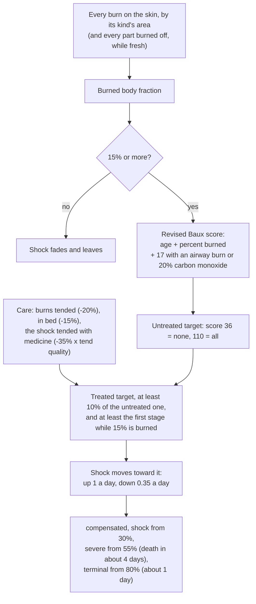

# D'thorga Burns and Smoke

Burns and smoke that matter the way More Injuries' wounds do: a burned body fraction, burn shock that kills within days
unless treated, airway burns that swell shut over hours, smoke that scars the lungs, carbon monoxide from fires in closed
rooms, and the heat around a fire in the open.

Version 0.5.0, built 6 November 2026 for House D'thorga. **Partly tested in game:** the owner reports burn numbers, how conditions progress, and the More Injuries and Organ Failure tie-ins working (5 November 2026). The tracheotomy and the fire heat in the open are not yet tested in game. The rest is read from the game's and
the mods' code.

## Read this first (gotchas)

- **Needs D'thorga Framework 0.2.0 or later (0.2.1 or later for gas masks under Combat Extended) and Harmony**, both loaded
  before it. More Injuries, More Injuries: Organ Failure and Combat Extended
  are optional and are used when present. Harmony is new in 0.5.0: it carries the one patch that adds the heat around fires in the
  open to the game's cell temperature.
- **Fires in the open are now hot.** The game gives a fire's heat to its room and throws it away outdoors, so beside a blaze the air
  was the weather's temperature. Now each fire in the open heats the cells around it: a full-size fire adds about 600 degrees at
  the flame, 150 one cell away, 67 at two, 24 at four, and nothing past five. Anyone standing beside it suffers heatstroke and, close
  in, burns from the hot air; crops stop growing; food spoils. **Rooms keep the game's own heating**, and fires spread as before.
  Hold Alt over a cell to see its temperature. Switch it off in the settings if you prefer the old behaviour.
- **With Atmosphere Overhaul or Celsius active, the fire heat stands down by itself**: those mods model the air cell by cell, and
  heat must not be counted twice. The load line says which mod it stood down for. Other such mods can be added to the rules Def.
- **Safe to add to a running colony.** Its conditions are recomputed from the burns a pawn has, so old burns count at once.
- **Before removing it, press the settings button "Remove every burn condition from every pawn", save, then switch the mod off.**
  Otherwise the next load prints one line per missing condition and carries on. Either way it prints one harmless line per map
  about the missing fire-heat map component.
- **With More Injuries, its own "fire inhalation" feature is switched off by this mod** (a patch in the More Injuries folder; delete
  that file to keep both). More Injuries put plain burns on both lungs whenever a burning pawn was hurt; this mod models the
  inhalation itself. Carbon monoxide and a closing airway feed More Injuries' hypoxia and brain damage.
- **With Combat Extended's smoke running, CE's smoke inhalation is the signal.** This mod adds the lasting lung damage and
  the carbon monoxide on top. A gas mask stops the smoke effects but **not the carbon monoxide**.
- **Without Combat Extended's smoke, burning rooms fill with the game's own smoke** (the framework does this), which also
  penalises aim and sight.
- **Tend the shock itself, with the best medicine you have.** Burn shock is a tendable condition: tending it stands in for
  giving fluids, and the medicine's quality sets how much it helps. With the burns tended and the patient in bed, **industrial
  medicine holds even the worst cases at the "shock" stage, out of the death clocks; glitterworld medicine brings them to
  "compensated"; herbal or no medicine leaves the worst cases life-threatening**. Fluids wear off after 12 hours, so keep tending.
- **Area and depth are two different things.** A burn's severity is its depth (pain, healing time, whether the part is lost).
  Its area comes from the kind of burn: fire covers a part quickly (12 points of damage for all of it), an incendiary round or
  a laser makes a deep burn no larger than a third of the part.
- **The tracheotomy** is a surgery on the neck. With More Injuries it needs its Emergency Medicine research; without, no research.
- **Plain mode shows no percentages.** Switch the display mode to Operator or Engineer in the settings to see the figures.
- **Only humanlike pawns** get these conditions in this version. Animals burn as before.
- **Beside the other D'thorga medical mods:** with **Triage**, the doctors queue the tracheotomy for a closing airway on their own;
  with **Medical Equipment**, a powered burn unit bed gives burned patients air-cell care and oxygen clears carbon monoxide about
  four times faster; with **Emergency Dosing**, a doctor gives a painkiller for burn pain at 60% or more. See
  [the medical mods together](../../docs/medical-mods.md).
- **A part burned off counts as all of its skin burned** while the stump is fresh, so a pawn who loses an arm and a leg to
  fire goes straight to a serious burn and burn shock; once the stump is tended, or 1.5 days old, it fades out over about two
  weeks. **A fresh stump also bleeds until it is tended** (the game's own rule). **Old burn scars do not count.**

## What it does

How burn shock is decided, every 300 ticks for a burned pawn (figures from the rules Def, all authored starting values):



| Condition | Comes from | Gets worse with | Treated by |
| --- | --- | --- | --- |
| burns (burned body fraction) | every burn on the skin, by its kind's area per point of damage, and every part burned off, weighted by each part's share of the skin | wider burns, lost parts | tending the burns and stumps; it is recomputed every 300 ticks |
| burn shock | 15% or more of the body burned; always at least its first stage from there | age, area, an airway burn or carbon monoxide (the revised Baux score) | tending the burns, bed rest, tending the shock with good medicine |
| airway burn | burning, or burns to the head and neck | time: swelling peaks at 8 hours, holds to 24, gone by 48 | a tracheotomy; or waiting, if it never closes |
| smoke-damaged lungs | breathing smoke | thicker smoke, longer | tending; rest; heals 4% a day untended, 16% tended well |
| pneumonia | severe lung damage | | tending and immunity, like a wound infection |
| carbon monoxide poisoning | the framework's carbon monoxide in a closed burning room | staying in the room | clean air: halves every 5.3 hours under a roof, 3 in the open; on supplied oxygen, about every 75 minutes, with D'thorga Medical Equipment |
| acute smoke inhalation | breathing the game's smoke, only when Combat Extended's smoke is not running | thicker smoke | clean air; clears in a day or so |

Fire heat in the open is not a condition but a change to the air: a cell near a fire whose air is the outdoor air reads hotter
than the weather, by the fire's size and the distance, and the game's own heatstroke, hot-air burns, hot thoughts, plant growth
and spoiling respond to it as they would to any hot air. The zones are rebuilt every 150 ticks, so a cell can stay hot for up to
two and a half seconds after its fire goes out.

Burned body fraction stages: minor from 5%, serious from 15% (hunger, cold sensitivity, blood pumping), major from 30%,
critical from 50%. Burn shock stages: compensated, shock from 30%, severe from 55% (a four-day death clock), terminal from 80%
(one day). Carbon monoxide: headache from 10%, dizzy 20%, confused 30%, collapsed 40%, dying from 55% (a half-day clock).
Every figure is an authored starting value; the sources behind the shape are in the design record.

A worked case: a 40-year-old with a quarter of the body burned and no inhalation injury scores 65 and heads for stage 1 untreated;
the same pawn with an airway burn scores 82 and heads for the severe stage. Burns tended and in bed, the shock tended with
industrial medicine, the second settles at compensated (30% of the untreated target); with no medicine, at the shock stage.

| Care, burns tended and in bed | Share of the untreated target left | Score 90 lands at | Score 110 or more lands at |
| --- | --- | --- | --- |
| fluids without medicine | 55% | shock | shock, just under severe |
| herbal medicine | 44% | shock | shock |
| industrial medicine | 30% | compensated | shock |
| glitterworld medicine | 20% | compensated | compensated |

Figures assume a doctor whose tend quality stat is 1; a poorer doctor gets less from the same medicine.

## Settings

Toggles for each of the five conditions; **Fires heat the air around them in the open** (on); **Also apply this mod's smoke
inhalation with Combat Extended** (off); the display mode; and the uninstall button.

## For modders

Mark an injury Def as a burn for the burned fraction with the extension this mod patches onto the game's burns, and say how
its damage becomes area (the Def's own severity stays its depth): the fraction of a part one point of damage covers, and the
most of a part one such burn can cover. Fire is 0.0833 and 1; an incendiary round is 0.025 and 0.3.

```xml
<modExtensions>
  <li Class="Phobos.BurnsAndSmoke.Defs.PhobosBurnLikeExtension">
    <areaPerDamage>0.0833</areaPerDamage>
    <maxArea>1</maxArea>
  </li>
</modExtensions>
```

Balance lives in `Common/Defs/Phobos/BurnsAndSmoke/Rules.xml` (one `PhobosBurnRulesDef`, first loaded wins) and in the stage
tables of the hediff Defs. Smoke and carbon monoxide are read from D'thorga Framework's `PhobosGases`. The fire heat's peak,
radius, cap and cadence are in the same Def, as is `perCellTemperatureMods`, the list of package ids whose presence makes the
fire heat stand down; add a mod there if it models the air cell by cell.

## Checks done (6 November 2026)

- Built against the RimWorld 1.7 and 1.6 reference assemblies. The game-free rules (skin shares, burn area by kind, burned
  fraction, burned-off parts, the Baux score, its floor and the treatment factor by medicine quality, carbon monoxide uptake and
  clearance, the airway curve, the fire heat's shape and cap) pass 23 unit tests.
- **Fire heat in the open is not yet tested in game.** Read from the 1.7 game's code: which method answers every cell-temperature
  question, that fires give their heat to the room and none outdoors, and that Vanilla Temperature Expanded, Dubs Central Heating,
  Dubs Bad Hygiene and Combat Extended leave that method's outdoor answer alone.
- **The owner's report (5 November 2026):** burn numbers, how conditions progress and the tie-ins all work. Faster carbon monoxide clearing on oxygen is the owner's inference from those, not something observed. The tracheotomy is unproven.
- The owner's first look in game (0.1.0, an incendiary raid) showed the mod running without errors but counting far too
  little: see the changelog's 0.2.0 fixes. 
- **Not checked in game:** the tracheotomy, and Organ Failure stepping in for a closed airway beyond what the owner reports.
