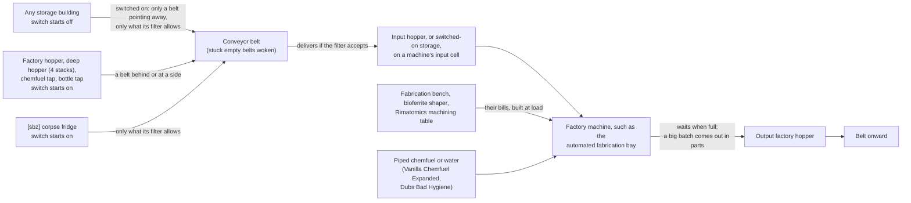

# D'thorga Factory Additions

Additions to Vanilla Furniture Expanded - Factory: a **"Belts may take from here" switch** on every storage
building, so conveyor belts and factory machines can take from any mod's shelves, pallets and bays, and on factory hoppers, so you can tell belts to leave one alone; an **automated fabrication bay** that makes what a
fabrication bench makes (bionics and other artificial body parts, spacer weapons and armour), and with Anomaly
or Dubs Rimatomics what a bioferrite shaper or a Rimatomics machining table makes; a **fix for every factory machine**,
which no longer destroys a finished batch and puts out a batch too big for its hopper in parts; with Dubs Bad Hygiene,
**piped water** for the conveyor oven's wet bills, with a chance of food poisoning from contaminated water; a **Synthesize neutroamine from human meat** bill for
the neutroamine synthesizer; a **Make batch of medicine from synthread** bill for the medicine granulator, so
medicine needs no cotton; with Vanilla Cooking Expanded, a **Cook simple soup** bill for the conveyor oven, so soup
comes out ready to eat; a **deep factory hopper** that holds four stacks; with "[sbz] Fridge", **conveyor belts and factory machines that take corpses
straight from its corpse fridge**; and **drug lab recipes from other mods as factory bills**, each switched
on only while its mod is active (Medicines+, Deep Pills, Ushankas Biological Warfare, Combat Extended, Dubs
Rimatomics, Hemofungus, Complementary Odyssey, Glitterworld Medicine Production, Farmable Neutroamine,
Passive Exoskeletons, Simple Washing Machine).

One of House D'thorga's mods (also spelt dthorga).

Version 0.12.2, built 10 November 2026 for House D'thorga. **Tested in game:** the human-meat bill (owner,
28 October 2026, RimWorld 1.7), the drug-lab bills appearing on their machines (owner, 29 October 2026), and
belts taking from switched-on storage, only when they point away from it (owner, 29 and 30 October 2026). The
corpse fridge change, running the 0.3.0 bills to the end, the 0.3.2 chemfuel repair, the 0.4.0 deep factory
hopper, everything in 0.5.0 and 0.5.1 (the fabrication bay and the output fix), machine input cells on
switched-on storage, the switch surviving a save and load, everything in 0.7.0 (stuck belts waking, belts
obeying storage filters), the 0.8.0 synthread medicine bill and the 0.9.0 and 0.9.1 soup bills, the 0.10.0 piped water, the 0.11.0 hopper switch, the 0.11.1 mincer fix and the 0.11.2 native 1.7 build are not yet tested in
game.

## Read this first (gotchas)

- **Requires Harmony, D'thorga Framework (from 0.11.3), Vanilla Expanded Framework and Vanilla Furniture Expanded - Factory.**
  Load it after all four, and after every mod listed above that you run (the About file asks for it, so RimSort does this for
  you). VFE Factory already needs Harmony, so you have it.
- **RimWorld 1.7 only** (from 0.11.5; 1.6 is no longer supported). It has two small assemblies; the Dubs Bad Hygiene one loads
  only while Dubs Bad Hygiene is active. (From source: `python scripts/deploy.py --build --apply PhobosFactoryAdditions` builds
  both before copying.)
- **A machine draws only from its three input cells, and nobody stocks those for it.** A machining bay or press takes
  ingredients from the hopper on each of its three input sides, every stack on them, and from nowhere else: a hopper beside it
  that is not on an input cell, or a hopper of the bay next door, is never read. **Pawns never carry ingredients to a machine that
  feeds from hoppers**, and a hopper at its default Low priority is never stocked from better storage either. So an ingredient a
  bill is short of has to arrive by belt, or you raise the input hoppers' priority (Critical works) so colonists fill them.
  (Read in the code and in the owner's save of 7 November 2026, where two bays each waited on one ingredient none of their input
  hoppers held.)
- **A bill whose recipe changed brings itself up to date (0.11.4, not yet tested in game).** A machine used to keep a bill's old
  ingredient list for ever after an update changed the recipe, and an item from the new recipe on its hopper could stop it reading
  the rest of the hopper. Now such a bill is rebuilt the first time it ticks after a load (or when it finishes its current batch),
  anything it had counted is set down beside the machine, and a message says so. You no longer need to delete bills before an update.
- **Belts can take from any storage once you switch it on (0.6.0).** Select a shelf, pallet, Rimefeller
  unloading bay or any other mod's storage building and click **Belts may take from here** (VFE Factory's belt
  icon). **It starts off on every storage, including what you have already built**, so nothing moves until
  you switch it on.
- **Factory hoppers have the same switch, starting on (0.11.0).** Select a hopper and click **Belts may take from
  here** to turn it off, and **no belt takes from that hopper**, on any side. **Belts can still deliver into it, and
  machines and colonists can still take from it.** The switch is per hopper, even in a linked group; select several
  to set them together. **A switched-off output hopper fills up and its machine waits**, unless colonists empty it.
- **Only a belt that points straight away from switched-on storage takes from it (0.6.1).** Build the belt on
  a cell next to the storage with its arrow pointing away. It takes **one whole stack at a time, whatever the
  belt's filter says**. Belts that only run past the storage leave it alone (under 0.6.0 they took from it
  too). A factory machine whose input cell is on it takes ingredients from it. **Don't point a belt back into
  storage it takes from**, or the items go round for ever.
- **Belts take only what the storage's own filter allows (0.7.0)**, from switched-on storage and from the
  corpse fridge. Anything else stays for your haulers. **If a belt ignores something on switched-on storage,
  tick it in that storage's filter.** Rimefeller unloading bays under Combat Extended may need **FSX** ticked.
  Factory hoppers and chemfuel taps are unchanged: belts take whatever is on them.
- **Stuck belts start again by themselves (0.7.0).** VFE Factory belts could get stuck empty and never move
  again, even after a reload; the only fix was rebuilding them. Now they wake on their own, and the log says
  where ("Woke a stuck conveyor at ...", up to 10 a session). **A belt holding an item the storage ahead refuses
  still waits**: right-click it with a colonist and pick **Haul from conveyor**.
- **Machines still put finished goods only into factory hoppers.** The switch is for taking, not for output.
- **The fabrication bay looks exactly like the automated machining bay** until it has art of its own. Select it
  to see which is which. It needs **Complex factories and Fabrication** research.
- **A fabrication bay bill appears only once its bench recipe is unlocked**: the item's research (for example
  Bionics), Ideology memes, and Rimatomics' own research for its parts. Until then it is not in the Add
  process menu.
- **Many spacer items need four to six ingredients** (marine armour: plasteel, uranium, gold, advanced
  components) and the bay has **three input cells**. Use **deep factory hoppers** on the input cells, and pipe
  chemfuel in with Vanilla Chemfuel Expanded.
- **Bionics, weapons and armour leave one at a time.** These items don't stack, so the bay (and the machining
  bay, after the fix) **waits while an identical item is still in the output hopper**. Its inspect text then
  says "Output factory hopper too full (max 1 units)": Vanilla Expanded's wording, here meaning "take the
  finished item away first". **Run a belt out of the output hopper.**
- **Factory machines no longer destroy finished batches (0.5.1).** Before, most of VFE Factory's machines
  destroyed every batch once the stack in their output hopper was full, and part of a batch when it was
  nearly full. Now they **wait** and say "Output factory hopper too full". **Machines may now sit idle where
  they used to eat inputs silently: run a belt out of each output hopper.** Owner's go-ahead, 29 October 2026.
- **Bills with no output limit drop a batch beside the machine** when it doesn't fit (VFE's stock neutroamine
  bill, Kimoju's drill and neutroamine bills). That is Pipe System's own fallback for such bills.
- **A corpse now gives its meat once (0.11.1).** Before, a corpse with more meat than its output hopper could hold made
  meat for ever. **If a line
  was living on that, such as neutroamine from human meat, it now needs real corpses.** The mincer puts out what its
  hopper can hold, waits and says "Output factory hopper too full", and takes the next corpse only when the last one's
  meat is all out. **Keep a belt running out of the output hopper.** A different item sitting in that hopper blocks it too.
- **The new bills keep their mods' research.** A bill appears in the machine's Add process menu only once
  its research is done: Medicines+ projects for its drugs, each disease's vaccine project for Biological
  Warfare, Deathrest (Biotech) for hemogen, Neutroaleaf refining for leaf neutroamine, and so on. Complex
  factories (granulator, synthesizer) or Basic factories (refinery) as well.
- **Some outputs stack small, so empty the output hopper.** Hemogen packs stack to 10, vaccines and
  antiserums to 15, medicine to 25. A batch waits ("output hopper full") while the stack on the output cell
  is above the bill's cap, which is set below each stack limit so nothing is lost.
- **Glitterworld medicine needs five input hoppers:** the usual three behind the granulator plus the two
  behind its corners. Four ingredients, one stack per hopper cell. Not yet seen in game: if the corner
  cells do not light up as input slots, feed the fourth ingredient by belt into one of the three.
- **The infusions need both Deep Pills and Medicines+.** Deep Pills only defines the raw plants when
  Medicines+ is active.
- **A reproduction pill bill makes one pill at a time.** It takes a pathogen sample, and samples do not
  stack, so one sample per hopper cell.
- **Medicine from synthread (0.8.0).** The granulator's **Make batch of medicine from synthread** bill takes
  **12 synthread, 4 neutroamine and 4 herbal medicine** for 4 medicine, the stock bill with synthread in place
  of cloth. It needs the same research (**Medicine production** and **Complex factories**). Give the granulator
  three input hoppers: **one each for synthread, neutroamine and herbal medicine**. Synthread costs more than
  cloth, so this bill is for a steady supply, not for selling medicine.
- **Soup that comes out cooked (0.9.0, needs Vanilla Cooking Expanded).** On the conveyor oven, **remove Prepare
  simple soup and add Cook simple soup**. It takes **20 raw meat and 20 raw plant food** for **5 ready-to-eat
  soups**. **Tick "simple soup" in the filter of any storage a belt carries it into**, or the belt waits for ever.
  **Clear any uncooked soup out of the output hopper first.**
- **The stock soup bill makes much less now (0.9.1).** VFE Factory's **Prepare simple soup** makes **1 uncooked soup a
  batch, not 8**. A pot still turns it into 10 soups. **A cannery needs about three ovens to stay busy**;
  "Cooked soup on the conveyor oven" below says why.
- **With Dubs Bad Hygiene, ovens need water (0.10.0).** The conveyor oven's soup, mass-produced meal, baby food and
  pumpkin coffee bills **pause until a pipe under the oven or against its side reaches a water tower**, including in
  colonies you already have. The batch is kept and carries on when water returns; the oven's inspect text says what is
  missing. **To turn it off: Options, Mod settings, D'thorga Factory Additions.** A second option there controls
  food poisoning from contaminated water.
- **The stock bill stops taking human meat** once this mod is on. Human meat sitting in a hopper that feeds
  the stock "Synthesize neutroamine" bill will stay there until you add the human-meat bill or move it.
- **Tick the ingredient in the hopper's storage filter**, and raise the hopper's priority (factory hoppers
  start at Low, so haulers will not move items off Preferred shelves to fill one). A bill reads "Missing
  inputs" until it is fed.
- **The deep factory hopper looks exactly like the ordinary one** on the map (VFE Factory's hopper draws
  fixed textures). Select it to see which it is. Like every factory hopper it starts at **Low** priority.
- **A belt touching the corpse fridge empties it.** Once the fridge counts as a factory hopper, any belt
  that has the fridge directly behind it or at either side pulls corpses out whenever the belt has room,
  whatever the belt's own filter says. Keep belts you do not want fed away from the fridge's four cells, or switch
  **Belts may take from here** off on the fridge to stop them all (0.11.0). Since
  0.7.0 it takes only what the **fridge's** filter allows, so a stray item (a slag chunk, say) no longer rides
  out and jams the corpse line.
- **Safe to add to a running save.** Before removing it, remove every bill this mod added from each
  machine's Processes tab and let any running batch finish; otherwise the first load afterwards should log
  an error about a missing process and drop that bill (expected, not yet checked). **Deconstruct every deep
  factory hopper and every fabrication bay** too; the items on a hopper stay where they are. The fridge
  change and the 0.7.0 belt fixes leave nothing in the save. A machine part-way through putting out a batch saves two small values
  on its bill, a switched-on storage or a switched-off hopper saves its switch; the game should drop them without a message once
  the mod is gone (expected, not yet checked), and items stay put.
- **Nothing is published on the Steam Workshop yet.** Install from source with `scripts/deploy.py`.
- **Tested in game: the human-meat bill, and the 0.3.1 fix.** The owner confirmed on 28 October 2026, on
  RimWorld 1.7, that the human-meat bill works, and on 29 October 2026, with 0.3.2 installed, that the bills
  now appear on the machines ("Everything seems to be good in-game now"). On 29 October 2026 the owner saw
  belts take whole stacks from a switched-on Adaptive Storage fridge, and found belts at its sides taking too;
  on 30 October 2026 they confirmed 0.6.1's fix ("The fix works brilliantly"). Running each new bill to the
  end, the corner input cells and the chemfuel-tap repair are not yet confirmed in game.

## What it does

How belts, hoppers and the fabrication bay connect (read from VFE Factory's code and ours):



### Belts that take from any storage (0.6.0)

VFE Factory's belts pull only from **factory hoppers**. Until now this mod let other storage feed belts one
building at a time (the corpse fridge, the chemfuel taps). Since 0.6.0 **every storage building gets a
switch** instead (owner's choice of design, 29 October 2026):

- Select the storage and click **Belts may take from here**. While it is on, the storage's inspect text says
  "Belts may take from here."
- It starts **off**, for new storage and for storage already in your colony. Select several and click once to
  switch them all; a message confirms what changed.

What a switched-on storage does (read from VFE Factory's and Pipe System's code; the owner confirmed the two
belt rows in game on 30 October 2026, and the machine rows are not yet seen in game):

| Where it is | What happens |
| --- | --- |
| **Directly behind a belt** (the belt points straight away from it) | The belt takes **one whole stack at a time**, the first **the storage's filter allows** (0.7.0), whenever it has room, **whatever the belt's filter says**, as it would from a factory hopper. It goes before a factory hopper at the belt's side: VFE Factory tries the cell behind a belt first. |
| **At a belt's side** (the belt runs past it) | Nothing: the belt carries on past (0.6.1). A factory hopper there would feed the belt; switched-on storage doesn't, so belts can run along storage. |
| **In front of a belt** (the belt points into it) | The belt delivers into it, as before. That is stock VFE Factory for any storage whose filter accepts the item. |
| **On a factory machine's input cell** | The machine takes ingredients from it, as from a factory hopper. Storage that holds several stacks on one cell (most Adaptive Storage shelves) then works like a deep factory hopper. |
| **On a factory machine's output cell** | Nothing changes: machines still put finished goods only into factory hoppers. |

**Which buildings get the switch.** Every storage building whose items lie on its cells, hoppers included (since
0.11.0): about **150 types** on your mod list (the 6 November 2026 log says 149). They include:

- vanilla shelves, and storage from VFE furniture, Vanilla Gravship Expanded, The Dead Man's Switch and others;
- **Rimefeller's refinery unloading bays**, which its refiners fill by placing their products on the bay's cell;
- every Adaptive Storage building: Warehouse Storage, the [sbz] mods, Cargo Holds and Adaptive Ideology
  Storage.

**Expect a line in the log at startup**: "[D'thorga Factory Additions] Added the "Belts may take from here"
switch to N storage building types, M of them starting on", with the real numbers for your game.

**Left out.** Graves, sarcophagi, growth vats, biosculpter pods, outfit stands, bookcases and sealed crates
keep their contents *inside* themselves, where belts can't reach (and shouldn't).

**Factory hoppers work the other way round (0.11.0).** Hoppers, deep hoppers, the chemfuel taps, the corpse fridge and
D'thorga Water Tap's bottle tap already feed belts, so their switch **starts on** and you turn it off to stop belts. Their inspect text mentions it only
while it is off. Read from VFE Factory's code; not yet tested in game.

| With the switch off on a hopper | What happens |
| --- | --- |
| A belt with it directly behind or at its side | Takes nothing, and carries on with anything else it can reach |
| A belt pointing into it | Delivers as usual, if the hopper's filter accepts the item |
| A factory machine with an input cell on it | Takes ingredients as usual |
| A factory machine with its output cell on it | Puts finished goods there as usual. Nothing takes them away by belt, so the machine waits once the hopper is full |
| Colonists | Take from it under VFE Factory's own **Allow taking** |

This is handy where a belt delivers into a machine's input hopper and another belt runs past it: switched off, the hopper
keeps what it was given.

**What it costs** (my estimate from the code, not measured; Dubs Performance Analyzer can check it):

- **Storage with the switch off costs nothing** while the game runs.
- Each belt already checks its neighbours about once a second for hoppers; this adds a look at the one cell
  behind it.
- A belt beside switched-on storage looks for a stack every **10 ticks** (a sixth of a second at normal
  speed), so it runs a little slower than a belt fed from a factory hopper, which it checks every tick.
- Machines keep checking their input cells every 100 ticks, as before.

If a Vanilla Expanded update changes the belt code, the switch stops working, the log names the part that
switched off, and everything else carries on.

### Stuck belts start again, and belts obey storage filters (0.7.0)

Two faults found in the owner's colony on 30 October 2026, when the human-meat neutroamine line stopped with
75 meat waiting in the mincer's hopper. Read from VFE Factory's code and the owner's save; not yet tested in
game.

**Stuck belts.** A VFE Factory belt that is **empty but marked as waiting** skips its whole update, so it never
takes from the hopper behind it again. A reload keeps it stuck, and so does **Change direction**; in VFE
Factory alone you have to rebuild it. The owner's colony had nine, two of them on the meat line. Now:

- a stuck belt wakes on its own and carries on, belts and underground entrances and exits alike, including
  belts already stuck in your save;
- the log says where, for example "Woke a stuck conveyor at (224, 0, 114)", up to 10 times a session.
  **What makes belts stick is not known yet**, so if you see these lines, the positions help find it.

**Belts obey storage filters.** VFE Factory's belts take the first thing they find on a hopper, whatever it is.
On a fridge or shelf that also holds a stray item, the belt carries that item to the next storage, which
refuses it, and the whole line behind it waits for ever. In the owner's colony a steel slag chunk rode out of
the corpse fridge and blocked every corpse belt behind the mincer's hopper. Now:

| Storage | What belts take |
| --- | --- |
| **Corpse fridge** ("[sbz] Fridge") | Only corpses its filter allows. Anything else stays; haulers take it away. |
| **Switched-on storage** ("Belts may take from here") | Only what its filter allows. **If belts ignore something, tick it in the storage's filter.** |
| **Factory hoppers, deep factory hoppers, chemfuel taps** | Unchanged: whatever is on them. Machines put their output on hoppers whatever the hopper's filter says, so obeying it would stop working lines. |

**Gotcha for Rimefeller under Combat Extended:** Rimefeller lets an unloading bay hold FSX but doesn't tick FSX
in a new bay's filter. If you switch a bay on and its belt leaves the FSX, tick FSX in the bay's filter.

**What it costs** (estimate from the code, not measured): two quick checks per belt per tick for stuck belts;
the filter check only when a belt takes from the corpse fridge or switched-on storage. Without "[sbz] Fridge",
the fridge check costs nothing.

### The automated fabrication bay (0.5.0)

VFE Factory's automated machining bay gets a bill for every item made at a **machining table**, and nothing
else. That is why MSE2's steel bone replacements had bills and bionics didn't: bionics are made at the
**fabrication bench**. The fabrication bay closes that gap (owner's choice of benches and of a separate
building, 29 October 2026):

| Bench it takes over | Needs | Bills on your mod list (counted from the mods' files, before patches) |
| --- | --- | --- |
| Fabrication bench | always | about 135: bionic and other artificial body parts (vanilla, Royalty, Biotech, Odyssey, MSE2's plasteel bones and modules, Glittertech, Dubs Bad Hygiene), spacer guns, spacer armour and helmets |
| Bioferrite shaper | Anomaly | about 18: ghoul parts, bioferrite guns, shard lances, ritual mask |
| Rimatomics machining table | Dubs Rimatomics | 27: reactor and weapon upgrade parts, warheads, sabot rounds, MOPP and radiation suits |

**How the bills are made.** The game doesn't store these as bills, so the mod builds them at load from each
item's own recipe, **after every other mod's changes** (Combat Extended's costs, MSE2's parts):

- **Ingredients:** the item's cost. An item made of a material takes **steel** for metal, any **textile** for
  fabric, any **leather** for leather, or its one possible material (VFE Factory's own rule, so the result is
  made of whatever was fed in).
- **Time:** the bench's work times **four** (VFE Factory's machining rule). No skill needed; everything comes
  out at **normal quality**.
- **Research:** the bench's research (Fabrication, Bioferrite shaping or Rimatomics activation) plus the
  item's own. And the bill shows only while the **bench recipe itself is available**, so Ideology memes and
  Rimatomics' own research steps still gate it.
- **Chemfuel** in a recipe comes **from the pipes** with Vanilla Chemfuel Expanded.
- **Not automated:** anything a machine already makes (the four bioferrite guns VFE's machining bay makes),
  buildings (the hologram base), and items made of **a material plus parts** (Pandora's Exopack, ExoHelmet
  and ExoVisor, Anomaly's ceremonial hood): Pipe System gives a finished item the material of the **last**
  ingredient it took, so those could come out made of components. The startup log names every skipped item.

**Expect a line in the log at startup** starting "[D'thorga Factory Additions]", giving, per bench, how many
bills the bay got and what was skipped. Those counts are the real ones for your game; the table above is an
estimate.

The building itself inherits everything from the machining bay (size, the three input cells behind and
beside it, output on the interaction cell in front, power, heat, overclocking, boosters, heatsinks, piped
chemfuel, the two mechanoid shredding bills) and differs in:

| | Automated machining bay | Automated fabrication bay |
| --- | --- | --- |
| Cost | 440 steel, 18 components, 5 advanced components | **300 steel, 150 plasteel, 12 components, 10 advanced components** |
| Work | 5000 | **7000** |
| Research | Complex factories | **Complex factories, Fabrication** |

Cost and work are agent defaults, open to tuning.

### Factory machines stop destroying their output (0.5.1)

**What went wrong (read in Pipe System's and the game's code, 29 October 2026; not seen in game).** When a
batch finishes, Pipe System adds it to the matching stack in the output hopper if that stack holds no more
than the bill's **output limit**, and never places whatever doesn't fit. Two things make that lose items:

- **Most of VFE Factory's limits equal the stack limit** (150 for chemfuel, 75 for steel, 25 for shells). The
  machine only waits when the stack is *above* the limit, which never happens, so **once the output stack is
  full, every later batch is destroyed**, and a nearly full stack keeps only part of a batch.
- **The game counts two identical guns as stackable** even though a gun stacks to 1. With the machining
  bay's limit of 1, a gun still in the output hopper makes the next identical gun vanish.

A belt carrying items out of the output hopper usually hides both.

**How many bills.** A read-only scan of your mods found **74 of the 134 bills that output to factory
hoppers** at risk, plus every machining bay bill VFE generates:

| Machine | At-risk bills (examples) |
| --- | --- |
| Automated biofuel refinery | chemfuel from wood, redwood, canola and organics; astrofuel; Kimoju's fecal sludge; Munitions Industries' FSX and prometheum |
| Automated smelter | metal from chunks and slag, smelting weapons, apparel and mechanoids |
| Automated ammunition press | every shell |
| Automated distillery, cannery, conveyor oven | beer, spirits, soda, canned food, kibble, pemmican, meals, baby food |
| Automated alloy forge, assembler | plasteel, bronze, gravlite, obsidian, components |
| Automated mincer | every corpse bill |
| Automated drill platform | stone chunks, metals, Kimoju's gold, silver, steel, uranium and more |
| Autoloom, masonry saw, medicine granulator, neutroamine synthesizer | patchleather, synthread, blocks, medicine, neutroamine |
| Automated machining bay | every generated bill (guns, armour), mechanoid and drone shredding |

**The fix (owner's go-ahead, 29 October 2026).** Just before Pipe System places a batch, this mod checks the
stack it is about to join. If the whole batch won't fit, the machine **waits** and its inspect text says the
output hopper is too full, exactly as Pipe System does when a stack is above the limit. It works for every
mod's factory bills, including batches whose size varies (corpses, ovens, smelting). Bills with **no** limit
(VFE's stock neutroamine bill, several of Kimoju's) instead drop the batch on a free cell beside the machine,
Pipe System's own fallback for them. 0.5.0's machining-bay-only fix is replaced by this one.

**Batches bigger than one stack (0.11.1, 3 November 2026; read in the code and the owner's save, not yet tested in
game).** A mincer's batch is the corpse's meat, 140 for each unit of body size, and meat stacks to 75:

| Corpse | Meat | Stacks | Fits one hopper? | Fits a deep factory hopper (4 stacks, 300)? |
| --- | --- | --- | --- | --- |
| Hare (0.2 body size) | 28 | 1 | Yes | Yes |
| Human | 140 | 2 | No | Yes |
| Grizzly bear | 301 | 5 | No | **No, by 1** |

Pipe System put down what the hopper could hold, threw the rest away, reported that it had failed, and tried the
same batch again. So whenever belts emptied the hopper, the machine made another load from the same corpse, and it
never moved on. **Our 0.5.1 fix above made this worse:** it made the machine wait for the hopper to empty, which
turned an occasional repeat into a certain one. That's our fault as much as Pipe System's.

**Now the batch comes out in parts.** The machine remembers what is left, puts more down as the hopper makes room, and
moves on only when none is left. A human gives 140 meat and a grizzly 301, on any hopper, and a save or reload part-way
doesn't restart the batch. It works for every mod's factory bills. It can't pile the whole batch onto one hopper: on
RimWorld 1.7, spawning into a full cell throws an item already there onto a nearby cell, which could be a belt carrying
something else.

### Neutroamine from human meat

| Bill | Inputs | Output | Time | Who adds it |
| --- | --- | --- | --- | --- |
| Synthesize neutroamine | 20 raw **animal** meat + 3 chemfuel | 5 neutroamine | 4800 ticks (about 2 hours) | VFE Factory; this mod excludes human meat and says so in its text |
| **Synthesize neutroamine from human meat** | 20 human meat + 3 chemfuel | **6 neutroamine** | 4800 ticks | **This mod** |
| Synthesize neutroamine from insect meat | 30 insect meat + 5 chemfuel | 10 neutroamine | 4800 ticks | Kimoju's "VFE Factories: Buffs and tweaks", if you run it |
| Synthesize neutroamine from fish meat | 4 fish + 3 chemfuel | 5 neutroamine | 4800 ticks | Kimoju's mod, with Odyssey |
| **Synthesize neutroamine from neutroaleaves** | 25 neutroaleaves | 5 neutroamine | 5000 ticks | **This mod**, with Farmable Neutroamine |

The new bills use the same input slots, sounds and effects as the stock one. With Vanilla Chemfuel
Expanded active, the synthesizer can draw the chemfuel for the human-meat bill from the chemfuel pipe
network, as it can for the stock bill.

**No Ideology thought fires.** Rendering fat for chemistry is not eating (owner's choice, 28 October 2026).

**Why 6 and not 5.** The 20 percent bump is an **authored gameplay value**, not a calculation. The reasoning:
VFE Factory's lore has the synthesizer render fat out of the meat, and a human carcass carries far more fat
than the game animals that supply most colony meat. Whole-body fat in adults averages roughly a quarter to
two fifths of body mass (US NHANES survey, 1999 to 2004, by DXA scan: men 23 to 31 percent, women 32 to 42
percent, by age group; [CDC MMWR report](https://www.cdc.gov/mmwr/preview/mmwrhtml/mm5751a4.htm), primary
source). Raw deer meat holds about 2 to 3 grams of fat per 100 grams ([USDA FoodData Central entry
173855](https://getfoodfacts.com/food/game-meat-deer-raw-173855), read through an aggregator site, so a
secondary source). Those two figures are not like for like (a whole body against a lean cut), and the game's
"meat" item is neither, so the bump is a nod to the direction of the difference, not its size.

### Medicine from synthread (0.8.0)

The stock **Make batch of medicine** bill needs cotton cloth, and cotton grows outdoors only in the warm
months. In a tundra colony that leaves medicine seasonal. This bill swaps the cloth for **synthread**, which
Rimefeller makes from chemfuel all year (owner's request, 31 October 2026). Not yet tested in game.

| | Stock bill (VFE Factory) | Synthread bill (this mod) |
| --- | --- | --- |
| Inputs | 12 cloth, 4 neutroamine, 4 herbal medicine | **12 synthread**, 4 neutroamine, 4 herbal medicine |
| Output | 4 medicine | 4 medicine |
| Time | 11,200 ticks (about 4.5 in-game hours, before overclocking) | the same |
| Research | Medicine production, Complex factories | the same |

**Why the same amount.** Both bills are four times the drug lab's recipe (1 herbal medicine, 1 neutroamine and
3 cloth make 1 medicine). Cloth weighs 0.026 kg a unit and synthread 0.025 kg (the game's own item data), so
12 synthread is the same amount of fabric for the kits' pads and dressings. That swap is a gameplay choice, not
a medical claim. Glitterworld Medicine Production already uses synthread for medicine (5 per glitterworld
medicine), so synthread in a medical kit isn't new to the game.

**What it costs.** At base market values the cotton bill's inputs are worth 82 silver and the synthread
bill's 112 (synthread 4 silver a unit against cloth's 1.5); both make 72 silver of medicine. **You lose value
either way, more with synthread**: it's for keeping medicine coming, not for selling.

**Keeping it fed all year:**

- **Synthread:** Rimefeller's synthread refiner turns **3 chemfuel into 1 synthread** and runs only while a
  colonist mans a **resource console** that has a synthread bill. Running, it uses about 500 chemfuel a day
  and makes about **167 synthread a day** (my reading of Rimefeller's code, not measured). One granulator at
  base speed uses about **64 synthread a day**; overclocked to 3, about 190, more than one refiner makes.
  Synthread leaves the refiner on its unloading bays: switch a bay on with **Belts may take from here** and run
  a belt to the granulator's synthread hopper.
- **Neutroamine:** the human-meat bill, Rimefeller's neutroamine refining, or both.
- **Herbal medicine is seasonal too.** It comes from healroot, which grows outdoors only in the warm months,
  but **healroot also grows in hydroponics basins** (sowing needs Plants 8). Grow it indoors under sun lamps for
  a year-round supply.

### Cooked soup on the conveyor oven (0.9.0)

VFE Factory's **Prepare simple soup** bill makes *uncooked* soup. That needs Vanilla Cooking Expanded's electric
pot, a colonist to load it and two days to cook, so it stops a fully automated line. **Cook simple soup** skips all
that and puts finished soup in the output hopper. Not yet tested in game. VFE Factory's own automated route is the cannery
(needs **steel**, as the owner was reminded), which turns uncooked soup into canned soup with no colonist.

| Route | Raw food | Makes | Nutrition out | Time |
| --- | --- | --- | --- | --- |
| Cook simple soup (this bill) | 20 meat, 20 plant food | 5 soups | 4.0 | 6,000 ticks |
| Mass-produced meals, for comparison | 20 meat, 20 plant food | 4 meals | 3.6 | 4,800 ticks |
| Bench and pot, by hand (Vanilla Cooking Expanded) | 4 nutrition, about 80 units | 10 soups | 8.0 | 2 days in the pot |
| Stock oven bill and pot, corrected in 0.9.1 | 40 meat, 40 plant food | 10 soups | 8.0 | 4,800 ticks, then 2 days in the pot |
| Stock oven bill and cannery | 40 meat, 40 plant food, 1 steel | 10 canned soups | 9.0 | 4,800 ticks, then 15,200 ticks |

**The yields follow Vanilla Cooking Expanded's own recipe**, 2 nutrition of raw food for 5 soups. Before 0.9.1 the
stock oven bill made 8 uncooked soups a batch, so 80 raw food became 80 soups: 64 nutrition from 4, worth 960 silver.
It borrows the formula VFE Factory uses for meals, and the pot then multiplies the result again. That looks like an
oversight (our reading of the files, not anything VFE Factory's authors have said). The 6,000 ticks are authored, so
soup gets more out of the food and meals more out of the machine.

### Piped water and food poisoning (needs Dubs Bad Hygiene; 0.10.0)

Not yet tested in game. With Dubs Bad Hygiene active, the conveyor oven's wet bills use water from your plumbing as they
work. **Run a pipe under the oven or against its side, connected to a water tower.** The pipe stays where it is; the
oven draws through it. With no water the oven pauses and keeps its batch. A paused oven still uses power.

| Bill | Water a batch | A day at base speed | A batch made with contaminated water |
| --- | --- | --- | --- |
| Cook simple soup | 20 L | 200 L | 25% chance of food poisoning |
| Make mass-produced meals | 10 L | 125 L | 25% chance of food poisoning |
| Prepare simple soup (uncooked) | 40 L | 500 L | No effect: uncooked soup can't carry it, and a pot starts fresh |
| Make baby food | 2 L | about 67 L | No effect: baby food can't carry it |
| Make pumpkin spice coffee | 10 L | 150 L | No effect: coffee can't carry it |

Kibble, pemmican and survival meals need no water: they're dried or sealed. For scale, Dubs Bad Hygiene's shower uses 50
L and its bath 190 L. Overclocking makes a batch quicker, so it uses more water a day but the same water a batch.

**The figures are authored gameplay choices.** Five soups weigh 2 kg (0.4 kg each, Vanilla Cooking Expanded's item
data) and their 40 raw ingredients 1.2 kg (0.03 kg each, the game's), so at least 0.8 L of water stays in the food. The
rest of the 20 L stands for boil-off, rinsing and wash-down, none of it modelled.

**How water quality works** (option: Contaminated water can poison food):

- **Treated and untreated water are safe here**, because these bills cook the food. That's a simplification.
- **Contaminated water is the risk.** Boiling kills germs but doesn't remove every toxin, so a batch made entirely with
  it has a **25% chance** of being poisoned (authored). A batch that met it for half its water has 12.5%.
- **It's the game's own food poisoning.** When a poisoned batch joins a stack, the stack's share of poison blends by
  count. Whoever eats from it rolls that share, times your storyteller's food poisoning setting. The game's message
  names **contaminated water** as the cause.
- **Nothing on the soup warns you**, just as the game shows nothing on a meal from a filthy kitchen. The warnings are
  Dubs Bad Hygiene's contaminated tower alert and the oven's inspect text while it draws that water.

**Dubs Bad Hygiene's lite mode** has no plumbing, so bills need no water there. **If you remove this mod**, your pipes
are untouched, because the oven only reads them. Food already poisoned stays poisoned, and the game's message then gives
a number as the cause.

### Drug lab recipes as medicine granulator bills (0.3.0)

Every bill is the other mod's drug lab recipe scaled the way VFE Factory scales its own drug bills: a
**batch of four** (four times the inputs) in **four times the lab's work** per unit, no skill needed, the
mod's own research plus Complex factories. Values are read from each mod's XML on 28 October 2026 for the
versions then installed; a later update to a source mod may change its lab recipe without changing these.

**Medicines+** (15 bills, one of them authored):

| Bill | Inputs | Output | Time (ticks) | Research |
| --- | --- | --- | --- | --- |
| aniracetam | 12 neutroamine, 4 medicine | 4 | 16000 | Advanced utility medicine |
| AntiTox | 12 neutroamine, 8 herbal medicine | 4 | 12800 | Basic utility medicine |
| clozapine | 8 neutroamine, 20 smokeleaf leaves | 4 | 12800 | Basic utility medicine |
| cyanide | 4 neutroamine | 4 | 6400 | Medicine basics |
| heroin | 8 crimson bulbs, 8 morphine, 4 neutroamine | 4 | 28800 | Advanced profit drugs |
| hydra | 8 crimson bulbs, 4 neutroamine | 4 | 19200 | Crimson bulb refining |
| Joy | 4 ambrosia, 40 raw fungus, 4 neutroamine | 4 | 9600 | Advanced profit drugs |
| addictol | 12 neutroamine, 20 chemfuel | 4 | 16000 | Advanced profit drugs |
| morphine | 20 opium, 20 psychoid leaves | 4 | 16000 | Basic utility medicine |
| penicillin | 4 neutroamine, 4 herbal medicine | 4 | 8000 | Basic utility medicine |
| **penicillin from fungus** | 40 raw fungus, 4 neutroamine | 4 | 8000 | Basic utility medicine |
| smelling salts | 4 psychoid leaves, 4 neutroamine | 4 | 12800 | none |
| ThornWeed serum | 20 ThornWeed needles, 20 steel, 4 neutroamine | 4 | 14400 | Advanced utility medicine |
| Tyrox | 8 neutroamine, 4 penicillin, 4 crimson bulbs | 4 | 22400 | Advanced utility medicine |
| Upper | 40 psychoid leaves, 12 neutroamine | 4 | 14400 | Basic profit drugs |

**Penicillin from fungus is authored, not a port.** Penicillin is made by Penicillium moulds, so a fungal
feedstock is the honest route to it; Medicines+'s own recipe goes through herbal medicine. The fungus bill
keeps the same neutroamine, work and research, and asks 10 raw fungus per unit, a gameplay choice meant to
make it a bulkier path rather than a cheaper one (raw fungus is worth about a tenth of herbal medicine).
Ask for a different ratio if play shows it beats the herbal path.

**Deep Pills infusions** (with Medicines+; batch of eight, from the x8 lab recipe, no research):

| Bill | Inputs | Output | Time (ticks) |
| --- | --- | --- | --- |
| peyote infusion | 32 peyote fruits | 8 peyote | 4000 |
| opium infusion | 32 opium poppies | 8 opium | 4000 |
| thorn weed infusion | 32 thorns of weed | 8 ThornWeed needles | 4000 |

**Ushankas Biological Warfare** (16 bills; seven diseases: flu, wound infection, malaria, necroa, plague,
scaria, sleeping sickness):

| Bill | Inputs | Output | Time (ticks) | Research |
| --- | --- | --- | --- | --- |
| each vaccine | 100 pathogen, 32 neutroamine, 4 penoxycyline | 4 | 41600 | that disease's vaccine project |
| each antiserum | 100 pathogen, 24 neutroamine, 4 glitterworld medicine | 4 | 28800 | that disease's vaccine project |
| malaria pills, sleeping sickness pills | 1 sample, 6 neutroamine | 1 | 2400 | Pathogen production |

Pathogen samples, the disease sampler and flesh-breaker stay at the drug lab.

**Singles:**

| Bill | Mod | Inputs | Output | Time (ticks) | Research |
| --- | --- | --- | --- | --- | --- |
| psycho | Combat Extended | 64 psychoid leaves | 4 | 9600 | none |
| potassium iodide | Dubs Rimatomics | 12 neutroamine | 4 | 8000 | Penoxycyline production |
| hemogen from hemofungus | Hemofungus (Biotech) | 60 hemofungus | 4 hemogen packs | 6400 | Deathrest |
| vacsop from steel | Complementary Odyssey | 4 vacdew, 20 steel | 4 | 9600 | Drug production |
| vacsop from vacstone | Complementary Odyssey | 4 vacdew, 20 vacstone blocks | 4 | 9600 | Drug production |
| glitterworld medicine | Glitterworld Medicine Production | 20 synthread, 4 components, 16 plasteel, 4 medicine | 4 | 28800 | Glitterworld medicine production |

The lab's vacsop recipe takes steel **or** vacstone blocks; a factory bill takes one exact item, so there
are two bills.

### Chemistry on the automated biofuel refinery (0.3.0)

| Bill | Mod | Inputs | Output | Time (ticks) | Research |
| --- | --- | --- | --- | --- | --- |
| polyamide | Passive Exoskeletons | 75 chemfuel, 8 plasteel | 25 | 24000 | Biofuel refining, Drug production |
| laundry detergent | Simple Washing Machine | 100 chemfuel, 4 neutroamine | 12 | 24000 | Sterile materials |
| heavy-duty laundry detergent | Simple Washing Machine | 100 chemfuel, 12 neutroamine | 12 | 32000 | Sterile materials |

With Vanilla Chemfuel Expanded active these three can draw their chemfuel from the pipe network, as the
refinery's stock bills do. With Vanilla Races Expanded - Android active, the granulator bills that take
neutroamine can draw it from that mod's neutroamine network (mirrors VFE Factory's own patch; untested).

### The deep factory hopper (0.4.0)

A factory hopper that holds **four stacks** on its one cell instead of one. Cost **35 steel and 1
component**, 800 work (the ordinary hopper: 20 steel, 400 work); same research and Architect tab. All three
figures are agent defaults, open to tuning.

**Why it helps.** A factory machine does not tie an input cell to one ingredient: while a bill waits, it
looks at every item on each of its input cells and takes whatever that bill still needs, keeping a running
count of each ingredient inside the machine. So one hopper can feed several ingredients. With an ordinary
hopper (one stack) that jams easily: a belt carrying two ingredients drops a stack the machine has had enough
of, the hopper is full, and the other ingredient waits behind it on the belt for ever. A deep hopper has room
for one stack of each of four ingredients, and more of the same item merges into its stack.

| Use | What to expect (read from the code, not yet seen in game) |
| --- | --- |
| **Input**, fed by one belt carrying mixed ingredients | The belt keeps filling it until all four places hold something; the machine takes what it needs from any of them. |
| **Input**, filled by haulers | Tick every ingredient in its storage filter and raise its priority. |
| **Output** of items that do not stack (weapons, bionics, armour) | Holds up to four **different** finished items. An identical one waits until the first is taken away (with the 0.5.1 fix; before it, the identical one vanished). Items made of a material (a steel helmet) are placed separately, up to four. |
| **Output** of items that stack | Same as an ordinary hopper: the batch waits once that stack reaches the bill's output cap. |
| Under a belt that pulls from it | The belt takes one whole stack at a time, the first it finds. |

It can share a storage group with ordinary hoppers (same group tag), and inherits everything else from VFE
Factory's hopper: input and output markings, the allow taking and allow inserting toggles, research.

**Tip for the automated machining bay** (three input cells, up to four solid ingredients plus chemfuel): put a
deep hopper on the input cell fed by the mixed belt, or deep hoppers on all three. Chemfuel needs no hopper
with Vanilla Chemfuel Expanded: the bay's bills draw it from the pipes.

### Chemfuel taps and piped astrofuel (needs Vanilla Chemfuel Expanded; 0.3.2)

VFE Factory sets up two things for Vanilla Chemfuel Expanded: the **chemfuel tap** (a 1 x 1 basin that fills
itself with chemfuel from the pipe network) counts as a **factory hopper**, and the refinery's **astrofuel**
bill (with Vanilla Gravship Expanded) takes chemfuel **straight from the pipes**. Both live at the end of one
VFE Factory patch, and that patch stops early when Combat Extended and Vanilla Factions Expanded - Deserters
are also active: CE removes an armour-piercing shell bill that an earlier step edits. This mod applies the
two missing steps itself, each only if it is still missing. Expected, not yet seen in game:

- A belt with a chemfuel tap behind it, or at either side, carries chemfuel away from it.
- A machine whose input cell sits on a tap takes chemfuel straight from it, no belt needed.
- The astrofuel bill runs on piped chemfuel, as the refinery's other chemfuel-using bills do.

As with any factory hopper, **a belt touching a tap pulls from it whenever the belt has room**, so keep
belts you don't want fed away from taps.

### The corpse fridge as a belt and factory source (needs "[sbz] Fridge")

VFE Factory's belts pull only from **factory hoppers**: either the hopper building itself, or any storage
building whose Def is flagged as one. Factory machines use the same flag to decide which cells they may grab
ingredients from. This mod flags the **corpse fridge** from seobongzu's "[sbz] Fridge" (an Adaptive Storage
Framework building, 2 x 2, 20 corpses). Expected from the code, not yet seen in game:

- A belt with the fridge directly behind it, or at either side, pulls one corpse at a time out of the
  fridge whenever the belt has room, and carries it on as it would from a hopper. Since 0.7.0 it takes only
  what the fridge's storage filter allows (its storage group's filter, if the fridge is linked to others).
- An automated mincer whose input cell (the cell in front of its hopper side) lands on one of the fridge's
  four cells takes corpses straight from the fridge, no belt needed.
- A belt pointed **into** the fridge already delivered corpses to it before this mod; that is stock
  behaviour for any storage the belt's item fits.
- Colonists still haul to and from the fridge as before. VFE Factory's "allow taking" and "allow inserting"
  rules apply to the real hopper building only, so the fridge gains no such toggles.

Only the corpse fridge is flagged, so it feeds belts all the time. Since 0.6.0 the mod's other fridges get
the **Belts may take from here** switch instead, like every other storage building.

## Where to find things

- Research **Complex factories** (VFE Factory) for the granulator and synthesizer, **Basic factories** for
  the refinery. Kimoju's mod also asks for **Biofuel refining** on the synthesizer.
- Build the machine (Architect, Factories), open its **Processes** tab, click **Add process** and pick the
  bill. Bills whose research is not done are not listed yet.
- The **water options** are under Options, Mod settings, D'thorga Factory Additions (only while Dubs Bad Hygiene is active).
- **Cook simple soup** is on the **conveyor oven**, once **Soup cooking** and **Basic factories** are researched.
- The **deep factory hopper** is under Architect, Factories, beside the factory hopper (Basic factories).
- The **automated fabrication bay** is under Architect, Factories, in the same tab as the machining bay
  (Complex factories and Fabrication). It must stand on factory floor, like every factory machine.
- Human meat comes from VFE Factory's automated mincer ("Mince human corpses") or a butcher table.
- The **corpse fridge** is under Architect, Temperature, after Air conditioning ("[sbz] Fridge").
- The **Belts may take from here** switch is among a storage building's buttons when you select it, factory
  hoppers included (only on your own storage).

## For modders

Every bill is a Pipe System `ProcessDef` (Vanilla Expanded Framework). The human-meat bill, defName
`PhobosFactory_SynthesizeNeutroamineFromHumanMeat`, is in `Common/Defs/ProcessDefs/`; every 0.3.0 bill is
in `Mods/<SourceMod>/Defs/ProcessDefs/`, beside the patch that adds it to its machine, and that folder
loads only while the source mod is active (`LoadFolders.xml`). Change a yield by patching the result count:

```xml
<Operation Class="PatchOperationReplace">
  <xpath>Defs/PipeSystem.ProcessDef[defName="PhobosFactory_SynthesizeNeutroamineFromHumanMeat"]/results/li[thing="Neutroamine"]/count</xpath>
  <value><count>5</count></value>
</Operation>
```

`Common/Patches/NeutroamineSynthesizer.xml` adds the human-meat bill to the synthesizer's process list and
puts `Meat_Human` on the stock bill's `disallowedThingDefs`. Remove that second operation to let the stock
bill take human meat again.

Rules a new bill follows here, from reading Pipe System's code (28 October 2026): one result per bill (only
the first is checked against the output hopper's filter); `maxOutputCount` set, and at most the result's
stack limit minus the batch count (in Pipe System alone, above that the surplus of a finished batch is
destroyed, and at zero a blocked output is dropped beside the machine; since 0.5.1 this mod's output guard
makes the machine wait instead of losing anything, but a limit within the stack still keeps the machine
from trying); `researchPrerequisites` hides the bill from the Add menu
until done; any ingredient may come from any input slot, but a hopper cell holds one stack. The offline
checker `scripts/check-factory-patches.py` enforces the first three against the installed game.

**Give every file in a `Mods/<SourceMod>/` folder that folder's name** (`MedicineGranulator_MedicinesPlus.xml`,
not `MedicineGranulator.xml`). RimWorld keys a mod's Defs and Patches files by their path inside each load
folder and loads only the copy in the folder listed last; the others are skipped without a message. That
hid most of 0.3.0's bills. `scripts/check-mod-layout.py` now refuses a shared path.

Since 0.6.0 every `Building_Storage` type gets the player's **Belts may take from here** switch at load
(`Phobos.Factory.CompProperties_BeltAccess`, added in code; the saved key is `PhobosFactory_BeltsMayTake`).
To make a storage building feed belts and machines **by default**, add Pipe System's extension to its Def instead.
Since 0.11.0 its switch then starts on, as a factory hopper's does, and the player can turn belts off:

```xml
<Operation Class="PatchOperationAddModExtension">
  <xpath>Defs/ThingDef[defName="YourStorageDef"]</xpath>
  <value>
    <li Class="PipeSystem.FactoryHopperExtension">
      <isfactoryHopper>true</isfactoryHopper>
    </li>
    <!-- Optional, 0.7.0: belts take only what this storage's filter allows. -->
    <li Class="Phobos.Factory.BeltFilterExtension" />
  </value>
</Operation>
```

It works only for storage whose items stay spawned on its cells (vanilla shelves, Adaptive Storage buildings);
the belt reads the map's thing grid. Without `BeltFilterExtension` a belt takes whatever lies there, VFE
Factory's own rule for hoppers. Add the `BeltFilterExtension` line only from a folder that loads while this
mod is active (`IfModActive="PhobosDthorga.FactoryAdditions"`); without this mod the game doesn't know the
class. The full reading is in
[docs/development/vfe-factory-conveyors.md](../../docs/development/vfe-factory-conveyors.md).

**Automating another bench (0.5.0).** Add a `Phobos.Factory.BenchBillTemplateDef` naming the bench and a
factory machine; the assembly turns every item that bench makes into a bill on that machine at load. The
fabrication bay's three templates are in `Common/Defs/BenchBillTemplateDefs/` and `Mods/Rimatomics/Defs/`:

```xml
<Phobos.Factory.BenchBillTemplateDef>
  <defName>YourMod_SmithyBills</defName>          <!-- part of every bill's defName; saved, never rename -->
  <machine>PhobosFactory_AutomatedFabricationBay</machine>
  <sourceBenches><li>ElectricSmithy</li><li>FueledSmithy</li></sourceBenches>
  <researchPrerequisites><li>Smithing</li></researchPrerequisites>
  <billLabel>Make {0}</billLabel>                  <!-- {0}: the item's label -->
  <billDescription>Make {0} as a smithy would.</billDescription>
  <firstPriorityInBillList>400</firstPriorityInBillList>
  <autoInputSlots><li>(0,0,3)</li><li>(-3,0,0)</li><li>(3,0,0)</li></autoInputSlots>
  <sustainerDef>VFEFactory_AutomatedMachiningSustainer</sustainerDef>
  <effecterDef>VFEFactory_Default</effecterDef>
</Phobos.Factory.BenchBillTemplateDef>
```

Optional fields: `excludedThings` (items to leave at the bench), `workMultiplier` (default 4),
`maxOutputCount` (default 75; never above the item's stack limit), `spawnOnInteractionCell` (default true).

**Piped water on your own bills (0.10.0).** While Dubs Bad Hygiene is active, a factory bill uses water if its ProcessDef
has this extension and its machine has the comp. Add both from a patch guarded with `IfModActive` or
`PatchOperationFindMod`, because the classes exist only while Dubs Bad Hygiene is active. Both poison chances are
optional and run from 0 to 1. An item without the game's `CompProperties_FoodPoisonable` ignores them.

```xml
<li Class="Phobos.Factory.Hygiene.WaterUseExtension">
  <litresPerBatch>20</litresPerBatch>
  <poisonChanceUntreated>0</poisonChanceUntreated>
  <poisonChanceContaminated>0.25</poisonChanceContaminated>
</li>
```

```xml
<li>
  <compClass>Phobos.Factory.Hygiene.CompFactoryWater</compClass>
</li>
```

## Checks done

- 28 October 2026: the stock bill's ingredient matching read in Vanilla Expanded Framework's Pipe System
  code (category match, exclusion list honoured, no human-meat filter anywhere in VFE Factory). The stock,
  insect and fish values read from the installed mods' XML. The belt's pull rule and the machines' input
  rule read in VFE Factory's and Pipe System's code; Adaptive Storage Framework's published source read for
  how it holds items. `scripts/check-mod-layout.py` passes.
- 28 October 2026, owner, in game on RimWorld 1.7: the human-meat bill works.
- 28 October 2026, 0.3.0: every source recipe's values read from the installed mods' XML, the granulator's
  bill rules read in Pipe System's code, and `scripts/check-factory-patches.py` run against the owner's
  installation (RimWorld 1.7, 299 active mods): every patch xpath matches one node, every Def name resolves,
  every output cap is within its stack limit.
- 29 October 2026, owner, in game: the 0.3.0 bills were missing from the machines (RimDex listed them).
  Cause found in RimWorld 1.7's file loader and confirmed by re-running the improved checker on the 0.3.0
  files (41 of 45 bills on no machine); fixed in 0.3.1. The checker passes on 0.3.1.
- 29 October 2026, owner, in game on RimWorld 1.7 with 0.3.2: "Everything seems to be good in-game now"
  after checking that the bills appear on the granulator, synthesizer (human meat back) and refinery.
- 29 October 2026, 0.5.0: VFE Factory's machining bill generator, Pipe System's output step, menu and
  ingredient cache, the game's stacking and recipe code, and Dubs Rimatomics' recipe unlock patch read in
  their decompiled 1.7 assemblies. The assembly builds with no warnings for RimWorld 1.6; every game and
  Pipe System member it calls exists in the 1.7 assemblies. The output-limit rule has unit tests, and
  `scripts/check-factory-patches.py` passes against the owner's installation (RimWorld 1.7, 300 active mods),
  including the three bench templates. The bill counts above come from a scan of the installed mods' files.
- 29 October 2026, 0.5.1: every factory bill in the owner's mods scanned for an output limit that can lose
  items (74 of 134 at risk). Pipe System's output step and quality step, VFE Factory's result workers and
  the game's random number state read in the 1.7 assemblies (the output step is the same in the 1.6 build).
  Builds with no warnings; the output rule has unit tests.
- 29 October 2026, 0.6.0: VFE Factory's belt pull, neighbour cache and hand-over, Pipe System's input check
  and polling, Adaptive Storage Framework's storage class and Rimefeller's unloading-bay code read in their
  decompiled assemblies (VFE Factory ships one assembly for 1.6 and 1.7). A read-only survey of the storage
  buildings in the owner's 300 active mods. Builds with no warnings against VFE Factory's installed assembly;
  every game member the switch uses exists in RimWorld 1.7. No automated test covers it: everything it does
  happens inside the game.
- 30 October 2026, 0.6.1: VFE Factory's pull order re-read (behind, then clockwise, then counter-clockwise; the
  side it passes is the direction from the belt to the neighbour). Builds with no warnings.
- 30 October 2026, 0.7.0: the owner's PG6 save read (a read-only copy): 9 of 579 belts stuck empty and
  waiting, two on the meat line; the slag chunk's last cell on the corpse fridge; the one switched-on building
  and all 25 unloading bays allow what they hold. VFE Factory's belt tick, state changes, pull, hand-over and
  "Haul from conveyor" job read in its assembly; the game's container add, `Thing.SplitOff`, storage settings
  and storage-group lookup read in the RimWorld 1.7 assembly. Builds with no warnings; the stuck-belt rule has
  unit tests.
- 31 October 2026, 0.8.0: VFE Factory's stock medicine bill, the game's medicine recipe, cloth and synthread
  values, healroot's sowing rules, and Rimefeller's synthread refiner (its Def and refinery code) read from the
  installed mods and the decompiled 1.7 assembly. No mod on the owner's list already makes medicine from
  synthread. `scripts/check-factory-patches.py` passes against the owner's installation (301 active mods,
  46 bills).
- **Not checked:** whether each new bill feeds, finishes and outputs as expected; whether the two corner
  input cells work; whether a belt takes chemfuel from a tap (0.3.2); whether the stock bill now refuses human meat, whether a belt
  actually lifts a corpse out of the fridge, and what happens on removal. For 0.5.0 and 0.5.1: everything in
  game, starting with the startup log line, the bay's Add process menu, one bionic made end to end, and a
  machine waiting at a full output hopper instead of eating its inputs. For 0.6.0 and 0.6.1: the startup log
  line, a machine's input cell on switched-on storage, and the switch surviving a save and load. For 0.7.0:
  the stuck belts in the owner's save waking on load (expect "Woke a stuck ..." log lines), and a stray item
  staying on the corpse fridge while corpses ride out.
- 2 November 2026, 0.9.0: the stock soup and meal bills, the pot's process and the soup items read from the
  installed mods' XML; VFE Factory's meal formula and Pipe System's output step read in their decompiled
  assemblies. The owner's screenshot of 24 uncooked soups fits batches of 8. `scripts/check-factory-patches.py`
  passes. Not yet tested in game.
- 2 November 2026, 0.9.1: Pipe System's default result worker read (it returns the bill's count).
  `scripts/check-factory-patches.py` passes with the stock soup correction. Not yet tested in game.
- 2 November 2026, 0.10.0: Dubs Bad Hygiene's plumbing, the game's food poisoning and its assembly loader, and Pipe
  System's process tick read in their decompiled 1.7 assemblies; both assemblies build with no warnings against 1.6,
  and every member they call exists in the 1.7 assemblies. The water rule has unit tests, and
  `scripts/check-factory-patches.py` passes. Not yet tested in game.
- 2 November 2026, 0.11.0: VFE Factory's belt pull read in its IL as well as decompiled, because the decompiler
  hides the check that refuses ordinary storage. The switch's rules have unit tests, and the assemblies build with no
  warnings. Not yet tested in game.
- 3 November 2026, 0.11.1: the endless output traced through Pipe System's output step (its 2 November 2026 build) and
  the game's direct placement and spawn code, in their decompiled 1.7 assemblies, and matched against the owner's save
  (mincers stuck mid-batch). The rule has unit tests, the assemblies build with no warnings, and
  `scripts/check-factory-patches.py` passes. Not yet tested in game.
