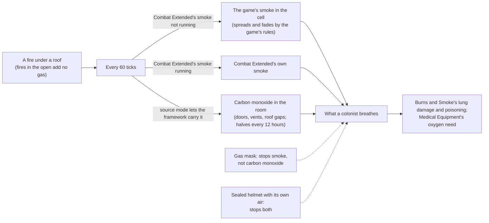

# D'thorga Framework

The shared library the D'thorga mods build on. On its own it changes almost nothing you will notice: it tells other mods what a
colonist is breathing, makes fires fill roofed rooms with the game's own smoke when Combat Extended's smoke is not running,
carries carbon monoxide from fires, holds the per-person care choices the D'thorga medical mods offer, and holds the small
helpers every D'thorga mod shares.

Version 0.33.0, built 8 November 2026 for House D'thorga. **Partly tested in game:** the owner reports the gas layer and the supplied
oxygen working through Burns and Smoke and Medical Equipment (5 November 2026). The health layer new in 0.3.0 and the **vehicle
systems new in 0.9.0, and their engines, drivetrains and gas turbines new in 0.11.0, are not yet tested in game.** The rest is read from the game's and the mods' code.

With **Vehicle Framework** active (RimWorld 1.7 only), it also gives vehicles real systems: a battery and alternator, coolant and
oil, an engine and drivetrain (gears, engine speed, load, grip), gas turbines for aircraft, tyres or tracks, brakes, a gearbox,
and wear that a mechanic services. See [Vehicle systems](#vehicle-systems-with-vehicle-framework).

## Read this first (gotchas)

- **New in 0.32.0, with Vehicle Framework (not yet tested in game): a fleet button on the bottom bar** lists every vehicle you own, wherever it
  is, and **a letter warns you before a vehicle left parked in the wild is lost** (three days ahead by default). Both are in this mod's vehicle
  settings, under **Your fleet**.
- **New in 0.31.0, with Vanilla Expanded Framework (not yet tested in game): garages.** A convoy that has stopped can set up a garage on
  the world map. Vehicles left in one stay with no time limit, and whoever is stationed there mends them from steel and components
  you bring by caravan. **Before removing this mod, take every vehicle out of every garage**, or they go with it.
- **RimWorld 1.7 only** (from 0.10.0; 1.6 is no longer supported, owner's decision of 8 November 2026).
- **From 0.28.0 the game's log is turned back on when it stops itself** at 10,000 messages a session (the setting **Keep the
  game's log going after its message limit**, on), at most 25 times a session, with a line naming the message that filled it. This
  replaces RimWorld's own anti-spam limit with a bounded one; switch it off to keep the game's limit. Not yet tested in game.
- **Vehicle systems change every Vehicle Framework vehicle you have, from any mod**, unless you choose otherwise in the settings
  (**D'thorga Framework: vehicle systems**). They append parts (battery, radiator, oil pump, brakes and so on) to vehicle designs.
  **Decide before you load a colony**: changing which vehicles get them needs a restart. Switching vehicles off later is safe.
- **Removing D'thorga Framework or Vehicle Framework from a colony that used vehicle systems: press the removal button first.**
  Vehicles save their parts in order, so load the colony, press **Remove the added parts from this colony's vehicles** in the
  settings, save, then remove the mod. Without that, saved vehicles may fail to load.
- **From 0.11.0, vehicles can be slowed by their own engines**: a laden truck climbing through sand, mud or snow runs out of
  power or grip and **crawls with "Wheels spinning"** (never below 15% of its speed). If you would rather keep every vehicle's
  speed as its author set it, choose **Drivetrain shown, speeds unchanged** in the settings (no restart needed).
- **Jump jets and hot days**: by default a Harrier too heavy for its engine to hover in the day's heat **lands on a runway
  instead of its pad** (with D'thorga Patches). The setting offers "allow it, at a cost to the engine" and "warn only".
- **From 0.12.0, helicopters and pods that launch through Vehicle Framework are checked before they lift off**: too heavy for the
  day's heat, or with engines or thrusters out, **the launch button refuses and says why** (unload, repair, or wait for cooler
  air). The same setting decides, so "warn only" lets them go.
- **From 0.16.0 a jump-start needs a jump-start kit** (a setting, on by default): craft one at a machining table or a fabrication
  bench before you need one, and carry one in every caravan. **From 0.18.0 a booster pack** (research: batteries) jump-starts a
  vehicle with no second vehicle and no kit: it holds 4 starts, charges again in the cargo of a running vehicle, and is recharged
  fully at a machining table. The setting **Every vehicle carries a booster pack** (off) makes packs unnecessary.
- **From 0.16.0 a closed cab shelters its passengers**: they feel the cab's temperature, not the weather, as long as the heater or
  the air conditioner has the engine to run on. **From 0.18.0 they also have moods about it** (a warm cab in the cold, a cold cab
  that is too cold for them); the setting **Passengers feel the cab** (on) turns them off. At a caravan's night camp the engine is off and the cab cools, unless the **night
  heater** setting is on and the vehicle's night heater switch was on before it left.
- **Steam locomotives (0.14.0): two settings to decide before you run one.** **Boiler explosions** are off by default: on, a
  boiler without a fusible plug (the American 4-8-4) whose water runs below the firebox crown explodes, and the settings window
  warns you. **Realistic feed water** is off by default: a water stop draws a tenth of the real tender (6,800 litres for the 4-8-4,
  under one Dubs water tower's 8,000); on, the real 68,000.
- **With Dubs Bad Hygiene, a vehicle's coolant top-up and a Harrier's injection water need a plumbing pipe with a water tower
  beside or under the parked vehicle.** Without Dubs Bad Hygiene, the coolant top-up takes chemfuel instead and the Harrier's water is free.

- **Load it before any D'thorga mod that needs it.** The About file asks for that order, so RimSort does it for you. It needs
  no other mod and no Harmony.
- **Safe to add to a running colony.** It saves the carbon monoxide in rooms, as the cells it sits in, and the per-person care
  choices you set; a save without it loads with no gas, and the choices are ignored without a line.
- **Safe to remove**, after the mods that depend on it are removed. The next load prints a line for each of its map components
  it cannot find (up to three per map); they are harmless. Jump-start kits and booster packs (with Vehicle Framework) vanish with
  it, with an error line each when the save loads: sell or destroy them first if you want a clean log.
- **It reuses what exists before adding its own** (owner's rule, 4 November 2026). Smoke is the game's smoke or Combat
  Extended's; only carbon monoxide is the framework's own gas, because nothing else carries it. The setting
  **Where gases come from** overrides this: Automatic (the default), always the framework's own gases, or never.
- **With Combat Extended, its "smoke effects" setting matters.** While it is on, CE's smoke inhalation is the smoke signal the
  framework hands out. Switch it off and fires fall back to the game's own smoke, which penalises aim and sight as CE's does.
- **Without Combat Extended, burning rooms now fill with the game's smoke**, which the game already spreads through open
  doors, fades slower under a roof and vents through gaps. Expect worse shooting inside a burning building.
- **Carbon monoxide ignores gas masks.** Only sealed headgear with its own air (Combat Extended's power and recon helmets)
  keeps it out. It lingers in a shut room for hours after the fire is out: open a door or a vent.
- **Gravships:** gas does not travel with a ship. The game's smoke and CE's stay on the old map, and so does ours.
- **Every humanlike pawn carries a small care-choices comp** from 0.3.0, for the per-person buttons medical mods such as
  D'thorga Triage offer. It saves only what you set and ticks nothing. A save loads without the framework with no line about it.

## What it does

| Gas | Who carries it | What the framework does with it |
| --- | --- | --- |
| Smoke | Combat Extended's black smoke while its smoke effects run; otherwise the game's own smoke | Reads it for other mods; without CE's smoke, fires add the game's smoke under a roof |
| Tox gas, rot stink, deadlife dust | The game | Reads them; adds tox gas where a mod asks |
| Carbon monoxide | The framework (its first own gas) | Fires add it to their roofed room on both paths; it moves through open doors and vents at the game's own door rates, leaks through roof gaps, halves on its own every 12 hours indoors |

How a room gas behaves, copied from how the game moves room temperature:

| Opening | Rate the game uses | Our pass |
| --- | --- | --- |
| Open door | 1 every 34 ticks | the same, scaled to one pass of 60 ticks |
| Closed door | 1 every 375 ticks | the same |
| Vent, switched on | 14 every 250 ticks | the same |
| Door or vent onto the outdoors | | a sink |
| Gap in the roof | | that share of the room halves every 600 ticks |

Rooms without gas cost nothing; a wall built through a smoky room leaves both halves smoky; a merged room dilutes.

From a fire to what a colonist breathes:



**The health layer** (0.3.0) answers for every D'thorga medical mod who the doctors look after (colonists, slaves, prisoners,
guests) and under what care, how dangerous a condition is and how soon it kills, and which doctor could operate. It also puts one
button per registered care choice on each of those people: D'thorga Triage's "Doctors may operate" is the first. How the medical
mods share the work is in [the medical mods together](../../docs/medical-mods.md).

## Vehicle systems (with Vehicle Framework)

Every vehicle gets systems that fit what it is, found by what it runs on and whether it drives, floats or flies, not by its name.
Other mods (D'thorga Vehicles first) can give a named vehicle its own figures. Nothing here is tested in game yet.

| System | What you see | What goes wrong | What fixes it |
| --- | --- | --- | --- |
| Battery and alternator | Battery charge; the alternator charges it while the engine runs | A damaged alternator stops charging; a flat or very cold battery **won't start the engine** (the draft button says why); a flat battery in deep frost can crack | **Jump-start it**: select a colonist and right-click the flat vehicle, with another vehicle parked within 8 cells and a jump-start kit, or with a booster pack; or park beside a powered conduit or battery to trickle-charge; warm the vehicle; repair the parts |
| Engine and drivetrain | Plain: "Engine labouring" or "Wheels spinning" only; Operator: the gear and engine speed; Engineer: load, engine, fuel and heat in kW | Cargo, passengers, hills and soft ground work the engine harder (more heat); out of power or grip, the vehicle slows, and **crawls** where it cannot grip; a damaged gearbox loses its top gears; a damaged clutch slips under load | Lighten it, take a road, or repair the gearbox and clutch |
| Coolant | Coolant temperature, warm at 88 to 110 °C | A holed radiator, low coolant or hard work in the heat: **running hot**, then overheating (engine damage), then boiling over (a letter) | Stop and let it cool; repair the radiator; a **coolant top-up** (due at 60%) takes **water from a plumbing pipe beside the parked vehicle with Dubs Bad Hygiene**, or 3 chemfuel without it |
| Oil | Oil level, temperature and pressure | Low oil or a damaged oil pump wears the engine while it runs | A service tops up the oil |
| Wear and service | Hours since the last service | Parts fail now and then, more once a service is due (120 running hours) and far more once overdue (180) | A **service**: haulers load 9 chemfuel and 1 component into the vehicle's cargo, then a constructor works on it |
| Tyres and tracks | Tread wear | Worn tyres slow the vehicle; worn through, they fail on the move | A service with 15 steel, 2 components and 10 chemfuel |
| Brakes | Brake wear, with every stop | Worn brakes slow the vehicle; worn through or wrecked, **it won't drive** | A service with 1 component |
| Gearbox | Gearbox temperature | A damaged gearbox heats up and wears while driving | Repair the gearbox |
| Cold fuel (a setting, off) | | Below about -8 °C chemfuel gels like diesel: **won't start** | Warm the vehicle in a heated room |
| Air brakes (named heavy trucks only) | Air pressure | After standing long, **it won't drive** until the engine has run a few minutes | Let it idle |
| Gas turbine (aircraft; D'thorga Vehicles' M1A2 tanks) | Turbine speed and temperature, and the flight phase | Run past its limits, the hot section wears, then the engine takes damage; a worn hot section breaks down; a weak battery lights it hot (wear) or **cannot light it** (the draft says why); with one of two engines out, the other runs hot | Ease off or land; **jump-start** a weak battery for a clean start; a **hot-section overhaul** (10 plasteel, 3 components) |
| Cab (closed vehicles) | Cab temperature | Freezing or stifling cab: the game's cold and heat injuries, and bad moods, as outdoors | The heater and the air conditioner while the engine runs; the night heater at camp (a setting) |
| Rotor drive (helicopters named by D'thorga Vehicles) | Over-torque, when it happens | The gearbox takes less power than the engines can give; asked for more it is **over-torqued** and wears; damaged, the helicopter lifts less | Lighten it; repair the transmission and rotor masts |
| Boiler (steam locomotives) | Steam pressure, the water glass, feed water | From cold, **it won't move** until it has steam (hours); run the feed water dry and **the fusible plug melts**, venting the boiler | Keep it drafted with the fire lit; **a water stop** refills the tender or tanks (with Dubs Bad Hygiene, from water towers); a mechanic fits a new plug |
| Traction motors (diesel-electric locomotives) | Traction motor temperature | Pulling hard from a standstill heats them: **running hot**, then burning their windings | Ease the load and let them cool; repair the motor |
| Traction battery (electric vehicles) | Battery temperature and health | Cold or hot, it gives less power and charges slowly; overheating, it takes damage and will not charge; past that, thermal runaway (fire only with the **Battery fires** setting). It wears with age and heat and holds less charge | Its heater holds it warm while on or charging; **new battery modules** (10 components, 20 steel) |
| Electric drive (electric vehicles) | Motor temperature | Hard work, or a damaged motor, heats it: less power, then damage | Ease off; repair the motor |
| Water injection (the Harrier, with D'thorga Vehicles) | Injection water | Without water the engine has only its dry ratings, so a heavy jet on a hot day may not hover | A refill of 227 litres: **with Dubs Bad Hygiene, from a plumbing pipe beside it**, otherwise free |

- **Three tabs on every vehicle with systems**, beside Vehicle Framework's Customize, Cargo and Pawns. **Health** (0.26.0, in
  Vehicle Framework's place; a setting keeps theirs): the vehicle's speed and strength with what each part does to them, every part
  grouped outside and inside with its health and what ails it, and the crew. Then the two from 0.17.0:
  **Dashboard** (does anything need me now? gauges, warning lights, what it waits for, the switches) and **Systems** (every figure,
  every part's health, the engine, and in Engineer mode a day's graph of each quantity). Systems is hidden in Plain mode. Tread
  and brake gauges show what is left. A gauge
  on the Dashboard opens Systems at that system. **From 0.23.0 both tabs are on the world map too**, on a vehicle caravan and an
  aircraft in flight, with a list of the caravan's vehicles down the left.
- **Parts can have conditions** (0.29.0), shown under the part on the Health tab: a radiator holed by shot or shrapnel goes on
  leaking coolant, a shot battery drains itself, and boiling over warps the cylinder head, so the engine runs hotter and, when it is
  bad, slower. **Repair the part to full health to clear them** (a colonist's repair job, or a caravan's). Not yet tested in game.
- **Other factions' vehicles run a simpler model** (0.25.0): raiders' and visitors' vehicles on your map take hits but nothing in
  them heats, wears or runs down by itself, which keeps a raid cheap; capture one and it wakes to the full model. The setting
  **Every faction's vehicles run the full model** (off) makes them cost what yours do.
- **Climate control** (0.22.0): modern vehicles hold the cab near 21 °C by themselves while the engine runs (a switch, on by
  default); older ones have the heater (below 5 °C outside) and the air conditioner (above 26 °C) by hand. The setting **Every closed
  cab has climate control** (off) gives it to every vehicle.
- **Empty mass** (0.19.0): each vehicle's weight with nothing aboard, set in Vehicle Framework's own settings window per vehicle.
  Real vehicles named by D'thorga Vehicles carry their real weights; other vehicles start at 12 kg per Vehicle Framework Mass.
- **The service button** (a spanner) asks for a service now, even if none is due. Services also start by themselves when due.
- **Switches** for headlights and the cab heater: each draws on the battery or the alternator while it runs.
- **Caravans**: the systems keep running on the world map. A caravan moves as its slowest vehicle (its explanation names it), a
  vehicle that will not move stops the caravan (the caravan's inspect text says why), and a crew member can jump-start it from
  another vehicle in the caravan with a kit aboard, or with a booster pack aboard. Services and water stops still need a map.
- **The ground on the world map** (0.18.0): a caravan's engines work against the tile's ground as well as its hills. Deserts are
  sand, swamps are mud, jungle is undergrowth, and winter adds snow; a road is firm whatever the land around it. A laden or
  underpowered vehicle slows on heavy ground and the caravan's explanation names it. Vehicle Framework's own travel times for each
  biome still apply as well.
- **Booster packs** (0.18.0): craft at a machining table or fabrication bench after researching batteries. A colonist carries one
  to a flat vehicle; no kit and no second vehicle needed. Each holds 4 starts (the inspect pane shows how many are left), gains a
  start back every 2 hours in the cargo of a vehicle whose engine runs, and is recharged fully by a bill at a machining table.
- **Cab moods** (0.18.0): people aboard a closed cab are glad of a warm cab when it is colder outside than they like, or a cool one
  in the heat, and unhappy in a cab too cold or too hot for them, judged by their own comfortable range (clothes, genes and traits
  count). Open vehicles give no such moods.
- **With RimHUD**: a value named **Vehicle (D'thorga Framework)** can be added to RimHUD's pawn display in its layout editor. It
  shows which vehicle a person is aboard and in what role; its tooltip gives the fuel, the cab and what the vehicle waits for, and
  a click selects the vehicle.
- **Electric vehicles** (0.20.0): the traction battery and electric drive above, 12 V electrics charged by a converter, brakes that
  wear a third as fast, and a cab whose heater and air conditioner cost range. They charge parked over a powered conduit, from the
  network's stored energy. **None of the owner's vehicles is electric** unless the setting **The Lightning runs on batteries** (with
  D'thorga Vehicles) is on.
- **Boats** cool with sea water (no radiator part). **Aircraft** get the battery, generator, service and a gas turbine; their
  engines cool unlike a car's, so they have no coolant.
- **Vehicle kinds**: light (Vehicle Framework mass under 120, petrol), medium (120 to 350, diesel), heavy (350 and more, 24 V and
  diesel), tracked (any vehicle with track parts), boats and aircraft.
- **The engine heats the room it stands in** while it runs, through the game's own temperature, so an idling truck warms a garage.
- **Engine running** means drafted, or moving in a caravan, or flying, with fuel aboard. Idling counts as half the work.
- **Combat Extended:** the added parts take the engine's cells and armour, so shots can reach them; from 0.15.0 their hit weights
  follow CE's own rule (it sorts the other way round), a part hit counts only the health the part really lost (a round the armour
  stopped drains nothing), and a boiler explosion carries a blast penetration on CE's scale.
- **Figures and supplies are gameplay choices**, each labelled with its source or as authored in the system files. Chemfuel stands
  in for oil, coolant and the rubber in tyres, because the game has none of them.

**Settings (D'thorga Framework: vehicle systems):** which vehicles (all, or only D'thorga ones; per mod; per kind: light, heavy and
tracked land vehicles, boats, aircraft), each system on or off, **figures only** (everything shows, nothing happens to the vehicle),
cold fuel, how much the vehicle shows (Plain, Operator, Engineer), and the removal button. The first group needs a restart.
**Engines and drivetrains:** the drivetrain off, shown only, or full (default full); **fuel use that follows engine load** (off:
vehicles burn what their authors set); and **when an aircraft is too heavy or too hot to hover onto its pad**: use the runway
(default), allow it at a cost to the engine, or warn only; from 0.12.0 it covers lift-off too. **Steam locomotives:** realistic
feed water (off: a tenth of the real figure) and boiler explosions (off, with a warning). **Night heater at camp** (off). **Jump-starts:**
leads must be crafted (on), every vehicle carries a booster pack (off). These take effect at once.

**Per vehicle, in Vehicle Framework's own settings** (each vehicle's page in its mod settings): battery capacity, alternator
output, starter draw, engine heat, radiator cooling, thermostat, oil use, tyre wear, gearbox heat and the air brakes' compressor
and leak. Each starts at the vehicle's own figure; Vehicle Framework keeps your changes.

**For modders:** every system and loadout is XML you can add to or change. The guide is
[vehicle systems for modders](../../docs/vehicle-systems-modding.md); `python scripts/check-vehicle-schemas.py` checks your files
offline.

## Settings

- **Where gases come from**: Automatic, always the framework's own gases, or never (then mods that depend on one fall back
  to a simpler estimate).
- **Show gases at the mouse (dev mode)**: a small label follows the mouse naming every gas in that cell's room.
- **Keep the game's log going after its message limit** (0.28.0, on): see the gotcha above.
- **Write every Def with all patches applied at the next start (dev mode)** (0.27.0): for mod developers; one file at
  the next start, in the RimWorld user folder (`PhobosPatchedDefs/PatchedDefs.xml`), then the setting turns itself off.
  The dev action "Framework: write patched Defs at the next start" does the same. Tested in game: the owner wrote one on
  8 November 2026 and the Def tool read it.

## For modders

Read what a pawn breathes:

```csharp
float smoke = PhobosGases.Breathed(pawn, GasKind.Smoke);          // 0..1, Combat Extended's condition or the game's smoke through the mask
float co = PhobosGases.Breathed(pawn, myGasDef);                   // a framework gas, through its own mask rule
float enclosure = PhobosGases.Enclosure(pawn.Position, pawn.Map); // 0 open air .. 1 sealed roofed room
GasSource where = PhobosGases.Source(myGasDef);                    // Own, Existing or None under the rule and the player's setting
```

Add a gas of your own in XML, and ask whether it earns its place first:

```xml
<Phobos.Framework.Gases.PhobosGasDef>
  <defName>MyMod_ChemfuelVapour</defName>
  <label>chemfuel vapour</label>
  <decayHalfLifeTicks>5000</decayHalfLifeTicks>
  <openRoofHalfLifeTicks>600</openRoofHalfLifeTicks>
  <filteredByMask>true</filteredByMask>
  <preferExisting>None</preferExisting>
</Phobos.Framework.Gases.PhobosGasDef>
```

An XML-only source is a comp: `Phobos.Framework.Gases.CompProperties_PhobosGasEmitter` with `gas` (or `kind` for an existing
gas), `amountPerRareTick`, and `onlyWhenPowered`, `onlyWhenSwitchedOn` or `onlyWhenFuelled`. From code,
`PhobosGases.AddOwn(cell, map, gas, cells)` or `PhobosGases.Add(cell, map, GasKind.Smoke, fraction)`.

The helpers: `OptionalMods` (active mods and Defs by name, cached), `LoadReport` (the one load line, optionally naming the part of a
mod it reports), `DisplayMode` and `SettingsUi.DrawDisplayMode`, `SettingsUi.Section` and `SettingsScroll` (headings and a scrolling
settings page), `SettingsImport` (carry a player's settings across a change of mod folder or Mod class, once), `SettingsUi.Warning` and
`SettingsUi.Choice` (a setting's cost in amber; a menu of choices), `OptionalMods.StaticMember` and `SettingField` (another
mod's setting by name), `PhobosBreathing.HealOnSuppliedOxygen` (conditions that heal faster on oxygen), `PatientPreferences.IconFor`, `MenuFor` and `LabelFor`
(a per-person choice drawn the same everywhere), `FrameWorkQueue` (run a long job a slice per frame, see below),
`RoomRebuildHold` (rebuild a map's rooms once per slice while many things are destroyed), `PhobosRulesDef` (a
rules Def whose first instance wins), `DebugCategory.Name`, and `CleanupService.RemoveHediffsOf(pack)` for a clean uninstall.

A long job: subclass `Phobos.Framework.Work.FrameWork` (`Start` takes the snapshot, `Step` does one unit, `Finished`, and
`BudgetMs` per frame), then `FrameWorkQueue.Enqueue(job)`. The queue runs from a game component's per-frame update, paused or not.
Jobs are never saved.

```csharp
bool fresh = !SettingsImport.HasOwnFile(this);                   // in the Mod constructor
Settings = GetSettings<MySettings>();
if (fresh && SettingsImport.ImportInto(Settings, "OldFolder", "OldModClass")) LongEventHandler.ExecuteWhenFinished(WriteSettings);
```

The health layer (`Phobos.Framework.Health`, 0.3.0), for mods whose doctors act on their own:

```csharp
PatientGroup? group = Patients.GroupOf(pawn);                       // Colonist, Slave, Prisoner, Guest, or null
bool allowed = Patients.CareAllows(pawn, MedicalCareCategory.HerbalOrWorse, requireMedicine: true);
float danger = ConditionDanger.DangerSeverity(hediff.def);           // from where the condition threatens life; huge when never
float hours = ConditionDanger.Clock(hediff).HoursToDeath(ConditionDanger.HoursUntilBloodLossDeath(pawn));
bool doctor = Doctors.AnyAvailableFor(pawn);                         // the game's own test
float best = Doctors.BestSurgeonSuccess(map, recipe, pawn);          // negative when no doctor meets the skill
var cache = new MapPatientCache<Pawn>((map, list) => { /* fill */ }); // rebuilt at most once per interval, when asked
Hediff? treatment = MedicalTreatment.GiveOrRefresh(pawn, myTreatmentDef); // a condition that lapses unless refreshed
```

A per-person choice is one registration at startup; the framework draws the button and saves the answer on the pawn:

```csharp
PatientPreferences.Register(new PatientPreference("MyMod_Choice", "MyMod_ChoiceLabel", "MyMod_ChoiceDesc",
    new[] { "MyMod_ChoiceOff", "MyMod_ChoiceOn" }, defaultFor: pawn => 1));
int choice = PatientPreferences.Choice(pawn, preference);
PatientPreferences.RegisterInspectLine(pawn => myLineOrNull);
```

The game-free rule behind the danger reader is `Phobos.Framework.Rules.ConditionDangerRule`, tested without the game.

Supplied oxygen (0.2.0) is a treatment, not a gas: put `Phobos.Framework.Breathing.PhobosSuppliedOxygenExtension` (with
`carbonMonoxideHalfLifeHours`, default 1.25) on your treatment condition, and `PhobosOxygenResponsiveExtension` (with
`minSeverity`) on a condition oxygen helps; read them with `PhobosBreathing.SuppliedCarbonMonoxideHalfLifeHours(pawn)` and
`PhobosBreathing.HasOxygenResponsiveCondition(pawn)`.

## Checks done (6 November 2026)

- Built for RimWorld 1.7 and 1.6. The game-free rules pass 26 unit tests: 17 for the gas layer (door and vent rates, exchange,
  venting, decay, rebuild, mask and signal choice, the owner's source rule), 5 for supplied oxygen and 4 for the danger rule.
- **The owner's reports (5 November 2026):** the gas layer and supplied oxygen working in game, through Burns and Smoke and
  Medical Equipment.
- **Not checked in game:** the health layer and its care-choice button, the door walk through regions, the vent lookup, the save
  and reload of room gas, and the cost on a big fire.
