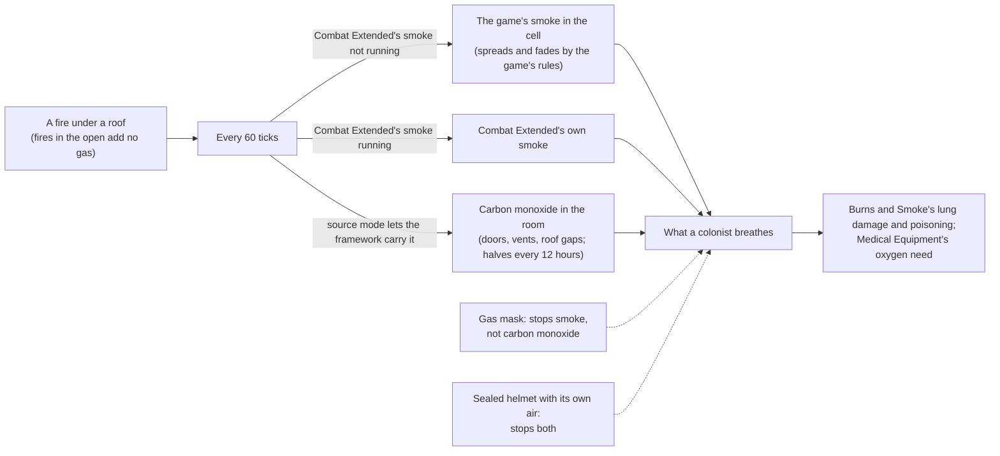

# D'thorga Framework

The shared library the D'thorga mods build on. On its own it changes almost nothing you will notice: it tells other mods what a
colonist is breathing, makes fires fill roofed rooms with the game's own smoke when Combat Extended's smoke is not running,
carries carbon monoxide from fires, holds the per-person care choices the D'thorga medical mods offer, and holds the small
helpers every D'thorga mod shares.

Version 0.6.0, built 7 November 2026 for House D'thorga. **Partly tested in game:** the owner reports the gas layer and the supplied
oxygen working through Burns and Smoke and Medical Equipment (5 November 2026). The health layer new in 0.3.0 is not yet tested in
game. The rest is read from the game's and the mods' code.

## Read this first (gotchas)

- **Load it before any D'thorga mod that needs it.** The About file asks for that order, so RimSort does it for you. It needs
  no other mod and no Harmony.
- **Safe to add to a running colony.** It saves the carbon monoxide in rooms, as the cells it sits in, and the per-person care
  choices you set; a save without it loads with no gas, and the choices are ignored without a line.
- **Safe to remove**, after the mods that depend on it are removed. The next load prints a line for each of its map components
  it cannot find (up to three per map); they are harmless.
- **It reuses what exists before adding its own** (owner's rule, 4 November 2026). Smoke is the game's smoke or Combat
  Extended's; only carbon monoxide is the framework's own gas, because nothing else carries it. The setting
  **Where gases come from** overrides this: Automatic (the default), always the framework's own gases, or never.
- **With Combat Extended, its "smoke effects" setting matters.** While it is on, CE's smoke inhalation is the smoke signal the
  framework hands out. Switch it off and fires fall back to the game's own smoke, which penalises aim and sight as CE's does.
- **Without Combat Extended, burning rooms now fill with the game's smoke**, which the game already spreads through open
  doors, fades slower under a roof and vents through gaps. Expect worse shooting inside a burning building.
- **Carbon monoxide ignores gas masks.** Only sealed headgear with its own air (Combat Extended's power and recon helmets)
  keeps it out. It lingers in a shut room for hours after the fire is out: open a door or a vent.
- **Gravships:** gas does not travel with a ship. The game's smoke and CE's stay on the old map, and so does ours.
- **Every humanlike pawn carries a small care-choices comp** from 0.3.0, for the per-person buttons medical mods such as
  D'thorga Triage offer. It saves only what you set and ticks nothing. A save loads without the framework with no line about it.

## What it does

| Gas | Who carries it | What the framework does with it |
| --- | --- | --- |
| Smoke | Combat Extended's black smoke while its smoke effects run; otherwise the game's own smoke | Reads it for other mods; without CE's smoke, fires add the game's smoke under a roof |
| Tox gas, rot stink, deadlife dust | The game | Reads them; adds tox gas where a mod asks |
| Carbon monoxide | The framework (its first own gas) | Fires add it to their roofed room on both paths; it moves through open doors and vents at the game's own door rates, leaks through roof gaps, halves on its own every 12 hours indoors |

How a room gas behaves, copied from how the game moves room temperature:

| Opening | Rate the game uses | Our pass |
| --- | --- | --- |
| Open door | 1 every 34 ticks | the same, scaled to one pass of 60 ticks |
| Closed door | 1 every 375 ticks | the same |
| Vent, switched on | 14 every 250 ticks | the same |
| Door or vent onto the outdoors | | a sink |
| Gap in the roof | | that share of the room halves every 600 ticks |

Rooms without gas cost nothing; a wall built through a smoky room leaves both halves smoky; a merged room dilutes.

From a fire to what a colonist breathes:



**The health layer** (0.3.0) answers for every D'thorga medical mod who the doctors look after (colonists, slaves, prisoners,
guests) and under what care, how dangerous a condition is and how soon it kills, and which doctor could operate. It also puts one
button per registered care choice on each of those people: D'thorga Triage's "Doctors may operate" is the first. How the medical
mods share the work is in [the medical mods together](../../docs/medical-mods.md).

## Settings

- **Where gases come from**: Automatic, always the framework's own gases, or never (then mods that depend on one fall back
  to a simpler estimate).
- **Show gases at the mouse (dev mode)**: a small label follows the mouse naming every gas in that cell's room.

## For modders

Read what a pawn breathes:

```csharp
float smoke = PhobosGases.Breathed(pawn, GasKind.Smoke);          // 0..1, Combat Extended's condition or the game's smoke through the mask
float co = PhobosGases.Breathed(pawn, myGasDef);                   // a framework gas, through its own mask rule
float enclosure = PhobosGases.Enclosure(pawn.Position, pawn.Map); // 0 open air .. 1 sealed roofed room
GasSource where = PhobosGases.Source(myGasDef);                    // Own, Existing or None under the rule and the player's setting
```

Add a gas of your own in XML, and ask whether it earns its place first:

```xml
<Phobos.Framework.Gases.PhobosGasDef>
  <defName>MyMod_ChemfuelVapour</defName>
  <label>chemfuel vapour</label>
  <decayHalfLifeTicks>5000</decayHalfLifeTicks>
  <openRoofHalfLifeTicks>600</openRoofHalfLifeTicks>
  <filteredByMask>true</filteredByMask>
  <preferExisting>None</preferExisting>
</Phobos.Framework.Gases.PhobosGasDef>
```

An XML-only source is a comp: `Phobos.Framework.Gases.CompProperties_PhobosGasEmitter` with `gas` (or `kind` for an existing
gas), `amountPerRareTick`, and `onlyWhenPowered`, `onlyWhenSwitchedOn` or `onlyWhenFuelled`. From code,
`PhobosGases.AddOwn(cell, map, gas, cells)` or `PhobosGases.Add(cell, map, GasKind.Smoke, fraction)`.

The helpers: `OptionalMods` (active mods and Defs by name, cached), `LoadReport` (the one load line, optionally naming the part of a
mod it reports), `DisplayMode` and `SettingsUi.DrawDisplayMode`, `SettingsUi.Section` and `SettingsScroll` (headings and a scrolling
settings page), `SettingsImport` (carry a player's settings across a change of mod folder or Mod class, once), `PhobosRulesDef` (a
rules Def whose first instance wins), `DebugCategory.Name`, and `CleanupService.RemoveHediffsOf(pack)` for a clean uninstall.

```csharp
bool fresh = !SettingsImport.HasOwnFile(this);                   // in the Mod constructor
Settings = GetSettings<MySettings>();
if (fresh && SettingsImport.ImportInto(Settings, "OldFolder", "OldModClass")) LongEventHandler.ExecuteWhenFinished(WriteSettings);
```

The health layer (`Phobos.Framework.Health`, 0.3.0), for mods whose doctors act on their own:

```csharp
PatientGroup? group = Patients.GroupOf(pawn);                       // Colonist, Slave, Prisoner, Guest, or null
bool allowed = Patients.CareAllows(pawn, MedicalCareCategory.HerbalOrWorse, requireMedicine: true);
float danger = ConditionDanger.DangerSeverity(hediff.def);           // from where the condition threatens life; huge when never
float hours = ConditionDanger.Clock(hediff).HoursToDeath(ConditionDanger.HoursUntilBloodLossDeath(pawn));
bool doctor = Doctors.AnyAvailableFor(pawn);                         // the game's own test
float best = Doctors.BestSurgeonSuccess(map, recipe, pawn);          // negative when no doctor meets the skill
var cache = new MapPatientCache<Pawn>((map, list) => { /* fill */ }); // rebuilt at most once per interval, when asked
Hediff? treatment = MedicalTreatment.GiveOrRefresh(pawn, myTreatmentDef); // a condition that lapses unless refreshed
```

A per-person choice is one registration at startup; the framework draws the button and saves the answer on the pawn:

```csharp
PatientPreferences.Register(new PatientPreference("MyMod_Choice", "MyMod_ChoiceLabel", "MyMod_ChoiceDesc",
    new[] { "MyMod_ChoiceOff", "MyMod_ChoiceOn" }, defaultFor: pawn => 1));
int choice = PatientPreferences.Choice(pawn, preference);
PatientPreferences.RegisterInspectLine(pawn => myLineOrNull);
```

The game-free rule behind the danger reader is `Phobos.Framework.Rules.ConditionDangerRule`, tested without the game.

Supplied oxygen (0.2.0) is a treatment, not a gas: put `Phobos.Framework.Breathing.PhobosSuppliedOxygenExtension` (with
`carbonMonoxideHalfLifeHours`, default 1.25) on your treatment condition, and `PhobosOxygenResponsiveExtension` (with
`minSeverity`) on a condition oxygen helps; read them with `PhobosBreathing.SuppliedCarbonMonoxideHalfLifeHours(pawn)` and
`PhobosBreathing.HasOxygenResponsiveCondition(pawn)`.

## Checks done (6 November 2026)

- Built for RimWorld 1.7 and 1.6. The game-free rules pass 26 unit tests: 17 for the gas layer (door and vent rates, exchange,
  venting, decay, rebuild, mask and signal choice, the owner's source rule), 5 for supplied oxygen and 4 for the danger rule.
- **The owner's reports (5 November 2026):** the gas layer and supplied oxygen working in game, through Burns and Smoke and
  Medical Equipment.
- **Not checked in game:** the health layer and its care-choice button, the door walk through regions, the vent lookup, the save
  and reload of room gas, and the cost on a big fire.
