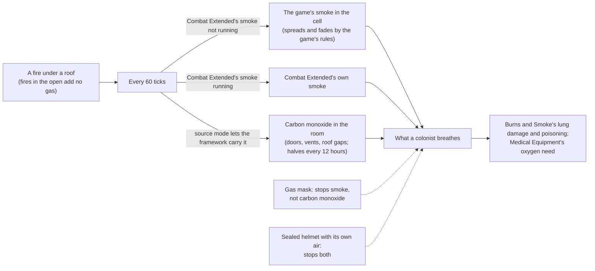

# D'thorga Framework

The shared library the D'thorga mods build on. On its own it changes almost nothing you will notice: it tells other mods what a
colonist is breathing, makes fires fill roofed rooms with the game's own smoke when Combat Extended's smoke is not running,
carries carbon monoxide from fires, holds the per-person care choices the D'thorga medical mods offer, and holds the small
helpers every D'thorga mod shares.

One of House D'thorga's mods (also spelt dthorga).

Version 0.110.1, built 13 November 2026 for House D'thorga. **Partly tested in game:** the owner reports the gas layer and the supplied
oxygen working through Burns and Smoke and Medical Equipment (5 November 2026). The health layer new in 0.3.0 and the **vehicle
systems new in 0.9.0, and their engines, drivetrains and gas turbines new in 0.11.0, are not yet tested in game.** The rest is read from the game's and the mods' code.

With **Vehicle Framework** active (RimWorld 1.7 only), it also gives vehicles real systems: a battery and alternator, coolant and
oil, an engine and drivetrain (gears, engine speed, load, grip), gas turbines for aircraft, tyres or tracks, brakes, a gearbox,
and wear that a mechanic services. See [Vehicle systems](#vehicle-systems-with-vehicle-framework).

## Read this first (gotchas)

- **New in 0.61.0 (not yet tested in game): a D'thorga research tab.** Vehicle parts and workshops now have their own research. **An existing colony gets a project free, once, if it had already done the research that project replaces**, so you keep everything you could build. New colonies research them normally. With Vehicle Framework, our own vehicles' upgrades now need the research they name.
- **New in 0.32.0, with Vehicle Framework (not yet tested in game): a fleet button on the bottom bar** lists every vehicle you own, wherever it
  is, and **a letter warns you before a vehicle left parked in the wild is lost** (three days ahead by default). Both are in this mod's vehicle
  settings, under **Your fleet**.
- **New in 0.31.0, with Vanilla Expanded Framework (not yet tested in game): garages.** A convoy that has stopped can set up a garage on
  the world map. Vehicles left in one stay with no time limit, and whoever is stationed there mends them from steel and components
  you bring by caravan. **Before removing this mod, take every vehicle out of every garage**, or they go with it.
- **New in 0.110.0 (not yet tested in game): aircraft avionics.** An aircraft whose flight instruments are broken or without power
  **will not take off at night or in fog** (the setting **Blind take-offs: warn only** lets it go with a warning). Without working
  navigation, or with only basic navigation in the dark, a world-map flight is slower and thirstier. Hydraulic flight controls go
  heavy when their fluid runs low. Aircraft without an instrument panel gain an **avionics bay** part.
- **New in 0.109.0 (not yet tested in game): EMP reaches vehicles.** An EMP hit can stall a vehicle for a moment and drains its battery
  (about 40 % on a civilian vehicle, 16 % on an armed one, which is hardened). Steam engines are never stalled, nor are RimThunder's
  vehicles, whose authors chose that. It works on raiders' vehicles too, so EMP grenades and mortars are now a real answer to them.
  Vehicle Framework's own EMP setting for each vehicle still wins.
- **New in 0.106.0 (not yet tested in game): a failing battery sheds loads.** With the engine running and the charging failed or unable to keep up, air conditioning, climate control, heaters, work lamps and then the lights go off by themselves, and come back when it recovers; the inspect line names them and says how long the battery has. **Every aircraft now has one flight-controls rule**: below 35 % it cannot take off.
- **New in 0.104.0 (not yet tested in game): headlights light the ground.** At night, with the headlights switched on, the ground ahead
  of a vehicle is lit, engine running or not. **The headlights switch is now off by default: switch it on before driving at night.**
  **Left on with the engine off, the lights run the battery flat**, and a message warns when the battery may soon be too weak to start.
  A setting, **Headlights light the ground**, turns the light itself off and is on by default.
- **New in 0.101.0 (not yet tested in game): sling wrecks.** A load let go from a helicopter's sling lies on the world map as a wreck
  until a caravan recovers it. **Before removing this mod, recover every wreck**, or the vehicle in it goes with it. **Likewise, let a
  water drop run land and unload every litter first**, or the helicopter in the run and the people on the litters go with it.
- **RimWorld 1.7 only** (from 0.10.0; 1.6 is no longer supported, owner's decision of 8 November 2026).
- **From 0.28.0 the game's log is turned back on when it stops itself** at 10,000 messages a session (the setting **Keep the
  game's log going after its message limit**, on), at most 25 times a session, with a line naming the message that filled it. This
  replaces RimWorld's own anti-spam limit with a bounded one; switch it off to keep the game's limit. Not yet tested in game.
- **Vehicle systems change every Vehicle Framework vehicle you have, from any mod**, unless you choose otherwise in the settings
  (**D'thorga Framework: vehicle systems**). They append parts (battery, radiator, oil pump, brakes and so on) to vehicle designs.
  **Decide before you load a colony**: changing which vehicles get them needs a restart. Switching vehicles off later is safe.
- **Removing D'thorga Framework or Vehicle Framework from a colony that used vehicle systems: press the removal button first.**
  Vehicles save their parts in order, so load the colony, press **Remove the added parts from this colony's vehicles** in the
  settings, save, then remove the mod. Without that, saved vehicles may fail to load.
- **From 0.11.0, vehicles can be slowed by their own engines**: a laden truck climbing through sand, mud or snow runs out of
  power or grip and **crawls with "Wheels spinning"** (never below 15% of its speed). If you would rather keep every vehicle's
  speed as its author set it, choose **Drivetrain shown, speeds unchanged** in the settings (no restart needed).
- **Jump jets and hot days**: by default a Harrier too heavy for its engine to hover in the day's heat **lands on a runway
  instead of its pad** (with D'thorga Patches). The setting offers "allow it, at a cost to the engine" and "warn only".
- **From 0.12.0, helicopters and pods that launch through Vehicle Framework are checked before they lift off**: too heavy for the
  day's heat, or with engines or thrusters out, **the launch button refuses and says why** (unload, repair, or wait for cooler
  air). The same setting decides, so "warn only" lets them go.
- **From 0.16.0 a jump-start needs a jump-start kit** (a setting, on by default): craft one at a vehicle parts bench before you need one, and carry one in every caravan. **From 0.18.0 a booster pack** (research: batteries) jump-starts a
  vehicle with no second vehicle and no kit: it holds 4 starts, charges again in the cargo of a running vehicle, and is recharged
  fully at a vehicle parts bench. The setting **Every vehicle carries a booster pack** (off) makes packs unnecessary.
- **From 0.16.0 a closed cab shelters its passengers**: they feel the cab's temperature, not the weather, as long as the heater or
  the air conditioner has the engine to run on. **From 0.18.0 they also have moods about it** (a warm cab in the cold, a cold cab
  that is too cold for them); the setting **Passengers feel the cab** (on) turns them off. At a caravan's night camp the engine is off and the cab cools, unless the **night
  heater** setting is on and the vehicle's night heater switch was on before it left. **From 0.67.0 the cab heater runs off the engine's
  heat**, so a cab warms only once the engine has warmed up, and the night heater keeps the engine warm as well, so a camp's morning start
  no longer wears it. **From 0.104.0 (not yet tested in game) electric vehicles have their own night heater**, on the same switch and
  setting, paid for from the drive battery. **Also from 0.104.0, the generator set is a hybrid**: with its battery buffer fitted, **Battery
  drive** moves it slowly and quietly with the engine off, and out of fuel it creeps on the battery by itself. **From 0.69.0 a fire on a vehicle cooks it from the inside**: the cab grows stifling, the coolant heats and the
  radiator cooks, so a fire put out within an in-game hour leaves the engine hot and a radiator to repair, and one left to burn for
  about two hours boils the engine over. **From 0.70.0** cold oil makes a start harder on the battery, and a **block heater** fitting
  keeps a vehicle parked beside power warm. **From 0.73.0** a drive belt turns the water pump and alternator (a snapped one overheats the
  engine and flattens the battery together), worn tyres lose grip in mud, working trucks' hydraulics run on their fluid, the dyno bay (the tuning rig before 0.82.1)
  can **Diagnose** a vehicle and fits replacement parts properly (60% health instead of 25%), and an **inspection pit** speeds the parts
  bench. **From 0.74.0 tyres, brakes, engine services and drive belts take kits** made at the parts bench (a tyre set, a brake pad set,
  an engine service kit, a drive belt), so caravans carry them. **A save from before 0.74.0 keeps paying in raw materials** until you
  switch off *This colony: services take raw materials instead of kits* in the vehicle systems settings; a new colony needs kits from
  the start. **From 0.78.0 a diagnosis opens as a report**: the vehicle's picture with its hurt parts tinted, the parts and readings
  with bars and warning colours, and (Operator and Engineer) a graph of the last day's temperatures and levels. **From 0.79.0** the Health
  tab shows the same tinted picture, the fleet board shows each vehicle's picture with fuel and worst-part gauges, and (Operator and
  Engineer) a small line of the last day sits under each Dashboard gauge. **From 0.84.0** small dots above the graphs mark what happened
  (a warning stage entered, a service done, a new fault, a jump-start): rest the mouse on one to read it. Click a part on the tinted
  picture to mark its row and scroll to it, and rest the mouse on a vehicle's picture on the fleet board to see its tinted picture.
  **From 0.85.0** a selected vehicle caravan has its reach on the fuel aboard outlined in amber on the globe, worked out over the real
  ground, hills, winter and roads, and its inspect text says how many hours of driving the fuel allows. **From 0.86.0** the Health tab
  has a **Wear** block: tread, brakes, battery health, hours since service and a turbine's hot section, each with when it will reach
  its next stage worth a look ("Tread: worn in about 4 days"), at the rate it has worn since its last service, and (Operator and
  Engineer) a line of its last fifteen days. **From 0.87.0** fittings, tunes and part grades have pictures: the fittings window shows
  each tune as a picture button (the one running lit green), each part's fitting and grade, and a line saying what a fitting or tune
  changes ("engine power up, fuel burned up" in Plain); the Health tab colours a hurt part's name and shows its fitting and grade
  pictures beside it. **From 0.88.0** each part's fittings and grades are picture buttons in the fittings window, the one it has lit;
  the engine and gearbox rows say what their fitting and the running tune give together ("Power tune + turbocharger: ..."), and resting
  the mouse on any choice shows what the row would give instead. **From 0.89.0** the wheels are grouped into axles (front axle, rear
  axle): a choice on an axle is ordered for each of its wheels. **From 0.90.0** tuning is easier to find: right-click a vehicle with a
  colonist selected ("Fittings and tunes...", and "Do the waiting work" for a mechanic), select a dyno bay for its **Vehicles in reach**,
  or use the **Fittings and tunes** button a vehicle shows while a dyno bay is in reach. **From 0.91.0 fitting and tuning are a real job**: a
  turbocharger is about 12 hours of a mechanic's work and 100 steel and 10 components on a 5-tonne vehicle, a Power tune about 10 hours, and
  a bigger vehicle costs more. Three settings under the repairs heading change it: *Time to fit and tune*, *Materials to fit and tune*
  and *Bigger vehicles cost more to fit and tune*. **From 0.92.0 a helicopter can carry a vehicle on a sling**: fit it a **cargo hook**,
  put a **sling set** aboard, press **Lift a vehicle** and pick one of ours parked outdoors nearby; a colonist hooks it up, and it flies
  with the helicopter and is set down beside it where it lands. It must weigh, with its cargo and people, no more than the hook takes
  today (less on hot days). Settings under **Sling loads**. **From 0.99.0 the load is drawn under the helicopter** as it takes off and
  lands, a message says it was lifted, the world map's tabs and the fleet board list it, and a landed helicopter with no room to set its
  load down has a **Set the load down** button. **Setting a load down after landing broke the map up to 0.100.0** (pictures lost, a grey
  screen); 0.101.1 fixes it, not yet tested in game, and a save made in that state loads normally. **Which helicopters take a cargo
  hook** is set by D'thorga Vehicles: the Cherokee, the Louie and the Hind. **From 0.102.0 (not yet tested in game)** a helicopter that
  flies across the map by itself, such as the Hind, carries its load hanging under it over the map and sets it down once it has landed;
  it cannot fly water drop runs. **From 0.101.0 (not yet tested in game)** wind and storms ground a lift, a slung flight
  is slower and burns more, landing asks where to put the load, and on the world map **Emergency release** drops it as a wreck for a
  caravan to recover; a crash drops it too. Each is a setting under **Sling loads**. **Also from 0.101.0 (not yet tested in game)** a
  helicopter with a cargo hook and a **fire bucket** aboard flies **Water drop** runs: click a fire within 50 cells, and it fills the
  bucket at the nearest open water and empties it over the fire; and a **litter kit** in a vehicle's cabin makes it an air ambulance:
  right-click a downed person with a colonist to **Carry to a litter aboard...**, a crew member who can doctor tends them while it
  stands, and **Unload casualties** sets them down. **From 0.93.0 the Systems tab is compact**: one row a reading, which opens to
  its graph on a click, a card a system, parts as a strip of small bars, and an **Only what needs attention** tick box. **From 0.94.0** a
  screen of ours that fails shows one line and tries again in a few seconds, where the game would fill its log; and in dev mode
  **"Vehicle systems: run the self-test"** checks most of this in one go, a sling lift included. Not yet tested in game.
- **From 0.101.0 (not yet tested in game), a land vehicle can tow a trailer**, such as D'thorga Vehicles' Pintle flatbed trailer. Select the
  vehicle, press **Hitch a trailer** and pick a trailer within 8 cells; a colonist who hauls couples it, and it is set straight behind the
  vehicle. **The trailer stays on the map**: it follows the hitch, cuts inside corners, can be shot, and **if it would run into a wall or
  another vehicle, the vehicle stops and says so**: take a wider way round, or **Unhitch**. The trailer and its load add to what the engine
  pulls, so a small truck with a full trailer climbs slowly and runs hot. **Only vehicles our drivetrain model works out can tow**, unless
  you turn on **Vehicles without the drivetrain model can tow** (under **Towing**, off by default), which uses a plain rule instead.
  **From 0.104.0 (not yet tested in game) the trailer goes on journeys**: a vehicle that leaves the map takes it along, its weight slows
  the caravan, and it is set down behind the vehicle on arrival. While you choose what to hitch, a label beside the mouse says what the
  tow would be like on this ground, and a towing vehicle's panels say what holds it back. **From 0.103.0 (not yet tested
  in game)**, a vehicle with the recovery winch fitted can tow an ordinary land vehicle the same way (see Families below).
- **From 0.96.0 (not yet tested in game), hover a reading or a part to learn what it is**: the tooltip says in a sentence what the
  reading means and what moves it, or what the part does and what losing it costs, on the Systems tab, the Dashboard and the Health tab.
- **From 0.95.0 (not yet tested in game), the depot bay is built from parts**: a fuel tank and a fuel pump beside its steel, and a
  vehicle of ours takes more of our engine assembly the heavier it is (two on a truck, three on a drill rig), **for repairs too**.
  **Finish or cancel a depot bay or a vehicle being built before you update.** Whose parts a build asks for is the setting
  **Parts for building**.
- **Making vehicle parts at the vehicle parts bench.** **Bills run from the top**: the bench works its bills in order, so a bill low
  in the list may wait a long time while those above keep it busy; move the part you need most to the top. **Give the parts somewhere
  to go**: kits and parts have a storage category of their own, **Vehicle parts**, and stockpiles made before you installed don't take
  a new category by themselves, so tick it in at least one stockpile or shelf. "Do until you have X" counts only parts in storage, so
  without one the bench makes more than you asked for. **Keep materials close**: steel and components stored beside the bench save a
  long walk for every part.
- **New in 0.106.0 (not yet tested in game): four cross-links.** Running the tank dry costs the fuel pump 5 %; heavy trucks warn of low
  air before their brakes lock; a fire burns the tyres and the battery as well as the radiator; and a land vehicle driving in the
  dark with its headlights off goes at 85 % of its speed.
- **Steam locomotives (0.14.0): two settings to decide before you run one.** **Boiler explosions** are off by default: on, a
  boiler without a fusible plug (the American 4-8-4) whose water runs below the firebox crown explodes, and the settings window
  warns you. **Realistic feed water** is off by default: a water stop draws a tenth of the real tender (6,800 litres for the 4-8-4,
  under one Dubs water tower's 8,000); on, the real 68,000.
- **From 0.108.1 the pipes and conduits our things lay beneath them are hidden again** (Dubs Bad Hygiene's hidden plumbing, the game's hidden
  conduit, a Vanilla Expanded Framework line's transparent pipe): **look for them in the plumbing and power overlays.** The visible ones 0.107.0
  and 0.108.0 laid turn hidden by themselves; your own pipes are never touched. A pipe of ours deconstructed gives nothing back. Not yet tested in game.
- **From 0.108.0, every vehicle of ours parked with its engine off shows its pipes and conduits** (plumbing if it takes water, power conduit if it
  has a battery, the pipe of any line it uses), whether or not a run touches it; they go when its engine starts or it moves. A conduit run
  touching a parked vehicle charges its battery. Old hidden pipes from earlier versions are found and made visible once. Not yet tested in game.
- **From 0.107.0 the pipes our things lay beneath them are visible** (Dubs Bad Hygiene's plumbing, a Vanilla Expanded Framework net's own pipe), and the
  generator set can join the grid through power conduits laid beneath it. Older hidden pipes are swapped for visible ones by themselves. With Vanilla
  Chemfuel Expanded, **a parked fuelled vehicle against a chemfuel pipe fills its tank from the line** (engine off, not set up), and the depot bay
  fills from a chemfuel pipe touching it. Not yet tested in game.
- **With Dubs Bad Hygiene, a vehicle's coolant top-up and a Harrier's injection water need a plumbing pipe with a water tower
  beside or under the parked vehicle.** Without Dubs Bad Hygiene, the coolant top-up takes chemfuel instead and the Harrier's water is free.

- **Load it before any D'thorga mod that needs it.** The About file asks for that order, so RimSort does it for you. It needs
  no other mod and no Harmony.
- **Safe to add to a running colony.** It saves the carbon monoxide in rooms, as the cells it sits in, and the per-person care
  choices you set; a save without it loads with no gas, and the choices are ignored without a line.
- **Safe to remove**, after the mods that depend on it are removed. The next load prints a line for each of its map components
  it cannot find (up to three per map); they are harmless. Jump-start kits and booster packs (with Vehicle Framework) vanish with
  it, with an error line each when the save loads: sell or destroy them first if you want a clean log.
- **It reuses what exists before adding its own** (owner's rule, 4 November 2026). Smoke is the game's smoke or Combat
  Extended's; only carbon monoxide is the framework's own gas, because nothing else carries it. The setting
  **Where gases come from** overrides this: Automatic (the default), always the framework's own gases, or never.
- **With Combat Extended, its "smoke effects" setting matters.** While it is on, CE's smoke inhalation is the smoke signal the
  framework hands out. Switch it off and fires fall back to the game's own smoke, which penalises aim and sight as CE's does.
- **Without Combat Extended, burning rooms now fill with the game's smoke**, which the game already spreads through open
  doors, fades slower under a roof and vents through gaps. Expect worse shooting inside a burning building.
- **Carbon monoxide ignores gas masks.** Only sealed headgear with its own air (Combat Extended's power and recon helmets)
  keeps it out. It lingers in a shut room for hours after the fire is out: open a door or a vent.
- **Gravships:** gas does not travel with a ship. The game's smoke and CE's stay on the old map, and so does ours.
- **Every humanlike pawn carries a small care-choices comp** from 0.3.0, for the per-person buttons medical mods such as
  D'thorga Triage offer. It saves only what you set and ticks nothing. A save loads without the framework with no line about it.

## What it does

| Gas | Who carries it | What the framework does with it |
| --- | --- | --- |
| Smoke | Combat Extended's black smoke while its smoke effects run; otherwise the game's own smoke | Reads it for other mods; without CE's smoke, fires add the game's smoke under a roof |
| Tox gas, rot stink, deadlife dust | The game | Reads them; adds tox gas where a mod asks |
| Carbon monoxide | The framework (its first own gas) | Fires add it to their roofed room on both paths; it moves through open doors and vents at the game's own door rates, leaks through roof gaps, halves on its own every 12 hours indoors |

How a room gas behaves, copied from how the game moves room temperature:

| Opening | Rate the game uses | Our pass |
| --- | --- | --- |
| Open door | 1 every 34 ticks | the same, scaled to one pass of 60 ticks |
| Closed door | 1 every 375 ticks | the same |
| Vent, switched on | 14 every 250 ticks | the same |
| Door or vent onto the outdoors | | a sink |
| Gap in the roof | | that share of the room halves every 600 ticks |

Rooms without gas cost nothing; a wall built through a smoky room leaves both halves smoky; a merged room dilutes.

From a fire to what a colonist breathes:



**The health layer** (0.3.0) answers for every D'thorga medical mod who the doctors look after (colonists, slaves, prisoners,
guests) and under what care, how dangerous a condition is and how soon it kills, and which doctor could operate. It also puts one
button per registered care choice on each of those people: D'thorga Triage's "Doctors may operate" is the first. How the medical
mods share the work is in [the medical mods together](../../docs/medical-mods.md).

## Vehicle systems (with Vehicle Framework)

**Depot bays (0.45.0, motor pool tab; not yet tested in game):** a home for one vehicle, with a fuel tank and pump, a shelf for its parts and an outlined pad. Press **Assign vehicle** on the bay, then **Go to bay** on the vehicle, which needs a driver aboard. On the pad it refuels with nobody attending (chemfuel only, while the bay has power) and mechanics need 70% of the usual work. It only ever moves when you tell it to.

**Build a vehicle parts bench first (Architect, motor pool tab; research Machining): since 0.43.0 our parts, kits and booster packs are made only there.
A tune or a change of grade on a working part also needs a dyno bay** (called the tuning rig before 0.82.1) within 5 cells of the vehicle as it is drawn (an aircraft's wings and rotor count; 3 cells of its footprint before 0.77.0), powered (a setting, on by default); fittings and
replacing a destroyed part do not. A bill already on a machining table goes on working until you remove it. **Not yet tested in game.**

Every vehicle gets systems that fit what it is, found by what it runs on and whether it drives, floats or flies, not by its name.
Other mods (D'thorga Vehicles first) can give a named vehicle its own figures. Nothing here is tested in game yet.

| System | What you see | What goes wrong | What fixes it |
| --- | --- | --- | --- |
| Battery and alternator | Battery charge; the alternator charges it while the engine runs | A damaged alternator stops charging; a flat or very cold battery **won't start the engine** (the draft button says why); a flat battery in deep frost can crack | **Jump-start it**: select a colonist and right-click the flat vehicle, with another vehicle parked within 8 cells and a jump-start kit, or with a booster pack; or park beside a powered conduit or battery to trickle-charge; warm the vehicle; repair the parts |
| Engine and drivetrain | Plain: "Engine labouring" or "Wheels spinning" only; Operator: the gear and engine speed; Engineer: load, engine, fuel and heat in kW | Cargo, passengers, hills and soft ground work the engine harder (more heat); out of power or grip, the vehicle slows, and **crawls** where it cannot grip; a damaged gearbox loses its top gears; a damaged clutch slips under load | Lighten it, take a road, or repair the gearbox and clutch |
| Coolant | Coolant temperature, warm at 88 to 110 °C | A holed radiator, low coolant or hard work in the heat: **running hot**, then overheating (engine damage), then boiling over (a letter) | Stop and let it cool; repair the radiator; a **coolant top-up** (due at 60%) takes **water from a plumbing pipe beside the parked vehicle with Dubs Bad Hygiene**, or 3 chemfuel without it |
| Oil | Oil level, temperature and pressure | Low oil or a damaged oil pump wears the engine while it runs | A service tops up the oil |
| Wear and service | Hours since the last service | Parts fail now and then, more once a service is due (120 running hours) and far more once overdue (180) | A **service**: haulers load 9 chemfuel and 1 component into the vehicle's cargo, then a constructor works on it |
| Tyres and tracks | Tread wear | Worn tyres slow the vehicle; worn through, they fail on the move | A service with 15 steel, 2 components and 10 chemfuel |
| Brakes | Brake wear, with every stop | Worn brakes slow the vehicle; worn through or wrecked, **it won't drive** | A service with 1 component |
| Gearbox | Gearbox temperature | A damaged gearbox heats up and wears while driving | Repair the gearbox |
| Cold fuel (a setting, off) | | Below about -8 °C chemfuel gels like diesel: **won't start** | Warm the vehicle in a heated room |
| Air brakes (named heavy trucks only) | Air pressure | After standing long, **it won't drive** until the engine has run a few minutes | Let it idle |
| Gas turbine (aircraft; D'thorga Vehicles' M1A2 tanks) | Turbine speed and temperature, and the flight phase | Run past its limits, the hot section wears, then the engine takes damage; a worn hot section breaks down; a weak battery lights it hot (wear) or **cannot light it** (the draft says why); with one of two engines out, the other runs hot | Ease off or land; **jump-start** a weak battery for a clean start; a **hot-section overhaul** (10 plasteel, 3 components) |
| Cab (closed vehicles) | Cab temperature | Freezing or stifling cab: the game's cold and heat injuries, and bad moods, as outdoors | The heater and the air conditioner while the engine runs; the night heater at camp (a setting) |
| Rotor drive (helicopters named by D'thorga Vehicles) | Over-torque, when it happens | The gearbox takes less power than the engines can give; asked for more it is **over-torqued** and wears; damaged, the helicopter lifts less | Lighten it; repair the transmission and rotor masts |
| Boiler (steam locomotives) | Steam pressure, the water glass, feed water | From cold, **it won't move** until it has steam (hours); run the feed water dry and **the fusible plug melts**, venting the boiler | Keep it drafted with the fire lit; **a water stop** refills the tender or tanks (with Dubs Bad Hygiene, from water towers); a mechanic fits a new plug |
| Traction motors (diesel-electric locomotives) | Traction motor temperature | Pulling hard from a standstill heats them: **running hot**, then burning their windings | Ease the load and let them cool; repair the motor |
| Traction battery (electric vehicles) | Battery temperature and health | Cold or hot, it gives less power and charges slowly; overheating, it takes damage and will not charge; past that, thermal runaway (fire only with the **Battery fires** setting). It wears with age and heat and holds less charge | Its heater holds it warm while on or charging; **new battery modules** (10 components, 20 steel) |
| Electric drive (electric vehicles) | Motor temperature | Hard work, or a damaged motor, heats it: less power, then damage | Ease off; repair the motor |
| Water injection (the Harrier, with D'thorga Vehicles) | Injection water | Without water the engine has only its dry ratings, so a heavy jet on a hot day may not hover | A refill of 227 litres: **with Dubs Bad Hygiene, from a plumbing pipe beside it**, otherwise free |

- **Three tabs on every vehicle with systems**, beside Vehicle Framework's Customize, Cargo and Pawns. **Health** (0.26.0, in
  Vehicle Framework's place; a setting keeps theirs): the vehicle's speed and strength with what each part does to them, every part
  grouped outside and inside with its health and what ails it, and the crew. Then the two from 0.17.0:
  **Dashboard** (does anything need me now? gauges, warning lights, what it waits for, the switches) and **Systems** (every figure,
  every part's health, the engine, and in Engineer mode a day's graph of each quantity). Systems is hidden in Plain mode. Tread
  and brake gauges show what is left. A gauge
  on the Dashboard opens Systems at that system. **From 0.23.0 both tabs are on the world map too**, on a vehicle caravan and an
  aircraft in flight, with a list of the caravan's vehicles down the left.
- **Parts can have conditions** (0.29.0), shown under the part on the Health tab: a radiator holed by shot or shrapnel goes on
  leaking coolant, a shot battery drains itself, and boiling over warps the cylinder head, so the engine runs hotter and, when it is
  bad, slower. **Repair the part to full health to clear them** (a colonist's repair job, or a caravan's). Not yet tested in game.
- **A destroyed part needs replacing** (0.36.0): at 0% it waits for supplies in the vehicle's cargo and a mechanic, then ordinary free repair
  carries on. **An engine or transmission costs the whole part by default, anything else half its materials; both are in the settings, and
  the setting Destroyed parts need replacing turns it off.** Make our engine, turbine and transmission at the **vehicle parts bench** (Architect, **motor pool** tab). A vehicle
  whose engine is destroyed cannot move until it has a new one. Not yet tested in game.
- **Other factions' vehicles run a simpler model** (0.25.0): raiders' and visitors' vehicles on your map take hits but nothing in
  them heats, wears or runs down by itself, which keeps a raid cheap; capture one and it wakes to the full model, on your own
  settings, from that moment. **From 0.96.1 there is no setting to change this** (owner, 11 Nov
  2026).
- **Claim another faction's vehicle** (0.97.0, not yet tested in game): select a colonist and right-click it. Nobody may be aboard
  and none of its owners' armed people may stand within 12 cells; the work takes from half an hour to six hours by size. **Taking a
  vehicle from a faction that is not hostile costs 30 goodwill**, and the order says so. Machines' vehicles cannot be claimed.
- **Climate control** (0.22.0): modern vehicles hold the cab near 21 °C by themselves while the engine runs (a switch, on by
  default); older ones have the heater (below 5 °C outside) and the air conditioner (above 26 °C) by hand. The setting **Every closed
  cab has climate control** (off) gives it to every vehicle.
- **Empty mass** (0.19.0): each vehicle's weight with nothing aboard, set in Vehicle Framework's own settings window per vehicle.
  Real vehicles named by D'thorga Vehicles carry their real weights; other vehicles start at 12 kg per Vehicle Framework Mass.
- **The service button** (a spanner) asks for a service now, even if none is due. Services also start by themselves when due.
- **Switches** for headlights and the cab heater: each draws on the battery or the alternator while it runs.
- **Caravans**: the systems keep running on the world map. A caravan moves as its slowest vehicle (its explanation names it), a
  vehicle that will not move stops the caravan (the caravan's inspect text says why), and a crew member can jump-start it from
  another vehicle in the caravan with a kit aboard, or with a booster pack aboard. Services and water stops still need a map.
- **The ground on the world map** (0.18.0): a caravan's engines work against the tile's ground as well as its hills. Deserts are
  sand, swamps are mud, jungle is undergrowth, and winter adds snow; a road is firm whatever the land around it. A laden or
  underpowered vehicle slows on heavy ground and the caravan's explanation names it. Vehicle Framework's own travel times for each
  biome still apply as well.
- **Booster packs** (0.18.0): craft at a vehicle parts bench after researching batteries. A colonist carries one
  to a flat vehicle; no kit and no second vehicle needed. Each holds 4 starts (the inspect pane shows how many are left), gains a
  start back every 2 hours in the cargo of a vehicle whose engine runs, and is recharged fully by a bill at a vehicle parts bench.
- **Cab moods** (0.18.0): people aboard a closed cab are glad of a warm cab when it is colder outside than they like, or a cool one
  in the heat, and unhappy in a cab too cold or too hot for them, judged by their own comfortable range (clothes, genes and traits
  count). Open vehicles give no such moods.
- **With RimHUD**: a value named **Vehicle (D'thorga Framework)** can be added to RimHUD's pawn display in its layout editor. It
  shows which vehicle a person is aboard and in what role; its tooltip gives the fuel, the cab and what the vehicle waits for, and
  a click selects the vehicle.
- **Electric vehicles** (0.20.0): the traction battery and electric drive above, 12 V electrics charged by a converter, brakes that
  wear a third as fast, and a cab whose heater and air conditioner cost range. They charge parked over a powered conduit, from the
  network's stored energy. **None of the owner's vehicles is electric** unless the setting **The Lightning runs on batteries** (with
  D'thorga Vehicles) is on.
- **Boats** cool with sea water (no radiator part). **Aircraft** get the battery, generator, service and a gas turbine; their
  engines cool unlike a car's, so they have no coolant.
- **Vehicle kinds**: light (Vehicle Framework mass under 120, petrol), medium (120 to 350, diesel), heavy (350 and more, 24 V and
  diesel), tracked (any vehicle with track parts), boats and aircraft.
- **The engine heats the room it stands in** while it runs, through the game's own temperature, so an idling truck warms a garage.
- **Engine running** means drafted, or moving in a caravan, or flying, with fuel aboard. Idling counts as half the work.
- **Combat Extended:** the added parts take the engine's cells and armour, so shots can reach them; from 0.15.0 their hit weights
  follow CE's own rule (it sorts the other way round), a part hit counts only the health the part really lost (a round the armour
  stopped drains nothing), and a boiler explosion carries a blast penetration on CE's scale.
- **Figures and supplies are gameplay choices**, each labelled with its source or as authored in the system files. Chemfuel stands
  in for oil, coolant and the rubber in tyres, because the game has none of them.

**Settings (D'thorga Framework: vehicle systems):** which vehicles (all, or only D'thorga ones; per mod; per kind: light, heavy and
tracked land vehicles, boats, aircraft), each system on or off, **figures only** (everything shows, nothing happens to the vehicle),
cold fuel, how much the vehicle shows (Plain, Operator, Engineer), and the removal button. The first group needs a restart.
**Engines and drivetrains:** the drivetrain off, shown only, or full (default full); **fuel use that follows engine load** (off:
vehicles burn what their authors set); and **when an aircraft is too heavy or too hot to hover onto its pad**: use the runway
(default), allow it at a cost to the engine, or warn only; from 0.12.0 it covers lift-off too. **Steam locomotives:** realistic
feed water (off: a tenth of the real figure) and boiler explosions (off, with a warning). **Night heater at camp** (off). **Low oil
calls for a service** (on, from 0.68.0): an engine's service falls due as soon as its oil is below 60%, so a worn engine, which burns
oil faster, is serviced sooner; off, burned oil only lowers the level until the next service. **Accessories load the engine** (on,
from 0.70.0): lights, heaters and climate control cost the engine a little heat, and fuel when fuel follows engine load. **Rough ground
wears tyres and suspension** (on, from 0.70.0): tyres and tracks wear up to three times as fast off the roads, and mud or deep snow
slowly knocks the running gear about. **Jump-starts:**
leads must be crafted (on), every vehicle carries a booster pack (off). These take effect at once.

**Per vehicle, in Vehicle Framework's own settings** (each vehicle's page in its mod settings): battery capacity, alternator
output, starter draw, engine heat, radiator cooling, thermostat, oil use, tyre wear, gearbox heat and the air brakes' compressor
and leak. Each starts at the vehicle's own figure; Vehicle Framework keeps your changes.

**For modders:** every system and loadout is XML you can add to or change. The guide is
[vehicle systems for modders](../../docs/vehicle-systems-modding.md); `python scripts/check-vehicle-schemas.py` checks your files
offline.

### Fittings and tunes (new in 0.40.0; not yet tested in game)

The new button on a vehicle's **Dashboard** opens **Fittings and tunes**, for any vehicle from any mod that has a loadout.

**From 0.106.0 (not yet tested in game), our own vehicles' upgrades cost what fittings and tunes do**, under the same settings (*Time to
fit and tune*, *Materials to fit and tune*, *Scale by weight*). Other mods' upgrade trees keep their own costs. Taking such an upgrade off
refunds a share of what it cost when it was fitted. An author can opt a tree in with `PhobosUpgradeCostsLikeTunes`.

- **Fittings** go on one part, one to a part: uprated radiator, oil cooler, turbocharger, heavy-duty alternator, deep-cycle battery, heavy-duty springs, road tyres. **A fitting is lost if its part is destroyed.** Where a vehicle has several of a part, such as axles, each fitted part gives a share and fitting them all gives the full effect.
- **Tunes** set up the whole engine (economy, stock, power) and the final drive (tall, stock, short; long, standard and short gearing before 0.82.1). Piston engines only; the final drive needs a gearbox. **A tall final drive cannot make a vehicle faster than it was built to go.** In the Engineer display mode
  (new in 0.83.0), a tune's tooltip lists what it changes on that vehicle: the final drive ratio as built and with the tune, engine
  power, fuel and engine heat, each as the factor applied.
- Materials are brought to the vehicle, then a mechanic does the work. **Demanding work needs a minimum Construction skill**: a mechanic below it is refused and told why; one at or above it always succeeds.
- **Other factions' vehicles may be found with a set** suited to their tech level, and keep it if captured. Turn this off in the settings under Repairs. Fittings that change speed or capacity act at once on them; engine power and tunes only matter once captured.
- **Part grades** (new in 0.41.0; not yet tested in game): salvaged parts are cheap, frail and fault-prone and cannot hold a fitting; heavy-duty parts cost more, take more punishment and shrug off faults. Choose one on the **Grade** button when a part is destroyed, or to refit a working part, which uses up the old one.
- **Families** (new in 0.103.0; not yet tested in game): above the parts, **Fit all** orders a whole family of fittings at once, on every part of the vehicle it suits, and the parts below still take each piece on its own. The **cold-weather pack** is a block heater in every engine, a deep-cycle battery and the night heater switched on (the night heater still needs its setting). **All-terrain tyres** grip far better in mud, sand and snow, are a little slower everywhere and wear faster. **Work lights**: every land vehicle has a lamp bracket for the new work lamps, which light the ground round it at night while it stands still, so work there goes at daylight pace; they run off the battery with the engine off. **Long range**: an **auxiliary fuel tank** on a land vehicle or boat (half as much fuel again, for some cargo space) or a **ferry tank** in an aircraft (three quarters as much again, for more of it); taking one off drains the extra fuel into containers beside the vehicle. **Recovery**: every land vehicle has a winch mount for the **recovery winch**. With someone aboard, **Winch a vehicle** drags a stuck, broken or empty vehicle within 12 cells in beside it, if the winch can: it pulls up to 5,443 kg, never more than the winching vehicle holds on its brakes, and soft ground under the stuck vehicle makes it harder. With the winch fitted, **Hitch a trailer or vehicle** also takes an ordinary land vehicle on a tow bar (up to 1.5 times the tractor's weight); whoever is aboard it rides along and cannot drive it off.
- **Gotcha:** every land vehicle gains a **lamp bracket** part on its Health tab from 0.103.0, empty until lamps are fitted. The generator set has none. Every land vehicle also gains a **winch mount**. Fuelled land vehicles and boats also gain an **auxiliary tank cradle**, and fuelled aircraft **ferry tank tie-downs**, empty until a tank is fitted. **Take an extra tank off before removing the mod**, or the fuel above the vehicle's own tank is lost when it next burns any.
- Every figure is authored, to be tuned in play.

### Submersibles (new in 0.58.0, spotting in 0.59.0; not yet tested in game)

- **A boat built to dive gets Dive and Surface buttons.** It needs deep water under its whole hull, enough crew, sound ballast tanks and pressure hull, and some air and charge in reserve. A refusal says which.
- **Under the water** nobody can aim at it until it is spotted. Only explosions reach it, most guns hold fire and nobody can get out.
- **Being spotted:** anyone hostile, near and with a clear line can spot it, more easily on the move and less easily in fog, rain or dark. **Dive out of sight**: a boat seen going down is followed. A spotted boat shows as a dark shape and can be shelled. Unspotted, your own boat shows only a faint mark at its middle.
- **The reserve** runs down while under, faster on the move, and refills on the surface. The boat comes up by itself if the reserve runs out, the water gets shallow, a vital part is badly damaged or, unless it was ordered to stay down, nobody aboard can work it.
- **Boats with bottoming gear can settle on the bottom**, using half the air and charge and becoming far harder to find. They must lift off before moving.
- **Stay down** (off by default) keeps it under after the reserve runs out. **The crew then breathes stale air, and it kills them.** You can call it off while anyone aboard can still work the boat. After that the order stands and **the boat is lost**: nothing can raise it yet.
- **A caravan of nothing but submersibles** can dive together over water tiles, and is then safe from ambushes, demands and meetings.
- **Diving puts out a fire** (new in 0.72.0): once a burning boat is fully under, the fire on it goes out.
- **The finished submarine is D'thorga Vehicles' Seabed Crawler.** A dev-mode test hull is there too.

### Listening arrays (new in 0.72.0; not yet tested in game)

- **A vehicle in the water with a listening array hears hostile movement around it** and makes no sound itself. Things moving in the water are heard across its whole range, things moving on land across half of it, and something standing still not at all.
- **It hears half as far on the move**, and only as well as the best ears aboard among those awake. Deafness and ear injuries count.
- **Its inspect line** says how many are moving, and how far away and in which direction the nearest one is. On a boat under the water it warns when the nearest is close enough to spot it.
- **One message comes when movement is first heard**, and again only after a quiet spell. Select the vehicle to see its range as a ring, with a red line to each place it heard something, fog or not.
- **Another boat under the water that it hears is spotted**, so it shows as a dark shape and can be fired on.
- It hears nothing on the world map. The Seabed Crawler's listening array is the first to use it.

### Sonar (new in 0.81.0; not yet tested in game)

- **A vehicle in the water with a sonar set gets a Sonar ping button.** A ping finds everything hostile in the water within its reach, moving or still, and every boat under the water however quiet; a boat resting on the bottom only from half as far. Boats it finds are followed, as when spotted.
- **Every ping gives its boat away:** a boat under the water is followed for a minute afterwards, and anyone in the water hears the ping from twice its reach. **Your boats are told the direction of any ping they hear, with or without a set.**
- **Other factions' boats ping too**, now and then, while they hunt under the water.
- A message says what was found and where; select the vehicle to see the ring and a line to each find for a few seconds. It needs someone awake aboard and 30 seconds between pings. It does not lift the fog of war. The Seabed Crawler's sonar set is the first to use it.

### Laboratories aboard vehicles (new in 0.65.0; not yet tested in game)

- **A vehicle with a laboratory has scientist's seats.** Colonists in them who can do research, have an Intellectual skill of 7 or more and are awake and on a work shift carry on the colony's current project, as at a research bench, and learn as they would there.
- **Moving halves the research**, but not the learning. It goes on in a caravan on the world map as well as on a map.
- **A basic laboratory takes any project that needs no particular bench.** The vehicle's inspect panel says who is at work, or why nobody is.
- The Seabed Crawler's wet laboratory upgrade is the first to use it.
- **Research done only aboard** (new in 0.66.0): some projects can only be worked on in a laboratory aboard. Choosing one leaves the benches on the colony's own project; both show as in progress, and either can be stopped. With Nice Research Tab, choose such a project directly rather than queueing it ahead of others, or the queue waits for it.

### Checking it yourself (dev mode)

- **"Vehicle systems: run the self-test"** reads every vehicle you have, then exercises fittings, tunes, part replacement and grades on a throwaway vehicle, and opens a pass or fail report. Nothing in your colony is touched. Every load in dev mode also checks your vehicles by itself.
- **"Vehicle systems: measure the cost for an in-game hour"** or **"day"** times the vehicle model and opens a verdict against its budget of 0.05 ms a tick on average. Leave the game running unpaused.

## Settings

- **Parts for building** (0.95.0; not yet tested in game): some things of ours are built from parts (an engine, a fuel tank, tyres), and
  other mods make such parts too. **Other mods' parts where installed** (the default): where a mod you have makes a part that suits, a
  build asks for it, and everything else is ours. **Always our own parts**: a build asks only for ours. **A change takes effect the next
  time the game starts.** Repairs accept either, as before.
- **D'thorga sounds volume** (0.71.0, 100%; not yet tested in game): how loud every D'thorga mod's sounds play, from silent (0%)
  to twice as loud (200%; 150% before 0.108.1), changed at once. At 100% each sits at the level of a comparable sound of the game's own, under the game's
  own volume sliders. The sounds so far: a switch click on vehicles' physical switches (lights, heaters, the rig's overdrive, the survey
  truck's long range; orders keep the game's tick), and in D'thorga Medical and D'thorga Vehicles a running concentrator, a running
  generator truck and a ping when a submarine is spotted. All were made with generative AI on the owner's PC and picked by the owner;
  `docs/development/sound-generation.md` says how.
- **Engines that follow the drive** (0.76.0; not yet tested in game): a vehicle whose Def names an engine sound (D'thorga Vehicles'
  seven do) plays an idling and a labouring loop blended by load and pitched by rpm, played by our systems rather than Vehicle
  Framework. There is no setting of its own: D'thorga sounds volume covers it.
- **Vehicles' work sounds** (0.82.0; not yet tested in game): a vehicle whose Def names them (D'thorga Vehicles' seven do) sounds its
  work as it happens: setting up, pumping, tipping, drilling, surveying, diving. Under the water only the player's own boats are heard.
  No setting of its own: D'thorga sounds volume covers it.
- **Vehicle system sounds on other mods' vehicles too** (0.75.0, on; not yet tested in game): the vehicle systems' own sounds (a tyre
  bursting, coolant boiling, an engine knocking, worn brakes, the air compressor, a key turned on a flat battery, the fuel nozzle, cargo,
  and a soft chime when a red warning lamp lights) play on any vehicle running our systems. Off: only D'thorga's own vehicles play them.
  Other mods' engines, doors and weapons always keep their authors' sounds. A failed start sounds only from the dashboard's key.
- **Where gases come from**: Automatic, always the framework's own gases, or never (then mods that depend on one fall back
  to a simpler estimate).
- **Show gases at the mouse (dev mode)**: a small label follows the mouse naming every gas in that cell's room.
- **Keep the game's log going after its message limit** (0.28.0, on): see the gotcha above.
- **Write a colony mood file at each save** (0.64.0, on; not yet tested in game): at every save, every colonist's, slave's and
  prisoner's thoughts as the game adds them up go to `PhobosSnapshots/ColonyMood.xml` in the RimWorld user folder, replaced each
  time. A save holds only remembered thoughts; with this file, the mood report in D'thorga Companion (and phobos-modkit's
  `rimworld-save mood`) names bedrooms, pain, cold and beliefs too. It changes nothing in the game.
- **Write every Def with all patches applied at the next start (dev mode)** (0.27.0): for mod developers; one file at
  the next start, in the RimWorld user folder (`PhobosPatchedDefs/PatchedDefs.xml`), then the setting turns itself off.
  The dev action "Framework: write patched Defs at the next start" does the same. Tested in game: the owner wrote one on
  8 November 2026 and the Def tool read it.

## For modders

**Parts bills (new in 0.95.0, not yet tested in game).** Say what a thing you build is made of by role, and let other mods' parts fill the roles when they are installed. A `Phobos.Framework.Bills.PhobosRoleSupplyDef` names a role's own item or materials and its `substitutes` (each with `MayRequire`, a `count`, and an optional `minSize` and `maxSize`); a `Phobos.Framework.Bills.PhobosBillDef` names a `target` (any ThingDef the player builds: a placed building, a vehicle's blueprint), an optional `size`, and `parts` written as the game writes a cost (`<Pump>2</Pump>`). The target's own `costList` keeps only its shell. XML alone is enough; `docs/development/parts-bills.md` has a worked example for a placed building.

**Protective-gear lines (new in 0.63.0, not yet tested in game).** A `Phobos.Framework.Protection.ProtectionZoneDef` names a stat worn gear raises and how much of it a pawn needs to cross; give a rotatable building `CompProperties_PhobosControlPoint` (with `PlaceWorker_PhobosControlPoint`) to close off the room it faces, or subclass `Designator_PhobosProtectionArea` to paint an area. Colonists stop at the line to fetch and put on gear, judged by its effect, and take it off on the way out. The core has no Harmony: D'thorga Medical's patches call `ProtectionLine.BeforeStep`, `AfterStep` and `AllowsCell` for every kind of line. A mod that adds a line without D'thorga Medical patches the same two methods itself; a step answered twice is acted on once ([the design](../../docs/development/radiation-control-line.md)). From 0.70.0 an alert, **Unprotected behind the line**, names everyone of the colony's standing behind any line without enough protection (animals, prisoners, guests and drafted colonists cross it as they are).

**Submersibles (Vehicle Framework).** Give a Sea vehicle a `Phobos.VehicleSystems.CompProperties_PhobosSubmersible` and the stats `Phobos_DiveEndurance` (hours) and `Phobos_DiveControl`, and list those stats in the categories of the parts that feed them. To let a small boat dive in chest-deep water and rivers, set `divesInChestDeepWater`. To have sonar or the like find a boat, call `Spot()` on its comp. Every figure is optional in XML; [the design](../../docs/development/submarine-framework.md) lists the fields.

Read what a pawn breathes:

```csharp
float smoke = PhobosGases.Breathed(pawn, GasKind.Smoke);          // 0..1, Combat Extended's condition or the game's smoke through the mask
float co = PhobosGases.Breathed(pawn, myGasDef);                   // a framework gas, through its own mask rule
float enclosure = PhobosGases.Enclosure(pawn.Position, pawn.Map); // 0 open air .. 1 sealed roofed room
GasSource where = PhobosGases.Source(myGasDef);                    // Own, Existing or None under the rule and the player's setting
```

Add a gas of your own in XML, and ask whether it earns its place first:

```xml
<Phobos.Framework.Gases.PhobosGasDef>
  <defName>MyMod_ChemfuelVapour</defName>
  <label>chemfuel vapour</label>
  <decayHalfLifeTicks>5000</decayHalfLifeTicks>
  <openRoofHalfLifeTicks>600</openRoofHalfLifeTicks>
  <filteredByMask>true</filteredByMask>
  <preferExisting>None</preferExisting>
</Phobos.Framework.Gases.PhobosGasDef>
```

An XML-only source is a comp: `Phobos.Framework.Gases.CompProperties_PhobosGasEmitter` with `gas` (or `kind` for an existing
gas), `amountPerRareTick`, and `onlyWhenPowered`, `onlyWhenSwitchedOn` or `onlyWhenFuelled`. From code,
`PhobosGases.AddOwn(cell, map, gas, cells)` or `PhobosGases.Add(cell, map, GasKind.Smoke, fraction)`.

The helpers: `OptionalMods` (active mods and Defs by name, cached), `LoadReport` (the one load line, optionally naming the part of a
mod it reports), `DisplayMode` and `SettingsUi.DrawDisplayMode`, `SettingsUi.Section` and `SettingsScroll` (headings and a scrolling
settings page), `SettingsImport` (carry a player's settings across a change of mod folder or Mod class, once), `SettingsUi.Warning` and
`SettingsUi.Choice` (a setting's cost in amber; a menu of choices), `OptionalMods.StaticMember` and `SettingField` (another
mod's setting by name), `PhobosBreathing.HealOnSuppliedOxygen` (conditions that heal faster on oxygen), `PatientPreferences.IconFor`, `MenuFor` and `LabelFor`
(a per-person choice drawn the same everywhere), `FrameWorkQueue` (run a long job a slice per frame, see below),
`RoomRebuildHold` (rebuild a map's rooms once per slice while many things are destroyed), `PhobosRulesDef` (a
rules Def whose first instance wins), `DebugCategory.Name`, and `CleanupService.RemoveHediffsOf(pack)` for a clean uninstall.

A long job: subclass `Phobos.Framework.Work.FrameWork` (`Start` takes the snapshot, `Step` does one unit, `Finished`, and
`BudgetMs` per frame), then `FrameWorkQueue.Enqueue(job)`. The queue runs from a game component's per-frame update, paused or not.
Jobs are never saved.

```csharp
bool fresh = !SettingsImport.HasOwnFile(this);                   // in the Mod constructor
Settings = GetSettings<MySettings>();
if (fresh && SettingsImport.ImportInto(Settings, "OldFolder", "OldModClass")) LongEventHandler.ExecuteWhenFinished(WriteSettings);
```

The health layer (`Phobos.Framework.Health`, 0.3.0), for mods whose doctors act on their own:

```csharp
PatientGroup? group = Patients.GroupOf(pawn);                       // Colonist, Slave, Prisoner, Guest, or null
bool allowed = Patients.CareAllows(pawn, MedicalCareCategory.HerbalOrWorse, requireMedicine: true);
float danger = ConditionDanger.DangerSeverity(hediff.def);           // from where the condition threatens life; huge when never
float hours = ConditionDanger.Clock(hediff).HoursToDeath(ConditionDanger.HoursUntilBloodLossDeath(pawn));
bool doctor = Doctors.AnyAvailableFor(pawn);                         // the game's own test
float best = Doctors.BestSurgeonSuccess(map, recipe, pawn);          // negative when no doctor meets the skill
var cache = new MapPatientCache<Pawn>((map, list) => { /* fill */ }); // rebuilt at most once per interval, when asked
Hediff? treatment = MedicalTreatment.GiveOrRefresh(pawn, myTreatmentDef); // a condition that lapses unless refreshed
```

A per-person choice is one registration at startup; the framework draws the button and saves the answer on the pawn:

```csharp
PatientPreferences.Register(new PatientPreference("MyMod_Choice", "MyMod_ChoiceLabel", "MyMod_ChoiceDesc",
    new[] { "MyMod_ChoiceOff", "MyMod_ChoiceOn" }, defaultFor: pawn => 1));
int choice = PatientPreferences.Choice(pawn, preference);
PatientPreferences.RegisterInspectLine(pawn => myLineOrNull);
```

The game-free rule behind the danger reader is `Phobos.Framework.Rules.ConditionDangerRule`, tested without the game.

Supplied oxygen (0.2.0) is a treatment, not a gas: put `Phobos.Framework.Breathing.PhobosSuppliedOxygenExtension` (with
`carbonMonoxideHalfLifeHours`, default 1.25) on your treatment condition, and `PhobosOxygenResponsiveExtension` (with
`minSeverity`) on a condition oxygen helps; read them with `PhobosBreathing.SuppliedCarbonMonoxideHalfLifeHours(pawn)` and
`PhobosBreathing.HasOxygenResponsiveCondition(pawn)`.

## Checks done (6 November 2026)

- Built for RimWorld 1.7 and 1.6. The game-free rules pass 26 unit tests: 17 for the gas layer (door and vent rates, exchange,
  venting, decay, rebuild, mask and signal choice, the owner's source rule), 5 for supplied oxygen and 4 for the danger rule.
- **The owner's reports (5 November 2026):** the gas layer and supplied oxygen working in game, through Burns and Smoke and
  Medical Equipment.
- **Not checked in game:** the health layer and its care-choice button, the door walk through regions, the vent lookup, the save
  and reload of room gas, and the cost on a big fire.
