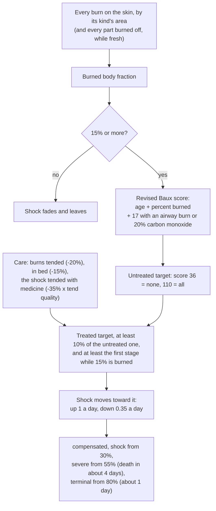
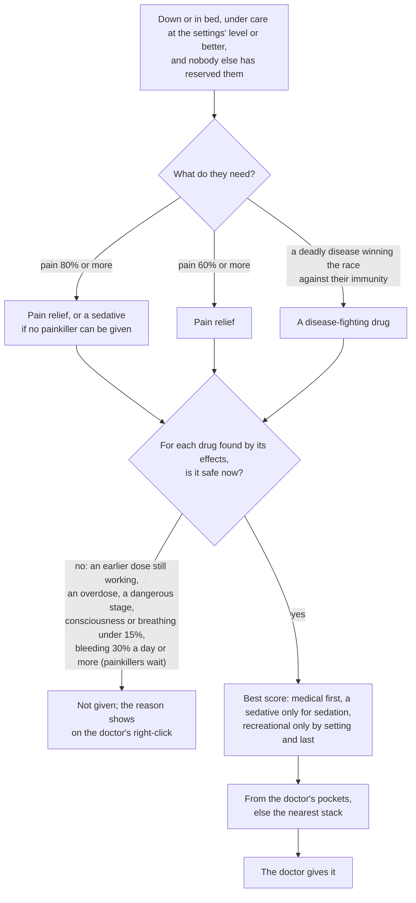
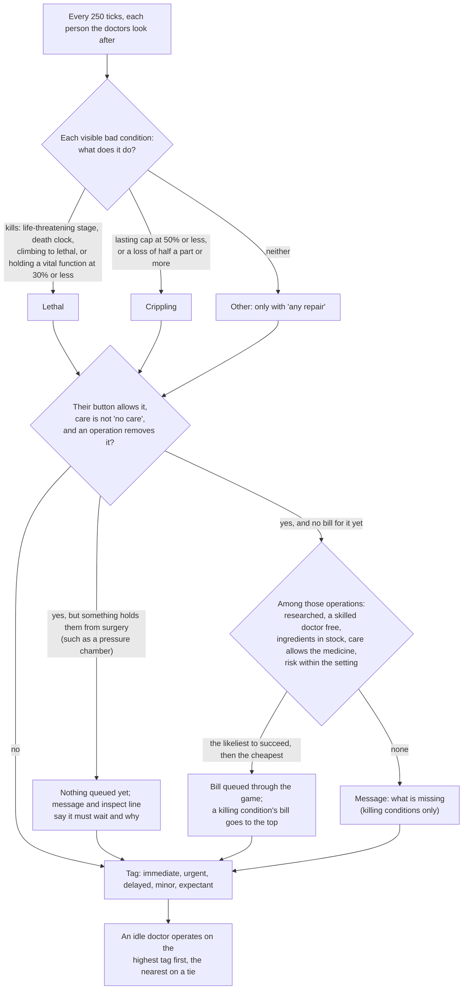
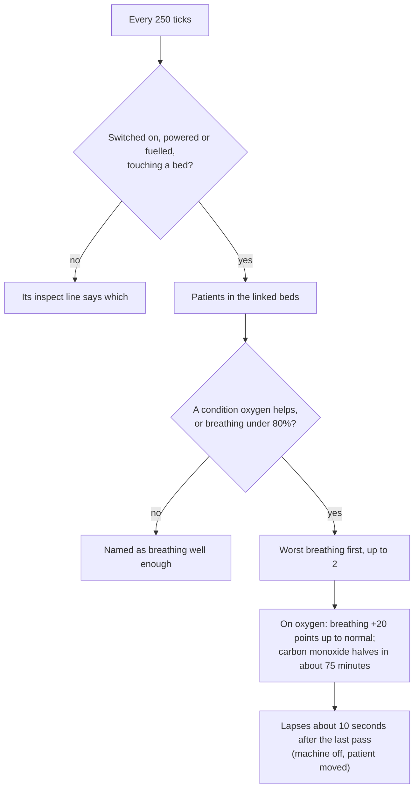
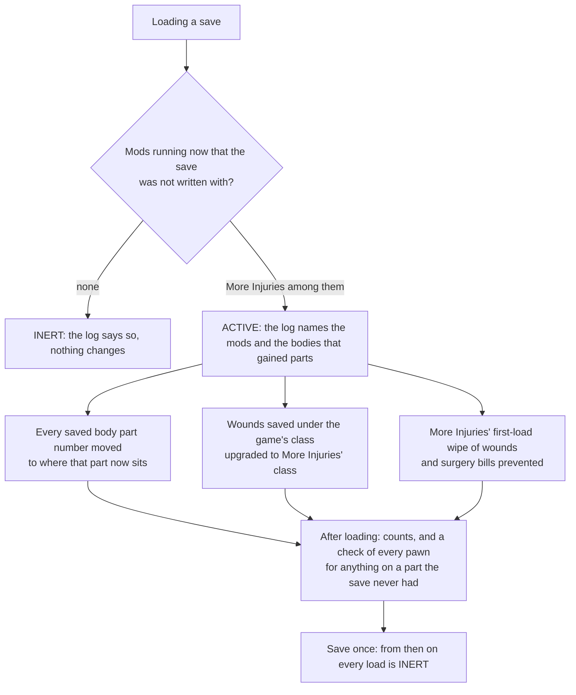

# D'thorga Medical

Burns and smoke that matter, doctors who dose and operate on their own, hospital and field equipment to treat it all, and a safe way
to add More Injuries to a colony you are already playing. Built to sit beside **More Injuries** and **Combat Extended**; neither is
required.

It replaces five earlier mods, merged into it on 7 November 2026 ([why](../../docs/development/mod-consolidation.md)): **D'thorga
Burns and Smoke**, **D'thorga Emergency Dosing**, **D'thorga Triage**, **D'thorga Medical Equipment** and **D'thorga Medical Save
Bridge**. Each is now a part of this mod, with its own section below.

Version 0.6.0, built 7 November 2026 for House D'thorga. **Not yet tested in game as D'thorga Medical.** What the owner tested of
the five parts before the merge is in each part's section; the parts' behaviour is unchanged, except that the save bridge now asks
first.

## Read this first (gotchas)

- **Switching from the five old mods: switch all five off in RimSort and this one on, in the same change, then load your colony.**
  The About file lists the five as incompatible, so RimSort warns if one is left on, and the load line logs an error naming any that
  is still active. Running one beside this would load the same part twice.
- **Your colony carries over.** Every condition, building, item, job and saved record keeps the name it had, so a save made with
  the five mods loads with this one. The game shows its usual warning that the mod list changed; load anyway. **Not yet tested in
  game.**
- **Your settings carry over, once,** from the five old mods' settings files, the first time the game starts with this mod. There is
  now one display mode for every part (Plain, Operator or Engineer), taken from Medical Equipment's.
- **Needs Harmony, D'thorga Framework and Vanilla Expanded Framework. Vanilla Gravship Expanded is strongly recommended**: the
  bedside stand, field oxygen kit, hyperbaric chamber, electrolyser and liquid oxygen store use its oxygen, and a letter says so
  once if it is missing. **More Injuries and Combat Extended are optional** and used when present.
- **Safe to add to a running colony.**
- **Taking it out of a colony:** in the mod settings, press **Remove every condition this mod adds, from every pawn**,
  deconstruct the machines and burn unit beds, then save and switch the mod off.
- **Loading a colony saved before More Injuries** (or another mod that adds body parts) **asks first**: **Convert now**, **Not
  now**, or **Never for this save**. Convert now is what the save bridge always did. **Not now loads the colony as it is: don't save
  it if you mean to convert later**, because whatever goes wrong on that load (wounds on the wrong parts, lost limbs back, the dead
  standing up) is kept when you save. Escape goes back without loading. A save you marked "never" can be asked about again from the
  mod settings. **Switching from the five old mods does not ask**: D'thorga Medical adds no body parts.
- **One settings window**, D'thorga Medical, with a section per part.

The sections below are the five former mods' guides, kept as they were written. Where one names another of the five, it now means
that part of D'thorga Medical, and where one points at its own settings window, that is now its section of D'thorga Medical's.

## Burns and smoke

Burns and smoke that matter the way More Injuries' wounds do: a burned body fraction, burn shock that kills within days
unless treated, airway burns that swell shut over hours, smoke that scars the lungs, carbon monoxide from fires in closed
rooms, and the heat around a fire in the open.

*As D'thorga Burns and Smoke, its last version before the merge:* Version 0.5.0, built 6 November 2026 for House D'thorga. **Partly tested in game:** the owner reports burn numbers, how conditions progress, and the More Injuries and Organ Failure tie-ins working (5 November 2026). The tracheotomy and the fire heat in the open are not yet tested in game. The rest is read from the game's and
the mods' code.

### Gotchas for this part

- **Needs D'thorga Framework 0.2.0 or later (0.2.1 or later for gas masks under Combat Extended) and Harmony**, both loaded
  before it. More Injuries, More Injuries: Organ Failure and Combat Extended
  are optional and are used when present. Harmony is new in 0.5.0: it carries the one patch that adds the heat around fires in the
  open to the game's cell temperature.
- **Fires in the open are now hot.** The game gives a fire's heat to its room and throws it away outdoors, so beside a blaze the air
  was the weather's temperature. Now each fire in the open heats the cells around it: a full-size fire adds about 600 degrees at
  the flame, 150 one cell away, 67 at two, 24 at four, and nothing past five. Anyone standing beside it suffers heatstroke and, close
  in, burns from the hot air; crops stop growing; food spoils. **Rooms keep the game's own heating**, and fires spread as before.
  Hold Alt over a cell to see its temperature. Switch it off in the settings if you prefer the old behaviour.
- **With Atmosphere Overhaul or Celsius active, the fire heat stands down by itself**: those mods model the air cell by cell, and
  heat must not be counted twice. The load line says which mod it stood down for. Other such mods can be added to the rules Def.
- **Safe to add to a running colony.** Its conditions are recomputed from the burns a pawn has, so old burns count at once.
- **Before removing it, press the settings button "Remove every burn condition from every pawn", save, then switch the mod off.**
  Otherwise the next load prints one line per missing condition and carries on. Either way it prints one harmless line per map
  about the missing fire-heat map component.
- **With More Injuries, its own "fire inhalation" feature is switched off by this mod** (a patch in the More Injuries folder; delete
  that file to keep both). More Injuries put plain burns on both lungs whenever a burning pawn was hurt; this mod models the
  inhalation itself. Carbon monoxide and a closing airway feed More Injuries' hypoxia and brain damage.
- **With Combat Extended's smoke running, CE's smoke inhalation is the signal.** This mod adds the lasting lung damage and
  the carbon monoxide on top. A gas mask stops the smoke effects but **not the carbon monoxide**.
- **Without Combat Extended's smoke, burning rooms fill with the game's own smoke** (the framework does this), which also
  penalises aim and sight.
- **Tend the shock itself, with the best medicine you have.** Burn shock is a tendable condition: tending it stands in for
  giving fluids, and the medicine's quality sets how much it helps. With the burns tended and the patient in bed, **industrial
  medicine holds even the worst cases at the "shock" stage, out of the death clocks; glitterworld medicine brings them to
  "compensated"; herbal or no medicine leaves the worst cases life-threatening**. Fluids wear off after 12 hours, so keep tending.
- **Area and depth are two different things.** A burn's severity is its depth (pain, healing time, whether the part is lost).
  Its area comes from the kind of burn: fire covers a part quickly (12 points of damage for all of it), an incendiary round or
  a laser makes a deep burn no larger than a third of the part.
- **The tracheotomy** is a surgery on the neck. With More Injuries it needs its Emergency Medicine research; without, no research.
- **Plain mode shows no percentages.** Switch the display mode to Operator or Engineer in the settings to see the figures.
- **Only humanlike pawns** get these conditions in this version. Animals burn as before.
- **Beside the other D'thorga medical mods:** with **Triage**, the doctors queue the tracheotomy for a closing airway on their own;
  with **Medical Equipment**, a powered burn unit bed gives burned patients air-cell care and oxygen clears carbon monoxide about
  four times faster; with **Emergency Dosing**, a doctor gives a painkiller for burn pain at 60% or more. See
  [the medical mods together](../../docs/medical-mods.md).
- **A part burned off counts as all of its skin burned** while the stump is fresh, so a pawn who loses an arm and a leg to
  fire goes straight to a serious burn and burn shock; once the stump is tended, or 1.5 days old, it fades out over about two
  weeks. **A fresh stump also bleeds until it is tended** (the game's own rule). **Old burn scars do not count.**

### What it does

How burn shock is decided, every 300 ticks for a burned pawn (figures from the rules Def, all authored starting values):



| Condition | Comes from | Gets worse with | Treated by |
| --- | --- | --- | --- |
| burns (burned body fraction) | every burn on the skin, by its kind's area per point of damage, and every part burned off, weighted by each part's share of the skin | wider burns, lost parts | tending the burns and stumps; it is recomputed every 300 ticks |
| burn shock | 15% or more of the body burned; always at least its first stage from there | age, area, an airway burn or carbon monoxide (the revised Baux score) | tending the burns, bed rest, tending the shock with good medicine |
| airway burn | burning, or burns to the head and neck | time: swelling peaks at 8 hours, holds to 24, gone by 48 | a tracheotomy; or waiting, if it never closes |
| smoke-damaged lungs | breathing smoke | thicker smoke, longer | tending; rest; heals 4% a day untended, 16% tended well |
| pneumonia | severe lung damage | | tending and immunity, like a wound infection |
| carbon monoxide poisoning | the framework's carbon monoxide in a closed burning room | staying in the room | clean air: halves every 5.3 hours under a roof, 3 in the open; on supplied oxygen, about every 75 minutes, with D'thorga Medical Equipment |
| acute smoke inhalation | breathing the game's smoke, only when Combat Extended's smoke is not running | thicker smoke | clean air; clears in a day or so |

Fire heat in the open is not a condition but a change to the air: a cell near a fire whose air is the outdoor air reads hotter
than the weather, by the fire's size and the distance, and the game's own heatstroke, hot-air burns, hot thoughts, plant growth
and spoiling respond to it as they would to any hot air. The zones are rebuilt every 150 ticks, so a cell can stay hot for up to
two and a half seconds after its fire goes out.

Burned body fraction stages: minor from 5%, serious from 15% (hunger, cold sensitivity, blood pumping), major from 30%,
critical from 50%. Burn shock stages: compensated, shock from 30%, severe from 55% (a four-day death clock), terminal from 80%
(one day). Carbon monoxide: headache from 10%, dizzy 20%, confused 30%, collapsed 40%, dying from 55% (a half-day clock).
Every figure is an authored starting value; the sources behind the shape are in the design record.

A worked case: a 40-year-old with a quarter of the body burned and no inhalation injury scores 65 and heads for stage 1 untreated;
the same pawn with an airway burn scores 82 and heads for the severe stage. Burns tended and in bed, the shock tended with
industrial medicine, the second settles at compensated (30% of the untreated target); with no medicine, at the shock stage.

| Care, burns tended and in bed | Share of the untreated target left | Score 90 lands at | Score 110 or more lands at |
| --- | --- | --- | --- |
| fluids without medicine | 55% | shock | shock, just under severe |
| herbal medicine | 44% | shock | shock |
| industrial medicine | 30% | compensated | shock |
| glitterworld medicine | 20% | compensated | compensated |

Figures assume a doctor whose tend quality stat is 1; a poorer doctor gets less from the same medicine.

### Settings

Toggles for each of the five conditions; **Fires heat the air around them in the open** (on); **Also apply this mod's smoke
inhalation with Combat Extended** (off); the display mode; and the uninstall button.

### For modders

Mark an injury Def as a burn for the burned fraction with the extension this mod patches onto the game's burns, and say how
its damage becomes area (the Def's own severity stays its depth): the fraction of a part one point of damage covers, and the
most of a part one such burn can cover. Fire is 0.0833 and 1; an incendiary round is 0.025 and 0.3.

```xml
<modExtensions>
  <li Class="Phobos.BurnsAndSmoke.Defs.PhobosBurnLikeExtension">
    <areaPerDamage>0.0833</areaPerDamage>
    <maxArea>1</maxArea>
  </li>
</modExtensions>
```

Balance lives in `Common/Defs/Phobos/BurnsAndSmoke/Rules.xml` (one `PhobosBurnRulesDef`, first loaded wins) and in the stage
tables of the hediff Defs. Smoke and carbon monoxide are read from D'thorga Framework's `PhobosGases`. The fire heat's peak,
radius, cap and cadence are in the same Def, as is `perCellTemperatureMods`, the list of package ids whose presence makes the
fire heat stand down; add a mod there if it models the air cell by cell.

### Checks done (6 November 2026)

- Built against the RimWorld 1.7 and 1.6 reference assemblies. The game-free rules (skin shares, burn area by kind, burned
  fraction, burned-off parts, the Baux score, its floor and the treatment factor by medicine quality, carbon monoxide uptake and
  clearance, the airway curve, the fire heat's shape and cap) pass 23 unit tests.
- **Fire heat in the open is not yet tested in game.** Read from the 1.7 game's code: which method answers every cell-temperature
  question, that fires give their heat to the room and none outdoors, and that Vanilla Temperature Expanded, Dubs Central Heating,
  Dubs Bad Hygiene and Combat Extended leave that method's outdoor answer alone.
- **The owner's report (5 November 2026):** burn numbers, how conditions progress and the tie-ins all work. Faster carbon monoxide clearing on oxygen is the owner's inference from those, not something observed. The tracheotomy is unproven.
- The owner's first look in game (0.1.0, an incendiary raid) showed the mod running without errors but counting far too
  little: see the changelog's 0.2.0 fixes. 
- **Not checked in game:** the tracheotomy, and Organ Failure stepping in for a closed airway beyond what the owner reports.

## Emergency dosing

Doctors give painkillers and sedatives on their own, from whatever mod made them.

*As D'thorga Emergency Dosing, its last version before the merge:* Version 0.3.1, built 6 November 2026 for House D'thorga. **Partly tested in game:** the owner reports doctors' dosing working on
0.3.0 (5 November 2026, penicillin and ketamine on one patient). Self-medication, the bleeding hold and 0.3.1's move to the
framework's health layer are not yet tested in game. The rest is read from the game's and the mods' code.

### Gotchas for this part

- **Needs D'thorga Framework 0.3.0 or later**, loaded before it. No Harmony. Nothing is saved: **safe to add or remove at any time**.
- **Who gets dosed:** a colonist, slave, prisoner or guest past babyhood who is **down or in bed**, in **severe pain** (60% or more;
  the game labels pain severe from 40%), under medical care of at least the level in the settings (default: herbal medicine or
  better; "no medicine" is never dosed), and not reserved by another doctor. A pawn up and working in pain is left alone: a painkiller could drop them where they stand.
- **What is given:** the painkiller with the strongest relief net of its side effects, from the doctor's inventory first, then
  the nearest unforbidden stack. **In extreme pain (80% or more) a sedative is given when no medical painkiller can be.**
- **What is never given:** a second painkiller while a medical one still works; anything during an overdose; a dose that would
  reach a dangerous stage; a dose whose offsets would leave consciousness or breathing under 15%; **recreational drugs unless
  you turn the setting on, and then only as a last resort**; drugs to a patient who refuses them on principle, unless you turn
  that setting on.
- **A drug counts as a painkiller only if it takes away 30% of the pain or more.** That keeps out relief that is only a side
  effect, by effect and not by name: **your epinephrine stays for cardiac arrest** (about 23%), and beer, tea and the like stay
  out too.
- **Any mod's drugs count.** The mod never looks for a drug by name: it reads what each ingestible does from its definitions.
  A mod can keep an item out with a one-line extension (below). **An effect a mod applies from its own code, not its XML,
  is invisible**: More Injuries raises bleeding after morphine through a linked condition this mod cannot see.
- **Search and Rescue and More Injuries are not changed.** Their doctors keep their patients; this mod waits for a patient
  nobody has reserved. In the Work tab the job sits under Doctor between tending and feeding patients.
- **Stock is your job.** The colony needs the drugs made or bought; a doctor who carries them (Combat Extended loadouts, Smart
  Medicine's stock-up) is fastest.
- **Doctors also give drugs that help fight disease, and only doctors do.** A patient down or in bed with a disease that can kill them, when immunity would
  arrive too late or within a day of the lethal mark, gets a medical drug that adds at least 10% to immunity gain speed. **A patient already winning gets none, so
  your stock lasts.** Drinks such as tea never count, nor do drugs that give a disease.
- **A patient bleeding at 30% a day or more waits for a painkiller until that is under control**, on both the doctors' and the self-medication paths. A sedative in extreme
  pain and a drug for fighting disease do not wait. The bleeding has to be tended for this to clear.
- **Mechs do not dose** in this version.
- **Beside D'thorga Triage:** Triage queues operations and this mod gives drugs; a patient waiting for an operation can still be
  dosed, and the game anaesthetises at the table. Both read the same list of patients from D'thorga Framework. See
  [the medical mods together](../../docs/medical-mods.md).
- **People also fetch their own painkillers, and your drug policies decide what.** An adult colonist who is up and about at 40% pain or more
  goes and takes the best painkiller whose policy line allows it, for joy or on a schedule. **Addiction and overdose are real
  risks, so check your drug policies before enabling this on a colony.** The setting is on by default.
- **Chemical interest and fascination ignore the policy**, as they do for joy in the game, and reach for it sooner (30% and 20%).
  **Teetotalers never self-medicate**, and neither do children.
- **A pawn under medical rest is left to the doctors.** That means anyone in bed, or who should be, including anyone with a tended wound still
  healing. In bed, doctors only step in from 60% pain, so a patient between 40% and 60% gets nothing yet.
- **Guests have no drug policy in the game.** With the guests setting on, they take medical painkillers from your stock and never recreational ones,
  so your morphine can go to a visitor. It is off by default.
- **Nobody knocks themself out.** A pawn on their feet refuses a dose that would leave consciousness or breathing under 40%, so a drowsy colonist may
  pass over morphine, whose cost is high.
- **Sedatives are never taken by choice**, and nobody takes from another pawn's pockets.

### What it does

A doctor's decision, for one patient:



| Need | Who | Given | Not given when |
| --- | --- | --- | --- |
| pain relief | resting, pain at or past 60% | the medical painkiller with the best score | a medical painkiller still at a quarter of a dose or more; overdose at 30% or more; a dangerous stage would be reached; consciousness or breathing would fall under 15% |
| sedation | resting, pain at or past 80%, no medical painkiller can be given | the sedative with the best score | its own last dose still working; otherwise the same |
| last resort | setting on, nothing above can be given | the recreational painkiller with the best score | the same |

Score = pain relief minus half the consciousness cost (not for sedatives) minus half the breathing cost minus the bleed increase
(a quarter of it when the patient is not bleeding) minus half the addictiveness. Every figure is an authored starting value in
the rules Def.

Worked examples from the Defs, not from play: More Injuries' morphine autoinjector gives relief 0.8 at a consciousness cost of
0.4 and breathing 0.2, score 0.5; Medicines+ thornweed serum gives relief 0.4 with no capacity cost, score 0.4; ketamine and
chloroform knock the patient out (relief 1, sedatives). So morphine is preferred when in reach, thornweed when it is not, and
ketamine only at pain shock with neither in reach.

With a doctor selected, a right-click on a patient in need says why no dose can be given: the care setting, nothing in reach,
an earlier dose still working, a dangerous dose, and so on. Nothing shows for a pawn who needs no dose.

### Settings

Doctors give medication on their own (on); dose patients whose medical care is at least (herbal or better); use recreational
drugs for pain (off); give medical drugs to patients who refuse drugs (off); doctors give drugs that help fight disease (on); people in pain fetch their own painkillers (on); guests may
take painkillers from your stock (off, for mods such as Hospitality); the display mode. The recreational setting is about what doctors give: a
pawn fetching their own goes by their drug policy instead.

### For modders

Keep an ingestible out of automatic dosing:

```xml
<modExtensions>
  <li Class="Phobos.Dosing.Defs.PhobosDosingExtension">
    <neverAutoDose>true</neverAutoDose>
  </li>
</modExtensions>
```

An ingestible is indexed when an IngestionOutcomeDoer_GiveHediff of its gives a condition whose stage at the dose takes away at
least 30% of the pain (through painFactor and a negative painOffset) and its score is above zero. Consciousness and breathing offsets, consciousness setMax, totalBleedFactor and
the drug comp's addictiveness and category are read from the same Defs. Balance lives in
`Common/Defs/Phobos/Dosing/Rules.xml` (one `PhobosDosingRulesDef`, first loaded wins).

### Checks done (6 November 2026)

- **The owner reports doctors' dosing working in game on 0.3.0** (5 November 2026, one screenshot: penicillin and ketamine on a patient). Self-medication and the bleeding hold
  are not yet tested in game.
- Built against the RimWorld 1.7 and 1.6 reference assemblies. The game-free rules (effect from stages, need bands, safety,
  choice and tiers, self-medication's threshold and policy gate) pass 23 unit tests.
- 0.1.0 loaded in the owner's game with no error naming it (5 November 2026); its load line showed the faults 0.1.1 fixes. That
  is a load, not a test of dosing.
- Read from code: More Injuries, Search and Rescue, Medicines+, Smart Medicine, MSE2 and VFE Medical give no painkiller or
  sedative automatically; More Injuries' drugs are a drafted doctor's right-click option, and Search and Rescue's doctors are
  undrafted by rule (see the design record).
- **Not checked in game:** self-medication (its think-tree hook, the ingest job and how often pawns reach for a drug), the bleeding
  hold, the work giver's priority beside Search and Rescue, and the index's full reading of the owner's mods.

## Triage

Doctors queue the life-saving operations a patient needs, and take the worst case first.

*As D'thorga Triage, its last version before the merge:* Version 0.2.0, built 7 November 2026 for House D'thorga. **Not yet tested in game.** Everything here is read from the game's and
the mods' code.

### Gotchas for this part

- **Needs D'thorga Framework 0.4.0 or later**, loaded before it. No Harmony. More Injuries, Search and Rescue and Hospitality are
  not needed and are never looked for by name: any mod's operation qualifies if its recipe removes a condition.
- **Safe to add to a running colony.** It saves the list of bills it queued, so it can withdraw its own and never yours, and each
  person's choice on the button. **Safe to remove:** the bills it queued stay as ordinary bills; the next load prints one line about
  a missing game component and one per map about a missing map component, all harmless, and carries on.
- **What gets queued by default: life-saving operations only.** A condition is life-saving to fix when the game marks its
  current stage life-threatening, it carries a death clock, its severity is climbing toward a lethal one, or it is a lasting
  bad condition holding consciousness, breathing or blood pumping at the floor. Fractures, lost limbs, hearing and the like
  are crippling, not killing: they wait for your own bill unless you raise a person's authority.
- **The button on each person** (colonists, slaves, prisoners, guests) says how far the doctors may go: never without orders;
  to save life (the default for your colonists, slaves and prisoners); to save life or a limb; for any repair (also conditions
  that neither kill nor cripple, when an operation removes them). Guests start at never. The defaults by group are in the mod settings, reachable from the main menu and from Options in play.
- **The doctors choose the operation most likely to succeed** among those your colony can do right now: the technique
  researched, a doctor who meets the skill and could come, the ingredients in stock, the patient's care level allowing the
  medicine, and the chance of death on the table (the recipe's death chance times the chance your best doctor fails) no higher
  than the setting, 5% by default. Costly instruments count as rare tools; a setting keeps those for your own orders.
- **When no one can do an operation a killing condition needs, a message says what is missing** (skill, a tool, research,
  risk), once per person and condition (a reload may repeat it). The patient's inspect line reads expectant: dying, with nothing
  to be done until that changes.
- **Some places hold surgery** (D'thorga Medical Equipment 0.4.1's hyperbaric chamber is the first). While a patient is in one,
  nothing new is queued and a bill already there stays; doctors don't go to them for it. The inspect line and one message give
  the reason and what to do, such as moving them to a bed. They are tagged by their clock, never expectant.
- **Drug addictions and dependencies are left alone** (psychite, go-juice, a gene that needs a drug): never operated on, tagged or
  named in a message. Their treatment is the drug, your drug policy and time.
- **Oxygen, rest and time are not operations.** A killing condition no operation removes (carbon monoxide poisoning, burn shock,
  a widespread burn) is tagged immediate or urgent for the doctors' order of work, but nothing is queued and no message names it:
  D'thorga Medical Equipment's oxygen, tending and Burns and Smoke's care rules treat those. See
  [the medical mods together](../../docs/medical-mods.md).
- **The queue is the game's own operations list.** A bill for a killing condition goes to the top; bills you added keep their
  places and are never withdrawn. Nothing is queued while a bill for the same condition is already there, yours or not. The
  game still needs the patient in a bed and a doctor with the skill: that is unchanged.
- **Doctors take the worst case first** (a setting). A doctor choosing between patients in beds goes to the one tagged worst
  rather than the nearest. The tag: immediate (dying within 6 hours, or a vital function at the floor), urgent (dying, with
  time), delayed (crippled), minor, expectant.
- **Field care stays with Search and Rescue and More Injuries.** This mod never tends, bandages or transfuses; it only queues
  operations and orders the doctors' surgical work. Search and Rescue already raises the evacuation of a patient who needs
  surgery; once in a bed, the bill this mod queued is what gets done.
- **With Emergency Dosing**, a patient waiting for an operation may still get a painkiller; the game anaesthetises at the
  table. Nothing changes there.
- **Plain mode shows no hours.** Switch the display mode to Operator or Engineer in the settings to see the clock on the tag.

### What it does

Every 250 ticks each map's patients are read. For each person the doctors look after, every visible bad condition is classed by
what it does: lethal, crippling or other. For each classed condition the person's authority allows, the mod looks up every
operation that removes that condition, drops those the colony cannot do, and queues the best one through the game's own bill.
Then it withdraws any bill it queued earlier whose condition has gone, and tags the person for the doctors' order of work.



| Tag | Means | Score band |
| --- | --- | --- |
| immediate | dying, and within 6 hours or with consciousness, breathing or blood pumping at 30% or less | 400 and up |
| urgent | dying, with more time; or life-threatening with no clock the mod can read | 300 to 399 |
| delayed | a crippling condition, nothing killing them | 200 to 299 |
| minor | nothing classed | 100 |
| expectant | dying of something only an operation removes, and nobody here can do it | 50 |

Within a band, less time left scores higher: a patient with 24 hours left gets half the urgency of one with none. The game's own operate work giver is kept; this mod's copy of it sits just above
and hands the doctor the highest score in reach. Every figure is an authored starting value; the design record says why.

### Settings

Doctors queue operations on their own (on); the default authority for colonists, slaves, prisoners and guests; the highest
chance of death the doctors may accept alone (5%); rare tools allowed (on); operations that would wrong another faction (off);
messages (on); doctors take the worst case first (on); the display mode.

### For modders

A recipe is found by its `removesHediff`, as the game's, More Injuries' and D'thorga Burns and Smoke's already are. A recipe
whose worker removes a condition some other way, or one that must never be queued by the doctors on their own, says so with the
extension this mod reads:

```xml
<modExtensions>
  <li Class="Phobos.Triage.Defs.PhobosTriageExtension">
    <treatsHediffs><li>MyMod_Condition</li></treatsHediffs>
    <neverAutoQueue>false</neverAutoQueue>
  </li>
</modExtensions>
```

Thresholds, bands and the bill cap live in `Common/Defs/Phobos/Triage/Rules.xml` (one `PhobosTriageRulesDef`, first loaded
wins). The per-person authority is D'thorga Framework's patient comp; the saved key is `PhobosTriage_Authority`.

### Checks done (6 November 2026)

- Built against the RimWorld 1.7 and 1.6 reference assemblies. The game-free rules (authority, condition class, the choice of
  operation and its refusal, the tag and the score) pass 13 unit tests.
- Read from the 1.7 code: how a bill is created and ordered, that the game removes stale medical bills only when a doctor looks,
  that a prioritised scanner is honoured by the job giver, and that comp fields on a pawn load without the mod.
- **Not checked in game:** everything. The first things to look at are in the design record's test protocol.

## Medical equipment

Hospital and field equipment for the injuries D'thorga Burns and Smoke and More Injuries bring: oxygen for patients who struggle to
breathe, from the bedside, a field kit or a pressure chamber; a hand pump for breathing that is failing; a burn unit bed and silver
burn dressings for burns; and an electrolyser and a liquid oxygen store to make and keep the oxygen.

*As D'thorga Medical Equipment, its last version before the merge:* Version 0.5.0, built 7 November 2026 for House D'thorga. **Partly tested in game:** the owner reports that a patient's breathing improves on the oxygen concentrator (5 November 2026, on 0.1.0), and that the burn unit bed looks right and gives a burned patient air-cell care (6 November 2026, on 0.2.0). **Everything new in 0.3.0 and 0.4.x is not yet tested in game**, nor are the inspect lines from 0.2.1. The rest is read from the game's and the mods' code.

### Gotchas for this part

- **Needs Harmony, D'thorga Framework 0.5.0 or later and Vanilla Expanded Framework,** loaded before it. The About file asks for that order.
- **Vanilla Gravship Expanded is strongly recommended** (it needs the Odyssey expansion). Without it, a letter says once which pieces are missing.
- **Safe to add to a running colony.** How it works beside the other medical mods is in
  [the medical mods together](../../docs/medical-mods.md).
- **Before removing it: deconstruct its buildings, take its items out of the colony (sell, destroy or use them up), press the settings button "Remove every treatment condition from every pawn", save, then switch the mod off.** Buildings and items left behind are dropped by the game with an error line when it loads without the mod.
- **Most of the oxygen kit needs Vanilla Gravship Expanded and its Oxygen Network research.** Everything that stores or pipes oxygen uses that mod's canisters and pipes: the bedside stand, the field oxygen kit, the hyperbaric chamber, the electrolyser and the liquid oxygen store. Without it you get the concentrator, the burn unit bed, the burn dressings and the hand pump.
- **Taking Vanilla Gravship Expanded out later** removes those five pieces from the colony (the game drops them with an error line). Patients on their treatments lose them within the hour, cleanly.
- **Build a bedside machine touching a hospital bed,** as you would a vitals monitor. One machine per bed, though it can serve two beds it touches. Any bed that accepts a vitals monitor works.
- **Nobody has to be told.** A patient in a served bed or chamber who needs oxygen gets it, and doctors use the field kit and the hand pump by themselves, as Doctor work. Doctors carry a downed patient who needs oxygen to a free chamber first. Use a machine's switch to stop it.
- **No operations in a hyperbaric chamber:** move the patient to a hospital bed for surgery. The chamber says who is waiting.
- **Oxygen does not repair lungs, and nothing here helps if the airway is shut** (breathing at zero): that patient needs a tracheotomy. Doctors say so when you right-click.
- **The electrolyser is power-hungry on purpose:** 3000 W for one patient's oxygen, which is roughly what real electrolysis costs. Vanilla Gravship Expanded's oxygen harvester gives far more for far less; the electrolyser is for vacuum and thin air, where the harvester can't run.
- **The liquid oxygen store needs power for its cooler.** Without it the store takes in no more oxygen, and about 2% of what it holds boils off each day. If it is badly damaged it bursts into a fireball: keep it away from fires and fighting.
- **Oxygen canisters, and the field kits made from them, explode when they burn.** That is Vanilla Gravship Expanded's rule.
- **Silver burn dressings are a medicine.** Doctors use them for any tend, like herbal or industrial medicine, under the medical care setting that allows them (normal medicine or better).
- **Move patients out of the burning room.** A patient on oxygen still takes in the carbon monoxide around them.
- **Some art is a placeholder:** the electrolyser and the hyperbaric chamber, until generated art is picked. The rest is AI-generated art picked by the owner on 5 and 7 November 2026; only the burn unit bed has been seen in game. The records beside the textures say how each was made.

### What it does

| Piece | Kind | Needs | Serves | Research |
| --- | --- | --- | --- | --- |
| Oxygen concentrator | Bedside machine | Power (350 W) | Up to 2 patients in beds it touches | Medicine production |
| Bedside oxygen stand | Bedside machine | 1 oxygen canister per patient per in-game hour, or an oxygen pipe | Up to 2 patients in beds it touches | Medicine production and Oxygen Network |
| Hyperbaric chamber | A bed for one, 1 by 3 | Power (800 W) and 6 canisters per in-game hour while treating, or an oxygen pipe | Its own patient | Hospital bed and Oxygen Network |
| Field oxygen kit | Item, used up | Made from 1 oxygen canister, 5 steel and 2 cloth at a machining table | One patient lying down, for about an hour | Medicine production and Oxygen Network |
| Manual resuscitator | Item, kept | Made from 4 cloth, 6 steel and 1 component at a machining table | One patient at a time, while a doctor pumps | Medicine production |
| Silver burn dressing | Medicine | Made from 2 cloth, 4 silver and 1 neutroamine at a drug lab | Any tend | Medicine production |
| Burn unit bed | Bed | Power (200 W) for its blower | Its own burned patient | Hospital bed |
| Oxygen electrolyser | Building, 2 by 2 | Power (3000 W) | Puts 1 unit of oxygen an hour into an oxygen pipe | Oxygen Network |
| Liquid oxygen store | Building, 2 by 2 | Power (300 W) for its cooler | Holds 2000 units on an oxygen pipe | Oxygen Network |

One unit of oxygen is one canister, about one patient-hour on a mask. Costs, power and work are authored; the sources behind the
rest are in the [design record](../../docs/development/medical-equipment.md).

#### Oxygen: who gets it

**Who gets it:** a patient with a condition oxygen helps, or with breathing under 80% from any cause. The worst breathing comes first. Conditions it helps: from D'thorga Burns and Smoke, carbon monoxide poisoning, smoke-damaged lungs, pneumonia and acute smoke inhalation; Combat Extended's smoke inhalation; More Injuries' organ hypoxia.

One bedside machine's pass, every 250 ticks:



**What it does for them:** breathing rises by 20 points, up to normal. It never lowers anyone already above normal, such as a pawn with bionic lungs. With D'thorga Burns and Smoke, carbon monoxide clears with a half-life of about 75 minutes, against about 320 on room air.

| Treatment | Breathing | Carbon monoxide half-life | Lasts |
| --- | --- | --- | --- |
| On oxygen (concentrator, stand) | +20 points, up to normal | About 75 minutes | While in the bed |
| On field oxygen (kit) | +20 points, up to normal | About 75 minutes | About an hour |
| Under hyperbaric oxygen (chamber) | +30 points, up to normal | About 22 minutes | While in the chamber |
| Hand-ventilated (resuscitator) | +30 points, up to normal | No change: it is room air | While a doctor pumps |

The half-lives are sourced; the breathing figures are authored. The chamber is a game tier, not medical advice: the review cited in
the design record found the clinical evidence for it of low quality.

#### Doctors' devices

The field oxygen kit and the manual resuscitator are Doctor work, done without orders, just below urgent tending. A doctor takes
the nearest one (or one they carry) to a patient lying down, in bed or on the ground:

- **Field oxygen kit:** for a patient who needs oxygen and isn't already on it. It takes a few seconds to fit and is used up.
- **Manual resuscitator:** for breathing under 50% that is still above zero. The doctor pumps for as long as it is needed, up to
  an in-game hour at a time, then keeps the resuscitator. Only one doctor pumps at once.

Right-click a patient with a doctor selected to give the order yourself, or to see why they won't: the airway is shut, no device
is within reach, or they are already on oxygen. Someone who breathes well enough gets no line at all.

#### Burn unit bed

Research: Hospital bed. Construction skill 8. Costs 120 steel, 30 cloth and 7 components. Draws 200 W. All authored.

| | Hospital bed | Burn unit bed |
| --- | --- | --- |
| Tend quality | +10% | +15%, which also lowers infection through the game's own rule, powered or not |
| Comfort | 80% | 85% |

While the blower runs, anyone in it with an open burn from fire, acid, chemicals or electricity gets **on air cells**: wounds heal 25% faster and pain falls by 15%. It works by itself, and stops soon after they leave or the power goes. The healing applies to all their wounds, not only the burns, which is a simplification. Oxygen machines and vitals monitors link to it as they do to a hospital bed.

#### Making and keeping oxygen

Both buildings join Vanilla Gravship Expanded's oxygen pipes, alongside its own tanks and harvesters.

- **Oxygen electrolyser:** splits water into oxygen and hydrogen. The oxygen goes into the pipe; the hydrogen is vented. **With Dubs Bad Hygiene it needs a water pipe** under it or against its side, about half a litre an hour; without water it stops, idles and says why. Without Dubs Bad Hygiene, water is assumed. It also drops to a low idle draw when the network's storage is full.
- **Liquid oxygen store:** holds oxygen as a liquid, about four times as much as a gas tank of the same size. Its cooler keeps it cold; without power about 2% boils off each day. It can be drained into canisters like a tank. A badly damaged store bursts into a fireball. The frost on it while it works is not drawn yet.

### Settings

The display mode, and the uninstall button. Plain mode shows no figures.

### For modders

- **Oxygen machines:** give a building `Phobos.Medical.Comps.CompProperties_PhobosOxygenSupply` and `CompProperties_Facility`; add a `CompProperties_Refuelable` and it burns fuel. On a bed it serves its own occupant instead, and its `treatment` can name a stronger condition.
- **Patient devices:** give an item `Phobos.Medical.Defs.PhobosPatientDeviceExtension` (its need, the treatment condition, the time to use it, and whether it is used up or worked continuously), and doctors use it by themselves.
- **Liquid stores:** pair Vanilla Expanded Framework's resource storage comp with `Phobos.Medical.Comps.CompProperties_PhobosBoilOff`.
- Mark your own burn injury Def with `Phobos.Medical.Defs.PhobosBurnCareExtension` so a burn unit bed gives its patient air-cell care. Mark your own condition with `Phobos.Framework.Breathing.PhobosOxygenResponsiveExtension` so that it counts as needing oxygen. Balance lives in `Common/Defs/Phobos/Medical/Rules.xml` and on each machine's comp.

### Checks done (7 November 2026)

- Built against the RimWorld 1.7 and 1.6 reference assemblies; the game-free rules pass their unit tests; the Defs pass the repository's checks.
- **Owner's report (5 November 2026, on 0.1.0):** a patient's breathing improves on the oxygen concentrator.
- **Owner's report (6 November 2026, on 0.2.0):** the burn unit bed looks right and gives a burned patient air-cell care.
- **Not checked in game:** everything new in 0.3.0 (the chamber, the field kit, the hand pump, the dressings, the electrolyser and the store, and their pipe links), the bedside oxygen stand and its pipe link, the inspect text from 0.2.1, the feel of the numbers, the uninstall button, and the 0.2.3 art.

Community-created content. Portions of the materials used to create this content/mod are trademarks and/or copyrighted works of Ludeon Studios Inc. All rights reserved by Ludeon. This content/mod is not official and is not endorsed by Ludeon.

## Colonies saved before More Injuries (the save bridge)

**Since the merge (7 November 2026), the bridge asks before it acts** (the owner's call): on loading a save that needs it, a dialog
offers **Convert now**, **Not now** or **Never for this save**, and the log line says ACTIVE, INERT or HELD. It asks only when
converting would change something: new body parts, or More Injuries new to the save. A load another mod starts directly, without
the load menu, converts as before. Its log lines now start with [D'thorga Medical: save bridge].

Lets you add **More Injuries (Continued)** to a colony you are already playing, with **Medical System Expansion 2** or without
it, without wounds vanishing, lost limbs growing back, bionics moving or corpses coming back to life. It acts once, on the first
load of a save written without More Injuries, and does nothing after you save.

*As D'thorga Medical Save Bridge, its last version before the merge:* Version 0.1.2, built 4 November 2026 for House D'thorga. **The first load was tested in game by the owner on 3 November 2026**
on a copy of a 330-mod colony with Medical System Expansion 2 and Combat Extended, and went cleanly, with 0.1.0 and again with 0.1.1, then saved and
reloaded. The native 1.7 build in 0.1.2 is not yet tested in game, and neither is a new colony.

### Gotchas for this part

- **Back up your save first.** Copy the save file and load the copy. The bridge changes nothing on disk, but the first load after
  adding More Injuries is the one that matters, and a backup costs nothing.
- **Load it after More Injuries and Medical System Expansion 2.** The About file asks for this, so RimSort does it for you. It needs
  Harmony and nothing else. **You have to switch it on yourself**: nothing requires it.
- **Switch on More Injuries and this mod in the same step**, then load the save. The bridge decides what to do from the mod list
  the save was written with: a save that already lists More Injuries gets nothing, because its parts are already numbered the new way.
- **More Injuries' add-ons** (More Injuries: Organ Failure, Medieval Solutions for More Injuries) were not studied. In the owner's
  one test both were switched on with More Injuries in the same step and nothing went wrong; neither adds body parts. If you want
  them, the safest order is still the one the owner used: everything on at once, then read the log.
- **Read the log on that first load.** Every line starts with [D'thorga Medical Save Bridge]. The first says ACTIVE or INERT and names
  the mods the save lacked. After loading it says how many body parts it re-numbered and how many wounds it carried over, then
  checks every pawn, dead or alive, and lists anything that sits on a part the save never had (there should be none).
- **Then save.** A save written with More Injuries makes the bridge inert for good on that colony. You can leave the mod on or
  remove it; neither matters after that.
- **Safe to remove** at any time: it saves nothing. Removing More Injuries itself is More Injuries' business, not this mod's.
- **It helps with any mod that adds body parts**, not just More Injuries: anything the save lacked that adds parts to a body is
  re-numbered the same way. A mod that moves or deletes an existing part is beyond it.
- **Tested in game by the owner on 3 November 2026**: the first load of a copy of the live colony, with 0.1.0 and with 0.1.1, then a
  save and a reload. Comparing the saves before and after showed every lost limb, bionic and implant still in place. A fresh colony
  is not yet tested. Everything else here is read from the game's and the mods' code.

### What goes wrong without it

RimWorld saves a hediff's body part as a number: the part's position in the body's part list. More Injuries adds eight parts to
the human body (an abdomen holding two intestines, an artery pair in each leg, and the spinal cord). Every part after the first
new one moves down the list, so on the first load every old wound, lost limb, prosthetic, bionic, implant and surgery bill lands on
the wrong part. Three things then happen at once:

1. Old wounds load as the game's own injury class while More Injuries' XML says they should be its class. Medical System Expansion 2
   sees the mismatch and re-installs them, which fails for every part under a lost limb.
2. More Injuries knows the numbers are wrong and, on its first load, removes every wound and missing part from every pawn, clears
   their surgery bills, and moves bionics it finds on the wrong part to a random right one or deletes them.
3. That clean-up treats every dead pawn as a victim of the bad numbering and sets it back to Mobile. The corpses in the owner's
   colony, 105 of them, came back as living pawns with no mind, needs or guest state, and the colonist bar crashed every frame.

### What it does

What happens on one load:



All of it only while the gate is open: More Injuries (or another part-adding mod) is active, and the save's own mod list does not
include it.

| Step | What | Where it hooks |
| --- | --- | --- |
| Re-number | Each saved part number is translated from the old list to the new one, for every body that gained parts | The game's own hook for this, BackCompatibility.GetBackCompatibleBodyPartIndex, which every saved part reference passes through |
| Upgrade | An old wound or missing part is created as More Injuries' class straight away, with the bleeding state a live wound would carry; old blood loss and hypothermia get the comp-carrying class More Injuries gives them | The game's own hook for choosing a saved object's class, BackCompatibility.GetBackCompatibleType |
| Hold | More Injuries' first-load flag is cleared as it is set, so its clean-up finds nothing to do | More Injuries' pawn comp, reached by name |
| Report | After the load, what was done and a check of every pawn, written to the log | Game.LoadGame |

It never touches Medical System Expansion 2: with the wounds upgraded there is nothing for it to re-install.

### Checking it worked

Open the log (dev mode, the log button) and search for the bridge's lines. On the first load after adding More Injuries:

- ACTIVE, naming th3fr3d.extendedinjuries and this mod, and "Human (8 new parts)".
- A "Load finished" line with the number of parts re-numbered and hediff classes upgraded, and wipes prevented equal to the number
  of pawns that have More Injuries' comp.
- "Hediffs sitting on parts newer than the save: none."
- No lines from More Injuries saying "Compatibility patch removed some hediff(s)", and none from MSE2 saying "Reinstalling Hediffs
  with wrong type". (0.1.0 still let MSE2 re-make old blood loss and hypothermia; 0.1.1 covers them.)

Then open the health tab of a colonist with a lost limb or a bionic and compare with what you saw before. Two dev-mode actions
help: **Medical Save Bridge: log body part indices** writes the human body's part list with each part's old number, and **check
every pawn's parts** repeats the after-load check.

### Checks done (4 November 2026)

- **The owner's first load (3 November 2026, on 0.1.0 and 0.1.1):** a copy of a 330-mod colony with Medical System Expansion 2
  and Combat Extended went cleanly, then saved and reloaded (INERT).
- Built for RimWorld 1.7 and 1.6. The game-free rules (the index re-numbering and the mod-list comparison) pass 8 unit tests.
- **Not checked in game:** a new colony, and the 0.1.2 build (Harmony 3 on 1.7).

### Settings

None. Its behaviour is a rule, not a preference.
