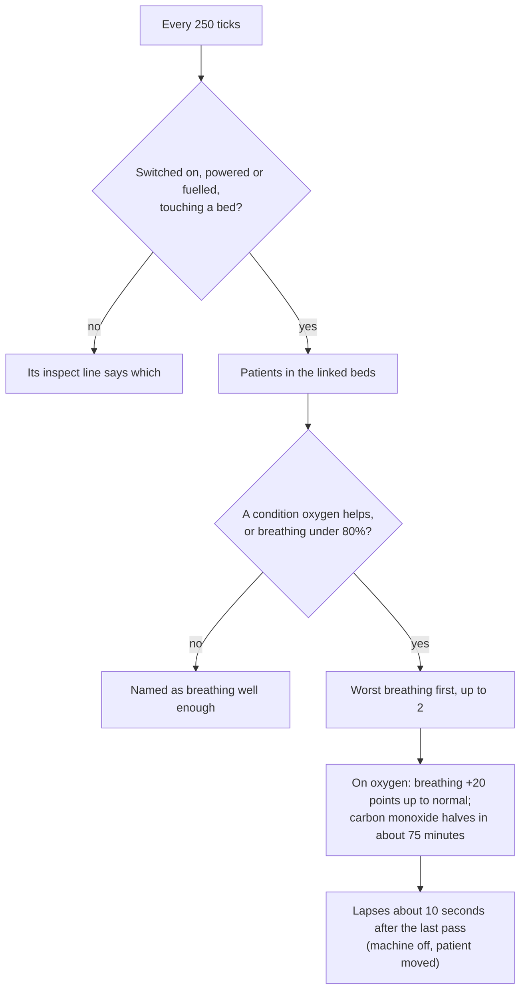

# D'thorga Medical Equipment

Hospital and field equipment for the injuries D'thorga Burns and Smoke and More Injuries bring: oxygen for patients who struggle to
breathe, from the bedside, a field kit or a pressure chamber; a hand pump for breathing that is failing; a burn unit bed and silver
burn dressings for burns; and an electrolyser and a liquid oxygen store to make and keep the oxygen.

Version 0.5.0, built 7 November 2026 for House D'thorga. **Partly tested in game:** the owner reports that a patient's breathing improves on the oxygen concentrator (5 November 2026, on 0.1.0), and that the burn unit bed looks right and gives a burned patient air-cell care (6 November 2026, on 0.2.0). **Everything new in 0.3.0 and 0.4.x is not yet tested in game**, nor are the inspect lines from 0.2.1. The rest is read from the game's and the mods' code.

## Read this first (gotchas)

- **Needs Harmony, D'thorga Framework 0.5.0 or later and Vanilla Expanded Framework,** loaded before it. The About file asks for that order.
- **Vanilla Gravship Expanded is strongly recommended** (it needs the Odyssey expansion). Without it, a letter says once which pieces are missing.
- **Safe to add to a running colony.** How it works beside the other medical mods is in
  [the medical mods together](../../docs/medical-mods.md).
- **Before removing it: deconstruct its buildings, take its items out of the colony (sell, destroy or use them up), press the settings button "Remove every treatment condition from every pawn", save, then switch the mod off.** Buildings and items left behind are dropped by the game with an error line when it loads without the mod.
- **Most of the oxygen kit needs Vanilla Gravship Expanded and its Oxygen Network research.** Everything that stores or pipes oxygen uses that mod's canisters and pipes: the bedside stand, the field oxygen kit, the hyperbaric chamber, the electrolyser and the liquid oxygen store. Without it you get the concentrator, the burn unit bed, the burn dressings and the hand pump.
- **Taking Vanilla Gravship Expanded out later** removes those five pieces from the colony (the game drops them with an error line). Patients on their treatments lose them within the hour, cleanly.
- **Build a bedside machine touching a hospital bed,** as you would a vitals monitor. One machine per bed, though it can serve two beds it touches. Any bed that accepts a vitals monitor works.
- **Nobody has to be told.** A patient in a served bed or chamber who needs oxygen gets it, and doctors use the field kit and the hand pump by themselves, as Doctor work. Doctors carry a downed patient who needs oxygen to a free chamber first. Use a machine's switch to stop it.
- **No operations in a hyperbaric chamber:** move the patient to a hospital bed for surgery. The chamber says who is waiting.
- **Oxygen does not repair lungs, and nothing here helps if the airway is shut** (breathing at zero): that patient needs a tracheotomy. Doctors say so when you right-click.
- **The electrolyser is power-hungry on purpose:** 3000 W for one patient's oxygen, which is roughly what real electrolysis costs. Vanilla Gravship Expanded's oxygen harvester gives far more for far less; the electrolyser is for vacuum and thin air, where the harvester can't run.
- **The liquid oxygen store needs power for its cooler.** Without it the store takes in no more oxygen, and about 2% of what it holds boils off each day. If it is badly damaged it bursts into a fireball: keep it away from fires and fighting.
- **Oxygen canisters, and the field kits made from them, explode when they burn.** That is Vanilla Gravship Expanded's rule.
- **Silver burn dressings are a medicine.** Doctors use them for any tend, like herbal or industrial medicine, under the medical care setting that allows them (normal medicine or better).
- **Move patients out of the burning room.** A patient on oxygen still takes in the carbon monoxide around them.
- **Some art is a placeholder:** the electrolyser and the hyperbaric chamber, until generated art is picked. The rest is AI-generated art picked by the owner on 5 and 7 November 2026; only the burn unit bed has been seen in game. The records beside the textures say how each was made.

## What it does

| Piece | Kind | Needs | Serves | Research |
| --- | --- | --- | --- | --- |
| Oxygen concentrator | Bedside machine | Power (350 W) | Up to 2 patients in beds it touches | Medicine production |
| Bedside oxygen stand | Bedside machine | 1 oxygen canister per patient per in-game hour, or an oxygen pipe | Up to 2 patients in beds it touches | Medicine production and Oxygen Network |
| Hyperbaric chamber | A bed for one, 1 by 3 | Power (800 W) and 6 canisters per in-game hour while treating, or an oxygen pipe | Its own patient | Hospital bed and Oxygen Network |
| Field oxygen kit | Item, used up | Made from 1 oxygen canister, 5 steel and 2 cloth at a machining table | One patient lying down, for about an hour | Medicine production and Oxygen Network |
| Manual resuscitator | Item, kept | Made from 4 cloth, 6 steel and 1 component at a machining table | One patient at a time, while a doctor pumps | Medicine production |
| Silver burn dressing | Medicine | Made from 2 cloth, 4 silver and 1 neutroamine at a drug lab | Any tend | Medicine production |
| Burn unit bed | Bed | Power (200 W) for its blower | Its own burned patient | Hospital bed |
| Oxygen electrolyser | Building, 2 by 2 | Power (3000 W) | Puts 1 unit of oxygen an hour into an oxygen pipe | Oxygen Network |
| Liquid oxygen store | Building, 2 by 2 | Power (300 W) for its cooler | Holds 2000 units on an oxygen pipe | Oxygen Network |

One unit of oxygen is one canister, about one patient-hour on a mask. Costs, power and work are authored; the sources behind the
rest are in the [design record](../../docs/development/medical-equipment.md).

### Oxygen: who gets it

**Who gets it:** a patient with a condition oxygen helps, or with breathing under 80% from any cause. The worst breathing comes first. Conditions it helps: from D'thorga Burns and Smoke, carbon monoxide poisoning, smoke-damaged lungs, pneumonia and acute smoke inhalation; Combat Extended's smoke inhalation; More Injuries' organ hypoxia.

One bedside machine's pass, every 250 ticks:

**What it does for them:** breathing rises by 20 points, up to normal. It never lowers anyone already above normal, such as a pawn with bionic lungs. With D'thorga Burns and Smoke, carbon monoxide clears with a half-life of about 75 minutes, against about 320 on room air.

| Treatment | Breathing | Carbon monoxide half-life | Lasts |
| --- | --- | --- | --- |
| On oxygen (concentrator, stand) | +20 points, up to normal | About 75 minutes | While in the bed |
| On field oxygen (kit) | +20 points, up to normal | About 75 minutes | About an hour |
| Under hyperbaric oxygen (chamber) | +30 points, up to normal | About 22 minutes | While in the chamber |
| Hand-ventilated (resuscitator) | +30 points, up to normal | No change: it is room air | While a doctor pumps |

The half-lives are sourced; the breathing figures are authored. The chamber is a game tier, not medical advice: the review cited in
the design record found the clinical evidence for it of low quality.

### Doctors' devices

The field oxygen kit and the manual resuscitator are Doctor work, done without orders, just below urgent tending. A doctor takes
the nearest one (or one they carry) to a patient lying down, in bed or on the ground:

- **Field oxygen kit:** for a patient who needs oxygen and isn't already on it. It takes a few seconds to fit and is used up.
- **Manual resuscitator:** for breathing under 50% that is still above zero. The doctor pumps for as long as it is needed, up to
  an in-game hour at a time, then keeps the resuscitator. Only one doctor pumps at once.

Right-click a patient with a doctor selected to give the order yourself, or to see why they won't: the airway is shut, no device
is within reach, or they are already on oxygen. Someone who breathes well enough gets no line at all.

### Burn unit bed

Research: Hospital bed. Construction skill 8. Costs 120 steel, 30 cloth and 7 components. Draws 200 W. All authored.

| | Hospital bed | Burn unit bed |
| --- | --- | --- |
| Tend quality | +10% | +15%, which also lowers infection through the game's own rule, powered or not |
| Comfort | 80% | 85% |

While the blower runs, anyone in it with an open burn from fire, acid, chemicals or electricity gets **on air cells**: wounds heal 25% faster and pain falls by 15%. It works by itself, and stops soon after they leave or the power goes. The healing applies to all their wounds, not only the burns, which is a simplification. Oxygen machines and vitals monitors link to it as they do to a hospital bed.

### Making and keeping oxygen

Both buildings join Vanilla Gravship Expanded's oxygen pipes, alongside its own tanks and harvesters.

- **Oxygen electrolyser:** splits water into oxygen and hydrogen. The oxygen goes into the pipe; the hydrogen is vented. **With Dubs Bad Hygiene it needs a water pipe** under it or against its side, about half a litre an hour; without water it stops, idles and says why. Without Dubs Bad Hygiene, water is assumed. It also drops to a low idle draw when the network's storage is full.
- **Liquid oxygen store:** holds oxygen as a liquid, about four times as much as a gas tank of the same size. Its cooler keeps it cold; without power about 2% boils off each day. It can be drained into canisters like a tank. A badly damaged store bursts into a fireball. The frost on it while it works is not drawn yet.

## Settings

The display mode, and the uninstall button. Plain mode shows no figures.

## For modders

- **Oxygen machines:** give a building `Phobos.Medical.Comps.CompProperties_PhobosOxygenSupply` and `CompProperties_Facility`; add a `CompProperties_Refuelable` and it burns fuel. On a bed it serves its own occupant instead, and its `treatment` can name a stronger condition.
- **Patient devices:** give an item `Phobos.Medical.Defs.PhobosPatientDeviceExtension` (its need, the treatment condition, the time to use it, and whether it is used up or worked continuously), and doctors use it by themselves.
- **Liquid stores:** pair Vanilla Expanded Framework's resource storage comp with `Phobos.Medical.Comps.CompProperties_PhobosBoilOff`.
- Mark your own burn injury Def with `Phobos.Medical.Defs.PhobosBurnCareExtension` so a burn unit bed gives its patient air-cell care. Mark your own condition with `Phobos.Framework.Breathing.PhobosOxygenResponsiveExtension` so that it counts as needing oxygen. Balance lives in `Common/Defs/Phobos/Medical/Rules.xml` and on each machine's comp.

## Checks done (7 November 2026)

- Built against the RimWorld 1.7 and 1.6 reference assemblies; the game-free rules pass their unit tests; the Defs pass the repository's checks.
- **Owner's report (5 November 2026, on 0.1.0):** a patient's breathing improves on the oxygen concentrator.
- **Owner's report (6 November 2026, on 0.2.0):** the burn unit bed looks right and gives a burned patient air-cell care.
- **Not checked in game:** everything new in 0.3.0 (the chamber, the field kit, the hand pump, the dressings, the electrolyser and the store, and their pipe links), the bedside oxygen stand and its pipe link, the inspect text from 0.2.1, the feel of the numbers, the uninstall button, and the 0.2.3 art.

Community-created content. Portions of the materials used to create this content/mod are trademarks and/or copyrighted works of Ludeon Studios Inc. All rights reserved by Ludeon. This content/mod is not official and is not endorsed by Ludeon.
