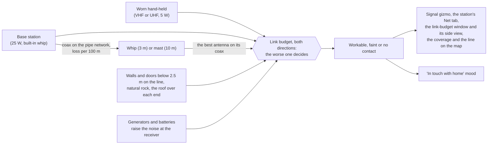

# D'thorga Radio Framework

Radio that works like radio: every contact is decided by a real link budget, and doubling the distance
costs 6 dB. This is **Phase 1**: local VHF and UHF on one map.

One of House D'thorga's mods (also spelt dthorga).

Version 0.4.0, built 24 November 2026 for House D'thorga. **Not yet tested in game.** It was built and deployed on 19 October
2026, but the Def loading, the coax net, the gizmos and the mood have not been seen running.

## Read this first (gotchas)

- **Requires D'thorga Framework** (from 0.4.0, for building upgrades) **and Vanilla Expanded Framework** (its pipe network carries
  the coax feedline). Load this mod after Core, the DLCs, Harmony, Vanilla Expanded Framework and D'thorga Framework. The radio itself
  patches nothing; Harmony comes with D'thorga Framework.
- **The upgrades are experimental** (0.4.0): a receive preamplifier for the desk, a taller pole for the whip, a mast extension and a
  longer collinear for the mast, fitted by builders from each building's Upgrades button.
- **RimWorld 1.7 only** (from 0.1.3; 1.6 is no longer supported). Its About file now lists 1.7, so the mod list no longer calls
  it outdated.
- **Decide before you start a colony:** the mod setting *Metres per cell* (default 1, from 0.5 to 30) changes every path
  and feedline loss. Changing it mid-save changes which links work. The "In touch" mood can be turned off in the same settings.
- **Safe to add to a running save.** Removing it is safe once you have deconstructed every radio building
  and dropped every hand-held; the first load afterwards shows one harmless "could not find class" error.
- **The hand-held is worn on the belt slot**, so a colonist cannot wear a shield belt and a hand-held at
  the same time.
- **Nothing is published on the Steam Workshop yet.** Install from source with `scripts/deploy.py`.

## What it does

What decides a contact:



Research **Local radio** (after Microelectronics Basics). Then:

| Thing | Where | What it is |
| --- | --- | --- |
| Hand-held radio (VHF) and (UHF) | Machining table, 20 steel + 1 component | 5 W, worn on the belt. VHF reaches further outdoors; UHF copes better with walls. |
| Radio base station | Architect → D'thorga → Radio, 100 steel + 3 components | 2 × 2, needs power (60 W idle, more while in use), works both bands, built-in whip. |
| Coax feedline | Architect → D'thorga → Radio, 2 steel per cell | Laid like power conduit, from the station to an antenna. Loses signal per metre; can run under walls. |
| Whip antenna | Architect → D'thorga → Radio, 15 steel | 1 × 1, 3 m high, no gain. Cheap way to get the antenna outside. |
| Mast antenna | Architect → D'thorga → Radio, 60 steel + 1 component | 1 × 1, 10 m high, 3 dBi. Sees over walls. |

How to build, read the signal, and the play test are in the player guide's [Radio chapter](../../docs/player-guide/radio.md); the
figures are here.

**What decides a link** (both directions; the worse one counts):

- distance, by the inverse-square law (doubling it costs 6 dB);
- walls and closed doors on the straight line, by material (wood least, plasteel most), but only where
  that line is below 2.5 m: a tall antenna sees over walls, the last few cells near the hand-held bite;
- natural rock, 30 dB per cell, whatever the heights;
- the roof over each antenna: a built roof costs a little, thin mountain roof a lot, overhead mountain
  almost everything;
- coax length: 8 dB per 100 m on VHF, more on UHF;
- your own generators and batteries, which raise the noise floor near them: by the inverse-square law, fading smoothly to nothing
  over the last third of each one's reach (12 cells for a generator, 6 for a battery; an authored simplification, from 0.2.0).

**Coverage on the map** (from 0.2.0): select the base station or an antenna and the map is painted by how well a hand-held would
reach that station from each spot, brighter for more signal to spare, dark red for no contact. It is worked out with the same
rules as a real contact, with every door counted as closed and the better of the VHF and UHF hand-helds on each spot. It costs
nothing until something is selected; then it works for 1.5 ms of each frame, a rough picture first and the full one after, and
again only when a wall, roof, antenna or noise source changes. The rules Def holds those limits.

**The line on the map** (from 0.3.0): select a colonist wearing a hand-held and a line runs to the antenna their radio uses,
coloured by the signal: thick where it is below wall height and walls count, thin where it is above them. A filled orange square
marks a wall or door that cost signal, a hollow ring one the line passed over, a red diamond rock. Operator adds the signal to spare;
Engineer what each run of walls or rock, and each roof, cost. It follows the colonist each time the net works links out (about once
a second). Up to 6 selected colonists are drawn at once.

**Upgrades** (from 0.4.0, experimental): select the radio desk, a whip or a mast and press **Upgrades**. Builders bring the materials
and fit it under Construction; it can be taken off again for about half its materials back.

| Upgrade | Fits | What it changes | Cost |
| --- | --- | --- | --- |
| Receive preamplifier | Radio desk | Its receiver from 6 dB to 3 dB of noise: hears faint hand-helds better where it is quiet | 10 steel, 1 component |
| Taller pole | Whip | 3 m to 5 m: clears more walls | 20 steel |
| Mast extension | Mast | 10 m to 15 m: clears walls for longer | 40 steel |
| Longer collinear | Mast | 3 dBi to 6 dBi of gain (approximate): about twice the signal both ways | 20 steel, 1 component |

**The side view** (from 0.3.0): the link-budget window draws the same path from the side, the antenna on the left and the colonist
on the right at their heights, wall height dashed, what the line met between them, and the line itself.

**Display modes** (mod settings): *Plain*, *Operator* and *Engineer*, as the guide describes; the
outcome is the same in each.

**Dev mode** (Actions → Phobos Radio): log the selected pawns' sheets, log the noise at a cell,
recompute the net now, and time one whole coverage pass of the selected station or antenna (it pauses the game while it runs).

## For modders

Everything is a Def: `Phobos.Radio.BandDef`, `Phobos.Radio.ModeDef`, one `Phobos.Radio.RadioRulesDef`
(the tuning values), `Phobos.Radio.CompProperties_Radio` on any apparel or building,
`Phobos.Radio.CompProperties_Antenna` plus `Phobos.Radio.CompProperties_FeedlinePort` on an antenna
building, and three `DefModExtension`s: `RadioObstructionExtension` (`lossDb` per crossing, on a stuff or
building Def), `RadioNoiseExtension` (`noiseDbmAt1m`, `radiusCells`, `noiseWhen` = PowerOn, Connected or
Always, on a building Def) and `RadioCoaxExtension` (`lossDbPer100m` at `referenceMHz`, on a coax Def
listed in the `PhobosRadio_FeedlineNet` pipe net). `Common/Patches` shows how the vanilla materials and
generators get theirs. No C# needed to add a radio, a band, an antenna or a noisy machine. **Upgrades** are D'thorga Framework's
`Phobos.Framework.Upgrades.PhobosBuildingUpgradeDef` (see its modding guide): give the building
`CompProperties_PhobosBuildingUpgrades` and set the figures the radio reads, `heightMetres` and `gainDbi` on an antenna and
`noiseFigureReductionDb` on a station (`Common/Defs/Radio/Upgrades.xml` has ours).

## Rebuilding

```text
python scripts/deploy.py --build --apply PhobosRadioFramework   (with RimWorld closed)
```

See [building, testing and deploying](../../docs/development/building.md).

## Checks done

- 4 and 5 Nov 2026 (0.1.1, 0.1.2): a native 1.7 build beside the 1.6 one, against VEF's PipeSystem for each version; named
  placeholders in messages. Not yet loaded in the game on either version. (1.6 retired 8 Nov 2026: the mod is 1.7 only from 0.1.3.)

- 19 Oct 2026: builds with 0 warnings against RimWorld 1.6.4871 and VEF's PipeSystem 1.0.1.0; the 25
  physics unit tests pass; every XML file parses, every Def reference, texture path and string key
  resolves; the mod folder passes `scripts/check-mod-layout.py`. Deployed to the owner's Mods folder.
  **Not yet loaded in the game**: the Def loading, the VEF net, the gizmos and the thought are untested. (1.6 retired 8 Nov 2026:
  it now builds against RimWorld 1.7 only.)
