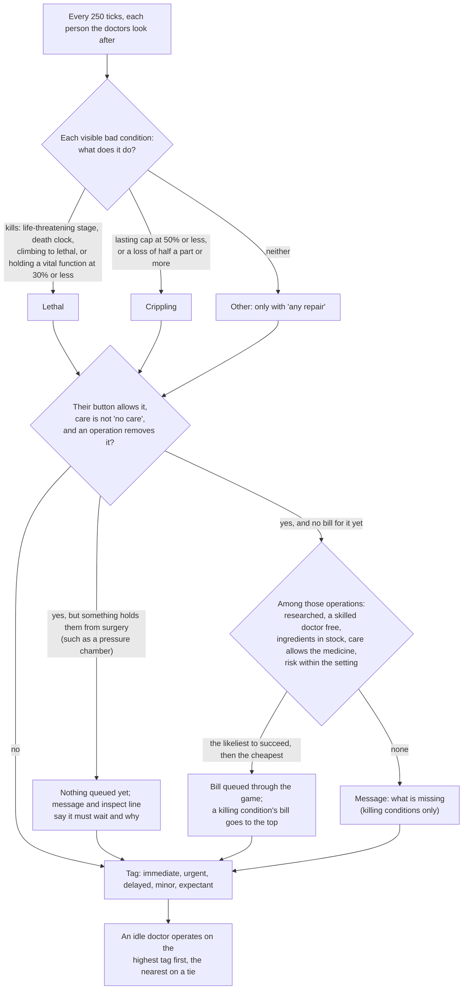

# D'thorga Triage

Doctors queue the life-saving operations a patient needs, and take the worst case first.

Version 0.2.0, built 7 November 2026 for House D'thorga. **Not yet tested in game.** Everything here is read from the game's and
the mods' code.

## Read this first (gotchas)

- **Needs D'thorga Framework 0.4.0 or later**, loaded before it. No Harmony. More Injuries, Search and Rescue and Hospitality are
  not needed and are never looked for by name: any mod's operation qualifies if its recipe removes a condition.
- **Safe to add to a running colony.** It saves the list of bills it queued, so it can withdraw its own and never yours, and each
  person's choice on the button. **Safe to remove:** the bills it queued stay as ordinary bills; the next load prints one line about
  a missing game component and one per map about a missing map component, all harmless, and carries on.
- **What gets queued by default: life-saving operations only.** A condition is life-saving to fix when the game marks its
  current stage life-threatening, it carries a death clock, its severity is climbing toward a lethal one, or it is a lasting
  bad condition holding consciousness, breathing or blood pumping at the floor. Fractures, lost limbs, hearing and the like
  are crippling, not killing: they wait for your own bill unless you raise a person's authority.
- **The button on each person** (colonists, slaves, prisoners, guests) says how far the doctors may go: never without orders;
  to save life (the default for your colonists, slaves and prisoners); to save life or a limb; for any repair (also conditions
  that neither kill nor cripple, when an operation removes them). Guests start at never. The defaults by group are in the mod settings, reachable from the main menu and from Options in play.
- **The doctors choose the operation most likely to succeed** among those your colony can do right now: the technique
  researched, a doctor who meets the skill and could come, the ingredients in stock, the patient's care level allowing the
  medicine, and the chance of death on the table (the recipe's death chance times the chance your best doctor fails) no higher
  than the setting, 5% by default. Costly instruments count as rare tools; a setting keeps those for your own orders.
- **When no one can do an operation a killing condition needs, a message says what is missing** (skill, a tool, research,
  risk), once per person and condition (a reload may repeat it). The patient's inspect line reads expectant: dying, with nothing
  to be done until that changes.
- **Some places hold surgery** (D'thorga Medical Equipment 0.4.1's hyperbaric chamber is the first). While a patient is in one,
  nothing new is queued and a bill already there stays; doctors don't go to them for it. The inspect line and one message give
  the reason and what to do, such as moving them to a bed. They are tagged by their clock, never expectant.
- **Drug addictions and dependencies are left alone** (psychite, go-juice, a gene that needs a drug): never operated on, tagged or
  named in a message. Their treatment is the drug, your drug policy and time.
- **Oxygen, rest and time are not operations.** A killing condition no operation removes (carbon monoxide poisoning, burn shock,
  a widespread burn) is tagged immediate or urgent for the doctors' order of work, but nothing is queued and no message names it:
  D'thorga Medical Equipment's oxygen, tending and Burns and Smoke's care rules treat those. See
  [the medical mods together](../../docs/medical-mods.md).
- **The queue is the game's own operations list.** A bill for a killing condition goes to the top; bills you added keep their
  places and are never withdrawn. Nothing is queued while a bill for the same condition is already there, yours or not. The
  game still needs the patient in a bed and a doctor with the skill: that is unchanged.
- **Doctors take the worst case first** (a setting). A doctor choosing between patients in beds goes to the one tagged worst
  rather than the nearest. The tag: immediate (dying within 6 hours, or a vital function at the floor), urgent (dying, with
  time), delayed (crippled), minor, expectant.
- **Field care stays with Search and Rescue and More Injuries.** This mod never tends, bandages or transfuses; it only queues
  operations and orders the doctors' surgical work. Search and Rescue already raises the evacuation of a patient who needs
  surgery; once in a bed, the bill this mod queued is what gets done.
- **With Emergency Dosing**, a patient waiting for an operation may still get a painkiller; the game anaesthetises at the
  table. Nothing changes there.
- **Plain mode shows no hours.** Switch the display mode to Operator or Engineer in the settings to see the clock on the tag.

## What it does

Every 250 ticks each map's patients are read. For each person the doctors look after, every visible bad condition is classed by
what it does: lethal, crippling or other. For each classed condition the person's authority allows, the mod looks up every
operation that removes that condition, drops those the colony cannot do, and queues the best one through the game's own bill.
Then it withdraws any bill it queued earlier whose condition has gone, and tags the person for the doctors' order of work.



| Tag | Means | Score band |
| --- | --- | --- |
| immediate | dying, and within 6 hours or with consciousness, breathing or blood pumping at 30% or less | 400 and up |
| urgent | dying, with more time; or life-threatening with no clock the mod can read | 300 to 399 |
| delayed | a crippling condition, nothing killing them | 200 to 299 |
| minor | nothing classed | 100 |
| expectant | dying of something only an operation removes, and nobody here can do it | 50 |

Within a band, less time left scores higher: a patient with 24 hours left gets half the urgency of one with none. The game's own operate work giver is kept; this mod's copy of it sits just above
and hands the doctor the highest score in reach. Every figure is an authored starting value; the design record says why.

## Settings

Doctors queue operations on their own (on); the default authority for colonists, slaves, prisoners and guests; the highest
chance of death the doctors may accept alone (5%); rare tools allowed (on); operations that would wrong another faction (off);
messages (on); doctors take the worst case first (on); the display mode.

## For modders

A recipe is found by its `removesHediff`, as the game's, More Injuries' and D'thorga Burns and Smoke's already are. A recipe
whose worker removes a condition some other way, or one that must never be queued by the doctors on their own, says so with the
extension this mod reads:

```xml
<modExtensions>
  <li Class="Phobos.Triage.Defs.PhobosTriageExtension">
    <treatsHediffs><li>MyMod_Condition</li></treatsHediffs>
    <neverAutoQueue>false</neverAutoQueue>
  </li>
</modExtensions>
```

Thresholds, bands and the bill cap live in `Common/Defs/Phobos/Triage/Rules.xml` (one `PhobosTriageRulesDef`, first loaded
wins). The per-person authority is D'thorga Framework's patient comp; the saved key is `PhobosTriage_Authority`.

## Checks done (6 November 2026)

- Built against the RimWorld 1.7 and 1.6 reference assemblies. The game-free rules (authority, condition class, the choice of
  operation and its refusal, the tag and the score) pass 13 unit tests.
- Read from the 1.7 code: how a bill is created and ordered, that the game removes stale medical bills only when a doctor looks,
  that a prioritised scanner is honoured by the job giver, and that comp fields on a pawn load without the mod.
- **Not checked in game:** everything. The first things to look at are in the design record's test protocol.
